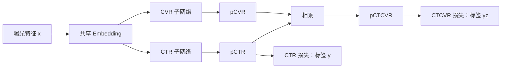

# ESMM 精读：用全曝光监督学习点击后转化率

点击后转化率（CVR）回答的是“用户点击后会不会购买”。传统做法只拿点击过的曝光训练模型，但排序时，要给所有候选曝光预测 CVR：点击样本稀少，低点击区域的特征又学得不充分。ESMM 的关键变化是，利用“曝光 → 点击 → 转化”的依赖关系，把 CVR 放进两个可在全曝光上监督的任务之间，通过乘法约束间接学习它。

论文的核心不在于增加多深的网络，而在于**两个可训练子网络、两项全曝光损失，以及共享的 Embedding**。具体机制来自原文 §2、图 2、公式 (1)–(3)。按问题横向学习可进入[点击后转化率估计](../../知识库/问题/点击后转化率估计.md)。

## CVR 为什么只在点击数据上有直接监督

令 $x$ 为一次曝光的特征，$y\in\{0,1\}$ 为点击标签，$z\in\{0,1\}$ 为转化标签。论文假设转化必先经过点击，即 $z=1\Rightarrow y=1$。三个概率分别是：

$$
\begin{aligned}
p_{CTR}(x)&=P(y=1\mid x),\\
p_{CVR}(x)&=P(z=1\mid y=1,x),\\
p_{CTCVR}(x)&=P(y=1,z=1\mid x).
\end{aligned}
$$

CTR 是“看见后点击”，CVR 是“点击后转化”，CTCVR 是“看见后既点击又转化”。例如，某类曝光 CTR 为 4%、点击后 CVR 为 20%，则 CTCVR 为 0.8%。这是一个说明概率关系的例子，不是论文实验数据。

传统 BASE 在点击子集 $\mathcal S_c=\{(x_i,z_i):y_i=1\}$ 上最小化 CVR 交叉熵。点击且购买是正样本，点击但没买是负样本，未点击曝光不进入这项训练。原文 §2.2 将由此带来的困难分为两类：

- **样本选择偏差（SSB）**：训练接触的是点击子空间，推理覆盖全曝光，点击倾向又随特征变化；有限数据下，部分区域很少有点击，甚至没有训练覆盖。
- **数据稀疏（DS）**：CVR 可用训练样本远少于 CTR。Public Dataset 有 8400 万次曝光，但只有 340 万次点击和 1.8 万次转化，点击约占曝光的 4%（表 1）。高基数用户、商品的表示尤其难学。

这里需要保留一个区别：$P(x\mid y=1)$ 与 $P(x)$ 不同，并不单独证明条件概率 $P(z=1\mid y=1,x)$ 的估计必然有偏。覆盖、样本量与模型拟合能力同样关键；原文脚注 2 也指出，当各区域点击概率为正且观测足够多时，点击空间可以覆盖曝光空间。ESMM 针对的是实际有限数据中的学习困难，不能把问题简化成“只用点击样本就一定统计不一致”。

## 从概率分解到两个子网络

由概率链式法则，点击且转化的联合概率可以分解为：

$$
p_{CTCVR}(x)=p_{CTR}(x)\,p_{CVR}(x).
$$

这里先预测是否点击，再预测点击后是否转化；两者相乘，才得到整条行为链发生的概率。对应出处为[原文 PDF 第 2 页，§2.1，公式 (1)](https://arxiv.org/pdf/1804.07931v2#page=2)。

因此，当 $p_{CTR}(x)>0$ 时，可以由 $p_{CTCVR}/p_{CTR}$ 恢复 CVR。分子和分母都能用全曝光数据监督：每次曝光都有是否点击的标签，也有是否最终点击且转化的标签。困难在于，直接训练两个独立模型再相除，会把低 CTR 区域的估计误差放大。

ESMM 采用相反的计算方向：让网络分别输出 CTR 与 CVR，再相乘形成 CTCVR。

两个子网络沿用 Embedding & MLP 结构：稀疏类别特征先查 Embedding，按域聚合后拼接，再经过 MLP 预测。CTR 与 CVR 各自有上层网络，但共享底部 Embedding 字典。图中的 CTCVR 是两个概率的乘积，**没有第三个独立参数塔**。原文实验段落将其泛称为三个“网络”，理解结构应以 §2.3 和图 2 为准。

模型前向输出可写成：

$$
c_i=f_{CTR}(x_i),\qquad v_i=f_{CVR}(x_i),\qquad q_i=c_iv_i.
$$

由于 $c_i,v_i\in[0,1]$，自然有 $q_i\le c_i$，符合“点击且转化的概率不超过点击概率”的约束。推理 CVR 时直接使用 $v_i$，不执行除法；需要 CTR 或 CTCVR 时则分别使用 $c_i$ 或 $q_i$。

## 全曝光训练不等于给未点击样本贴 CVR 负标签

训练时分别约束点击预测和联合事件预测，目标函数为：

$$
L=\sum_{i=1}^{N}\operatorname{BCE}(y_i,c_i)
 +\sum_{i=1}^{N}\operatorname{BCE}(y_iz_i,c_iv_i).
$$

这里 $N$ 是曝光总数，$\operatorname{BCE}(t,p)=-t\log p-(1-t)\log(1-p)$ 是二元交叉熵，$t$ 为标签、$p$ 为预测概率。这个写法对应[原文 PDF 第 3 页，§2.3，公式 (3)](https://arxiv.org/pdf/1804.07931v2#page=3)。

两项损失都遍历全部曝光，**没有直接的 $\operatorname{BCE}(z_i,v_i)$ 损失**。三类样本的监督如下：

| 曝光行为 | CTR 标签 $y$ | CTCVR 标签 $yz$ | 含义 |
|---|---:|---:|---|
| 未点击 | 0 | 0 | 没有发生点击且转化 |
| 点击，未转化 | 1 | 0 | 有点击，但没有完成转化 |
| 点击且转化 | 1 | 1 | 完成整个行为链 |

未点击的曝光，其 CTCVR 为 0 是观测到的事实；但这并未告诉我们“假如点击，它是否会购买”。把这类曝光直接当 CVR 负样本，会混淆联合事件与条件事件，这也是 ESMM 与论文中 AMAN 思路的关键区别。

未点击样本仍能影响 CVR 子网络，因为第二项损失的预测包含 $v_i$。但约束的是乘积：前面的例子中，若 $c_i=0.04,v_i=0.2$，CTCVR 负样本损失为 $-\log(1-0.008)$，约 0.008；直接把它当 CVR 负样本的损失为 $-\log(1-0.2)$，约 0.223。两种训练信号差异很大。

进一步看，CTCVR 负样本对 CVR 概率的导数为 $c_i/(1-c_iv_i)$。这解释了为什么低 CTR 曝光可以通过很小的乘积满足负标签约束，并不需要强迫 CVR 本身接近零；也说明这些区域的 CVR 学习仍可能缺少强信号。这是由目标函数得到的分析，不是论文额外报告的实验。

## 共享表示如何缓解稀疏

只做全曝光联合建模还不足以解释 ESMM 的全部设计。稀疏类别特征的 Embedding 往往占据大量参数，如果仅靠点击样本训练 CVR，其低频用户和商品向量难以充分更新。

共享 Embedding 后，CTR 损失从全部曝光中学习用户、商品及其他域的表示；CVR 子网络直接复用这些向量。CTCVR 损失也会经由两条分支回传。原文 §2.3 将其解释为特征表示迁移：用较丰富的点击任务监督帮助较稀疏的转化任务。

这种设计增加了表示可利用的监督，不能凭空制造转化正例，也不保证两个任务总能互相促进。CTR 偏好与购买偏好可能不同，共享表示的收益需要用独立 Embedding 的 ESMM-NS 做对照；换到其他业务时仍需验证。

## BASE、DIVISION 与 ESMM 分别改变了什么

以下方案都来自 ESMM 本文的定义与实验，不能视作已独立精读了多篇论文。

| 方案 | 使用的数据与目标 | CVR 怎么得到 | 与 ESMM 的差别 |
|---|---|---|---|
| BASE | 点击曝光上的 CVR 交叉熵 | 直接预测 | 训练较简单，点击覆盖与表示学习受限 |
| DIVISION | 全曝光上分别拟合 CTR、CTCVR | 两个独立预测相除 | 利用相同概率关系，但缺少乘法联合约束，低 CTR 处误差容易放大 |
| ESMM-NS | 全曝光上的 CTR、CTCVR 两项联合损失 | CVR 子网络直接输出 | 保留乘法约束，两个子网络不共享 Embedding |
| ESMM | 同上，并共享 Embedding | CVR 子网络直接输出 | 同时利用联合监督与表示迁移 |

例如 CTR 为 0.01、真实 CTCVR 为 0.001 时，CVR 为 0.1；若独立 CTCVR 模型预测为 0.003，相除就得到 0.3。这个例子说明比值对分子误差的敏感性。独立模型还可能预测出 CTCVR 大于 CTR，使比值超过 1；ESMM 的参数化结构避免了这类不一致，但不保证概率已经校准。

论文还实现了 AMAN、OVERSAMPLING、UNBIAS：分别引入未点击负样本、复制稀有正例、采用基于点击概率的拒绝采样。它们的细节与结果仅按 ESMM §1、§3.1 转述；本次没有阅读被引原论文，因此不扩大为对这些方法的一般性评价。

## 实验到底验证了什么

原文 §3 使用淘宝推荐流量，Public Dataset 是作者公布的随机采样版本，Product Dataset 是完整数据。表 1 的规模为：

| 数据集 | 用户 | 商品 | 曝光 | 点击 | 转化 |
|---|---:|---:|---:|---:|---:|
| Public Dataset | 0.4M | 4.3M | 84M | 3.4M | 18k |
| Product Dataset | 48M | 23.5M | 8950M | 324M | 1774k |

两项任务都按时间前一半训练、后一半测试，实验重复 10 次。论文报告的公共数据集结果如下（表 2；AUC 按百分制展示，均值 ± 标准差）：

| 方法 | CVR AUC：点击测试集 | CTCVR AUC：全曝光测试集 |
|---|---:|---:|
| BASE | 66.00 ± 0.37 | 62.07 ± 0.45 |
| AMAN | 65.21 ± 0.59 | 63.53 ± 0.57 |
| OVERSAMPLING | 67.18 ± 0.32 | 63.05 ± 0.48 |
| UNBIAS | 66.65 ± 0.28 | 63.56 ± 0.70 |
| DIVISION | 67.56 ± 0.48 | 63.62 ± 0.09 |
| ESMM-NS | 68.25 ± 0.44 | 64.44 ± 0.62 |
| ESMM | 68.56 ± 0.37 | 65.32 ± 0.49 |

ESMM 相对 BASE 的增益是 CVR **2.56 个 AUC 百分点**、CTCVR **3.25 个百分点**，即 AUC 的 0.0256 与 0.0325，不是相对增长率。ESMM-NS 到 ESMM 的差值为 0.31 和 0.88 个百分点，支持共享表示在这一实验中的收益。DIVISION 到 ESMM-NS 同时改变了联合训练与约束方式；作者归因于避免数值不稳定，但表格本身不足以把提升全部归因于除法问题。

**CTCVR 的评估协议容易读错。** §3.1 规定，所有方法都用各自的 CVR 预测，乘以同一个独立训练的 CTR 模型输出，构成用于评估的 CTCVR；包括 ESMM，也不是直接拿内置乘积输出比较。因此该列主要反映固定 CTR 条件下不同 CVR 输出对联合事件排序的贡献。它仍不是全曝光上“假如点击”的 CVR 真值检验。

完整 Product Dataset 上，作者报告 ESMM 相对 BASE 的 CVR、CTCVR AUC 分别绝对提升 2.18、2.32 个百分点（§3.3）。图 3 还比较不同数据采样比例，支持数据量和共享表示有作用；这里不从曲线臆读精确数值。正式论文没有报告线上 A/B 转化率或收入提升。

网络超参数包括 ReLU、18 维 Embedding、$360\times200\times80\times2$ 的 MLP，以及 Adam 的 $\beta_1=0.9,\beta_2=0.999,\epsilon=10^{-8}$（§3.1，维度按原文记录）。原文未完整交代学习率、batch size、所有特征处理和随机种子，不能仅凭本文声称精确复现。

## “全空间”仍有哪些边界

从理想条件看，如果 CTR 与 CTCVR 两项概率都能被准确拟合，且 $p_{CTR}(x)>0$，乘法关系确实确定了 $p_{CVR}(x)$。但概率恒等式不自动保证有限数据下学出的 CVR 无偏。若点击概率为零，两个可观测概率都为零，乘积约束无法识别 CVR；点击概率很低时，也会面临估计误差和稀少正例。

作者使用“消除 SSB/DS”描述方法效果。更稳妥的技术理解是：**将监督扩展至全曝光，用行为约束和表示迁移改善 CVR 学习**。它没有证明解决一切选择机制，没有估计点击的因果效应，也没有自动处理曝光策略变化、标签错配或概率校准。

延迟转化尤其独立：刚点击尚未购买的样本，可能只是标签未成熟。原文 §2.2 明确将 delayed feedback 排除在本次工作重点之外。数据中若存在绕过点击的转化，或点击与购买的归因窗口不一致，也应先重查行为链和标签定义，而不能直接照搬乘法关系。

若要迁移到实际场景，最先验证的是曝光、点击、转化的归因一致性与标签成熟；随后在相同时间切分下对照 BASE、ESMM-NS、ESMM，分别看点击集 CVR、全曝光 CTCVR、校准与低点击区域表现。离线排序改善之后，仍需独立业务实验才能判断交易收益。这是后续实验思路，本次未执行。

## 原文与中文版

原文为 Xiao Ma 等，*Entire Space Multi-Task Model: An Effective Approach for Estimating Post-Click Conversion Rate*，SIGIR 2018，[arXiv:1804.07931v2](https://arxiv.org/abs/1804.07931v2)，[DOI](https://doi.org/10.1145/3209978.3210104)。检索与阅读日期为 2026-10-25；正式 PDF 全文 4 页、3 幅图、2 张表及参考文献均已阅读核对，无附录。§2.1 首次文字定义将 CTR 误写为 $P(z=1\mid x)$，应为 $P(y=1\mid x)$；公式 (1) 和图 2 正确，中文版已加译注。

- 中文 PDF（本地附件，不随 Git 分发）：`.local/papers/SRC-ESMM/translation/Entire Space Multi-Task Model: An Effective Approach for Estimating Post-Click Conversion Rate.pdf`：由当前模型翻译实际正文 LaTeX 后编译，正文、标题、图表标题和描述性脚注译为中文；参考文献、专名、公式与原图保留，图内英文标签未重绘；最终 4 页已渲染目视核查，公式与文献引用无未解析标记。
- 译后 LaTeX 主文件（本地附件，不随 Git 分发）：`.local/papers/SRC-ESMM/translation/translated-sources/mtl.tex`，以及同目录 4 个正文子文件、样式、参考文献和图片，可继续修改与编译。
- [原始 PDF](https://arxiv.org/pdf/1804.07931v2)、下载后原始 LaTeX（本地附件，不随 Git 分发）：`.local/papers/SRC-ESMM/original/latex/mtl.tex`；正式哈希快照与阅读身份见 [来源记录](来源.json)。源码包是下载后未修改文件的本地重新打包，不是上游压缩包的原始字节。

上述 PDF、源码与译文位于忽略的 `.local/`，需要随本地知识库单独备份；Git 保存笔记、来源账本与问题页。本次未下载大规模训练数据，未核查官方模型实现，也未运行训练、绘图脚本或线上实验。

公开访问：[固定版本原文](https://arxiv.org/abs/1804.07931v2)；全文译文的公开状态与许可见[译文目录](../../译文/目录.md)。文中行内代码形式的 `.local/` 路径是本地附件，不随 Git 分发；原有阅读/翻译/编译记录保持其当次事实。
