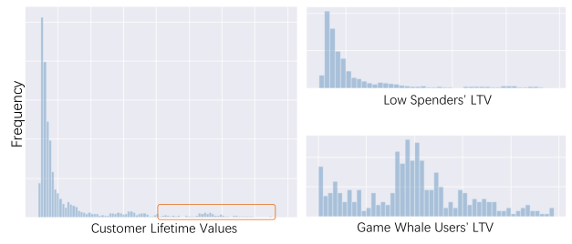
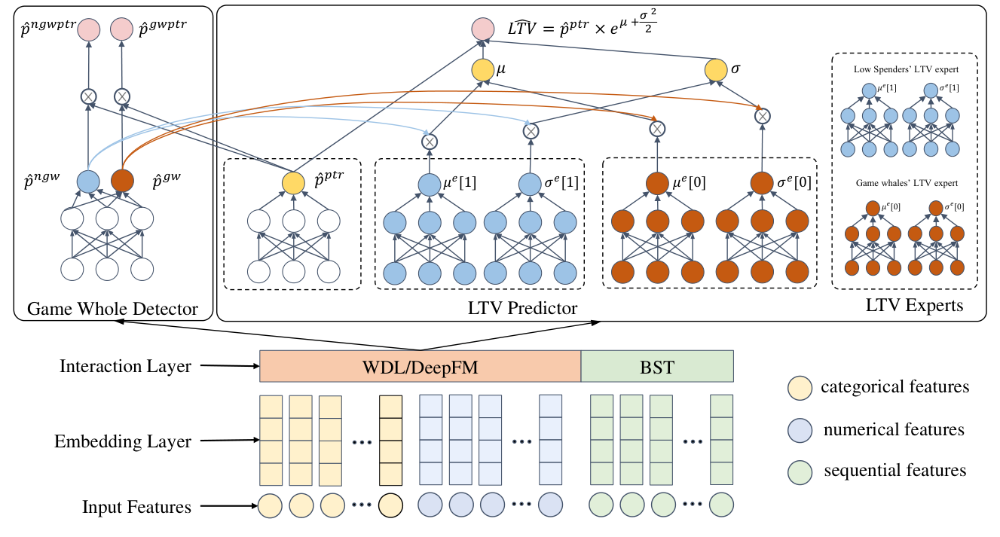
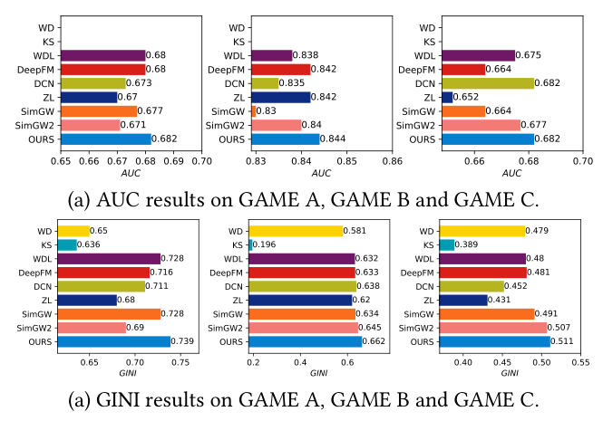
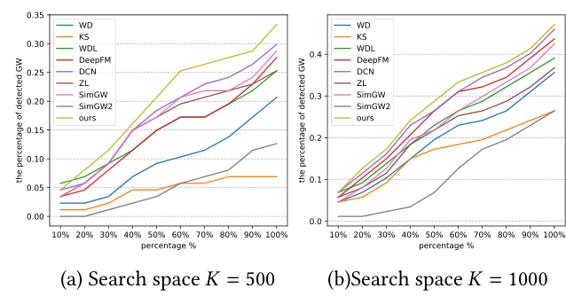
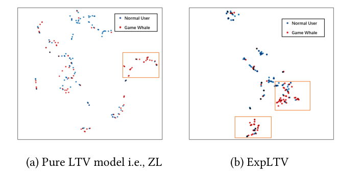
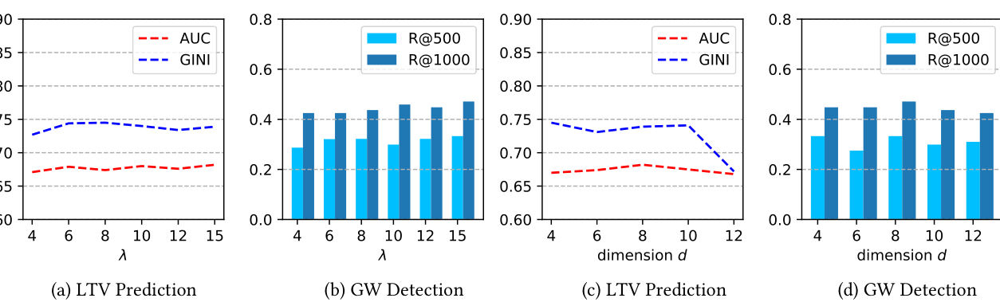

# ExpLTV：用高消费识别给金额专家分配权重

游戏获客既要预估新注册或新回流用户的 7 天消费，还要在有限候选中找回真正的高消费玩家。单一 ZILN 已能区分零金额和正金额，但所有正金额仍由同一参数化读出描述。简单地按金额阈值训练分类器又会丢掉阈值内的次序。ExpLTV 用金额软标签训练检测器，把检测器的条件分数用于组合两个专家，并与金额任务共用付费率。 [作者版 §1–2](https://arxiv.org/pdf/2308.12729v1#page=2)

*图 1，作者版 PDF 第 2 页，Zhang 等的原图裁取。*

## 从实际金额得到两个训练目标

设高消费阈值为 100 元。金额为 0、20、100、200 元的用户，硬标签分别为 0、0、1、1。ExpLTV 对金额 (v) 计算 (q(v)=1-e^{-v/R})，对应约 0、0.181、0.632、0.865。硬阈值用于评估找回真实高消费用户，软值用于训练。(q(v)) 随金额增加并逐渐饱和。它在阈值以下也可能为正，因此其条件期望不能直接解释为硬事件概率。 [作者版 §2 式 (1)–(4)](https://arxiv.org/pdf/2308.12729v1#page=3)

*图 2，作者版 PDF 第 4 页，作者原图裁取。条件检测分数同时连到金额专家。*

数值、类别和行为序列经嵌入与交互层得到共享表征。模型输出付费概率 (p) 和付费后高消费分数 (g)，另一个条件分数为 (1-g)。检测端把 (pg) 与 (1-pg) 和软标签向量 ([q(v),1-q(v)]) 对齐。用付费 BCE 监督 (p) 时，所有已转化用户都有该任务标签。取事实金额 100 元、预测 (p=0.4,g=0.75)，联合软分数为 0.30，对应训练目标约 0.632。零值样本以 0 监督联合端，并以未付费监督概率端。这与 ESMM 将联合任务放在完整样本空间的思路相通。原文式 (10) 与条件 softmax 复用符号，需结合式 (8)–(9) 的联合和互补概率阅读。 [作者版 §3.3–3.5](https://arxiv.org/pdf/2308.12729v1#page=4) · [ESMM 的全空间监督](../../知识库/问题/点击后转化率估计.md)

## 门控先混参数，再算金额

每个金额专家输出 (mu,sigma)。设高消费专家为 ((log 100,0.8))，低消费专家为 ((log 20,0.4))。用 (g=0.75) 混合后，(mu=0.75log100+0.25log20)，(sigma=0.7)，最终读出 (0.4e^{mu+sigma^2/2}approx34.18) 元。若先算两组各自的原金额均值再加权，则预测约 43.48 元。式 (12)–(13) 明确使用前一种，所得正金额仍是单个对数正态分布。 [作者版 §3.4，式 (12)–(13)](https://arxiv.org/pdf/2308.12729v1#page=5) · [新客金额预测知识页](../../知识库/问题/新客价值怎样预测零值和长尾金额.md)

联合优化中，共享概率端只计一次二元交叉熵。LTV 负对数似然为共享概率、两个金额专家及 (g) 提供梯度，检测损失也随 (pg) 更新概率和门控。原文式 (14) 在金额似然中使用了先前定义为付费指示的 (s_u)，并未明确把平方残差放在正额掩码内。复现时可用原始 ZILN 定义核验应当怎样用正金额，当前证据无法确认作者实现。 [作者版 §3.4–3.5，式 (14)–(15)](https://arxiv.org/pdf/2308.12729v1#page=5) · [原始 ZILN 式 (3)–(4)](https://arxiv.org/pdf/1912.07753v1#page=5)

## 在同样的搜索预算下检查两项任务

作者用三款游戏的日志做 7 天金额预测，按时间切分 40 天训练、3 天验证、3 天测试。按图 3，A、B、C 的归一化 Gini 相较最强基线分别提高约 1.5%、3.8%、6.2%。表 2 中 GAME A 的 R@500 从 DCN 的 0.299 到 ExpLTV 的 0.333，相对提高约 11.4%。R@5000 在 A 与 DCN 并列 0.793。GAME C 的完整模型 Gini 在图 3 为 0.511、在表 3 为 0.517，两处分别引用。固定候选数的找回率回答的是寻找高消费人群，Gini 回答整体金额排序，实验未报告出价后的增量收益。 [作者版 §4.1–4.6，图 3 和表 2](https://arxiv.org/pdf/2308.12729v1#page=6)

*图 3，作者版 PDF 第 6 页，作者原图裁取。*

*图 4，作者版 PDF 第 7 页，作者原图裁取。*

表 3 在 GAME A 中将两专家减至一套时，Gini 由 0.739 降至 0.577，而 R@500 均为 0.333。移除行为链时 Gini 仍为 0.739，R@500 变成 0.276。由这两个值算，完整模型相对变体提升 20.7%，反向以完整模型为分母下降约 17.1%。论文文字把前者写作下降。表征可视化展示的是选定样本上的 t-SNE，不能量化线上效果。 [作者版 §4.7–4.9，图 5–6、表 3](https://arxiv.org/pdf/2308.12729v1#page=8)

*图 5，作者版 PDF 第 7 页，作者原图裁取。*

*图 6，作者版 PDF 第 9 页，作者原图裁取。*

[固定作者版](https://arxiv.org/pdf/2308.12729v1) · [CIKM 题录](https://doi.org/10.1145/3583780.3615002) · [PDF 访问流程](../../文档/工具/中文PDF发布.md)。阅读摘要与正文 §1–6，译本覆盖正文、图表说明及作者脚注，保留原公式、图内英文、参考文献与版权声明。
