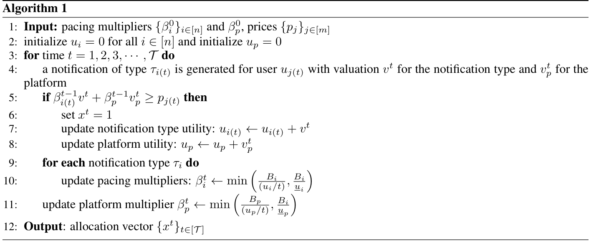
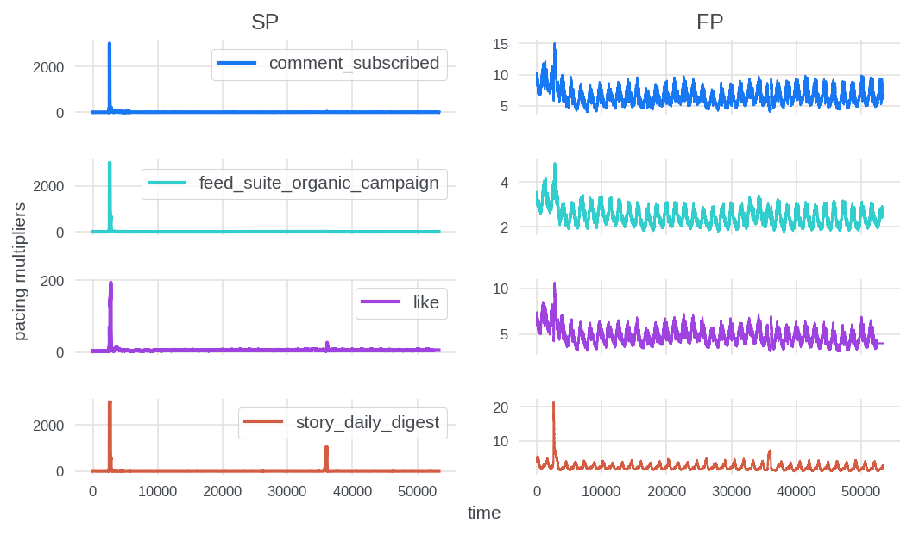

# Fair Notification Optimization：让不同通知类型共同竞争用户容量

如果点赞团队和故事摘要团队分别定阈值，同一个用户可能短时间收到两组各自看起来合理的通知。一个团队多用掉的注意力会影响另一个团队未来的触达。论文把通知类型当作持有虚拟预算的买家，把每次发送机会当作物品，把用户可接受的通知量作为供给约束。一次拍卖通常只有一个类型候选。竞争通过跨时段共享的用户价格和类型预算实现。候选的生成时刻仍由上游决定，发送层只决定立即发送还是丢弃。[固定 v1 §1.2–2](https://arxiv.org/pdf/2302.04835v1#page=3)

## 给定同一用户价格，计价规则改变预算反馈

延用同一个例子。一个用户三天最多接收五条，历史数据给他的在线价格是 0.70。此时来了一条点赞通知，估值 0.60，点赞类型的节奏乘数是 1.3，出价为 0.78。假设平台没有补贴，出价超过门槛，通知发送。第一价格从点赞预算中扣 0.78，第二价格扣 0.70。两者当前的发送结果相同，花费却不同，节奏系统随后就可能给该类型不同的出价乘数。稍后故事摘要到达时，当前门槛与它所在类型的乘数共同决定分配。虚拟预算编码业务优先级，不能读成分到固定数量的通知。[原文 §1.2.2、§2–4](https://arxiv.org/pdf/2302.04835v1#page=3)

若拍卖方也考虑整个平台的目标，可以用独立模型估值，再按平台的节奏乘数增加合成出价。若平台补贴为 0.10，则该候选的合成出价是 0.88。在第一价格下点赞团队付 0.78、平台付 0.10，在第二价格下点赞团队付 0.60、平台付 0.10。论文的生产与离线模拟没有平台效用，实际令平台估值为零。例子的补贴数值只说明付款接口。[原文 §2–4、§6.2](https://arxiv.org/pdf/2302.04835v1#page=5)

## 回看完整候选，为什么用对数效用定价

静态第一价格模型预先知道每个候选的估值。令 $x^t$ 表示第 $t$ 条通知的发送比例，类型效用 $u_i$ 是其候选估值乘发送比例的和。目标是最大化 $\sum_i B_i\log u_i+B_p\log u_p$，每个用户的发送比例总和不超过容量 $s_j$。在效用为正时，多给类型一单位效用带来的目标增量是 $B_i/u_i$，因此近期效用低的类型可以有较高的边际权重。若平台没有效用也不参与出价，则应分析去掉平台项后的目标，不能直接在正预算的对数项代入零。用户供给的对偶变量是基础价格，单条通知的 $x^t\le1$ 约束还能引入逐机会价格。第一价格竞争均衡的比例基准是把按预算分到的供给均摊到相应候选。第二价格命题给类型的比例基准允许用其份额优先安排高价值候选，但没有给平台同样的最优购买保证。这些公平陈述的对象是类型及模型中的平台效用。[原文 §3–4、附录 B](https://arxiv.org/pdf/2302.04835v1#page=6)

第二价格离线定义中的价格取第 $s_j+1$ 高出价。若有六条正价候选、容量为五，按原文写的“达到门槛即胜出”会把第六条也纳入，容量约束即失效。若有相同出价，还需要明确哪些边界候选入选。论文没有指定一致的边界处理。线上用历史第五高价，属于另一价格口径，实际允许部分用户超过每三天五条的目标。[原文 §4、§6.1、§6.3](https://arxiv.org/pdf/2302.04835v1#page=7)

## 在线算法固定价格，生产用花费调节

作者算法 1，Christian Kroer 等，采用版第 9 页，从 PDF 按算法边界裁取。算法接收外部用户价格，累积已发送候选给各类型带来的估值。对点赞类型，用预算除以截至当前事件的平均效用，再按比例效用设置的上限截断。发送后积累效用能压低下一时刻的乘数，在无新效用时随事件数增大会回升。伪代码给平台乘数设置上限时仍写 $B_i$，和平台预算 $B_p$ 的记号不同，实际运行方式待作者澄清。定理的均方收敛要求输入正确用户价格，在有底层分布并满足下界的模型条件下成立。它不证明使用生产历史价能实现精确容量或公平。[原文 §5、算法 1、定理 2](https://arxiv.org/pdf/2302.04835v1#page=8)

线上部署复用的是按预算花费的协议，基于“已花预算／当前应花预算”的比例更新，函数未披露。若用户过去三天没有收到太多候选，历史价格很低，发出一条热门帖子后大量点赞到来可能在短期超过容量。模拟中的启发式是在用户超出约定量后提升门槛，给后续高估值候选留机会。软控制允许超额，因此真实评估仍要量化发送、超限和剩余机会。[原文 §6.1、§6.3–6.4](https://arxiv.org/pdf/2302.04835v1#page=10)

## 两次线上 A/B 回答不同的问题

- 2022 年 5–6 月，Instagram 四类通知实验，每组 7740 万用户。第二价格加花费节奏对比分类型独立阈值，报告 CTR +0.42%、全类型发送量 −0.495%、可触达性中性，两项未披露名称的核心指标 +0.057%、+0.064%。2022 年 7 月在四类上线。
- 2022 年 12 月至 2023 年 1 月，同四类、每组 875 万，花费节奏相同，只比较第一与第二价格。整体发送量 +0.28%，CTR、可触达性和两项核心指标中性。表 3 切取三天展示节奏，第一价格的标准差较低。第二价格总发送和信息流行的绝对数排印异常，未用于比较。表 3 中人均超量均印作 0.03，正文称下降，显示精度不足以核验方向。[原文 §6.1、§6.5，表 1、3](https://arxiv.org/pdf/2302.04835v1#page=10)

作者图 2，采用版第 14 页，取源码 PNG。两侧横轴都是时间（分钟），纵轴刻度不同。第一价格侧波动较小，图结合表 3 的标准差说明链路对短期扰动的敏感度。它不直接测量触达疲劳或长期业务收益。

TIM 先有每日配额，再分给不同时间槽。本文让多个通知类型争夺同一批用户的容量，分配发生在候选到达时。STEPS 还能生成下次触发时间，时间输出本身不提供类型间的供给分配。三个机制的输入和输出见[通知配额问题](../../知识库/问题/给定配额怎样安排通知发送时机.md)与[Push 阅读路线](../../知识库/阅读/Push触达与时机论文路线.md)。

## 原文与阅读范围

采用 [arXiv:2302.04835v1](https://arxiv.org/abs/2302.04835v1)，核对摘要、§1–7、正文两图三表、算法 1 及附录的比例性与稳定性证据。固定版元数据为 CC BY-NC-ND 4.0。官方代码只核对仓库文档和结构，未重跑模拟或查阅内部参数。16 页中文 PDF 覆盖摘要、正文、三表两图的标题、伪代码、脚注和致谢，保留图内英文、参考文献及附录。译文存取见[本批交接](../../文档/会话/PAPER-022.md)。[官方实现固定提交](https://github.com/facebookresearch/FairNotification/tree/5f37544360a20df9fc3a462a196bc71427d240d3)
