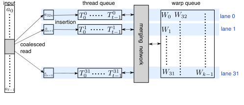
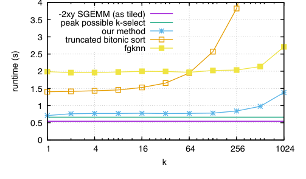
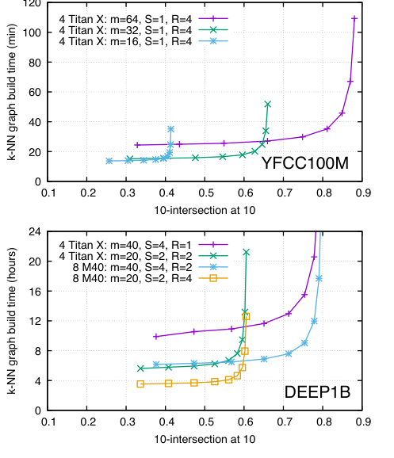

# Faiss 需要分别解决向量扫描、距离近似和 Top-K

双塔给定请求向量后，问题变成在固定向量表上找最近邻。全库矩阵乘法可以得到精确结果，物品向量和中间距离矩阵会占用计算与显存。Johnson、Douze 与 Jégou 将距离计算、压缩索引和 GPU Top-K 放在同一条链路中检验。

## 精确搜索的主要开销

设查询为 $x$、物品原向量为 $y_i$。平方欧氏距离 $\|x-y_i\|_2^2=\|x\|_2^2+\|y_i\|_2^2-2x^\top y_i$。对于查询批，可以预存物品模长，以矩阵乘法计算积项，再按行选最小的 $k$ 项。在查询和候选都做单位归一化时，平方距离的顺序与内积降序一致。若评分允许任意物品模长，应选择与模型一致的内积搜索接口或经过证明的变换。[原文 §2，式 (1)–(2)，PDF 第 2 页](https://arxiv.org/pdf/1702.08734v1#page=2)。

作者原图 2，Johnson、Douze 与 Jégou，arXiv 1702.08734v1，PDF 第 5 页。左侧候选流按 lane 读入，先存到每线程短队列，再合并到整个 warp 的 Top-K 队列。选择状态主要驻留寄存器。只要保留正确的选择不变量，该部分可接精确距离或近似距离，决定选到的是当前分数的 Top-K。

## 倒排扫描漏检与残差量化错序

索引构建用粗量化器把 $y$ 分配到簇中心 $c=q_1(y)$，再对残差 $y-c$ 分段量化。将同一中心的物品放入一份倒排表，存 ID 与乘积量化码。一个 $d$ 维向量分成 $b$ 段，每段 256 个码字时残差码为 $b$ 字节，另有 ID、码本和倒排表的支出。搜索先访问离 $x$ 最近的 $\tau$ 个粗中心，再以 $\|x-c-\widehat r(y)\|^2$ 为在表物品打分。查询保留原向量，通过预计算查表降低残差距离开销。

令 $x=(0,0)$，教学目录有 A=$(0.10,0)$，B=$(0.20,0)$。若 A 属于本次未扫描簇，则后续精排也无法补回 A。若 A、B 都扫描到，但重建向量分别为 $(0.23,0)$ 和 $(0.17,0)$，排名仍反转。扩大探测簇数主要缓解漏扫，增大码长或保留原向量作重排主要缓解近似错序。[原文 §2、§5，式 (3)–(6)，PDF 第 2–3、6–7 页](https://arxiv.org/pdf/1702.08734v1#page=6)。

WarpSelect 支持在输入流只走一遍时保留最小 $k$ 项。设教学线程束队列当前保留距离平方 $0.03,0.09$，一个线程队列之后装满 $0.02$ 和 $0.04$，其最大项 $0.04$ 已优于线程束的末项 $0.09$，触发合并。合并后线程束保留 $0.02,0.03$，其余回到线程队列。即使最后一组输入不足一个线程束，仍需合并局部队列才输出。第 4.2 节把回填区间末端多写了一项，$k+32t$ 个元素中的最后一项应为第 $k+32t$ 小。[原文 §4.2，算法 3、图 2，PDF 第 5–6 页](https://arxiv.org/pdf/1702.08734v1#page=5)。

## 用同一份向量评估系统代价

作者原图 4、5，同版 PDF 第 9 页。图 4 固定 SIFT1M 和单卡，沿横轴改变 $k$。图 5 的两组数据为 YFCC100M 与 DEEP1B，横轴比较近邻索引结果与精确十邻居的交集比例，纵轴是建图耗时。论文在 SIFT1B 单张 GPU、每向量 8 字节的设置下报告 17.7 μs/查询、R@10 为 0.376。这里每个查询只看真实第一近邻是否出现在返回的十项里，命中就计 1。图 5 则数十个精确邻居各找回了几个。所比方法为 150 μs/查询、R@10 为 0.35，因此该操作点的耗时比约 8.5 倍。DEEP1B 使用 4 张 GPU 比较另一组索引设置。向量空间的邻居交集衡量搜索质量，不能替代业务点击、安装或观看标签的 Recall。[原文 §6.3–6.5，PDF 第 8–9 页](https://arxiv.org/pdf/1702.08734v1#page=9)。

比较双塔训练策略时先在同一候选快照跑精确 Top-K。要检查 ANN 的贡献，再固定模型和快照用同一请求评估 ANN 丢失、延迟和索引成本。[精确召回与 ANN 的比较](../../知识库/问题/向量索引怎样影响候选覆盖.md)。

采用 [arXiv 1702.08734v1](https://arxiv.org/abs/1702.08734v1)，阅读正文 §1–7、WarpSelect 算法与复杂度附录。

中文学习译本 22 页。摘要、正文 §1–7、算法注释、图表说明与脚注译为中文。参考文献、附录及图内英文保留。作者 LaTeX 改为单栏中文排版。本地附件为 `.local/papers/SRC-FAISS/translation/Faiss.中文.pdf`。采用版原文与译文均已认证下载并核对完整 SHA-256。见 [PDF 备份说明](../../文档/工具/中文PDF发布.md)。
