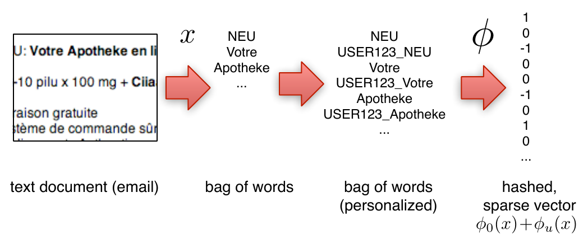
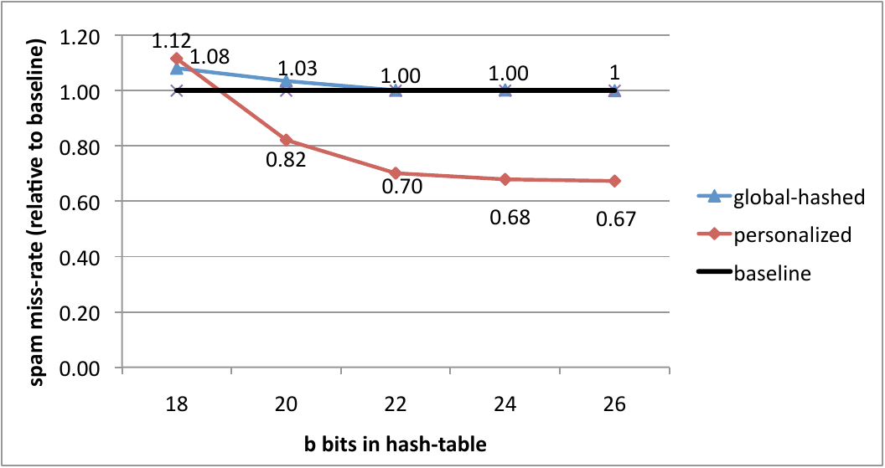
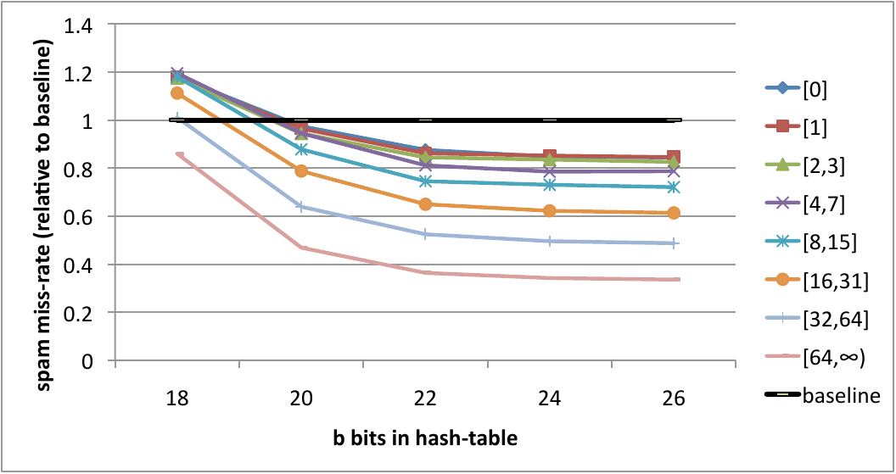

# Feature Hashing · 槽位碰撞怎样改变稀疏输入

精确字典给每个词一个坐标。训练垃圾邮件分类器时，如果同时为所有用户建一套共享词权重、为每个用户建一套私有词权重，内存就随用户与词表的叉积增长。Weinberger 等把「全局词」和「用户 × 词」都映入一个定长数组。在每个桶中带符号求和，可以用普通稀疏线性模型学习。模型在压缩后的坐标上共享参数，原文证明的是随机映射下的估计性质。

## 两个独立的哈希各管一件事

输入是稀疏向量 $x$，非零坐标 $x_j$ 可以是词计数。桶哈希 $h(j)\in\{1,\dots,m\}$ 选地址，符号哈希 $\xi(j)\in\{-1,1\}$ 决定加号或减号。一个样本在桶 $k$ 的值为

$$
\phi_k(x)=\sum_{j:h(j)=k}\xi(j)x_j.
$$

设一次教学样本在两个 ID 坐标上的值分别为 $2,1$。若两个 ID 都落进桶 3，符号分别为 $+1,-1$，则桶 3 的读出是 $2-1=1$。另一个只含第一个 ID、值为 1 的样本读出 1。两个样本的哈希内积为 1，原内积为 2。若第二个 ID 的符号为 $+1$，压缩内积则为 3。无符号哈希总是加上这次正值碰撞，符号哈希让误差正负都有可能。实际训练和推理共用固定哈希，因此在所选种子下，这两个 ID 每次都用同样的方式碰撞。

展开 $\langle\phi(x),\phi(x')\rangle$ 得到 $\sum_{i,j}\mathbf 1[h(i)=h(j)]\xi(i)\xi(j)x_ix'_j$。$i=j$ 的项必然进入结果，而且 $\xi(i)^2=1$。$i\ne j$ 时，对独立、均匀的随机符号取期望后，交叉项为零。于是期望等于原内积。以两个不同的 one-hot ID 为例，原内积为 0，哈希内积以 $1-1/m$ 的概率为 0，以各 $1/(2m)$ 的概率为 $+1$ 或 $-1$。增大 $m$ 会降低碰撞频率，一旦碰撞仍会出现大小为 1 的误差。

原文 §3、附录 A 将方差写成桶数的倒数乘输入的交叉项。对单位向量的范数平方，直接代入 $x'=x$ 得到 $\operatorname{Var}(\|\phi(x)\|_2^2)=2(1-\sum_jx_j^4)/m$。浓度分析还使用 $\|x\|_\infty/\|x\|_2$ 表示最大的单坐标贡献。某个坐标独占大部分质量时，一次碰撞就可能主导失真。独立任务向量的近似正交界还要求被拿来对比的权重不依赖当前任务的哈希，且界受双方范数影响。不能据此给某个固定热桶的训练误差加保证。[原文 §2–3，附录 A–C](https://arxiv.org/pdf/0902.2206v4#page=2)

## 同一封邮件怎样更新两部分权重

作者原图，Weinberger 等，arXiv:0902.2206v4 图 1，PDF 第 5 页。从左向右，先做词袋，再给每个词复制一份带用户 ID 的词元，最后把两份都映入同一数组。图从作者源码矢量图转换，保留原标签。

假设用户 7 标记一封含 `deal` 的邮件为垃圾邮件，教学例中编码标签 $y=+1$。输入有 `global:deal` 与 `user:7:deal` 两个键。若它们分别得到桶 3 的 $+1$ 和桶 1 的 $-1$，模型读出 $z=w_3-w_1$。用教学损失 $\tfrac12(z-y)^2$，当两个权重初始为零时，$\partial_w\ell=(z-y)\phi(x)$，梯度为 $\partial_{w_3}\ell=-1$、$\partial_{w_1}\ell=+1$。一次学习率为 $0.1$ 的 SGD 把两权重更新为 $+0.1$ 和 $-0.1$，同一邮件下次的分数为 $0.2$。用户 8 的邮件也读取 `global:deal` 对应的桶，但其个性键 `user:8:deal` 按自身哈希取值。全局共享来自使用同一个全局键，个性键之间仍可能偶然共桶。

论文用 Vowpal Wabbit 和平方损失直接在哈希空间训练。无需先学完每个用户的一整张私有表再压缩。§4 写出的 $w_h=\phi_0(w_0)+\sum_u\phi_u(w_u)$ 说明各部分如何共享槽。预测的额外项可由「同一个哈希映射下的内积扰动」和「不同任务间的交叉内积」拆开。式 (6) 的精确等式需要前一项取带符号的差，原文随后用绝对值之和给它定界。参见原文 §4 的式 (5)–(8)。[原文 §4–5](https://arxiv.org/pdf/0902.2206v4#page=4)

## 桶数是在内存与干扰之间做选择

作者原图，Weinberger 等，arXiv:0902.2206v4 图 2，PDF 第 5 页。横轴是寻址位数，22 位即约 419 万桶。纵轴以 $2^{26}$ 桶的全局分类器漏判量为 1，数值越低越好。图从作者源码矢量图转换，保留原标签。

原文用 433,167 位用户标记的 320 万封邮件，前 10 天训练、后 4 天测试，在测试时令正常邮件误报率为 1%。全局模型的曲线在 22 位已接近 26 位基线，加入个性键后相对漏判量在 22 位约为 0.70。曲线平台说明这个任务和协议下继续扩桶对全局模型的分类指标收益小，实际桶占用和模型权重仍可能受到碰撞影响。

作者原图，Weinberger 等，arXiv:0902.2206v4 图 3，PDF 第 6 页。图例按每位用户的训练邮件数分组，比较个性化模型相对基线的漏判率。图从作者源码矢量图转换，保留原标签。

标注量高的组收益更大，作者报告漏判量最多下降约 65%，图注对零标注组概括为接近 20% 的相对下降，图 3 在 26 位的终点读数约为 0.85。作者解释为局部权重吸收个人标注差异，让共同权重有机会更好地泛化。这个联合训练对照没有单独隔离共同权重质量与测试时个性键碰撞的影响。

推荐里的小型 Embedding 桶表同样会因为共桶而共享参数。但若两个 ID 都直接读取同一个向量 $E[3]$，它们的监督会在同一组参数上累加，此时无从援用原文的带符号内积期望来保证两条语义可分。哈希若仅决定去哪个参数分片、分片内仍按完整键检索，两 ID 可以去同一台机器且保持各自的行。前者改变模型容量，后者改变路由和负载。参见[稀疏 ID 哈希何时会共享参数](../../知识库/问题/稀疏ID哈希何时会共享参数.md)。

## 原文与阅读范围

Weinberger、Dasgupta、Langford、Smola、Attenberg，ICML 2009。采用 [arXiv:0902.2206v4](https://arxiv.org/pdf/0902.2206v4)，PDF 12 页，核对摘要、正文 §1–7 和图 1–3，并读附录 A–C 的均值、方差及集中界证明。正文 §3 的推论 4 以三个坐标集中度的最小值写尾界，附录的三项并集证明直接需要用最大比值才能统一上界。推论 5 的证明写 $\sigma^2\leq1/m$，与引理 2 和附录 B 的通式不符。引理 6 的复制方差式第二项还缺少 $1/m$，可把复制后的各坐标四次方之和代入上面的范数方差公式验算。精读的均值、方差、例子与实验比较分别使用对应证据，未把这些有疑问的上界用于工程选桶。

中文 PDF 7 页，用作者 LaTeX 工程及本地 XeLaTeX 编译。译出摘要、正文 §1–7、图注和描述性文字，保留公式、图内标签、参考文献、附录 A–C，正文原式保留并加译注。PDF 位于不随 Git 分发的本地路径 `.local/papers/SRC-FEATURE-HASHING/translation/SRC-FEATURE-HASHING.中文.pdf`，逐页渲染并核对中文提取。原文和中文 PDF 已通过私有附件的认证下载核验。见[访问说明](../../译文/PDF目录.md)。
