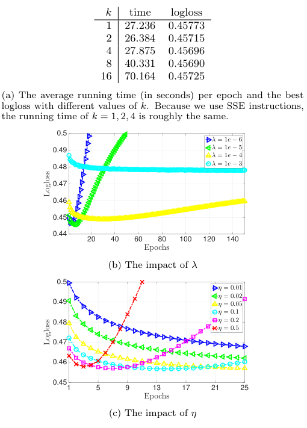
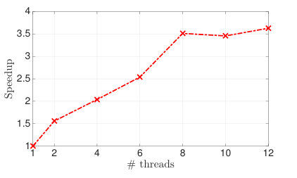

# FFM：让同一特征按对方字段使用不同向量

[原文版本与中文 PDF 位置](#原文与阅读范围) · [私有备份下载说明](../../文档/工具/中文PDF发布.md#登录下载)

给 ESPN、Nike、Male 各一个特征 ID，再分别附发布商 (P)、广告主 (A) 和受众 $G$ 的字段 ID。FM 用同一个 ESPN 向量同时表示 ESPN×Nike 和 ESPN×Male。FFM 把这个共享假设收窄到同一个对方字段。ESPN×Nike 用 $v_{\text{ESPN},A}$ 与 $v_{\text{Nike},P}$，ESPN×Male 改查 $v_{\text{ESPN},G}$ 与 $v_{\text{Male},P}$。同属广告主字段的 Adidas 仍与 Nike 共用 ESPN 的广告主视角。[§3，式 (4)，PDF 第 2–3 页](https://www.csie.ntu.edu.tw/~cjlin/papers/ffm.pdf#page=3)

## 一次曝光会读出三对向量

FFM 输出 $s=\sum_{i<j}x_i x_j v_{i,f(j)}^\top v_{j,f$i$}$，$f$i$$ 是特征 $i$ 的字段，原文式 (4) 只写交叉项。使用教学的一维因子，三对分别取 $(0.5,0.2)$、$(0.4,-0.4)$、$(0.2,0.1)$。原输入全是 1 时，得分 $0.1-0.16+0.02=-0.04$，概率约 0.490。作者实验还采用实例单位范数归一化。如果用它处理本例的三个 1，每个交叉乘积缩为原来的三分之一，得分变为 $-0.04/3$。

点击标签按作者约定记作 $y\in\{-1,+1\}$。对损失 $\log(1+e^{-ys})$，数据梯度的共同因子是 $-y/(1+e^{ys})$。以未归一化的教学行计，正样本下 ESPN 的广告主向量收到约 $-0.102$ 的数据梯度，受众向量收到约 $+0.204$。若按算法 1 加 L2 并使用 AdaGrad，每个向量坐标将平方梯度计入自己的累加器 $G$，用 $\eta/\sqrt{G}$ 缩放更新。下个样本若换成 Adidas，ESPN 的广告主向量继续使用刚才更新后的值。线上预测只需要这一条曝光的活动特征和向量表。[§3.1–3.3、算法 1、式 (5)–(10)，PDF 第 3–4 页](https://www.csie.ntu.edu.tw/~cjlin/papers/ffm.pdf#page=3)

## 字段表达力与稀疏存储一起变化

特征词表大小 $n$、字段数 $F$ 与向量维数 $k$ 决定最直接的表规模 $nFk$。一行 $m$ 个非零坐标需遍历约 $m(m-1)/2$ 个配对。FM 的整体平方和会混合这里的多套向量。若每个激活特征仅按组使用单一向量，即回到 FM 的共享假设。原文通过较小的 FFM 维度、稀疏访问和多线程降低花费。多线程 Hogwild! 的线程并行处理样本，热门特征同时写入仍可冲突。[§3.2、表 2、§4.4，PDF 第 3–5 页](https://www.csie.ntu.edu.tw/~cjlin/papers/ffm.pdf#page=3)

Juan 等作者原图 1，RecSys 2016, pp.43–50，PDF 第 5 页。先看因子维度和每轮耗时，再看 L2 与学习率如何改变验证损失的走势。

Juan 等作者原图 3，RecSys 2016, pp.43–50，PDF 第 6 页。用单线程的每轮耗时作分子，线程增加后加速逐渐饱和。

## 结果依赖字段质量与停止轮次

Criteo 竞赛私有测试中，表 3 的 FFM 以 $k=4$、9 轮得到 0.44603 Logloss，同文自实现 $k=100$ FM 的结果可在表内对照。Avazu 私有测试的 FFM 是 0.38223，自实现 $k=40$ FM 为 0.38407。表 3 的 public/private 都是竞赛测试切片，各算法有不同停止条件。§4.3 报告继续训练可出现验证损失上升，作者以验证集选择轮数。表 4 的 phishing 上 FM 为 0.09229，优于 FFM 的 0.10650。稠密或全数值数据即使人工分字段，其分组也未必提供广告日志中发布商、广告主那样的关系结构。[§4.3、§4.5–4.6、表 3–4，PDF 第 5–8 页](https://www.csie.ntu.edu.tw/~cjlin/papers/ffm.pdf#page=7)

[FM 精读](../SRC-FM/阅读笔记.md) · [稀疏特征交叉](../../知识库/问题/稀疏特征的低高阶交互学习.md)

## 原文与阅读范围

采用作者站保存的 RecSys 2016 会议 PDF，阅读 §1–5、算法 1、表 1–4 及参数和并行实验。 [DOI 10.1145/2959100.2959134](https://doi.org/10.1145/2959100.2959134) · [原文 PDF](https://www.csie.ntu.edu.tw/~cjlin/papers/ffm.pdf)

中文 PDF（9 页）依据会议版 PDF单栏重排，覆盖摘要、§1–5、公式、算法及图表说明。图内文字、原表部分英文及参考文献保留，部分叙述合并表述。

本地文件 `.local/papers/SRC-FFM/translation/SRC-FFM.中文.pdf`，按原文章节和页码定位的 Markdown `.local/papers/SRC-FFM/translation/FFM_中文翻译.md`，可编辑工程主文件 `.local/papers/SRC-FFM/translation/translated-sources/main.tex`。[许可与范围盘点](../../译文/PDF目录.md) · [私有备份下载说明](../../文档/工具/中文PDF发布.md#登录下载)
