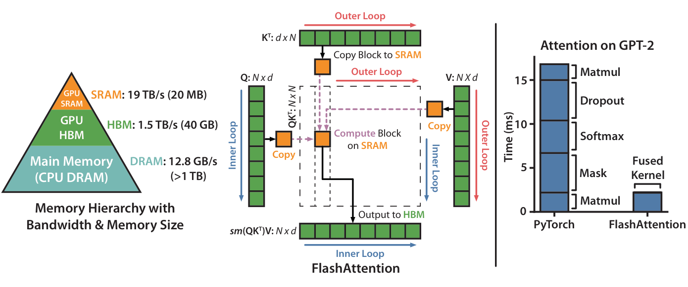
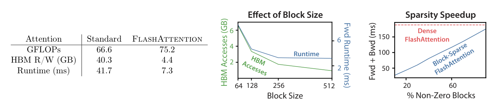
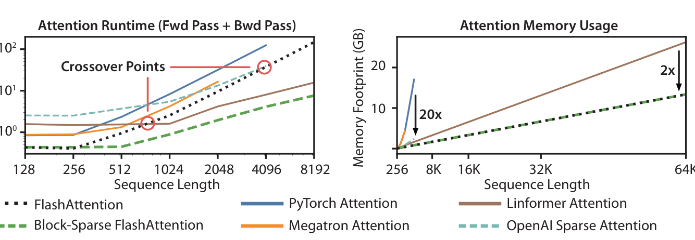

# FlashAttention：边扫键值块，边合并同一行 Softmax

标准实现通常先把 $QK^\top$ 整张分数矩阵写到 GPU 的 HBM，再读回做 Softmax、写回概率矩阵，接着读概率与 $V$ 做矩阵乘法。序列长度是 $N$ 时，中间矩阵有 $N^2$ 项。矩阵乘法本身仍需计算所有允许的词元对，但 Softmax 所需的全行最大值和分母可以在遍历键值块时逐步维护，不需要把两张完整中间矩阵往返显存。FlashAttention v1 的贡献是把这类分块统计与反向重算合成 IO 感知的 GPU 核函数。

作者原图 1，固定版第 2 页，Dao 等。先看左侧 HBM 与片上 SRAM 的层级，再沿中图红箭头看外循环载入一块 K、V，蓝箭头扫过 Q 块及其历史输出。虚线框对应经典算法会写入 HBM 的大注意力中间矩阵。右图比较某个 GPT-2 注意力计算，端到端训练还包括其他算子、优化器和数据处理。

## 新块到达时，旧分子如何换底

以 “hello world .” 的 world 位置预测下一个词元为例，因果掩码让这个查询看到 hello、world 两个键。为演示，设这两个允许的打分已包含缩放，分别为 $\ln 2,\ln 4$，某一值维的数值分别为 2 和 8。经典做法一次算出概率 $(1/3,2/3)$ 和输出 6。当 K/V 按一行一块读入时，处理第一个键得到最大值 $m=\ln 2$，缩放后的分母 $\ell=1$，加权值分子 $U=2$；第二块打分更大，令 $m'=\ln4$，先把旧状态乘 $e^{m-m'}=1/2$，再加新块的分母 1、分子 8。现在 $\ell'=1.5,U'=9$，输出仍为 6。句号虽在同一训练样本中，掩码阻止该查询读取它的值。

通常每个 Q 块并行维护各查询行的状态。论文算法 1 存已归一化的输出 $O$，上例的分子就是 $\ell O$。找出新块行最大值 $\tilde m$，把旧状态与新块都换到 $\max(m,\tilde m)$ 的指数基准下，合并分母和分子并更新 $O$。全掩蔽的块对已有有效键的行贡献为零，若此前也没有有效键则继续保留空状态。整行全掩蔽的输出语义需要由实现约定。精确指在实数算术下与同一掩码的普通 Attention 等价，浮点归约顺序可能产生舍入差异。通用式见 [Attention 计算与存储](../../知识库/概念/Attention计算与存储.md)。

## 反向如何重算概率

在这个例子，用上层或词表头反传的梯度 $dO$ 计算 $dV,dQ,dK$。固定查询行 $i$，在反向从 Q/K 块重算打分 $S_{ij}$，结合前向最后保存的 $m_i,\ell_i$ 得到 $P_{ij}=\exp(S_{ij}-m_i)/\ell_i$。这个概率同时参与 $dV=P^\top dO$ 和 Softmax 的梯度。无 dropout 时，$dP=dO\,V^\top$，需要扣除的行内标量 $\sum_jP_{ij}dP_{ij}$ 正好是 $dO_i\cdot O_i$。由此每块可算 $dS_{ij}=P_{ij}(dP_{ij}-dO_i\cdot O_i)$，再累加到 Q、K 的梯度。借由这条恒等式，任何单块都能使用整行的信息，不需要反向物化大矩阵。附录 B.3–B.4 说明 dropout 通过保存伪随机状态在反向重建同一掩码，因果或 Padding 掩码也必须保持一致。推理只走前向。自回归时历史 K/V 的缓存独立于该核函数的临时概率状态。

## 算力、HBM 和训练收益怎样区分

作者原图 2，固定版第 6 页，Dao 等。左侧 A100 的 GPT-2 medium 对照由 66.6 增至 75.2 GFLOP，HBM 读写从 40.3 降至 4.4 GB，前后向由 41.7 降至 7.3 ms，设置为长度 1024、头维数 64、16 头、批大小 64。中图看块变大后访存和耗时的变化，直到其他因素变成瓶颈。右图是预设稀疏块的保留比例，跳过块会改变稠密模型允许的交互。

稠密算法仍做 $O(N^2d)$ 算术，额外全局存储为 $O(N)$，另有 $O(Nd)$ 输入/输出。在论文两级存储模型下，$M$ 为 SRAM 可容纳的元素数。粗略地，每块放 $O(M/d)$ 个键，因此有约 $Nd/M$ 块。对每块扫描查询、输出及统计量，单次 $O(Nd)$，于是 IO 为 $\Theta(N^2d^2/M)$，典型 $M$ 远大于 $d^2$ 时减少搬运。固定 $d,M$ 时 IO 对 $N$ 仍是二次。命题 3 说明无法对整个 $[d,Nd]$ 的 SRAM 区间同时渐近降低该界，证明使用 $M=\Theta(Nd)$ 时读取输入的 $\Omega(Nd)$ 下界。块稀疏版另乘非零块比例 $s$，并保留读写输入输出的 $\Theta(Nd)$ 项。

作者原图 3，固定版第 9 页，Dao 等。左图比较不同长度的前后向耗时，短序列的低访存能使稠密 FlashAttention 快于部分近似方法，之后有交叉。右图比较注意力算子的显存开销，稠密与块稀疏版的内存曲线均近似线性。基准使用单块 40 GB A100，启用 dropout 与 Padding 掩码。表 1 是八块 A100 上 BERT-large 达到相同 MLM 准确率的时间，20.0 与 17.4 分钟。表 4 中同一 FlashAttention 实现把 GPT-2 small 上下文由 1K 增至 4K，困惑度从 18.2 到 17.5，耗时从 2.7 天增至 3.6 天，但仍短于 1K Megatron-LM 的 4.7 天。效果提升来自可用的长上下文，固定上下文时看等价计算与系统指标。

阅读范围为固定版摘要、§1–5、算法 0–1、图 1–3、表 1–6 及附录 B–E 的相关段落。译文覆盖正文、图表说明、算法 0–1 及致谢，文献和附录沿用英文，未复跑作者基准。[固定原文](https://arxiv.org/pdf/2205.14135v2) · [中文 PDF 访问说明](../../文档/工具/中文PDF发布.md)
