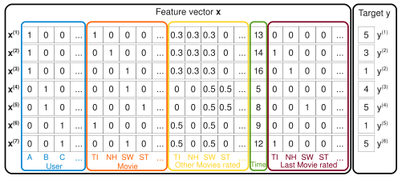
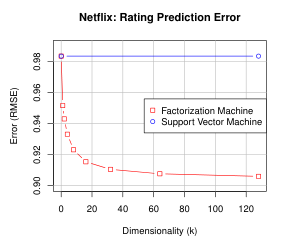
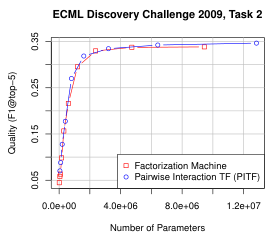

# FM：让从未共同出现过的特征组合也有分数

[原文版本与中文 PDF 位置](#原文与阅读范围) · [私有备份下载说明](../../文档/工具/中文PDF发布.md#登录下载)

一次曝光包含发布商 ESPN、广告主 Nike 和受众字段 Male，点击标签为 1。线性模型给三个激活坐标各计一次贡献。若维护独立的 ESPN×Nike 系数，这个系数只能在两者同现时获得数据梯度。Rendle 的 FM 给每个特征各分配一个向量，用内积定义所有二阶系数。ESPN 可在别的曝光中学习向量，Nike 也可以，随后用两者内积估计缺少联合曝光证据的组合。[§II–III.A，PDF 第 1–3 页](https://cseweb.ucsd.edu/classes/fa17/cse291-b/reading/Rendle2010FM.pdf#page=2)

## 同一个特征向量可以装下用户、物品、时间和历史

Rendle 作者原图 1，ICDM 2010, pp.995–1000，PDF 第 2 页。不同色块区分用户、当前影片、历史、时间和前序影片，最右列是评分。

原文用评分示例。Alice 在 2010 年 2 月给 Notting Hill 打 3 分，当行激活 Alice 和 Notting Hill，还可以加入归一化的已评分电影集合、时间月份和上一次评分的 Titanic，监督仍是 3 分。不同颜色的电影列属于不同身份，例如当前 Titanic 与前序 Titanic 有各自坐标。对按时间预测的实际数据，应从预测时已知记录构造历史。作者插图里的「曾经评分」集合用于展示编码弹性，照抄整段记录会把后续行为带进先前样本。

## 从三次点积到平方和

令 $x_i=1$ 表示本条曝光中激活的类别，连续或归一化特征也可有其他实数值。二阶模型的分数为
$$
s=w_0+\sum_i w_i x_i+\sum_{i<j}x_ix_j v_i^\top v_j.
$$
取一维教学因子 $v_P=0.5,v_A=0.2,v_G=-0.4$，交叉项依次是 $0.1,-0.2,-0.08$，合计 $-0.18$。对于任一因子维 $f$，先算 $h_f=\sum_i x_i v_{if}$。平方包含自乘与每对不同下标的两种排列，去掉自乘再除 2 得 $\tfrac12(h_f^2-\sum_i x_i^2v_{if}^2)$。本例为 $(0.3^2-0.45)/2=-0.18$。只遍历 $m$ 个非零特征，$k$ 维因子需要 $O(mk)$ 时间。[§III.A.4](https://cseweb.ucsd.edu/classes/fa17/cse291-b/reading/Rendle2010FM.pdf#page=3)

若一阶项和偏置此刻均为零，点击模型先对 $-0.18$ 取 Sigmoid，预测约 0.455。正样本的交叉熵会给分数约 $-0.545$ 的梯度。ESPN 因子对分数的偏导是 $x_P(h_f-x_P v_P)=-0.2$，因此损失对它的梯度约 $+0.109$，梯度下降会降低该坐标。Nike 与 Male 也收到这条曝光的梯度。这样的更新能同时影响尚未出现过的 ESPN×Adidas。所有组合都只能读到已有坐标训练获得的信号，全新类别需要初始化、侧信息或其他回退。原文还允许用评分残差训练回归，或用两行分差训练排序。训练完只需保存权重和因子，服务读同样编码的特征即可。[§III.B–D，式 (4)–(6)](https://cseweb.ucsd.edu/classes/fa17/cse291-b/reading/Rendle2010FM.pdf#page=3)

## 输入编码决定可以还原哪种协同模型

只放用户和当前物品两个 one-hot 就剩全局、用户、物品偏置与一项内积，对应带偏置 MF。加入历史集合或上一物品时，需要核对 FM 会产生哪些额外交互。§V 用不同特征编码和交互约束对照 SVD++、PITF 和 FPMC。全量二阶项的自由 FM 还可能学习历史内部、用户与上一物品等交互，逐项比对才可确认与专用方程的关系。核多项式 SVM 也可以表达交叉，但其显式特征映射对应分别估计权重的形式。FM 对全部二阶权重施加共享因子约束。Gram 矩阵正半定且秩至多 $k$，二阶模型只读取非对角项。给定任意实对称非对角要求，可用足够大的对角线完成正定矩阵，此时在足够大 $k$ 下可表达这些非对角项。小 $k$ 会限制这种自由度。[§IV–V，PDF 第 4–6 页](https://cseweb.ucsd.edu/classes/fa17/cse291-b/reading/Rendle2010FM.pdf#page=4)

Rendle 作者原图 2，ICDM 2010, pp.995–1000，PDF 第 4 页。横轴为因子维数，纵轴为评分 RMSE。

Rendle 作者原图 3，ICDM 2010, pp.995–1000，PDF 第 6 页。横轴为模型参数量，纵轴为标签推荐 F1@5。

原文重点是方程、复杂度和编码关系。2016 年 FFM 的同协议比较补上 CTR 实证，并检验当一个向量同时承担多个字段关系时，按对方字段拆分是否有效。[FFM 同协议比较](../SRC-FFM/阅读笔记.md) · [稀疏特征交叉](../../知识库/问题/稀疏特征的低高阶交互学习.md)

## 原文与阅读范围

采用 ICDM 2010 的 6 页正式版，高校课程镜像与论文题名、作者和 DOI 对照。核查 §I–VI 与评分示例。 [DOI 10.1109/ICDM.2010.127](https://doi.org/10.1109/ICDM.2010.127) · [原文 PDF](https://cseweb.ucsd.edu/classes/fa17/cse291-b/reading/Rendle2010FM.pdf)

中文 PDF（9 页）依据会议版 PDF单栏重排，覆盖摘要、§I–VI、公式、图注及脚注。图内文字及参考文献保留，部分叙述合并表述。

本地文件 `.local/papers/SRC-FM/translation/SRC-FM.中文.pdf`，按原文章节和页码定位的 Markdown `.local/papers/SRC-FM/translation/FM_中文翻译.md`，可编辑工程主文件 `.local/papers/SRC-FM/translation/translated-sources/main.tex`。[许可与范围盘点](../../译文/PDF目录.md) · [私有备份下载说明](../../文档/工具/中文PDF发布.md#登录下载)
