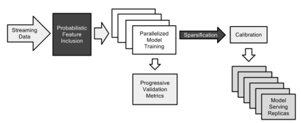
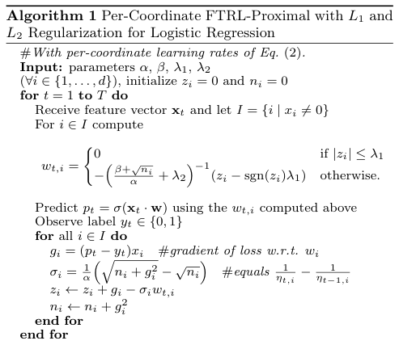
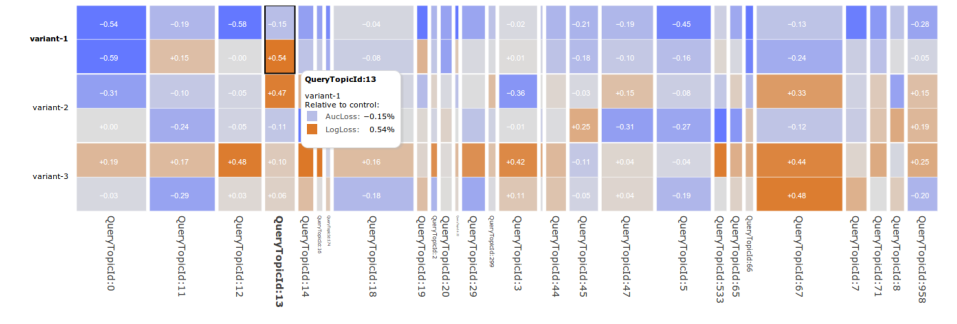
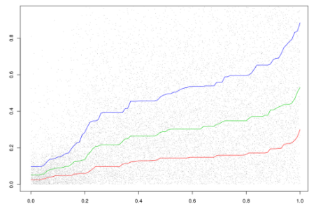

# FTRL-Proximal 怎样边学边得到稀疏的 CTR 权重

[原文版本与中文 PDF 位置](#原文与阅读范围) · [私有备份下载说明](../../文档/工具/中文PDF发布.md#登录下载)

在一条包含 ESPN、Nike 和 Male 的曝光样本上，线上线性模型读三个坐标及可能已编码的人工交叉，算 $p=\sigma(w^\top x)$。随后观察 $y=1$ 或 $0$。新标签只需处理当行非零坐标，适合流式训练。把 L1 的次梯度直接加到普通在线梯度下降，通常只会把权重推近零。McMahan 等改为逐坐标求含 L1 的近端目标，使满足阈值的权重精确为零。训练仍可保留相应统计量，并在后续数据令坐标重新激活。[§2–3，PDF 第 1–3 页](https://chbrown.github.io/kdd-2013-usb/kdd/p1222.pdf#page=2)

McMahan 等作者原图 1，KDD 2013, pp.1222–1230，PDF 第 2 页。从流式样本、概率纳入特征到训练。服务展开为校准和多副本，评估位于训练下游。

## 一次曝光怎样更新两个状态

设 $n_i$ 是该坐标历史平方梯度和，$z_i$ 汇总线性化梯度与近端修正，$\alpha,\beta$ 控制学习率，$\lambda_1,\lambda_2$ 控制 L1、L2。预测前从状态读出 $w_i$：
$$
A_i=(\beta+\sqrt{n_i})/\alpha+\lambda_2,\qquad
w_i=\begin{cases}
0,& |z_i|\le\lambda_1,\\
-(z_i-\operatorname{sgn}(z_i)\lambda_1)/A_i,& |z_i|>\lambda_1 .
\end{cases}
$$
它来自 $\min_w z_i w+\tfrac12 A_iw^2+\lambda_1|w|$。零点的 L1 次梯度可覆盖区间 $[-\lambda_1,\lambda_1]$。超出区间后，最优点向数据梯度倾向的方向移动，且二次项限制步长。

以三项当前权重全零开始。取 $\alpha=\beta=1,\lambda_1=0.25,\lambda_2=0$，此时 $p=0.5$。点击后，对 $x_i=1$ 的 ESPN 坐标有 $g_i=(p-y)x_i=-0.5$。按算法 1，
$$
\sigma_i=(\sqrt{n_i+g_i^2}-\sqrt{n_i})/\alpha,\quad
z_i\gets z_i+g_i-\sigma_iw_i,\quad n_i\gets n_i+g_i^2 .
$$
因此 $z_i=-0.5,n_i=0.25$。下次包含 ESPN 时，读出 $w_i=(0.5-0.25)/1.5=1/6$。若 $\lambda_1=0.6$，同样的单条梯度仍留在状态中，但读出权重为零。少有梯度的坐标不随系统总步数自动降低学习率，频繁出现或梯度大的坐标则较快降速。[算法 1、式 (2)，PDF 第 2–3 页](https://chbrown.github.io/kdd-2013-usb/kdd/p1222.pdf#page=2)

McMahan 等作者原算法 1，KDD 2013, pp.1222–1230，PDF 第 2 页。上半部从两个统计量读权重，下半部在看到标签后写回。

同文第 3 页中间递推一行印成了加号，和前一行 $z_t=\sum_{s\le t}(g_s-\sigma_sw_s)$ 以及算法 1 的减号不相符。把近端项 $\sigma_s(w-w_s)^2/2$ 展开可直接检查交叉项为 $-\sigma_sw_s w$。该页展开后的二次项还少了前式的 $1/2$。以上推导以原始目标和算法 1 互相核对。

## 在线验证与概率校准如何接进生产系统

训练可先用新到达样本验证当前模型，再用刚观察到的标签更新，形成 progressive validation。比较模型时要用同一时间区段与样本。历史已经按旧策略产生，指标不会自动呈现改变拍卖和排序后的流量结果。原文保留至少有一次点击的查询及其广告样本，并以概率 $r$ 抽取无点击查询。对保留的无点击查询样本赋 $1/r$ 的损失权重。在期望意义下恢复原损失贡献，梯度方差仍会变化。概率校准在另一个环节对各切片拟合单调映射，评估各分桶的平均预测与观察 CTR。从分桶点击数拟合单调映射的算例见[曝光点击概率校准](../../知识库/问题/排序分数怎样校准为曝光点击概率.md)。[§4.6–7，PDF 第 5–8 页](https://chbrown.github.io/kdd-2013-usb/kdd/p1222.pdf#page=5)

McMahan 等作者原图 2，KDD 2013, pp.1222–1230，PDF 第 6 页。一列是一种切片，宽度表示流量大小，颜色用于扫描正负变化。

McMahan 等作者原图 3，KDD 2013, pp.1222–1230，PDF 第 7 页。曲线为误差的百分位数，横轴做过分布归一化。

表 1 在原文匹配的 AucLoss 下，OGD-Count 非零权重比 FTRL 多 216%。RDA 非零权重多 3%、AucLoss 恶化 0.6%。前者来自全量实验，RDA 与 FOBOS 的比较来自较小原型集，报告的 AucLoss 是 $1-\mathrm{AUC}$。原文还报告过强特征哈希和单层输入 dropout 在该数据中未带来收益。FTRL 规定如何更新稀疏参数，FM 和 FFM 规定如何构造交叉得分，Wide & Deep 的宽分支以 FTRL 更新原特征与人工交叉各自的权重。[表 1，第 3 页](https://chbrown.github.io/kdd-2013-usb/kdd/p1222.pdf#page=3) · [§9，第 8 页](https://chbrown.github.io/kdd-2013-usb/kdd/p1222.pdf#page=8) · [逐曝光更新与稀疏权重](../../知识库/问题/在线CTR怎样得到稀疏权重.md) · [宽深联合的更新路径](../SRC-WIDEDEEP/阅读笔记.md#应用安装标签训练输入与更新路径)

§9.1 报告，在这套广告模型上把坐标数压到数十亿以下时，作者观察到预测效果损失。[稀疏 ID 哈希问题](../../知识库/问题/稀疏ID哈希何时会共享参数.md)比较了有限坐标中的碰撞、有符号特征映射与按槽共享 Embedding。

## 原文与阅读范围

采用 KDD 2013，页码 1222–1230，阅读 §1–10、算法 1、实验和校准。会议资料镜像的 PDF 与固定 Git blob 核对一致。[DOI](https://doi.org/10.1145/2487575.2488200) · [Google Research](https://research.google/pubs/ad-click-prediction-a-view-from-the-trenches/) · [会议 PDF](https://chbrown.github.io/kdd-2013-usb/kdd/p1222.pdf)

中文 PDF（10 页）依据会议版 PDF单栏重排，覆盖摘要、§1–10、算法 1、公式及图表说明。图内文字及参考文献保留，部分叙述合并表述。

本地文件 `.local/papers/SRC-FTRL/translation/SRC-FTRL.中文.pdf`，按原文章节和页码定位的 Markdown `.local/papers/SRC-FTRL/translation/FTRL_中文翻译.md`，可编辑工程主文件 `.local/papers/SRC-FTRL/translation/translated-sources/main.tex`。[许可与范围盘点](../../译文/PDF目录.md) · [私有备份下载说明](../../文档/工具/中文PDF发布.md#登录下载)
