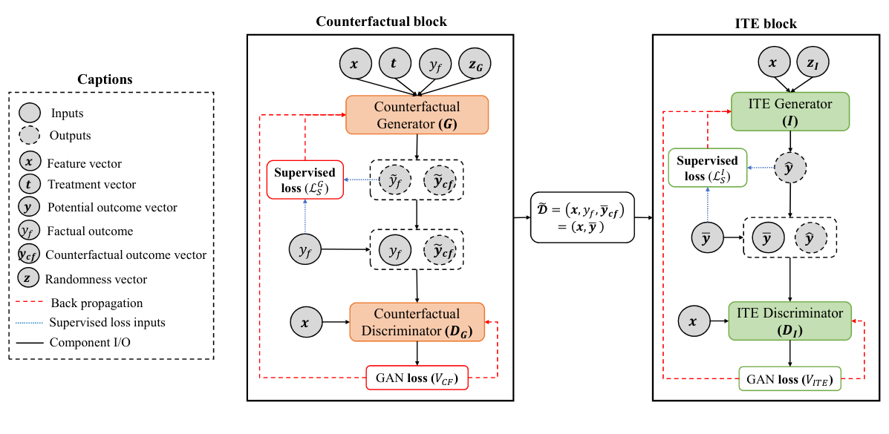
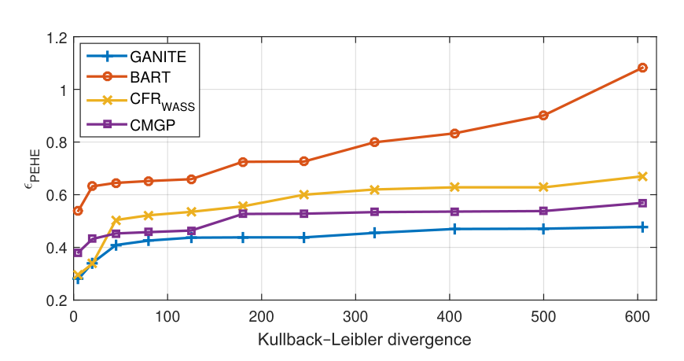
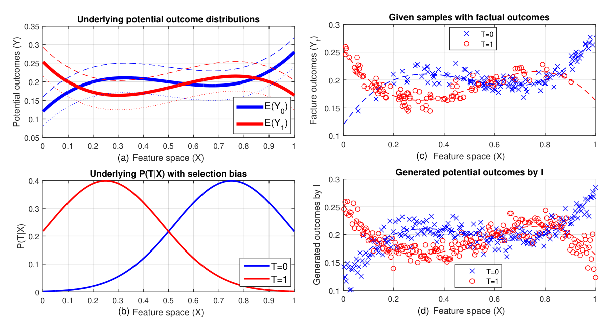

# GANITE：用事实记录补齐反事实，再学习可部署的双臂预测

历史日志可能只告诉我们，某位用户收到券后下了单。把他的无券头也标为 0，会把未观察当成未下单。TARNet 给这一行只更新发券头，共享编码器仍从两臂数据学习。GANITE 的思路是先用实际动作和已观察结果填补缺失臂，再让另一个模型从补全的数据学习。这样部署模型可以只读画像，同时输出用户在所有候选动作下的结果。作者用两组对抗网络实现这条链。 [ICLR 2018 采用版 §2–4](https://github.com/gasanchez10/freganv2/blob/3037720047e4cdd02d11394ff77919f93ce385df/Papers_elegidos/588_ganite_estimation_of_individua%20%281%29.pdf) · [TARNet 的事实臂监督](../SRC-CFRNET/阅读笔记.md)

## 第一阶段怎样填补没有观察到的结果

设一行发券日志为 $(x,t=1,y_f=1)$。画像 $x$ 都来自指派前，例如最近交易次数。$t=1$ 是收到券，$t=0$ 是未收到。下单标签 $y_f=1$ 是实际收到券后观察到的结果。训练时，反事实生成器 $G(x,t,y_f,z_G)$ 还读一份噪声 $z_G$，一次生成按无券、发券排列的两个潜在结果候选。假设某次输出 $\widetilde y=(0.3,0.8)$，数字仅用于演算。该行观察到发券结果确为 1，因此将发券维覆盖成 1，得到交给判别器的 $\bar y=(0.3,1)$。

作者原图 1，采用版第 4 页。顺着左侧的黑线读，$G$ 给出候选，已观测事实值重新插入向量交给 $D_G$。蓝虚线给监督项提供真值和预测，红虚线表示误差传回对应网络。中间的补全数据是两阶段之间的接口，右侧的 $I$ 无需输入实际动作或已发生的结果。

$D_G$ 读 $(x,\bar y)$，预测哪一维是真的。记它的各维得分为 $d_j$，处理的 one-hot 标记为 $t_j$。固定 $G$ 时，$D_G$ 最大化 $V_{\rm CF}=\sum_j[t_j\log d_j+(1-t_j)\log(1-d_j)]$。固定 $D_G$ 时，$G$ 最小化这个量，使补全向量里哪一维来自事实变得难辨。事实位在 $\bar y$ 中已被替换，因此这条对抗路径直接经过生成的无券维 $0.3$。$G$ 自己预测的事实位 $0.8$ 由单独监督项 $(1-0.8)^2=0.04$ 约束。共享层会收到两条路径的梯度。作者在正文 §3、§4.1 分别定义判别和经验损失，式 (4) 的向量记号与图 1 不一致，按图和经验式理解判别器输入。 [采用版图 1、式 (3)–(4) 与 §4.1](https://github.com/gasanchez10/freganv2/blob/3037720047e4cdd02d11394ff77919f93ce385df/Papers_elegidos/588_ganite_estimation_of_individua%20%281%29.pdf)

如果旧策略按画像更常发券，$D_G$ 即使只看 $x$ 也能猜到偏向哪一档。补全目标是在给定 $x$ 后，潜在结果向量不再额外泄露哪一维是事实。某画像的历史发券率为 80% 时，理想的判别器仍能从 $x$ 知道这个比例。若缺少无券样本，判别器无法给该画像补出真实的无券支持。正文 §2 假设每档均具备重叠，且给定 $X$ 后处理分配与潜在结果独立。 [采用版 §2–3](https://github.com/gasanchez10/freganv2/blob/3037720047e4cdd02d11394ff77919f93ce385df/Papers_elegidos/588_ganite_estimation_of_individua%20%281%29.pdf) · [历史发券中的可交换性与重叠](../../知识库/问题/历史发券日志如何估计补贴增量.md#在哪一群人哪个时刻比较发与不发)

## 第二阶段怎样把补全样本转成只读画像的预测

第一阶段训练完后固定 $G$，用它补全训练数据，再训练新的 $I(x,z_I)$。第二个判别器 $D_I$ 以相同 $x$ 为条件，比较从补全数据来的整条向量 $\bar y$ 和 $I$ 生成的整条向量 $\hat y$。它判别的是**整条向量的出处**，第一阶段的 $D_G$ 判别的是**向量内部的事实位**。第二个对抗项是 $\log D_I(x,\bar y)+\log(1-D_I(x,\hat y))$。对二元处理，还给 $I$ 一个差值平方损失。若 $I$ 在上例输出 $(0.20,0.75)$，补全向量的差为 $0.70$、当前预测差为 $0.55$，监督损失为 $(0.70-0.55)^2=0.0225$。减小损失会把两输出往相反方向拉，二者同时增加同一常数仍得到相同差值。向量对抗损失承担拟合补全分布的任务。多处理时，论文改为对完整 $k$ 维向量逐坐标计算平方误差。 [采用版 §3.2、§4.2 与图 1](https://github.com/gasanchez10/freganv2/blob/3037720047e4cdd02d11394ff77919f93ce385df/Papers_elegidos/588_ganite_estimation_of_individua%20%281%29.pdf)

预测新用户时无需知道实际是否发券，也无需等待下单。论文结构只保留 $I$，可重复抽 $z_I$，对每次有券与无券输出之差求均值，得到条件平均效应的估计。分位范围描述的是由补全和生成模型共同给出的差值波动。即使随机试验能识别两臂的边缘率，个人两种潜在结果的联合分布仍可有多种形状。例如无券下单率 20%、有券下单率 40%，若无券下单者发券后都下单，则有 20% 被券促成、无人被劝退；若两臂下单者完全不重叠，则有 40% 被促成、20% 被劝退。同样的边缘率和 20 个百分点净增量对应不同的个人效应分布。将生成的区间解释为个人效应分布或可校准区间，需要额外依据。 [采用版式 (1)、(5)–(6)](https://github.com/gasanchez10/freganv2/blob/3037720047e4cdd02d11394ff77919f93ce385df/Papers_elegidos/588_ganite_estimation_of_individua%20%281%29.pdf) · [结果分布与个体效应分布](../../知识库/问题/补贴怎样改变消费金额的分布.md)

作者后来公开的二元 Twins 示例是简化实现。代码中 $G$ 读取 $[x,t,y_f]$，$D_G$ 读取覆写事实位的两维向量，最终预测器仅读 $x$。它没有显式生成噪声或第二个判别器 $D_I$，训练 $I$ 时用两头分别拟合补全的软标签交叉熵。第一阶段也把事实重构改成二元交叉熵，并以代码的 alpha 乘对抗项。解读论文分布模型时使用图 1 的四个网络，读固定代码的二元预测时使用三网络监督链。 [作者代码 e299731 的输入与损失](https://github.com/jsyoon0823/GANITE/blob/e2997317d5e8699d6fd56e704cae35890f5599c8/ganite.py#L122-L229)

## 实验检验了哪些效应

作者原图 2，采用版第 8 页。横轴是处理与对照的特征分布 KL 散度，纵轴是 PEHE。在作者模拟的均值平移范围内，GANITE 的误差曲线增幅小于 BART、CFRWASS 和 CMGP。它检验观测特征下组间距离变大时的估计表现，未构造未测混杂，也未验证几乎没有重叠时的识别。

表 1 用 8,000 条合成样本训练、2,000 条测试，重复 100 次。两阶段各只有监督项时 PEHE 为 $0.397\pm0.011$，两阶段都加入对抗项时为 $0.335\pm0.011$，比前者低约 15.6%。表 2 的二元 Twins 样本外根 PEHE 为 $0.297\pm0.016$，CFRWASS 为 $0.313\pm0.008$，该对照未标样本外显著性星号。Jobs 只在随机试验子集核验策略风险，GANITE 样本外为 $0.14\pm0.01$，CFRWASS 为 $0.21\pm0.01$。样本内的 k-NN 风险为 0.02，低于 GANITE 的 0.13。IHDP 样本外根 PEHE 为 GANITE 2.4、CFRWASS 0.76；作者将差异部分归因于样本较小，原文未单独控制网络参数量来检验此解释。三套基准的真值、指标和评价样本不同。 [采用版 §5.1–5.3，表 1–2，附录表 4–5](https://github.com/gasanchez10/freganv2/blob/3037720047e4cdd02d11394ff77919f93ce385df/Papers_elegidos/588_ganite_estimation_of_individua%20%281%29.pdf)

Twins 二元协议用 11,400 对体重低于 2 公斤且无特征缺失的双胞胎，将较重与较轻者的观测结果用作同对代理，再按有偏概率只向训练数据展示其中一个。两名双胞胎仍是不同的人，基准提供的是成对代理。多处理版本按体重高低与性别组合成四档，附录表 4 标明没有完整反事实。表 3 依据可用结果计算样本外 $\mathrm{MSE}_y$，GANITE 为 $0.0723\pm0.0183$，CFRWASS 为 $0.0894\pm0.0057$，表中相对降幅 19.1%。该比较未标样本外显著星号，基线还采用共用对照、逐对训练的扩展方式。 [采用版 §5.3、表 3–4](https://github.com/gasanchez10/freganv2/blob/3037720047e4cdd02d11394ff77919f93ce385df/Papers_elegidos/588_ganite_estimation_of_individua%20%281%29.pdf)

作者原图 3，采用版第 17 页。先看左上两条按 $x$ 变化的结果曲线，再看左下的选择偏差。右上两臂的事实点分别密集在不同区间。右下所画的是 $I$ 的生成输出，稀疏区间也出现了两臂的样本。图提供生成分布的直观检查，未直接报告真实个人区间覆盖率。

## 原文与中文译本

正式译本 23 页，重排摘要、正文 §1–6、图表说明与致谢，保留图内文字、公式、参考文献与英文附录。本地正式文件为 `.local/papers/SRC-GANITE/translation/GANITE_中文.pdf`，可编辑主文档为 `translated-sources/main.tex`。采用的 Github 固定镜像标为 ICLR 2018。题名、署名、会议与官方记录一致，官方附件返回访问验证，无法核对镜像与官方资产是否逐字节一致。作者实现只作静态核对，未运行实验。 [ICLR 会议条目](https://iclr.cc/Conferences/2018/Schedule?showEvent=153) · [OpenReview](https://openreview.net/forum?id=ByKWUeWA-) · [版本及哈希](来源.json) · [私有备份下载说明](../../文档/工具/中文PDF发布.md)
