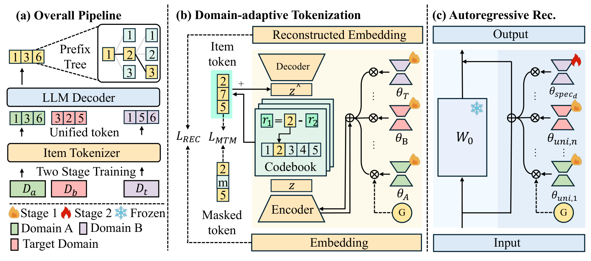
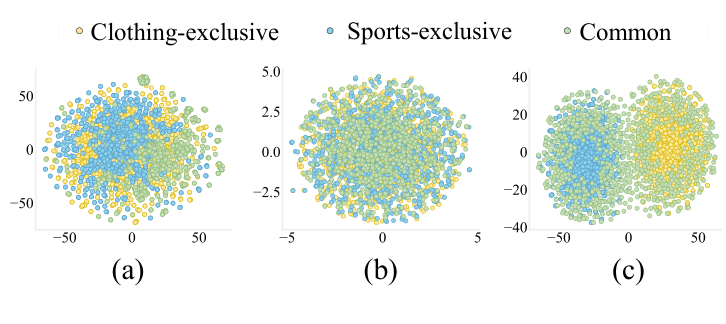
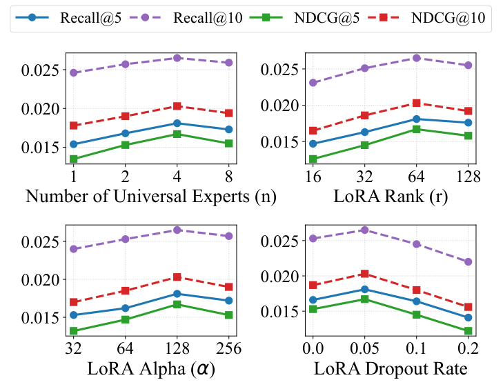
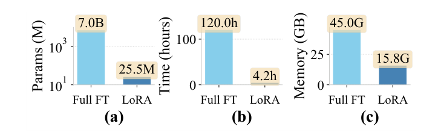
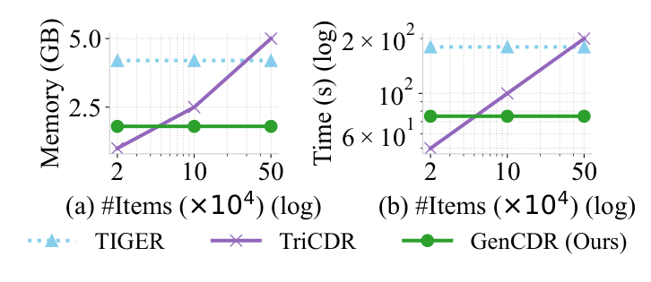

# GenCDR：在物品量化和用户历史上分别控制跨域共享

同一个店铺账号在运动域买过跑步手套，在服饰域买过防风衣。要预测服饰域的下一件商品，合并历史能提供跑步偏好，也会带入对眼前预测无用的运动器材记录。GenCDR 在两个地方调节共享强度：先按物品混合通用和逐域的语义表示，再由用户历史调节通用和逐域推荐器的输出。目标域目录约束最终可生成的物品。[正式版第 14875–14879 页](https://ojs.aaai.org/index.php/AAAI/article/download/38508/42470#page=2)

*图 1 · 两个领域的文本共享一部分语义，同一名称也可能指向不同物品。 Peiyu Hu、Wayne Lu、Jia Wang，GenCDR AAAI 2026 40(17)，14874–14882 第 1 页，采用版 PDF 裁取。*

## 物品先按域适配，再回到共享码本

*图 2 · 左边串联分词、LLM 和前缀树，中间与右边分别画出分词模块和推荐模块的适配。 Peiyu Hu、Wayne Lu、Jia Wang，GenCDR AAAI 2026 40(17)，14874–14882 第 3 页，采用版 PDF 裁取。*

一套 RQ-VAE 先从各域物品嵌入学习通用编码器和量化码本。第二阶段按域用 LoRA 调整编码器，保留共享码本和解码器。设 $x$ 是跑步手套的内容嵌入，$z_{\rm uni}$ 是冻结通用编码器的输出，$z_{\rm spec}$ 是运动域适配后的输出。路由器读 $x$，计算 $\alpha=\sigma(R_\phi(x))$，把

$$z_{\rm fused}=(1-\alpha)z_{\rm uni}+\alpha z_{\rm spec}$$

送入量化器。这样，同一码本仍可表示不同域的内容，但个别商品可以更多依赖各域特有的表示。原文用重建训练域适配器，以 KL 损失约束路由器内部表示。路由发生在量化之前，可能改变物品最终选中的码。[正式版框架图及式 (2)–(8)，第 14876–14877 页](https://ojs.aaai.org/index.php/AAAI/article/download/38508/42470#page=3)

## 跨域序列需要先知道哪些记录属于同一用户

任务定义按用户收集各域时间序列。通用阶段读取同一用户按跨域顺序组织的 SID 序列，冻结 LLM，训练多个通用 LoRA 适配器预测下一物品码。逐域阶段再冻结已有通用适配器，以该域序列训练专有 LoRA。预测用户下一件服饰时，路由器从历史表示计算 $\gamma$，在通用分布与加上服饰 LoRA 的分布之间插值。

$$
P_{\rm final}(i\mid S_u)=(1-\gamma)P_{\rm uni}(i\mid S_u)+\gamma P_{\rm spec}(i\mid S_u).
$$

原文式 (11) 以物品概率描述混合，式 (12) 以 Token logits 描述前缀树掩码。实现时，整码概率混合和每步 Token 概率混合对应不同分布；原文没有据此给出足以消除歧义的推导。目标域树能把下一步限制为仍可延伸到目录物品的码，不提供跨业务身份匹配。[正式版式 (9)–(12)，第 14877–14878 页](https://ojs.aaai.org/index.php/AAAI/article/download/38508/42470#page=4)

## 物品重合率与跨域身份可用性分别核对

*图 3 · 比较原始嵌入、共享 LoRA 嵌入和逐域 LoRA 嵌入的 t-SNE 投影。 Peiyu Hu、Wayne Lu、Jia Wang，GenCDR AAAI 2026 40(17)，14874–14882 第 7 页，采用版 PDF 裁取。*

*图 4 · 依次改变通用专家数、LoRA 秩、缩放系数和丢弃率。 Peiyu Hu、Wayne Lu、Jia Wang，GenCDR AAAI 2026 40(17)，14874–14882 第 7 页，采用版 PDF 裁取。*

*图 5 · 同一 7B 骨干下比较可训练参数量、训练时间及峰值显存。 Peiyu Hu、Wayne Lu、Jia Wang，GenCDR AAAI 2026 40(17)，14874–14882 第 7 页，采用版 PDF 裁取。*

*图 6 · 对比物品池扩大时的显存与时间。GenCDR 此图使用 0.5B 骨干。 Peiyu Hu、Wayne Lu、Jia Wang，GenCDR AAAI 2026 40(17)，14874–14882 第 7 页，采用版 PDF 裁取。*

原文表 1 在合并后计算物品重合。Sports–Clothing、Phones–Electronics、Books–Movies 的重合率分别为 1.73%、0.55%、7.48%。这些是物品重合率。任务定义使用共享的用户索引来归集历史，表 1 的数字不能说明可无身份链接地构建同一人的跨域序列。两对数据出自 Amazon，一对出自豆瓣。实验以末条作测试、倒数第二条作验证，以验证 Recall@10 选检查点，比较 Recall 和 NDCG。若要审计跨域时间边界，还需落实每次预测所能读取的各域历史范围。[正式版表 1 及实验设置，第 14878 页](https://ojs.aaai.org/index.php/AAAI/article/download/38508/42470#page=5)

[多场景共享问题](../../知识库/问题/多场景怎样共享模型又保留差异.md#共享域内训练样本与合并同人历史是两种操作)进一步比较从身份归并得到的实际历史，以及只通过编码器、词表或共享参数得到的迁移。

### 实验分别观察总体指标和部署规模

表 2 并非每一格都领先。Sports 的 Recall@10 为 0.0403，高于 LLM4CDSR 的 0.0398。其 NDCG@10 为 0.0262，低于 TIGER 的 0.0287，也低于 STOSA 的 0.0283。表 3 在四域考察 NDCG@10。Phones 的完整方案是 0.0512，移除通用专家后是 0.0425，去掉目录树后是 0.0498。逐项消融支持这些组件在所测设置中增益，不能解释输入序列的身份协议。图 5 使用同一 7B 骨干对比 LoRA 与全量微调，图 6 的扩展性对照则使用 0.5B 骨干，不能把这些开销直接作为 7B 排名实验的推理成本。[正式版表 2–3 与图 5–6，第 14879–14880 页](https://ojs.aaai.org/index.php/AAAI/article/download/38508/42470#page=6)

## 公开预处理脚本与论文输入定义有差异

论文问题定义以同一 $u$ 归集各域记录，式 (9) 的通用网络也以跨域 SID 序列为输入。作者公开仓库固定提交 `204b0ce0f624d04f84d0c72c52f4d62512ce4bdf` 中，Amazon 脚本以 `{category}_{local_user_id}` 作为映射和序列键，逐域将原序列写入同一个集合。豆瓣脚本也使用 `{category}_{user_id}` 作为键。两个所查入口均保留域限定用户身份，跨域训练集合与同人跨域拼接在这里会得到不同样本。现有公开预处理不足以确认论文表 2 的推荐训练如何消费数据，需取得对应训练入口和实际数据字段再裁定。[Amazon 脚本第 30、52 行](https://github.com/hupeiyu21/GenCDR/blob/204b0ce0f624d04f84d0c72c52f4d62512ce4bdf/dataloader/create_joint_dataset.py#L30-L54) · [豆瓣脚本第 83–89 行](https://github.com/hupeiyu21/GenCDR/blob/204b0ce0f624d04f84d0c72c52f4d62512ce4bdf/dataloader/douban_joint_dataset.py#L83-L89)

## 采用版与译文

采用 Peiyu Hu、Wayne Lu、Jia Wang 的 AAAI 2026 正式版，出版页 14874–14882。12 页中文正文 PDF 已逐页验收。采用版原文与译文均完成私有备份并通过认证下载及完整 SHA-256 校验。[DOI](https://doi.org/10.1609/aaai.v40i17.38508)

[中文 PDF 私有访问说明](../../文档/工具/中文PDF发布.md) · [译文范围与许可](../../译文/PDF目录.md)。可编辑工程及本地 PDF 位于 \`.local/papers/SRC-GENCDR/translation/\`，附件不随 Git 分发。
