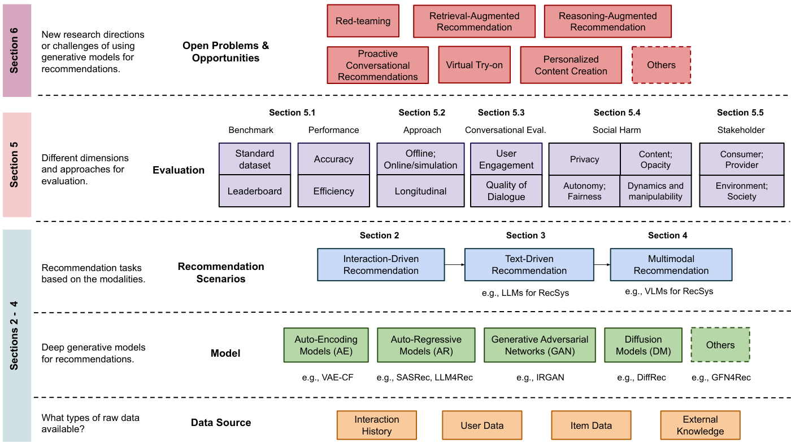

# Gen-RecSys综述：先分清生成对象，再选择模型与评估

“用了生成模型”不能说明系统最终怎样推荐。模型可能重建用户交互向量、采样训练负例、生成物品码，也可能只写解释或合成试穿图。本文的价值是把这些用途放到同一张地图上：按交互数据、自然语言与多模态组织方法，再讨论离线效果、线上长期表现、对话质量和社会影响。它是教程配套综述，没有提出统一新算法或报告自己的模型对比实验。

固定版本为Yashar Deldjoo等十位作者的 *A Review of Modern Recommender Systems Using Generative Models (Gen-RecSys)*，arXiv:2404.00579v2，2024-07-04；KDD 2024，DOI 10.1145/3637528.3671474。以下分类反映这一版本的覆盖，不是截至2026年的完整综述。文中的其他论文只在本库另有精读时作为独立依据。

## 数据模态、训练来源与系统角色是不同坐标

作者原图 1，Yashar Deldjoo 等，arXiv:2404.00579v2，LaTeX 附图转 PNG。从底部数据源向上读，同一种输入可以供给多类生成模型，最上层的任务和评估也没有与模型家族一一绑定。[原文第 2 页](https://arxiv.org/pdf/2404.00579v2#page=2)

图1从下向上排列数据源、模型范式、推荐场景、评估与开放方向。正文§1还区分直接训练与利用预训练：VAE-CF可直接从交互学习，LLM则可利用域外文本知识，通过零/少样本提示、微调、RAG或特征提取接入推荐。两类并不等于传统/现代，也不等于小模型/大模型。

按模态分类方便梳理输入，但不足以决定执行链路。同一文本编码器可以给向量检索提供物品Embedding，也可以给语义码量化提供输入；同一自回归骨干可以输出评分、解释或物品列表。阅读时还需补上输出对象、候选空间和部署接口这三个坐标。[§1、图1与表1，第1–3页](https://arxiv.org/pdf/2404.00579v2#page=2)。

以读者刚点击一篇地铁开通新闻为例。现有推荐器用点击历史表示兴趣，对候选新闻打分并取前几项。它能选中一篇报道，却只能展示编辑为所有读者写的同一标题。若新报道没有交互，纯 ID 召回还缺少可用的行为表示。

引入生成模型有三种不同接口。用报道正文提取交通线路属性，交回现有推荐器，可以补特征。把历史中的新闻写成离散码，以实际下一点击码监督生成，再查目录，可以改变候选产生。把已选报道交给标题生成器，让通勤读者先看到开通日期，可以改变展示。刊期、线路和日期均以正文为准。前两步关注真实留出和最终候选命中，第三步同时看事实、个性化及阅读结果。下文把这三个位置放回综述的模型家族，具体标题监督见[PENS](../SRC-PENS/阅读笔记.md)。

## 只有交互数据，也可以做生成式推荐

§2按生成机制组织交互推荐。去噪自编码器从损坏输入恢复原交互；BERT4Rec的掩码物品恢复也被放入广义去噪。VAE用随机潜变量建模偏好，CVAE则可条件生成整张列表。自回归模型逐步学习$p(x_i\mid x_{<i})$，RNN和自注意力都能实现；这个概率分解与是否使用自然语言无关。

GAN的生成器与判别器对抗学习，但其在推荐中的作用并不固定：IRGAN式负例选择、交互合成增强，以及页面生成是不同接口。扩散同样可用于预测未来交互或增强训练序列。若只按GAN/扩散命名，就会把训练数据生成与服务时推荐混在一起。原文还列出normalizing flow、generative flow network和neural process等线索，本轮没有独立核实这些引用工作的机制与指标。[§2，第3–4页](https://arxiv.org/pdf/2404.00579v2#page=3)。

本库已有的[DiffRec精读](../SRC-DIFFREC/阅读笔记.md)能提供更具体证据：推理从历史的加噪状态恢复连续全目录分数，未逐物品生成标题或SID。[SASRec精读](../SRC-SASREC/阅读笔记.md)则解释因果注意力的下一物品预测。二者都能利用交互数据，训练目标与推理输出却不同，综述的同级分类不能替代这些实现差异。

## 语言模型接入推荐的两个方向

§3.1区分双编码与交叉编码。稠密检索分别编码查询和物品，可预建物品索引；cross-encoder联合编码用户偏好与候选文本，允许细粒度交互，却要为候选重复计算，更适合较小候选集或重排。两者都可能使用LLM，但此时LLM未必在生成推荐结果。

§3.2把任务描述和数据写成提示，输出标题/ID、评分或解释。零/少样本利用预训练知识，微调把领域交互写入参数，软提示则训练连续提示向量。综述转述：现成LLM在充足监督数据下通常弱于协同过滤，而在近冷启动条件可有竞争力；这里没有统一数据、候选和算力下的定量比较，不能当普遍排序。

§3.3与§3.4的方向相反：

| 接口 | 谁给谁提供输入 | 最终职责与代价 |
|---|---|---|
| 检索增强推荐 | 检索器/推荐器给LLM提供候选、评论或用户记忆 | LLM重排、解释或回答；内容可外部更新，但仍受检索覆盖和上下文成本影响 |
| LLM特征提取 | LLM给推荐器提供Embedding、语义码或生成查询 | 下游模型承担检索/排序；需验证表征是否包含行为相关信息 |
| 直接生成推荐 | 历史与任务提示输入LLM，输出物品标题/ID | 需完成合法映射、候选协议和解码，流畅文本本身不保证可执行 |

原文将RAG概括为方便更新、减少幻觉和参数需求。这是引用文献支持的设计动机，不是本文实测，也不保证任意检索质量下都成立。知识外置没有消除过时文档、缺失候选与生成错误。[§3，第4–6页](https://arxiv.org/pdf/2404.00579v2#page=4)。

本库[P5](../SRC-P5/阅读笔记.md)具体展示统一语言任务接口；[TIGER](../SRC-TIGER/阅读笔记.md)先提取内容、量化为码，再训练历史到SID；[LIGER](../SRC-LIGER/阅读笔记.md)则生成候选后补入冷池并连续排序。后两者不是“检索文本作为提示再生成解释”的同一类RAG。对话推荐又增加多轮偏好获取、对话控制和工具调用，不能只以一次top-k命中概括全部质量。

## 多模态需要互补信息，不只是让两种向量接近

§4的关键困难是共享信息与互补信息的取舍。图片可表达外观，文字还能表达非视觉属性；仅把两者映射得接近，未必保留价格约束、材质或用户上下文。原文以CLIP的图文对称对比目标、ALBEF的对齐后融合，以及VAE/扩散/MLLM说明可选组件。图像加文字修改、虚拟试穿和房间内家具搭配，分别需要跨模态条件理解与可视输出，不能从单模态检索数字直接推断。

这里没有多模态推荐统一实验。“多模态生成将成为标准”属于作者预测。§4.4把ContrastVAE描述为模态对齐案例，并把Stable Diffusion的预训练自编码器称为“UNet autoencoder”；这些简略转述尚未回查原论文，不能作为图文推荐机制或网络结构的独立依据，已保留在审核台。译文保留原说法，不悄悄更正。[§4，第6–7页](https://arxiv.org/pdf/2404.00579v2#page=6)。

## 输出质量、用户收益与系统代价分别评估

§5把评估分为离线、在线长期、对话、社会影响和整体评估。物品选择仍可看Recall/NDCG，评分预测看RMSE/MAE；解释与摘要可借BLEU/ROUGE，语言建模可看perplexity。但词面相似不证明解释真实，也不证明推荐符合偏好。对话还需任务完成与多样性，LLM评委或用户仿真不能自动替代真实用户与人工评估。

离线改进不能替代线上A/B，短期参与也不能替代长期满意、收入或伤害。论文强调平台、用户及其他利益方的目标可能不同。公平、隐私、可操纵性和环境成本是额外维度，而非把几个指标加总即可得到的统一分数。计算效率需要同时计训练和推理；本文只提出评估要求，未报告延迟、吞吐、成本或资源对齐实验。[§5–6，第7–8页](https://arxiv.org/pdf/2404.00579v2#page=7)。

因此这篇综述适合确定“缺哪一种评估”，不适合据此宣称某个模型优于另一个。进一步比较应回到相同任务、输入信息、时间切分、候选与算力预算。按问题继续读[生成对象与评估目标](../../知识库/问题/生成式推荐怎样选择输出对象与评估目标.md)，按模块回到[生成机制](../../知识库/模块/生成机制与约束解码.md)与[评估](../../知识库/模块/评估、偏差与因果收益.md)。

## 原文与中文阅读材料

采用 arXiv:2404.00579v2，重读摘要、正文 §1–6、图 1 与表 1，无附录。参考文献用于回查线索。中文译文覆盖摘要、正文、描述性脚注和图表标题，保留图内英文与参考文献。正式中文 PDF 为 20261027.1，共 10 页，含署名许可页。原文和正式译文已备份并通过认证下载核验。[固定原文](https://arxiv.org/pdf/2404.00579v2) · [私有备份下载说明](../../文档/工具/中文PDF发布.md)

本地正式 PDF 为 `.local/papers/SRC-GENRECSYS-REVIEW/translation/GenRecSys_中文翻译.pdf`，工作 Markdown 为同目录 `GenRecSys_中文翻译.md`，可编辑主文件为 `translated-sources/main.tex`。译文许可与范围见[PDF目录](../../译文/PDF目录.md)。
