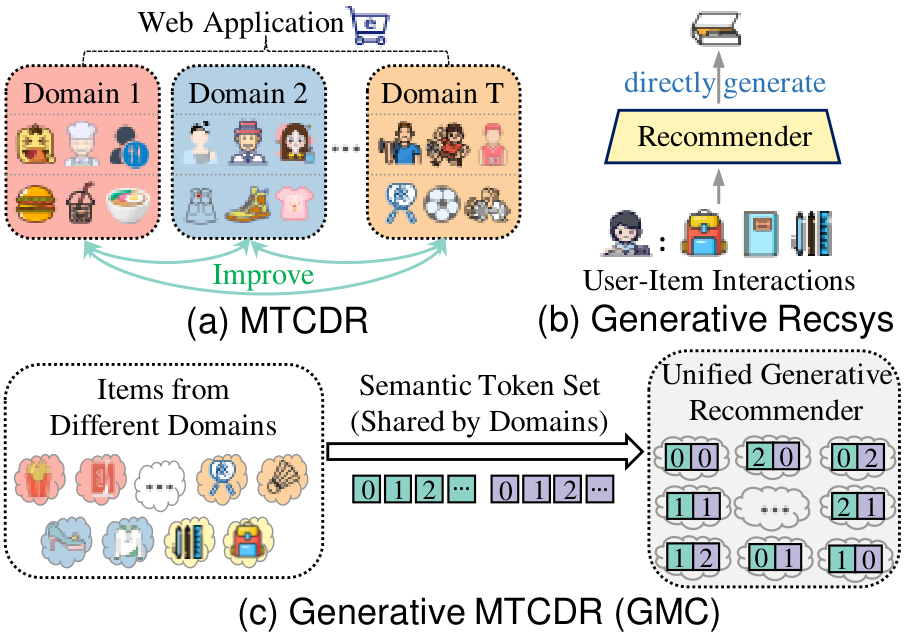
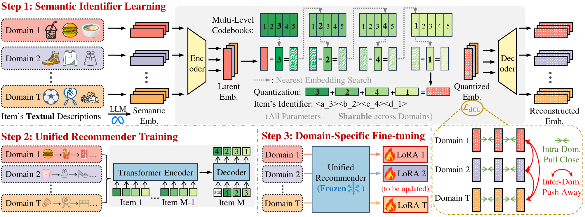
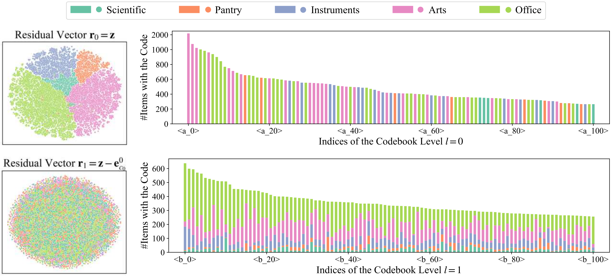
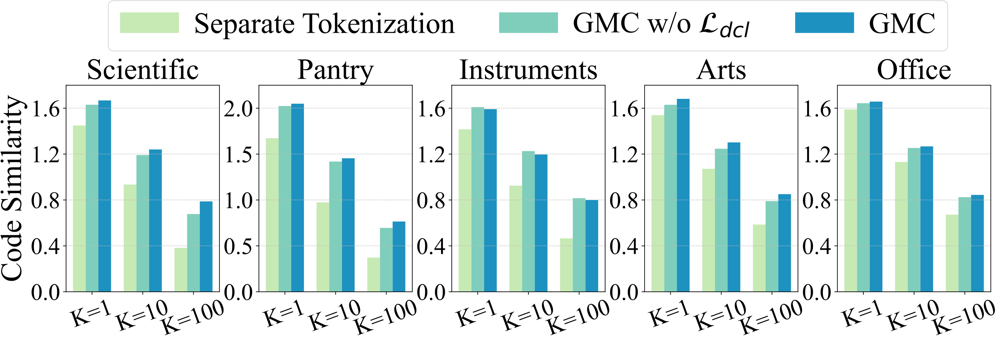
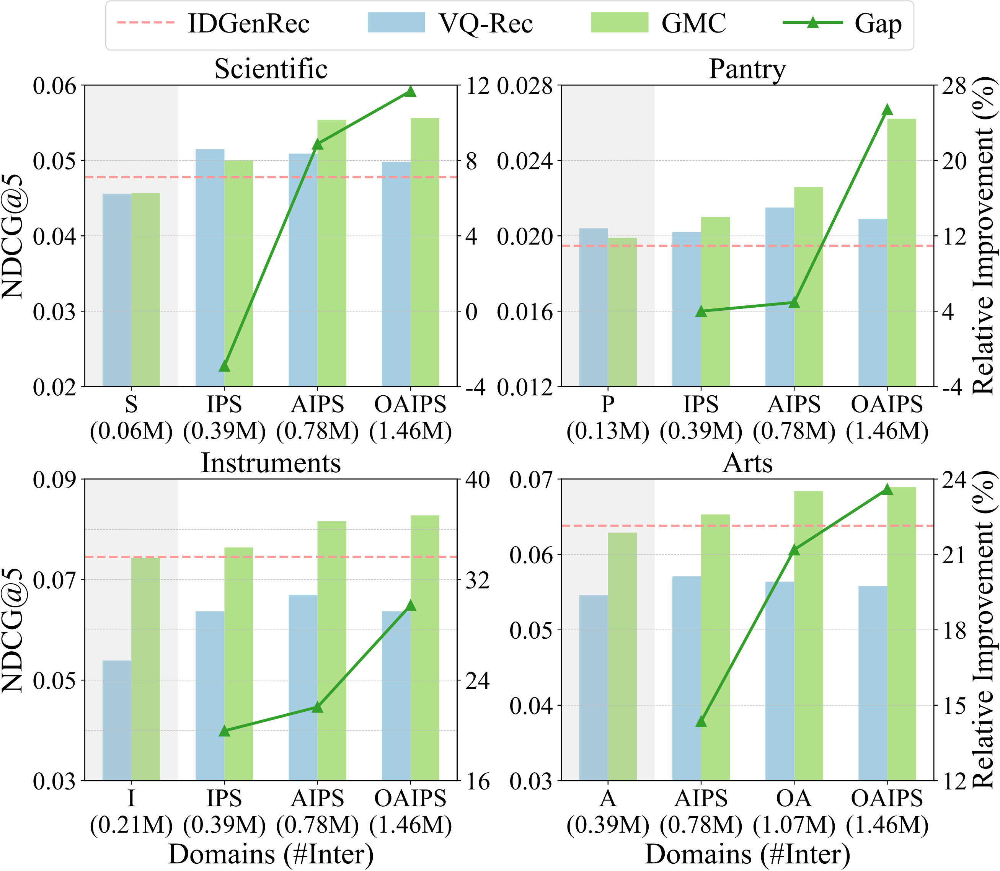

# GMC：让独立域序列共享生成器和物品码

假设 Arts 的用户买过滤纸、手冲壶，Office 的另一位用户买过保温杯、手账本。用商品 ID 分域训练，两个模型各自看到一段序列，而保温杯和手冲壶之间的内容联系没有进入共同词表。GMC 用一套分层语义码表示各域商品，再混合各域的域内序列训练下一物品生成器。部署时选择目标域的 LoRA 和物品目录。这样可以借用别域的序列规律，即使两段历史无从归到同一身份。[原文 §3.1–3.2，第 3 页](https://arxiv.org/pdf/2507.12871v1#page=3)

*图 1 · 左上展示多目标跨域任务，下方用推荐生成与集中训练的接口解释共享语义码。 Jinqiu Jin 等，GMC arXiv 2507.12871v1 第 1 页，采用版 LaTeX 附图。*

## 共享码字给物品建立内容联系

*图 2 · 从内容编码和残差量化进入全域训练，最后分配逐域 LoRA。 Jinqiu Jin 等，GMC arXiv 2507.12871v1 第 4 页，采用版 LaTeX 附图。*

Llama 3.1 8B Instruct 将标题、品牌和类目编码为 4096 维向量，RQ-VAE 的 MLP 压成 32 维，再从四级码本逐层选取距当前残差最近的码字，每级 256 个中心。滤纸和保温杯可以在某一级选到同一个符号，后续位置保留差异。共享发生在码字和模型参数层面。各域的单条训练样本仍是本域历史及其下一个物品。[原文 §3.3、§5.1.4，第 4、6 页](https://arxiv.org/pdf/2507.12871v1#page=4)

训练分词器时，重建损失保留原始内容嵌入的信息，量化损失让表示和所选中心相互靠近。GMC 再用域标签增加一个监督项。对批内第 $i$ 件物品，令 $z_i$ 为各级选中码字的向量和，$t_i$ 为所属域，优化

$$
-\log \frac{\sum_{j:t_j=t_i}\exp(z_i^\top z_j)}{\sum_j\exp(z_i^\top z_j)}.
$$

按原文式 (6) 的求和范围，$j=i$ 在分子和分母中。训练提高同域量化表示的相对相似度，期望保留域内共性，同时各域仍从同四套码本取码。图 3–4 用不同层的码分布和相似度观察这两个方向，无法从损失直接推出对齐了跨域行为偏好。[原文 §3.3 与 §5.3–5.4，第 4、8–9 页](https://arxiv.org/pdf/2507.12871v1#page=4)

## 汇集域内样本，生成时切回本域目录

把 Arts 历史中的滤纸和手冲壶依序替换成码，下一件手磨的四级码是监督。共享 T5 的编码器读取历史码，解码器在每一步根据历史和目标码前缀预测下一码。Office 样本以同样的方式训练，共用 T5 和物品码词表。此处需要集中获得各域的训练序列，不使用跨域用户 ID 连接样本。

先混训骨干，再冻结骨干，逐域只用本域样本更新注意力 LoRA。Arts 请求选择 Arts LoRA，搜索 Arts 前缀树。束搜索每步在合法子码中扩展候选，最终从码映射回本域商品。原文式 (10) 写单步 argmax，实验报告束宽 20。完整码唯一性、碰撞时叶内映射和目录刷新需在实现中单独确认。[原文 §3.4–3.5，第 4–5 页](https://arxiv.org/pdf/2507.12871v1#page=4)

## 五域对照的可比条件

*图 3 · 图中用量化前残差及选中的码观察域感知对比学习对分布的影响。 Jinqiu Jin 等，GMC arXiv 2507.12871v1 第 8 页，采用版 LaTeX 附图。*

*图 4 · 比较不同近邻数 $K$ 和分词策略下的物品码相似度。 Jinqiu Jin 等，GMC arXiv 2507.12871v1 第 9 页，采用版 LaTeX 附图。*

*图 5 · 改变加入联合训练的数据域，观察目标域效果。 Jinqiu Jin 等，GMC arXiv 2507.12871v1 第 9 页，采用版 LaTeX 附图。*

作者以 Scientific、Pantry、Instruments、Arts 和 Office 为五个目标域，去掉缺标题的物品，应用 5-core，历史最长 20。各用户最后一次交互用于测试，倒数第二次用于验证，并在整套物品池上评估 Recall 与 NDCG。UniSRec、VQ-Rec 和 RecFormer 的预训练改为使用本实验五个域，而非照搬各自论文的额外源域。第 4 节表 1 对不同方案的资料需求作比较，第 5 节表 3 的数值仍须在这套改造后的协议下阅读。[原文 §4–5，第 5–7 页](https://arxiv.org/pdf/2507.12871v1#page=5)

### 哪一级的码真正跨域共享

假设第一层给 Arts 和 Office 选的中心分别更接近手工材料和办公用品。把这些中心从原始表示扣掉后，残差可能仍保留「便携、耐热」等两个域都有的信号。原文图 3 的可视化与此过程一致。第一级的域分组较明显，第二级残差和码字有更多跨域混合。图 4 用原文本嵌入选出输入近邻，再看它们的码有多相似。这两张图说明词表共享如何落到实际分码上，单凭 t-SNE 或码字重合无法判断用户偏好是否已经对齐。[原文 §5.4.1–5.4.2，第 8–9 页](https://arxiv.org/pdf/2507.12871v1#page=8)

### 全目录 NDCG 提升与逐域 Recall 并存

表 3 中，Pantry 的 NDCG@5 为 0.0262，高于该列最强基线 UniSRec 的 0.0218，表列相对提升 25.41%。同一域的 Recall@10 为 0.0656，低于 VQ-Rec 的 0.0667。Scientific 和 Arts 也有 Recall 指标逊于最强基线。表中的总体行按各域用户数加权，Office 样本量约为 Scientific 的十倍。读总体行时还需看各域及指标，不能把改善解释为每个域或每项指标均领先。[原文表 3，第 7 页](https://arxiv.org/pdf/2507.12871v1#page=7)

表 4 中 Pantry 的 Recall@5 由分别训练码本的 0.0316，或分别训练推荐器的 0.0283，升到完整方案的 0.0422。两项消融改变的共享接口不同，支持在该设置下把共享码本与共享骨干配对。全量微调的 Office Recall@5 则从 LoRA 的 0.1063 到 0.1074，NDCG@5 从 0.0912 到 0.0923。保留域小且训练预算有限时，逐域 LoRA 具有参数效率优势，不能据此断言全量微调在任何域都较差。作者称 0.17M 为 4.3M 的 3.7%，用显示值相除约为 3.95%；采用报告的绝对参数量并保留比例差异。[原文 §5.3、表 4，第 7–8 页](https://arxiv.org/pdf/2507.12871v1#page=8)

[多场景共享问题](../../知识库/问题/多场景怎样共享模型又保留差异.md#共享域内训练样本与合并同人历史是两种操作)比较同样的序列在 GMC、GenCDR 和 FedCGR 下可传播的信息。

## 采用版与译文

采用 Jinqiu Jin 等的 arXiv:2507.12871v1。正文、作者图和实验按该版本定位。已译摘要、正文 §1–6、图表标题及说明性脚注。原图英文及参考文献保留；9 页正文中文 PDF 已逐页检查，采用版原文与译文均完成私有备份并通过认证下载及完整 SHA-256 校验。[固定原文](https://arxiv.org/pdf/2507.12871v1)

[中文 PDF 私有访问说明](../../文档/工具/中文PDF发布.md) · [译文范围与许可](../../译文/PDF目录.md)。可编辑工程及本地 PDF 位于 \`.local/papers/SRC-GMC/translation/\`，附件不随 Git 分发。
