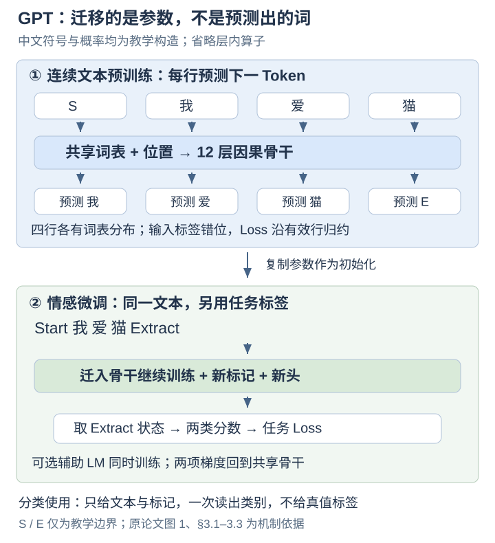
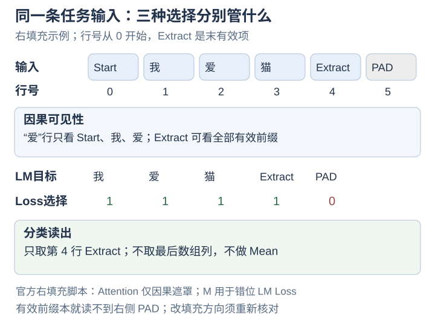

# GPT初代：先学习连续文本，再把表示迁移到判别式任务

[原文PDF](https://cdn.openai.com/research-covers/language-unsupervised/language_understanding_paper.pdf) · [中文PDF位置](#原文译文与实际范围) · [私有备份下载说明](../../文档/工具/中文PDF发布.md#登录下载) · [学习思考](学习思考.md) · [官方实现解读](../SRC-GPT1-CODE/阅读笔记.md)

阅读顺序：[网络与训练起点](#预训练改变参数的起点微调改变参数的用途) → [逐位置预测](#从一段文本到所有位置的下一token预测) → [任务头与Extract](#最后位置读完输入线性头预测任务标签) → [任务输入](#用输入变换适配任务而非为每种关系重建架构) → [实验与消融](#消融支持预训练但不证明辅助目标普遍有效)。

原理补充：[词表预测与梯度](../../知识库/概念/语言模型的词表预测与交叉熵.md) · [Extract与Pooling](../../知识库/概念/Token表示怎样汇聚成序列表示.md) · [Attention与填充遮罩](../../知识库/概念/Attention遮罩与填充.md)。

如果每个语言理解任务都从少量标注训练自己的网络，模型既要学习语言结构，又要学习任务规则。GPT初代把这两件事分开：在大量连续文本上学习下一Token预测，再用任务标签微调整个网络。它的重要贡献是证明同一Transformer骨干可以成为多种任务的良好初始化；“生成式”描述的是预训练目标，下游主要通过分类头作判别，并不要求把每个答案都生成成文本。

论文为Alec Radford、Karthik Narasimhan、Tim Salimans、Ilya Sutskever的 *Improving Language Understanding by Generative Pre-Training*，采用OpenAI官方2018年12页PDF，无arXiv版本号。以下实验均为作者报告，未运行模型。

## 预训练改变参数的起点，微调改变参数的用途

只迁移词向量，主要提供词级统计；把冻结语言模型状态作为特征，则需要下游另建专用模型。GPT迁移的是包含Embedding与多层上下文变换的整个网络，并让目标任务继续更新这些参数。这里的“任务无关模型”指共享架构和预训练起点，各任务通常分别微调得到自己的参数，不是一个同时服务所有任务的最终检查点。[§1–3，原PDF第1–3页](https://cdn.openai.com/research-covers/language-unsupervised/language_understanding_paper.pdf#page=3)。

先用“我爱猫”比较几种训练起点。从零训练情感分类器时，Token嵌入、上下文网络和分类边界都要从有限的正/负标签学习；只迁移词向量，带过来的是词级表示，上下文组合仍要另学；冻结预训练网络作特征，带来的是已学上下文，但任务误差不能再调整它。GPT的方案是在连续文本上先训练整个因果网络，再复制这套参数作为情感任务的起点，让任务标签继续修改它。这里列的是接口差别；并未在这个教学句子上实际训练或比较这些方案，也不把前两种都归为无效。[§1–3，第1–3页](https://cdn.openai.com/research-covers/language-unsupervised/language_understanding_paper.pdf#page=3)。

同一文本将走过两条不同监督：预训练把它当连续文本的一部分，预测下一个Token；微调把它当带“正向”标签的样本，读取末尾提取位置作分类。后者不是把预训练预测出来的Token再喂给分类器，而是迁移预测过程学到的参数。下面的中文Token、短句和低维向量均为教学构造，不是BooksCorpus原样本、真实BPE切分或训练输出。

从图上半部四个预测读到下半部一个分类结果：竖向箭头传递的是训练后的参数初始化，不是生成词串。下半部仍有整条序列的状态，只将Extract送分类头；辅助LM可以从其他行另外计损失。图省略头内计算和填充，S/E仅为教学符号。

令$u_i$是文本Token、$k$是上下文窗口，预训练最大化：

$$L_{\mathrm{LM}}(U)=\sum_i\log p_\theta(u_i\mid u_{i-k},\ldots,u_{i-1}).$$

所有预测目标可以在训练中并行计算。若以待预测Token索引，它只读取此前Token；若以已经错位的输入索引，因果遮罩允许读取当前输入位置及其左侧。预测下一Token迫使网络从前缀提取局部语法和较长语境；这提供学习长依赖的机会，并不保证每个依赖都学到，也不说明自回归推理能同时生成所有位置。

骨干是12层decoder-only Transformer：隐藏维768、12头、前馈中间维3072、GELU、学习式位置Embedding，Token输入Embedding与语言模型输出投影共享。它移除了原始[Transformer](../SRC-TRANSFORMER/阅读笔记.md)的双向编码器与编码器—解码器交叉注意力，保留因果自注意力。图1的残差后LayerNorm与现代部分Pre-LN变体要区分，不能把GPT初代当成LLaMA的完整架构说明。[§3.1式(1)–(2)、§4.1与图1，第3–5页](https://cdn.openai.com/research-covers/language-unsupervised/language_understanding_paper.pdf#page=4)。

原式(2)写$h_l=\operatorname{transformer\_block}(h_{l-1}),\forall i\in[1,n]$，层下标$l/i$不一致，且$n$复用于语料长度和层数。上面用$\theta$和文字区分含义；译文保留原式并加注。

### 因果骨干为什么足以完成语言建模

预训练目标是$p(x_t\mid x_{<t})$，条件本来就是同一文本的前缀。因果自注意力可直接聚合这个条件，不需要另编码一条源句供Cross-Attention读取。Encoder—Decoder的交叉注意力服务“给定源序列生成目标序列”，去掉它是任务接口的改变，并非证明它无用；Decoder-only也不是语言建模唯一可选结构。

忽略Dropout，一层GPT Block可写为

$$a=LN_1(h+MHA_{causal}(h)),\qquad h'=LN_2(a+W_2 GELU(W_1a+b_1)+b_2).$$

此式按逐位置列向量书写FFN；整段张量实现可用右乘权重的等价约定。它是Post-LN：先子层、残差相加，再LN。学习输入为Token嵌入加位置嵌入；原Transformer默认的正弦位置改成学习表，FFN激活改为GELU。GELU的定义为$x\Phi(x)$，$\Phi$为标准正态分布函数；官方代码采用tanh近似，逐元素平滑调节输入，而非ReLU的硬截断。[论文图1与§4.1，第4–5页](https://cdn.openai.com/research-covers/language-unsupervised/language_understanding_paper.pdf#page=5)；[固定代码的block与gelu](../SRC-GPT1-CODE/阅读笔记.md#post-ln与gelu的实际顺序)。

学习位置表能为训练范围内各位置学习独立向量；GELU提供另一种非线性。原文只报告采用这些配置，未分别证明它们优于正弦位置或ReLU。机制可以解释它们怎样工作，不能补写成作者实测的选择原因。学习表的未训练位置与长度边界见[位置编码](../../知识库/概念/Transformer位置编码.md#学习位置表为什么不能直接保证长度外推)。

### 模型规模与参数量怎样核对

| 配置 | GPT初代 |
|---|---|
| Transformer层数 | 12 |
| 隐藏宽度／注意力头数／每头宽度 | 768／12／64 |
| FFN中间宽度 | 3072 |
| 预训练上下文长度 | 512 Token |
| 官方发布Token词表 | 40,478项；BPE合并次数为40,000 |
| 发布参数形状合计 | 116,534,784，约1.165亿 |

前四项架构设置据§4.1；词表行数和精确参数量由[固定官方文件](../SRC-GPT1-CODE/阅读笔记.md#发布参数形状怎样计数)核算。12个含偏置和LN的Block各$12d^2+13d$参数，再加$40478d+512d$两张表，取$d=768$得到上述总数。下游新增Token和任务头另计；不能以不同表/头约定的近似“117M”反推精确参数。

## 从一段文本到所有位置的下一Token预测

取教学数组 $[S,我,爱,猫,E]$，$S/E$仅在本例表示起始/结束，不能据此断言原始BooksCorpus预处理必定按句加入这两个标记。输入取前四项，监督取后四项；暂不加batch与填充：

| 行号 | 当前输入 | 因果前缀 | 此行状态负责预测 | 本次计LM损失 |
|---|---|---|---|---|
| 0 | S | S | 我 | 是 |
| 1 | 我 | S、我 | 爱 | 是 |
| 2 | 爱 | S、我、爱 | 猫 | 是 |
| 3 | 猫 | S、我、爱、猫 | E | 是 |

因果遮罩允许读取对角线，即当前**输入**；目标已经错位到下一项，因此这不等于看见标签。若第1行能读第2输入“爱”，它才会拿到自己的答案。训练时真实前缀全已知，四行能并行；生成时只有已有前缀，未知的新Token必须逐步产生。[§3.1、式(1)–(2)，第3页](https://cdn.openai.com/research-covers/language-unsupervised/language_understanding_paper.pdf#page=3)。

### 每位置状态怎样沿12层形成

输入第2行是 $h_2^0=E_{爱}+P_2$：$E$按Token ID查共享表，$P_2$查位置表。它起初还没有融合“我”。在每层的每个头，当前行投影成Q，合法前缀各行投影成K/V；Q与各K的点积除以 $\sqrt{64}=8$，只在S、我、爱这三列Softmax，再加权读取对应V。训练得到的权重不是人工标注“应该看谁”。12头输出拼接、投影，加残差后LayerNorm，再过GELU前馈和第二次残差/LN；下一层读取的是这些已更新的上一层状态。详细QKV数值可看[Transformer算例](../SRC-TRANSFORMER/阅读笔记.md#沿一次读取算出新的上下文向量)。

这里残差使旧状态与新结果有直接相加路径；LN按这一行的768个特征归一化，再作可学习缩放/偏移；FFN逐行把768维扩到3072维再压回，不在序列轴另作混合。它们是沿用模块，在GPT里接到同一因果任务。最终 $H^{12}\in\mathbb R^{4\times768}$，四行各有状态；不是把四个Token先压成一个向量，也不是每行只留一个概率。[图1、第4页；§4.1、第5页](https://cdn.openai.com/research-covers/language-unsupervised/language_understanding_paper.pdf#page=4)。

### 从一个状态算到词表概率和Loss

论文式(2)用 $Z=H^{12}E^\top$，$E\in\mathbb R^{V\times768}$；所以 $Z\in\mathbb R^{4\times V}$。每行的V个logit是未归一化分数，Softmax沿**词表**竞争；Attention的Softmax则沿**可见位置**竞争。二者的轴和作用不同。

为实际算一次，把宽度暂缩为2，词表仅取 $[S,我,爱,猫,E]$。构造 $h_2=(1,0)$，共享表五行依次为 $(0,0),(0,1),(\log2,0),(\log5,1),(0,-1)$，则

$$
z_2=h_2E^\top=[0,0,\log2,\log5,0],\qquad
p_2=\frac{[1,1,2,5,1]}{10}=[0.1,0.1,0.2,0.5,0.1].
$$

标签是“猫”的ID，等价one-hot $q_2=[0,0,0,1,0]$；它不是模型概率。此行损失 $\ell_2=-\log p_2(猫)=\log2\approx0.6931$。不是把logit或概率减去整数ID。若四行各自真值概率为 $[0.5,0.25,0.5,0.8]$，按有效目标平均的教学损失为

$$\mathcal L_{LM}=-\tfrac14(\log0.5+\log0.25+\log0.5+\log0.8)\approx0.7489.$$

这里仅第2行给出了全部分布，其他行只指定真值概率；这是解释归约的构造，不是一次真实模型前向。论文式(1)最大化对数似然的和，写成最小化Loss时需整体变号，和/平均还需按实现说明。稳定实现直接算 $-z_y+\operatorname{logsumexp}(z)$，不必先显式Softmax；把概率送进再次执行LogSoftmax的交叉熵接口会改变目标。完整推导见[交叉熵详解](../../知识库/概念/语言模型的词表预测与交叉熵.md#交叉熵为什么直接接收logits)。

### 只算某行Loss，梯度怎样回到前缀

对上述四行平均损失，第2行的logit梯度为

$$G_2=\frac{p_2-q_2}{4}=[0.025,0.025,0.05,-0.125,0.025].$$

这来自Softmax Jacobian与负对数损失的链式法则；不是直接拿概率减去标签ID。仅看第2行损失经输出投影的贡献，$\partial\mathcal L/\partial h_2=G_2E\approx(-0.1665,-0.125)$，对表的贡献为 $G_2^\top h_2$。真值和非真值行都可在输出侧更新；同一表还在输入侧被查用，两路贡献必须相加，不能更新两份互不相干的副本。

误差再沿12层的LN、残差、FFN和Attention向前传。对一头 $O=AV$，值路径有 $dV=A^\top dO$，权重路径经Softmax和 $QK^\top$ 回到Q/K；所以“爱”行的损失可以训练此前“我”的输入表示。各路径存在不保证每次非零，也不保证共享参数更新一步后每行真值logit都上升。通用Jacobian和共享表推导见[LM头反传](../../知识库/概念/语言模型的词表预测与交叉熵.md#梯度怎样穿过lm头和共享embedding)及[QKV反传](../../知识库/概念/语言模型的词表预测与交叉熵.md#attention中的qkv怎样接到反传)。

论文称预训练为“无监督”，强调不依赖人工任务标签；按监督信号构造方式，下一Token标签来自文本自身，今天通常称自监督。两种称呼描述不同侧面，并非两个训练阶段。它让参数学习有助于文本预测的结构，但迁移是否有效仍由下游实验检验。

## 最后位置读完输入，线性头预测任务标签

对分类样本$x=(x_1,\ldots,x_m)$，设最后一层最后位置的状态为$h_L^m$，新加线性头$W_y$：

$$p(y\mid x)=\operatorname{softmax}(h_L^mW_y),\qquad
L_{\mathrm{cls}}(C)=\sum_{(x,y)\in C}\log p(y\mid x).$$

最后位置能读到整条任务输入的前缀，因此适合提取分类表示。分类头、分隔符Embedding和整个预训练骨干一起训练；新增参数少，不等于只训练新增参数。[§3.2式(3)–(4)，第3页](https://cdn.openai.com/research-covers/language-unsupervised/language_understanding_paper.pdf#page=3)。

微调还可加入原语言模型目标：

$$\max_{\theta,W_y}\ L_{\mathrm{cls}}(C)+\lambda L_{\mathrm{LM}}(C),\qquad\lambda=0.5.$$

这里λ=0.5来自§4.1的微调设置。若实现写成待最小化的loss，需要整体取负号。辅助项让模型在拟合任务标签时继续保留语言预测压力，可能起正则化作用；是否有利要由具体任务验证，而非从式子直接推出。[§3.2式(5)，第3页](https://cdn.openai.com/research-covers/language-unsupervised/language_understanding_paper.pdf#page=3)。

### Extract是读出角色，不是额外网络层

图1中的Start、Delim、Extract分别表示序列开始、片段分隔与末尾提取标记。正文§3.3用$\langle s\rangle,\langle e\rangle$等记号，公开代码字面值则是`_start_`、`_delimiter_`、`_classify_`。这些标记对应新增可训练嵌入；Extract位置照常经过全部Transformer层，随后选出它的状态接线性头。

因果模型把提取Token放在末尾，使它有机会读取全部文本。这个状态能用于分类，是因为任务损失训练了从输入到读出位置再到标签的整个路径；它并非天生拥有完整句义。真实末Token也可作为读出点，但读出Token身份随文本变化。残差保留自身输入的依赖通路，并不保证自身词义占主导或不受改变。专用位置、真实末Token与BERT CLS的区别，见[序列表示](../../知识库/概念/Token表示怎样汇聚成序列表示.md#专用提取位置与最后真实token)。

### 同一句文本怎样微调成情感分类器

给“我爱猫”人工标注正向情感；用教学输入 $[Start,我,爱,猫,Extract,PAD]$，有效位为 $[1,1,1,1,1,0]$。这与预训练片段不是同一监督样本：预训练标签由文本自身按下一项错位构造，情感标签来自任务标注；Start与Extract在此承担论文图1的下游标记角色。

| 输出路径 | 读取哪些状态 | 输出形状（省略batch） | 真值来自哪里 |
|---|---|---|---|
| 情感分类 | 第4行Extract（零基） | $[2]$，负向/正向 | 人工情感标签 |
| 可选辅助LM | 第0–3行各预测后继 | $[4,V']$ | 我、爱、猫、Extract |

$V'$表示微调时包含新增标记的输出类别约定；这张表按论文Token表接口解释，不把它等同官方脚本合并位置行后的全表宽度。分类不用第5行PAD，也不直接取最后数组列；代码按特殊Token ID定位，细节见[固定实现](../SRC-GPT1-CODE/阅读笔记.md#分类token怎样定位)。

把Extract最终状态暂设 $c=(1,2)$，类别顺序为[负向,正向]，构造分类矩阵

$$W_y=\begin{bmatrix}0&1\\0&0\end{bmatrix},\quad z_{task}=cW_y=[0,1],\quad p_{task}\approx[0.2689,0.7311].$$

正向标签选第二类，$\mathcal L_{task}=-\log0.7311\approx0.3133$。这些类别是独立任务标签，不要求“正向”是LM词表里的某个Token；两类概率也不参与前面的五词Softmax。分类的状态梯度为 $(p_{task}-[0,1])W_y^\top\approx(-0.2689,0)$，它经Extract的因果读取路径回到前文与共享骨干。顶层只有Extract被这项任务直接读取，并不等于只训练Extract的Embedding。

若辅助LM开启，另构造此任务输入四个有效目标的概率恰为 $[0.5,0.25,0.5,0.8]$，其平均Loss也为0.7489。这个相同数值只是教学选值，不表示迁移前后模型预测不变。取论文$\lambda=0.5$并采用上述归约，得到

$$\mathcal L_{total}=\mathcal L_{task}+0.5\mathcal L_{LM}\approx0.3133+0.5\times0.7489=0.6877.$$

各序列先平均还是全batch有效Token一起平均，会改变不同长度样本的权重；相同0.5不能脱离归约比较。官方ROCStories脚本先对每候选序列的有效目标平均，再做batch平均；这里的二类情感例子解释论文一般接口，不冒称该脚本已实现情感任务。[论文式(3)–(5)，第3页](https://cdn.openai.com/research-covers/language-unsupervised/language_understanding_paper.pdf#page=3)；[代码损失归约](../SRC-GPT1-CODE/阅读笔记.md#错位标签与损失平均)。

### 三种遮罩和读出位置不能混用

图中先对齐输入行号与下一项标签，再读Loss选择：第3行“猫”预测Extract要计LM损失，第4行Extract预测PAD不计；但分类恰好读取第4行。这不是同一个mask的两种叫法。图未逐条画全部注意力连接，也没有指定一般实现必须使用的Key mask。

在这条右填充输入里，因果mask限制“我”不能读取后面的“爱”；若使用Key padding mask，它限制其他行不能把PAD当内容；LM Loss mask则按**目标**错位后为 $[1,1,1,1,0]$，不计Extract预测PAD的项。把输入mask原样切前五项会误将这项计入，所以要看目标切片。分类的读出选择又是单独操作：选Extract的索引4，不把所有有效行平均。

固定官方脚本实际上只有因果Attention mask，$M$用于LM Loss；由于所有PAD都在有效输入右侧，有效前缀本就读不到它们。这是该构造下成立的实现选择，不是所有GPT必须另外加Key mask。改为左填充或内部空洞，需要重新检查注意力和位置编号；不能仅令PAD词向量为0就忽略它的位置向量、偏置及归一化。[固定实现的右填充](../SRC-GPT1-CODE/阅读笔记.md#错位标签与损失平均)。

若用Mean Pooling替代Extract，必须先定义选择集。例如只取“我、爱、猫”三行，就排除Start、Extract、PAD，再除以3；这时平均的是看过不同前缀的三个状态，不能让“我”行倒过来看见“猫”。Last只向被读出顶层行给直接梯度，Mean向三行各给 $g/3$，但Last也可经较低层Attention训练前文。Mean可能保留不同状态的信息，也可能稀释关键特征；它并未增加因果末位不可读取的原始输入。GPT原文没有用这项替换做隔离对照，不能据机制断言哪种必优。通用比较、Attention Pooling和BERT CLS见[序列读出详解](../../知识库/概念/Token表示怎样汇聚成序列表示.md#last与mean究竟改变了什么)。

### 分类推理和续写推理分别做什么

部署这一个情感任务时，保留微调后的Token/位置表、12层骨干、新标记和分类头。请求“我爱猫”按同样规则加入Extract，关闭训练Dropout，取它的状态一次输出两类分数；不输入真实情感标签，不从头再做预训练，也不必调用LM头或解码出“正向”两个字。新的情感任务或另一个数据集通常从预训练初始化另行微调，不能假定共享这份最终参数。

若目的是续写，则保留LM输出接口，根据真实已有前缀最后一行预测下一Token，再把选出的Token追加到输入，反复生成。它与分类模型的一次标签读出不同；微调后LM是否仍适合通用生成也需验证。论文主要结论是前缀语言建模能提供有用的迁移起点，并非现代指令跟随或聊天能力报告。

### 同一个骨干为什么接两种输出头

LM头$W_{LM}\in\mathbb R^{d\times V}$区分词表项，分类头$W_y\in\mathbb R^{d\times C}$区分任务类别；类别不一定是词表Token。两者共享骨干，输出空间不同。微调从预训练参数初始化，每个任务再更新整套骨干、新标记与任务头；它不是默认冻结骨干，也不是所有任务共用一个最终检查点。辅助LM启用时，共享参数的梯度为

$$\nabla_\theta\mathcal L_{total}=\nabla_\theta\mathcal L_{task}+\lambda\nabla_\theta\mathcal L_{LM}.$$

新增分类头只直接服务任务损失，LM输出共享表同时还参与输入路径。作者在§3.2提出辅助LM可帮助泛化和收敛；表5说明收益依任务而异。实现时应同时说明两个loss的求和/平均方式，再解释$\lambda=0.5$的尺度。[迁移方式比较](../../知识库/问题/预训练怎样迁移到不同任务.md#输入适配输出头与联合训练不是同一件事)。

## 用输入变换适配任务，而非为每种关系重建架构

模型原本只接受连续Token。GPT用开始/结束标记和分隔符，把有结构的任务整理成它能处理的序列：

| 任务 | 编码与输出 |
|---|---|
| 分类 | 开始标记、文本、结束提取位置，最后状态接分类头 |
| 蕴含 | 前提、分隔符、假设按顺序拼接，预测蕴含/矛盾等标签 |
| 相似性 | 分别编码“句A→句B”和“句B→句A”，两个末状态逐元素相加后分类 |
| 多选问答/故事补全 | 每个候选分别编码“文档、问题、分隔符、候选答案”，候选分数跨候选Softmax |

例如把A设为“我爱猫”、B设为“我喜欢猫”：相似性分两次编码Start A Delim B Extract与Start B Delim A Extract，再组合表示，标签是句对关系。若改成多选补全，“我最喜欢的动物是”分别接候选“猫”“石头”，则对两条完整候选序列各给一个标量；假设分数为[1,0]，跨候选Softmax为[0.7311,0.2689]。这里归一化的是候选答案，不是句子位置，也不是词表；候选可以含多个Token。这些文本与分数是教学构造。

相似性不是把两种句序塞进一条更长序列；多选也不是让模型自由生成答案。假设有四个候选，通常需要四条候选相关序列的前向计算。共享架构减少了任务定制，却未消除候选数和输入长度的计算成本。[§3.3、图1，第4页](https://cdn.openai.com/research-covers/language-unsupervised/language_understanding_paper.pdf#page=4)。

### 为什么相似性需要交换句序

单次编码`Start A Delim B Extract`时，B的状态可使用A的信息，A的状态不能使用B；AB与BA的词、位置及上下文条件不同，一般$g(A,B)\ne g(B,A)$。对称相似性任务把两个方向独立编码后相加：

$$z(A,B)=g(A,B)+g(B,A)=z(B,A).$$

相同参数和确定性推理下，这个组合对交换输入对称；它不是把因果骨干改为双向注意力，训练Dropout的两次随机采样也不保证逐次完全相同。蕴含关系通常有方向，“A蕴含B”不等于“B蕴含A”，因而保留前提→假设的顺序。相似性双序与多选逐候选输入均来自§3.3，不是通用地把所有任务输入翻倍。[图1与§3.3，第4页](https://cdn.openai.com/research-covers/language-unsupervised/language_understanding_paper.pdf#page=4)。

## 连续语料、训练预算与结果的适用范围

预训练用BooksCorpus，超过7000本未出版图书，保留长段连续文本；作者将其与句子打乱的1B Word Benchmark作对照讨论。这是数据设计动机，并没有完整隔离语料内容、顺序与规模的因果消融。正文给出困惑度18.4，但“该语料”的指代及评估切分说明不充分，不用这一数字补造跨语料结论。[§4.1，第4–5页](https://cdn.openai.com/research-covers/language-unsupervised/language_understanding_paper.pdf#page=5)。

训练为100epoch，batch64条连续512 Token，BPE进行40000次合并（不是直接声明词表40000项）。Adam峰值学习率$2.5\times10^{-4}$，2000步warmup后余弦衰减，Embedding/注意力/残差Dropout均0.1，改进L2权重0.01排除bias/gain。大多数任务微调3epoch、batch32、学习率$6.25\times10^{-5}$、前0.2%步warmup后线性衰减。没有完整硬件、训练时长与服务延迟报告，不能用层数直接换算成本。[§4.1，第5页](https://cdn.openai.com/research-covers/language-unsupervised/language_understanding_paper.pdf#page=5)。

作者评估12套数据，报告其中9套达到当时最佳。代表性结果：

| 任务与指标 | 本文 | 表中相关对照 | 可支持的结论 |
|---|---:|---:|---|
| Story Cloze准确率 | 86.5 | Hidden Coherence 77.6 | 两选项故事补全提升8.9个百分点 |
| RACE总体准确率 | 59.0 | BiAttention MRU九模型集成53.3 | 多选阅读理解提升5.7个百分点 |
| MNLI-m/mm准确率 | 82.1/81.4 | SAN三模型集成80.6/80.1 | 匹配/不匹配测试各有提升，不能合成同一个数字 |
| RTE准确率 | 56.0 | 多任务BiLSTM+Attn 61.7 | 本文并非所有任务更好 |
| GLUE总体分 | 72.8 | 多任务BiLSTM+ELMo+Attn 68.9 | 按表值相差3.9分 |

依据[表2–4，原PDF第6–7页](https://cdn.openai.com/research-covers/language-unsupervised/language_understanding_paper.pdf#page=6)。MRPC的82.3也低于TF-KLD86.0，SST-2的91.3低于Sparse byte mLSTM93.2。引言称GLUE“绝对提升5.5%”与表中差值不一致；保留原话与表值，不混淆绝对分差和相对比例。

### 迁移更多层是在检验什么

如果收益只来自词嵌入，把Embedding迁移过去就应足够。图2左侧改变从语言模型迁入下游的层数，比较MultiNLI与RACE的训练/开发准确率；作者用它检验预训练的高层变换是否也带来可迁移功能。曲线总体随迁移增加而改善，但存在局部波动，图上左右纵轴分别属于RACE和MultiNLI。

这支持迁移收益不局限于静态词表，并不等同“把下游模型只保留k层”，也不表示每加一层都严格提升。固定代码的`n_transfer`控制载入参数范围，骨干循环仍按`n_layer`执行。正文对其他未迁移层等完整实验细节披露有限，不能据图补造统一设置。[§5与图2，第7页](https://cdn.openai.com/research-covers/language-unsupervised/language_understanding_paper.pdf#page=7)；[参数载入代码](../SRC-GPT1-CODE/阅读笔记.md#迁移层数不等于骨干深度)。

## 消融支持预训练，但不证明辅助目标普遍有效

表5对8项结果作不加权平均，其中混合准确率、F1、Matthews/Pearson相关系数；这一均值不能等同GLUE正式总体分。完整Transformer为74.7，不预训练为59.9，差14.8分；原文写“14.8%下降”，若以74.7为分母，相对下降约19.8%。预训练在该表全部任务均有帮助，是本文最直接的迁移证据。

去掉辅助LM平均75.0，反而略高于完整模型74.7：CoLA47.9对45.4、SST-2 92.0对91.3等更高，而QQP、MNLI、QNLI、RTE较低。因此应理解为依任务而定。换成单层2048单元LSTM后平均69.1，比Transformer低5.6分，但网络深度、容量、优化等没有被完全隔离，不构成所有设置下Transformer必然更优的证明。[§5、表5，第8页](https://cdn.openai.com/research-covers/language-unsupervised/language_understanding_paper.pdf#page=8)。

表5的MNLI81.8与表2的82.1/81.4不能直接视为同一列，正文未在此充分说明聚合口径。以上数字口径、图2“稳步增长”存在局部波动等边界记录于[审核台REV-030](../../维护/审核台.md)。

## 零样本是启发式读分，不是现代聊天模型评估

作者让预训练语言模型不做监督微调，直接按任务规则读概率：CoLA以平均Token对数概率过阈值判断语法；SST-2在句末追加`very`，比较`positive`与`negative`；RACE按候选答案条件平均对数概率选择；DPRD替换代词为两个候选指代，比较后续文本概率。图2将效果归一化到随机猜测与当时最佳单模型之间，展示训练过程中任务相关能力的变化。[§5与图2，第7–8页](https://cdn.openai.com/research-covers/language-unsupervised/language_understanding_paper.pdf#page=7)。

这些结果说明语言建模中可以学到下游可用信息；CoLA阈值怎样选尚不充分，不能扩大为完全无任何标注调参。启发式提示、候选评分与自由指令生成也有区别，图中局部回落不支持严格单调的能力增长。

## 从GPT接到推荐，先区分迁移什么与预测什么

GPT与[SASRec](../SRC-SASREC/阅读笔记.md)都可用因果自注意力聚合前缀，但GPT先从自然语言学习参数，再接任务分类头；SASRec从物品交互学习状态、以内积和采样BCE预测下一物品。自注意力结构、预训练数据、预测单位和损失是不同设计维度。

[P5](../SRC-P5/阅读笔记.md)则把任务说明和个性化条件写进输入，使用编码器—解码器生成目标文本，共享条件Token损失。GPT初代的“统一骨干+输入适配+任务头”与P5的“统一文本输入输出”不同，也没有在相同推荐数据上互相比过效果。可复用机制与比较合并于[预训练怎样迁移到不同任务](../../知识库/问题/预训练怎样迁移到不同任务.md)，推荐语言接口细节见[原问题页](../../知识库/问题/如何用语言接口统一个性化推荐任务.md)。

## 原文、译文与实际范围

[官方原文](https://cdn.openai.com/research-covers/language-unsupervised/language_understanding_paper.pdf)，阅读正文§1–6、式1–5、表1–5、图1–2及文献身份。官方代码另在2026-11-14定向读取并登记为[实现来源](../SRC-GPT1-CODE/阅读笔记.md)，与本论文证据分开；未运行模型。官方代码仓库树固定为[a69b5c43b0452462890bca8ff92fb75dee9290cf](https://github.com/openai/finetune-transformer-lm/tree/a69b5c43b0452462890bca8ff92fb75dee9290cf)，树中未找到论文LaTeX，不代表全网无源码。

本地附件不随Git分发：`.local/papers/SRC-GPT1/translation/中文译文.md`、`.local/papers/SRC-GPT1/translation/Improving Language Understanding by Generative Pre-Training.pdf`、可编辑重排工程`.local/papers/SRC-GPT1/translation/translated-sources/main.tex`。正文第1–8页、摘要及图表说明已译，参考文献与原图内部英文保留；明确为PDF重排，不是作者源码翻译。未核实全文翻译再分发许可，全文译文留本地。中文重排PDF共12页，已全部渲染并目视检查；修复宽表列宽后最终日志无溢出、缺字或未定义引用，公式1–5及文献1–71保留，表1–5数值与原表核对。当前Agent自查，未做独立审查或模型复现。

当前采用的中文PDF为2026-10-27的LuaLaTeX字体修正版（12页），位置为`.local/papers/SRC-GPT1/translation/中文修正版-GPT初代.pdf`，原件与中文PDF既有私有备份见[访问说明](../../文档/工具/中文PDF发布.md)和[PDF目录](../../译文/PDF目录.md)。2026-11-14修复阅读入口时，从私有备份重新下载并恢复该字体修正版，核对12页、553,007字节及SHA256 `6a2de0e2fcbe8e2e12069b8b483e8512d930474de4ecc1b768dc4f73d64f886b`，区别于本地旧重排本；12页中文提取与逐页渲染目视已复核，未重译或重新发布PDF。

2026-11-15重读结合既有学习思考的33组疑问与5个延伸点，补齐同一文本的预训练—微调—使用链路、构造数值与原创图。沿用既有译文/PDF；本轮对照固定原文与已登记官方实现相关段落，未下载权重或运行模型。
