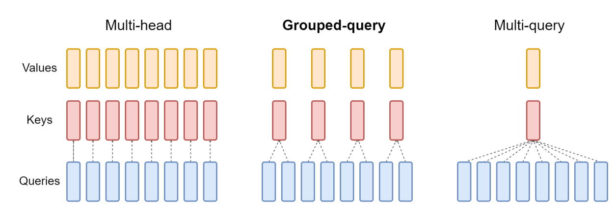
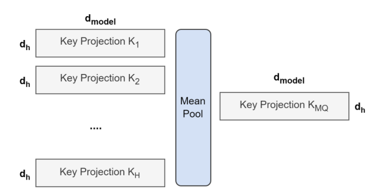
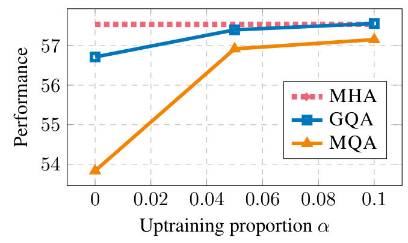
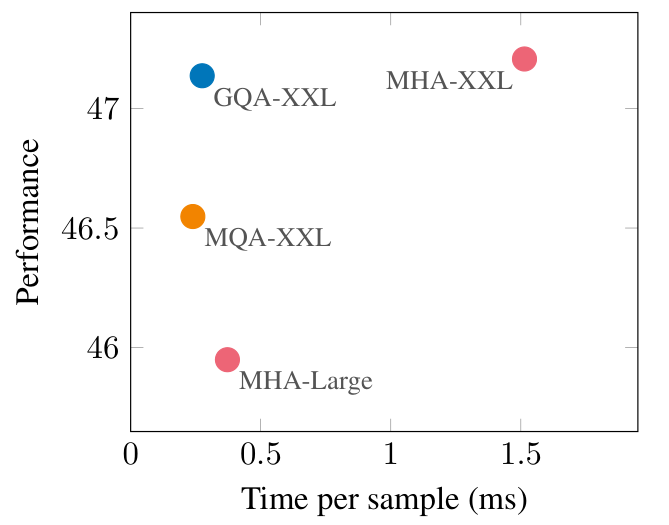
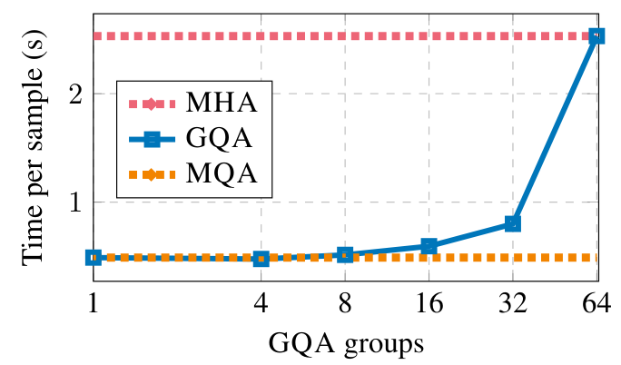

# GQA：让多个查询头读同一份键值缓存

生成摘要时，解码器每发出一个 Token，都要再次读取历史键和值。多头注意力（MHA）为每个查询头保留独立的键和值投影。不同头可以学习不同读取方式，代价是同一个历史 Token 的键值要按头存多份。多查询注意力（MQA）让全部查询头共享一组键值，省掉大部分缓存读取，模型质量和训练稳定性可能变化。Ainslie 等人在两端之间引入分组查询注意力（GQA），并提出从已有多头检查点转换和追加预训练的做法。[§1–2](https://arxiv.org/pdf/2305.13245v1#page=1)

## 继续生成摘要时，哪些头共享键和值

作者图 2，固定版第 2 页，Joshua Ainslie 等。由下向上读：蓝色 Query 仍各自发起读取，中间红色 Key 提供匹配依据，上方橙色 Value 提供要聚合的向量。左图每个 Query 与一组键值相配，中图每两个 Query 共享一组，右图所有 Query 使用同一组。

假设 T5 正在生成天气新闻的摘要，已输出「明天 北京」，这一行要预测「降雨」。教学模型用四个查询头，MHA 分别缓存四组前缀键值。改成两组 GQA，头 0 和 1 用组 0 的键和值，头 2 和 3 用组 1 的键和值。两者各有自己的查询。例如组 0 缓存两个位置的键 $[(1,0),(0,1)]$，对已经按 $\sqrt{d_k}$ 缩放的两条查询 $(2,0)$、$(0,2)$，原始点积分别为 $[2,0]$、$[0,2]$。两条 Softmax 分布约为 $[0.881,0.119]$ 和 $[0.119,0.881]$。即便共享值向量，它们也从两个位置读出不同的混合。各头输出拼接后，仍由输出投影和后续子层构造词表分布。

每层自注意力的 KV 元素数从 $2BT H d_h$ 降到 $2BTGd_h$，这里 $B$ 为批大小、$T$ 为缓存长度、$H$ 为查询头数、$G$ 为键值组数，键和值的头宽均为 $d_h$。两组的教学例子省去一半 KV 元素。查询头和它们的逐位置比较仍然存在，收益要结合读写、算子、分片和硬件测量。T5 实验同时在解码器的自注意力与交叉注意力改组，编码器自注意力保持多头。交叉注意力的相同分组发生在源端编码状态的键值投影上。[KV 缓存的计算和存储](../../知识库/概念/Attention计算与存储.md#多个查询头怎样共享缓存) · [固定版 §2.2–3.1](https://arxiv.org/pdf/2305.13245v1#page=2)

## 把预训练的头合并后继续训练

作者图 1，固定版第 1 页。图以 MQA 为例把全部键投影平均成一份。值投影也单独平均。GQA 将同样的操作限制在组内。

对上述四个头，把旧头 0 和 1 的 $W_0^K,W_1^K$ 逐权重平均，得到组 0 的新 $W_0^{K\prime}=(W_0^K+W_1^K)/2$。值投影同理。头 2 和 3 得到组 1，原四个 Query 投影沿用。对于同一输入，平均矩阵得到的是原投影结果的平均。Softmax 非线性，新的读取结果通常与原模型的两个头不同。追加预训练让模型适应这项变化。同一去噪预训练仍以缺失片段 Token 作监督，输出误差经解码器更新投影。同组多个查询头对共享键、值支路的梯度会累加。微调才根据摘要、翻译或问答各自的输出文本训练。推理直接用新模型投影缓存键值，平均操作已在转换时完成。[§2.1、§3.1](https://arxiv.org/pdf/2305.13245v1#page=1)

作者图 5，固定版第 4 页。消融覆盖短、长摘要和问答三个任务。刚平均后，GQA-8 表现已接近 MHA，MQA 降幅更大。追加原预训练步数的 5% 后均有改善，作者观察到从 5% 增至 10% 收益减小。图 4 另在 T5-Large → MQA、追加 5% 的条件下对照平均、取第一头和重新随机初始化，平均最高。附录 A 报告从头训练的 MQA 模型出现损失尖峰及长输入任务发散，追加预训练的 MQA 更稳定但仍有波动。[§3.3，第 3–4 页](https://arxiv.org/pdf/2305.13245v1#page=3) · [附录 A](https://arxiv.org/pdf/2305.13245v1#page=7)

## 在什么预算和任务下靠近 MHA

作者图 3，固定版第 3 页。横轴印为 ms，点值与表 1 的秒数吻合。EMNLP 出版 PDF 也保留此处差异。以下用表 1 明示的 s，并保留原图标签。[EMNLP 出版版图 3](https://aclanthology.org/2023.emnlp-main.298.pdf#page=3)

在 T5.1.1 的七个生成任务上，按表 1，MHA-XXL 的平均开发分数为 47.2，每样本 1.51 s，GQA-8-XXL 为 47.1 与 0.28 s，MQA-XXL 为 46.5 与 0.24 s。GQA 与 MQA 都从 XXL 检查点追加 5% 的原预训练步数。摘要采用 R1，翻译采用 BLEU，问答采用 F1，47.1 是混合指标的平均值。各模型在 8 块 TPUv4 上分别优化并行方式，每芯片取可容纳批大小，上限 32，使用贪心解码。时间是这一计时协议的单芯片每样本结果。[§3.1–3.2、表 1](https://arxiv.org/pdf/2305.13245v1#page=3)

作者图 6，固定版第 4 页。在固定输入长度 2048、输出长度 512 的设置中，1、8、64 组分别为约 0.489、0.514、2.531 s（源码中的绘图数据）。头数与耗时关系受实现影响，改变并行规模时还要检查每个设备是否复制同一组键值。上述结果支撑 8 组是该论文 XXL 设置中的折中点。[§3.3，图 6](https://arxiv.org/pdf/2305.13245v1#page=4)

核对 arXiv v1 摘要、§1–5、六图、一表和附录 A。中文 PDF 译出正文、致谢、脚注和图表标题，图内英文、参考文献与附录保留。采用相同 LaTeX 正文和 ACL 版面，改用本地 XeLaTeX 编译。实验数字来自作者报告，未运行作者实现。[固定原文](https://arxiv.org/pdf/2305.13245v1) · [中文 PDF 访问说明](../../文档/工具/中文PDF发布.md)
