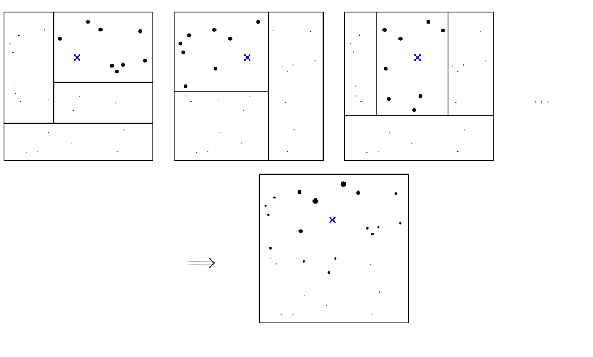
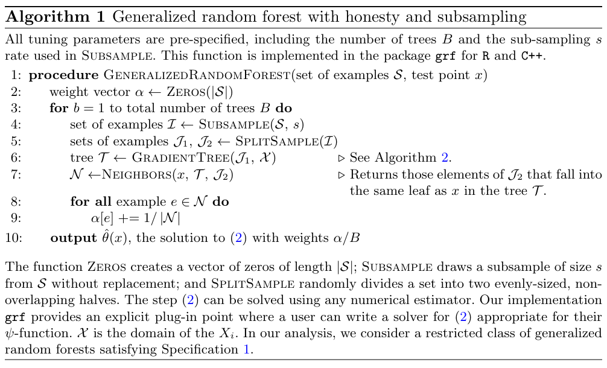
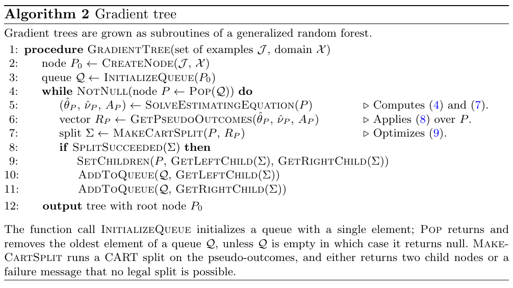
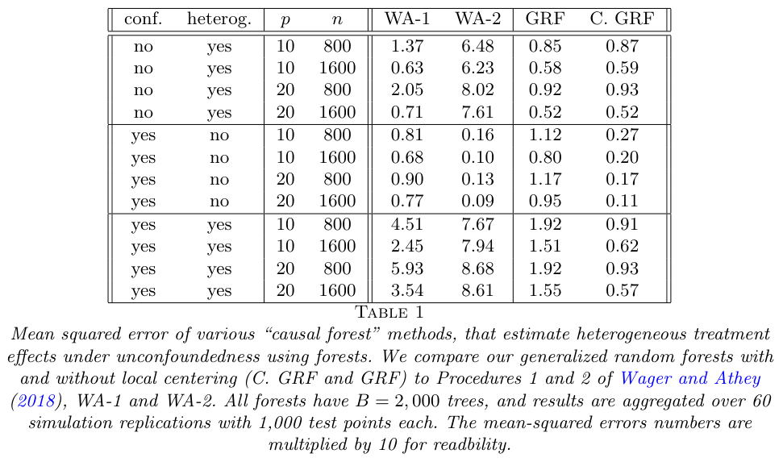
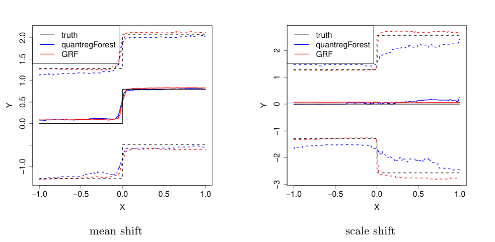
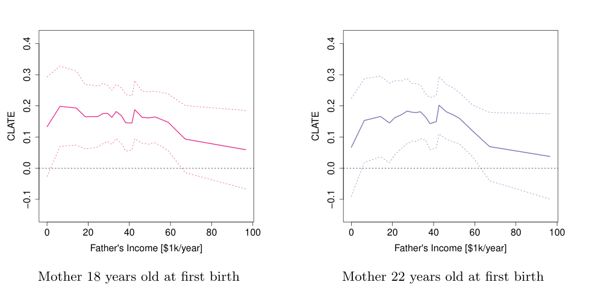

# 广义随机森林怎样为局部效应寻找训练样本

给一位用户估计发券增量时，已有因果森林可以找到许多和他落在同一叶的邻域，再对叶内两臂差取平均。如果希望从同样的历史数据估计下单金额的条件分位数，单独求每棵树小叶的 90% 分位数再平均，小叶里一个大订单就可能扭曲该树的估计。Athey、Tibshirani 与 Wager 的广义随机森林（GRF）让树提供邻域权重，用汇总的权重解一次目标矩方程。建树时，也按目标参数的变化重写分裂标签。 [原文 §1–2](https://arxiv.org/pdf/1610.01271v4#page=5)

## 森林提供邻域，估计方程决定在邻域怎样计算

输入每条记录的处理前画像 $X_i$，以及参与目标估计的观测 $O_i$。对发券问题，$O_i=(Y_i,W_i)$，分别是事实结果和券指派。希望找出目标参数 $\theta(x)$ 及需要的干扰参数 $\nu(x)$，使 $E[\psi_{\theta(x),\nu(x)}(O_i)\mid X_i=x]=0$。例如取 $\psi_\theta(Y)=Y-\theta$，零点就是条件均值。若要估二元发券的条件效应，可令 $\theta$ 为局部回归中的处理斜率，$\nu$ 为截距，要求结果残差以及结果残差乘以处理的条件均值都为零。 [原文式 (1)–(3)](https://arxiv.org/pdf/1610.01271v4#page=6) · [局部回归式 (19)](https://arxiv.org/pdf/1610.01271v4#page=20)

对每一棵树 $b$，从全量记录中无放回抽子样本，拆成结构集和估计集。前者用于选择分裂。后者按冻结切点落叶，用 $L_b(x)$ 表示和请求点 $x$ 同叶的估计记录集。原图上排三个不同的叶，对同一片区域给出了不同的覆盖。任何记录在某一树上同叶就得到 $1/|L_b(x)|$ 的权重，否则是零。算法对各树权重取平均，并把这些权重放入同一个样本方程：
$$
\alpha_i(x)=\frac1B\sum_{b=1}^B\frac{\mathbf 1\{i\in L_b(x)\}}{|L_b(x)|},\qquad
(\hat\theta(x),\hat\nu(x))
\in\arg\min_{\theta,\nu}\left\|\sum_i\alpha_i(x)\psi_{\theta,\nu}(O_i)\right\|_2.
$$

沿用因果森林笔记的两棵树。树 A 同叶有发券 4 单／10 人、无券 3 单／10 人；树 B 为发券 3 单／6 人、无券 4 单／10 人。早期因果森林先逐树计算发券差，再平均，得到 10 个百分点。不中心化的 GRF 先给两片叶各半份总权重，再用加权处理回归解一次斜率。发券组的加权下单率为 $(4/20+3/16)/(10/20+6/16)$，无券组为 $(3/20+4/16)/(10/20+10/16)$，差约 8.73 个百分点。差别来自各树的处理占比不同，汇总后的两臂由不同的相对叶权重支撑。估计条件均值时，先逐叶求均值再平均，与先平均权重再求均值完全相同。分位数、协方差比值和带截距的处理斜率通常没有这个可交换性。 [原文 §2.1、§6.2](https://arxiv.org/pdf/1610.01271v4#page=22) · [逐树两臂差的算例](../SRC-CAUSAL-FOREST/阅读笔记.md#双样本树怎样决定谁与目标用户同叶)

## 怎样用一次父节点求解，扫描多条候选切线

为了按增量变化切分，直接做法是给每个候选的两个新叶分别解矩方程，再看两个目标参数相差多大。若估计量为分位数、局部斜率或工具变量比值，反复求解代价大，某些候选叶还可能退化。GRF 先在父节点 $P$ 解一次 $(\hat\theta_P,\hat\nu_P)$，求得局部矩对参数的导数矩阵 $A_P$，再由保留目标坐标的向量 $\xi$ 生成伪结果：
$$
\rho_i=-\xi^\top A_P^{-1}\psi_{\hat\theta_P,\hat\nu_P}(O_i),\qquad
\tilde\theta_C=\hat\theta_P+\frac{1}{|C|}\sum_{i\in C}\rho_i.
$$

第二式近似把父解移到候选子叶后的斜率，因而只需对 $\rho_i$ 做 CART 式分裂。对每个候选计算 $S=\sum_{j=1}^2(\sum_{i\in C_j}\rho_i)^2/|C_j|$。父节点样本固定，按某个特征排序后可累计两侧伪结果之和及人数，连续扫描切点。选定分裂后，在各子节点用它们自己的数据重新求解和重标记。每一层的 $\rho_i$ 随父节点而变，推断时用的是森林权重和原矩方程。原文式 (5) 和式 (9) 的分数归一化不同，固定同一父节点选切点时差异是与切点无关的缩放和平移。 [原文式 (5)–(9)、命题 2 及附录 B](https://arxiv.org/pdf/1610.01271v4#page=9)

## 局部中心化怎样剥离历史发券倾向

设活跃度同时抬高本来的下单率和发券概率，较宽的叶内依旧可能失衡。GRF 在第 6 节用留一预测先计算 $\tilde Y_i=Y_i-\hat E_{-i}[Y\mid X_i]$ 和 $\tilde W_i=W_i-\hat E_{-i}[W\mid X_i]$，以这两个残差建树和解局部斜率。父节点再按自身残差均值中心化，以局部回归误差与处理残差偏离的乘积构造切分伪结果。预测时，用 $\alpha_i(x)$ 加权得到
$$
\hat\tau(x)=
\frac{\sum_i\alpha_i(x)(\tilde W_i-\bar{\tilde W}_\alpha)(\tilde Y_i-\bar{\tilde Y}_\alpha)}
     {\sum_i\alpha_i(x)(\tilde W_i-\bar{\tilde W}_\alpha)^2}.
$$
若局部区域内真实效应恒定、处理可交换且条件方差有支持，即使邻域没有收得很窄，真残差的协方差比仍能找回常数斜率。若效应在邻域内变化，加权仍有平滑偏差。论文把确定性中心化和可交叉拟合的理论构造与计算方便的留一实现分开讨论。R-learner 用同源残差把效应函数作为回归目标，通过模型和正则化学习全局函数；这里的局部权重由森林生成，计算的是每个目标点的一次加权回归。 [原文 §6.1、式 (19)–(21)](https://arxiv.org/pdf/1610.01271v4#page=21) · [残差化问题页](../../知识库/问题/残差化怎样估计营销干预效应.md#r-learner-直接拟合效应函数)

表 1 比较 WA-1（早期双样本树）、WA-2（倾向树）、GRF 与 C. GRF（中心化）。当混杂和异质性并存、$p=20,n=1,600$ 时，表中分别为 3.54、8.61、1.55、0.57，单位是 MSE 乘 10。每种设置用 2,000 棵树、60 次模拟，每次 1,000 个测试点。只有混杂且真实效应恒零时，同样维数和样本量下，倾向树为 0.09、中心化 GRF 为 0.11，前者略好。该证据厘清了原先两种树的取舍，也表明中心化收益依赖数据生成条件。 [原文 §6.2、表 1](https://arxiv.org/pdf/1610.01271v4#page=23)

## 换一个矩方程，树会寻找不同的变化

给定分位水平 $q$，令 $\psi_\theta(Y)=q-\mathbf1\{Y\le\theta\}$，预测就是同叶权重汇总后的经验分位数。切分时只需按样本是否超过父节点的当前分位数重标记，固定父节点内常数缩放和中心化不影响选切点。要共用一片森林估多个分位数，作者按父节点的多个分位点定义区间，把观测落在哪个区间作为多分类标签。图 2 的 $n=2,000,p=40$ 中只有第一个字段承载信号。尺度变化、均值恒定时，瞄准分位数的分裂识别出两侧尾部差，按条件均值切分的 quantregForest 在这个例子失效。券后零消费处若存在明显的点质量，平滑密度条件不能直接套用来构造分位数区间。 [原文 §3 分位数示例及 §5、图 2](https://arxiv.org/pdf/1610.01271v4#page=19) · [消费分布的口径](../../知识库/问题/补贴怎样改变消费金额的分布.md)

工具变量森林的观测扩充为 $(Y_i,W_i,Z_i)$，例如随机提醒资格 $Z$、实际接受干预 $W$、窗口结果 $Y$。给定画像 $x$，以工具与结果的协方差除以工具与处理的协方差。原文应用于有条件外生工具和排除限制的场景，分母还须非零。个体响应异质时，若要把比率解释为条件局部平均处理效应，还需要二元工具下的单调性等条件，目标人群是会随工具改变实际处置者。父节点用工具残差乘以局部结果误差生成标签，正式预测才由加权的两个协方差之比给出。 [原文 §7.1](https://arxiv.org/pdf/1610.01271v4#page=24)

图 3 用美国 1980 年普查中至少有两个孩子的 334,535 位已婚母亲，将前两个孩子的性别组合作为工具，估计是否还生育第三个孩子对不就业概率的影响。论文用逐点 95% 区间，并指出父亲收入在普查时测量，可能已受家庭决策影响。该数据不能回答以处理前父亲收入为条件的同一个问题。 [原文 §7.2、图 3](https://arxiv.org/pdf/1610.01271v4#page=26)

## 区间和分裂共用哪一个线性化思想

分裂在父节点解附近用矩的导数把残差转换为参数变化。理论则在未知真参数附近做类似线性化，把估计量近似为一个可套用回归森林渐近结果的伪森林。在诚实、分裂平衡、局部识别及子抽样率等条件下，这支持居中的逐点正态推断。方差通过 Delta 方法将森林得分向量的抽样方差 $H$ 转成目标参数的方差 $\xi^\top V^{-1}HV^{-\top}\xi$。$V$ 是目标点矩对参数的导数。小袋自助法用同一个随机半样本训练每袋数棵树；从袋均值的组间波动扣除袋内有限树的噪声，再代入参数。区间反映抽样波动。邻域太粗、分母太弱或目标在边界时，平滑偏差和不稳定性仍需检查。原文 §4 的覆盖式把右端写成 $\alpha$，按双侧正态分位数及定理 6，名义覆盖为 $1-\alpha$。 [原文定理 5、式 (15)–(17)、定理 6](https://arxiv.org/pdf/1610.01271v4#page=16)

## 原文与中文译本

采用 Susan Athey、Julie Tibshirani 与 Stefan Wager 的 arXiv 1610.01271v4。核对摘要、正文 §1–8、算法、图表以及耦合、分裂与工具变量的附录。36 页译本覆盖摘要、正文、算法说明和注释、主图表标题及致谢，保留公式、图内英文、伪代码、参考文献和附录。正式译文为 `.local/papers/SRC-GRF/translation/广义随机森林_中文.pdf`，可编辑主文件为 `translated-sources/paper.tex`。未重跑实验。 [采用版](https://arxiv.org/pdf/1610.01271v4) · [来源与原件哈希](来源.json) · [私有备份下载说明](../../文档/工具/中文PDF发布.md)
