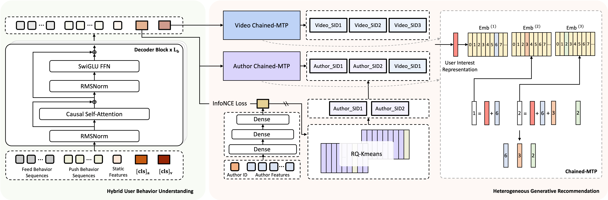
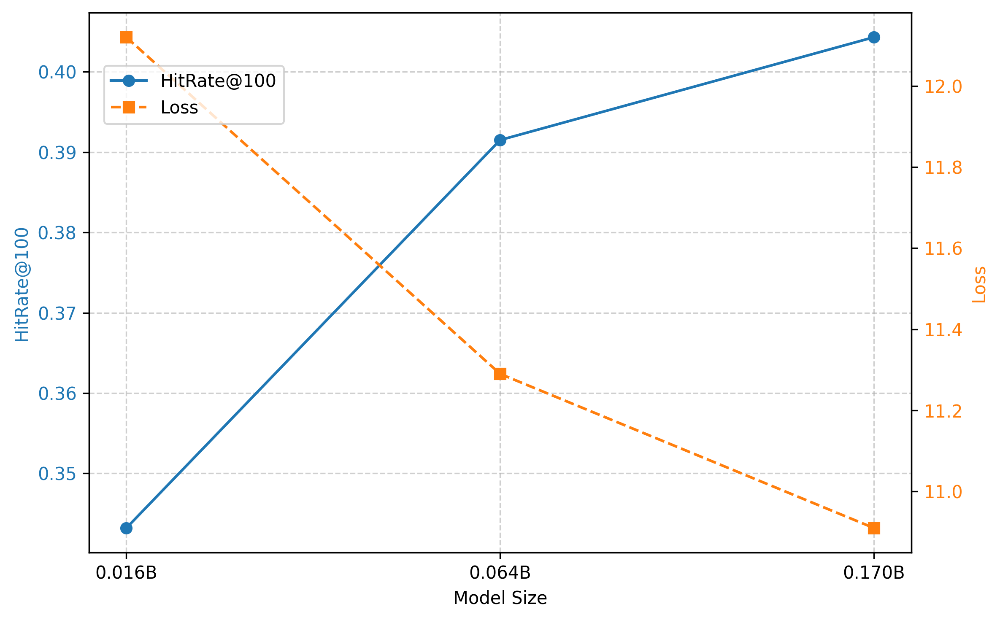

# HGenPush：用同一段用户历史生成视频码和作者混合码

短视频推送有两条线索。用户可能想看某类内容，也可能想看某位作者的新作品。只生成视频码时，模型可以找到主题相近的视频，却难以显式区分由谁创作。为每种对象各跑一遍大模型又会重复编码历史。HGenPush 共享兴趣建模主干，用两个读出向量分别生成视频语义码与“作者码＋视频首层码”，再将候选交给线上精排。[固定 v1 §1、§3](https://arxiv.org/pdf/2607.03362v1#page=2)

作者图 1，Xiao Liang、Jiali Feng 等，arXiv v1 第 4 页，采用源码 PNG。左侧四组序列与静态特征进因果主干，高层分别取视频和作者的汇总表示。图中作者侧用点击对齐作者与用户，再量化作者表示。消费奖励接视频生成侧。

## 同一段历史读出两类兴趣

假设小程平时会看做面与露营视频，最近反复看手工拉面，之前点过一位擅长面食的作者的推送。输入分别整理长期信息流、短期信息流、推送点击和推送发送。信息流视频用语义码、作者 ID、主题标签与播放时长构造表示。推送侧把通知类型也带进去。发送序列记录系统已经发过什么，点击序列记录用户做过什么，发送记录不能直接当作喜欢。拼入静态特征后，在序列末尾依次放作者和视频两个 CLS。因果注意力允许各自读到前序行为，视频 CLS 还能读到在它前面的作者 CLS。作者没有给出屏蔽两者依赖的额外掩码。[原文 §3.1、图 1](https://arxiv.org/pdf/2607.03362v1#page=3)

## 视频码仍按前缀逐级选择，省去的是主干重算

固定视频兴趣向量为 $h_v$。若示例中视频码为 $(8,21,3)$，第一层用自己的 FFN 对 $h_v$ 给码字分数。束搜索若保留前缀 8，第二层对 $h_v+E_1(8)$ 预测。继续给该前缀选中 21 时，第三层读 $h_v+E_1(8)+E_2(21)$。同一层的多个束可以批处理，下一层仍取决于各束的前序结果。训练用点击视频作为目标，以各层目标 Token 的对数概率和做交叉熵。原文没有细说束内去重、非法码回查和多个视频共享同一完整码时的处理。

这与独立预测所有位置的 Parallel-MTP 以及重新跑逐层 Transformer 的 DeepSeek-MTP 对照分别清晰。表 3 视频 HitRate@100 为 0.1150、0.3954、0.3915，对应单设备最大 QPS 2.40k、1.27k、1.70k。链式方法比 DeepSeek-MTP 提高约 33.9% 吞吐，命中略低。表文另称 DeepSeek 相对 Parallel 的吞吐降低 47.09%，按表内四舍五入值计算约 47.08%。此处直接用表中显示的 QPS，不能外推到整个推送服务成本。[原文 §3.2.1、§4.3.2 表 3](https://arxiv.org/pdf/2607.03362v1#page=5)

## 作者码锁定来源，视频首码为内容留约束

即使两位作者都做面食，小程可能偏好其中一人。作者分支把点击样本中的目标作者表示与用户作者兴趣投影到同一空间，以批内 InfoNCE 拉近配对。再对作者向量做两级残差量化。第一层选最近中心，第二层从上一层没解释的残差继续选码。假设作者码是 $(14,6)$，小程点击的拉面视频首层码为 8，监督目标便是 $(14,6,8)$。末位并非作者第三层。它加入了视频内容约束，同一个作者下仍可能有多个候选视频命中，如何从混合码映射到具体视频的排序细节没有披露。

作者码本跟随训练更新，SimVQ 用于缓解坍缩，码本距离对残差停止梯度。正文另外定义了 $\mathcal L_{align}$，但总损失只列两个 MTP、码本损失和 GSISPO。缺少对齐项的权重与调度，不能仅据总式还原训练。两分支都用束搜索，生成候选跳过粗排、直接进入精排。从本文能确认的是候选来源和精排接口，未披露线上去重、候选比例和独立的发送时机策略。[原文 §3.2.2、§3.4](https://arxiv.org/pdf/2607.03362v1#page=5)

## 用点击后消费区分只是点开和愿意继续看

小程从推送进入应用后，在同一会话看了三条视频。假设拉面视频有效播放并获点赞，奖励为 3，另一条只短播，奖励 −2，第三条分享，奖励 1。会话内减均值再除以标准差，三条的优势方向为正、负、正。每条优势附在整个视频码上。GSISPO 对新旧策略的整码概率比开码长次方，裁剪后停梯度，用其乘优势及当前整码的对数概率。旧策略的概率是权重基准，论文未给出从线上日志估计原行为策略概率的办法，不能把这个比值当作消除了曝光偏差。式子也未给出组内奖励全等时的零标准差处理。并行保留点击 MTP 项约束主训练，原文没有另加 KL。[原文 §3.3–3.4](https://arxiv.org/pdf/2607.03362v1#page=6)

与按整张列表评奖或比较同一视频的两条文案相比，这里的优势附在被消费视频的整段标识码上。见[点击后会话的偏好信号](../../知识库/问题/生成式推荐怎样从似然训练走向偏好对齐.md#点击后的同一会话可以给候选视频相对优势)。

## 离线命中、在线消费、业务活跃有各自对照

作者图 2，采用版第 7 页，源码 PNG。视频 HitRate@100 从 0.3432 到 0.3915 再到 0.4043。第一段同时增加层数和宽度，第二段引入 MoE，不能据此推导只增加参数的边际收益。表 1 的完整模型视频／作者分支为 0.3915／0.4848，TIGER 为 0.3802／0.4677。指标是日志中真实语义码被候选集合命中的比例，没有直接量化码冲突或线上注意力成本。[原文 §4.1–4.4](https://arxiv.org/pdf/2607.03362v1#page=7)

表 4 仅点击基线的 HitRate@100 为 0.3964，按观看时间重加权降至 0.3394，UCPA 为 0.3915。表 5 另以仅点击为线上对照，报告完播率 +0.90%、点赞率 +0.75%、转发率 +7.57%。表 6 的对照换成生产级联。完整 v3 的 DAU +0.181%（$p=0.04$）、CTR +1.577%（$p=0.11$）、应用时长 +0.148%（$p=0.75$），按 0.05 阈值只有 DAU 显著。三行的点估计不能当作 v3 与 v2 间的直接 A/B，不能单独确证作者分支增量。[原文 §4.5–4.6、表 4–6](https://arxiv.org/pdf/2607.03362v1#page=8)

与 [PushGen](../SRC-PUSHGEN/阅读笔记.md) 相比，HGenPush 改变源候选，PushGen 为给定视频生成和筛选文案。[语义短码问题](../../知识库/问题/用语义短码直接检索物品.md)比较 HGenPush 的轻量逐级读出与 TIGER 的自回归。

## 原文与阅读范围

采用 [arXiv:2607.03362v1](https://arxiv.org/abs/2607.03362v1)，核对摘要、§1–5、两图六表及正文公式。未运行作者实现。PDF 标 CC BY 4.0，arXiv 版本页列非独占分发许可，两端分别记录。11 页中文 PDF 翻译摘要、正文、图表标题和脚注，图内英文与参考文献保留。采用 ACM 单栏避免宽公式和表格溢出。译文存取见[本批交接](../../文档/会话/PAPER-022.md)。[KDD 2026 DOI](https://doi.org/10.1145/3770855.3818429)
