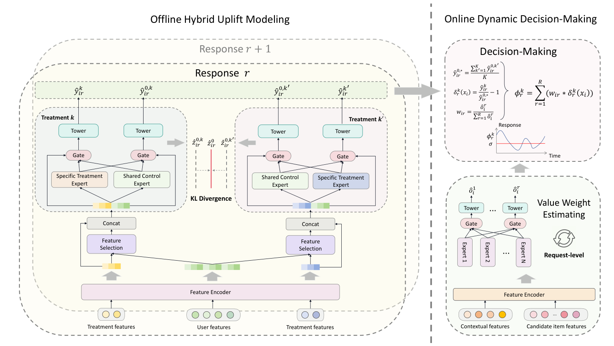
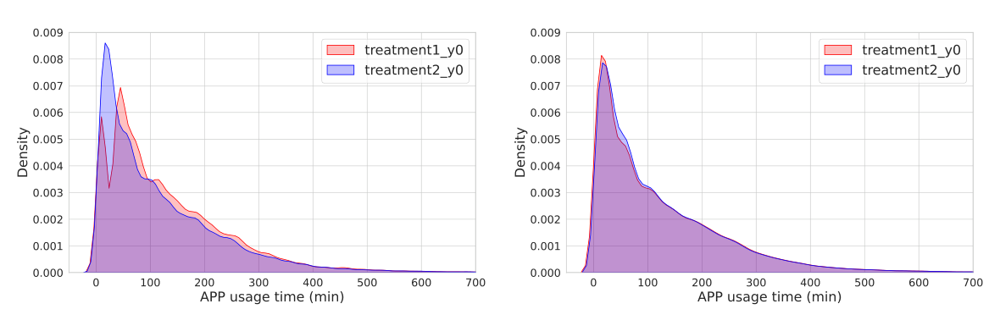
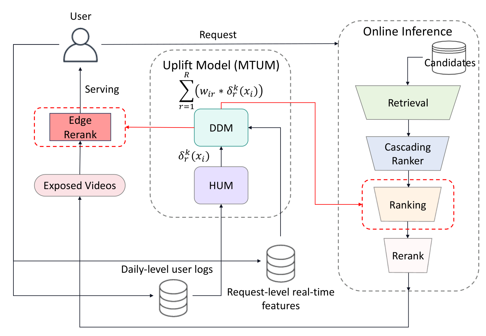

# HMUM 怎样在一次推荐请求中权衡观看时长与播放量

Chenhao Zhai、Chang Meng、Xueliang Wang、Shuchang Liu、Xiaolong Hu、Shisong Tang、Xiaoqiang Feng、Xiu Li。采用 [arXiv:2511.18997v2](https://arxiv.org/pdf/2511.18997v2)（2025 年 11 月 29 日修订），会议书目为 KDD 2026。 [正式书目](https://doi.org/10.1145/3770854.3783933) · [来源与版本](来源.json) · [译本范围](#版本与译本) · [私有备份下载说明](../../文档/工具/中文PDF发布.md#登录下载)

短视频排序同时关心用户看多久、看几个视频。给候选增加消费侧打分器，可能选出能让用户停留更久的视频，却使播放数下降。商业化侧打分器可能沿相反方向改变这两个结果。把新打分器推给所有用户，平均效果会掩盖用户差异；对每个策略单独训练一套结果模型，则会为同一个人拟合多条本应描述同一事件的「无打分器」基线。HMUM 将各策略的处理塔分开，用无处理样本连接各分支，再由请求级模型根据当前候选决定如何给两种响应加权。 [v2 §1、§3](https://arxiv.org/pdf/2511.18997v2#page=2)

## 每种打分器各有一条事实预测路径

设一名用户的实验动作只有不启用新打分器、使用消费侧打分器 A、使用商业化侧打分器 B。训练记录保存处理前历史、试验中实际分到的动作，以及随后测得的时长、播放量。先跟踪其中的时长结果。假设日志中的用户被分到 A、实际观看 106 秒，HUM 在 A 的处理路径上预测 104 秒，这一行用 $ (106-104)^2 $ 监督 A 的时长预测。B 的处理路径没有这条日志的反事实时长标签；播放量有自己的事实响应与分支。 [v2 §3.1、§4.1，式 (1)–(5)](https://arxiv.org/pdf/2511.18997v2#page=5)

对 A 分支，用户各字段先分别嵌入。处理嵌入输入线性层与 softmax，得到一组作用于用户字段的权重，按权重汇总用户嵌入后与处理嵌入拼接。权重取决于分支及处理特征；它没有像 MTMT 的 Query–Key 点积那样为同一处理逐样本计算字段匹配。拼好的向量进入多个专家，经门加权后由对应塔读出时长。同一 A 分支还可输入「未处理」特征，由该分支的对照塔读出其自然时长预测。 [v2 §4.1.1–4.1.2](https://arxiv.org/pdf/2511.18997v2#page=4) · [MTMT 的任务路由与处理查询](../SRC-MTMT/阅读笔记.md#玩家历史先按结果路由奖励再查询任务表示)

Zhai 等，arXiv v2 第 5 页图 1，从作者 LaTeX 源图转换，保留图内标签。左侧按动作分支分别读出处理与对照预测，右侧则在请求级别读出多结果权重。 [原图](https://arxiv.org/pdf/2511.18997v2#page=5)

如果这条用户事实记录来自不启用打分器的对照组，同一个事实时长会监督每个动作分支的对照塔。按 §4.1 的写法，每个对照路径门输出与各分支门输出的平均向量再算 KL，所有对照分支因这项损失而相互约束。这跟 M³TN 共用一个自然响应头的做法不同，HUM 保留各分支的自然响应读出，线上才对它们取均值。图 3 比较的是模型预测分布；分布靠近只说明所展示的差别变小，无法推出每个用户的两条预测相等或其效应无偏。作者称模型捕捉「协同」，式 (5) 具体支持的是控制路径上的联合学习。要估计 A、B 同发时超出单发之和的效应，需要把同发定义为行动并提供相应日志或识别依据。 [v2 §4.1.3、附录 A.2](https://arxiv.org/pdf/2511.18997v2#page=10) · [M³TN 的共享自然响应](../SRC-M3TN/阅读笔记.md#一条锐化日志经过哪两个头)

Zhai 等，arXiv v2 第 10 页图 3，裁取原图两面板。左侧为分开建模，右侧为联合建模，颜色区分两条控制路径。 [原图](https://arxiv.org/pdf/2511.18997v2#page=10)

## 同一位用户的权衡随候选改变

继续使用同一用户。若 A、B 分支的自然时长分别预测为 99、101 秒，取均值为 100 秒。假设同样得到自然播放量 20 次，A 的预测为 104 秒、19 次，B 为 98 秒、22 次。论文用 $\hat y_r^k/\hat y_r^{0,*}-1$ 将不同单位改写为相对增量，因此 A 的两个分数是 +4% 与 −5%，B 是 −2% 与 +10%。均值落在最小与最大预测之间是恒等事实，均值本身的误差仍需用对照样本核验。自然响应接近零时，相对分数也会被放大。 [v2 §4.2.1，式 (6)–(7)](https://arxiv.org/pdf/2511.18997v2#page=6)

DDM 每次请求读取近期上下文及候选特征，并沿候选或交互序列均值池化。监督标签来自已曝光视频的类型占比。论文将每个视频的消费指标和商业指标分别换成各自排序百分位，给它分配百分位较高的类型，再统计请求内两类数量。类似 MMoE 的任务头以均方误差拟合这两个占比，推理时归一化各头分数作为两目标权重。它估计的是曝光构成的代理量，其语义跟随日志服务策略。 [v2 §4.2.2，式 (8)–(10)](https://arxiv.org/pdf/2511.18997v2#page=6)

若某次请求读出 0.75 和 0.25，A 的分数为 $0.75\times4\%+0.25\times(-5\%)=1.75\%$，B 是 1%。若下次变为 0.30 和 0.70，A 为 −2.30%，B 为 6.40%。同一用户的离线增量没有变，响应价值的权重变了，因而阈值规则的动作也可改变。论文按 $\phi_i^k>\sigma$ 分别判断启用各策略，未给出候选同时超过阈值时的联合效应学习或全局预算优化。 [v2 §4.2.3、§6.2](https://arxiv.org/pdf/2511.18997v2#page=7) · [按目标共享和策略价值](../../知识库/问题/多档营销动作怎样共享并区分多个结果.md)

Zhai 等，arXiv v2 第 7 页图 2，从作者 LaTeX 源图转换。HUM 的增量日级计算并入库，DDM 在线读取请求特征，判断是否在排序或端侧重排启用策略。 [原图](https://arxiv.org/pdf/2511.18997v2#page=7)

## 线上增长属于整套决策

工业离线约 600 万条样本，报告 8:2 训练／测试，标签为使用时长与播放量。表 1 按处理和响应拆列、单位为 $10^{-4}$。例如消费侧打分器的时长 QINI 为 14.55，M³TN 为 13.04，HUM 去掉 KL 后为 10.87。商业化侧打分器的播放量 AUUC 为 30.46，M³TN 为 29.18。Lazada 和 Criteo 本身是二元处理，表 2 以单处理的多个表示分支运行，不能用来归因异质的动作交互。正文 §5.1.1 将工业数据描述为来自多项 RCT，附录 A.3 又描述基于重排与伪处理组的回溯设计，文中未将这两种口径与各离线表逐一映射。 [v2 §5、表 1–2](https://arxiv.org/pdf/2511.18997v2#page=7) · [附录 A.3](https://arxiv.org/pdf/2511.18997v2#page=10)

作者报告排序试验 13 天、端侧重排试验 8 天。表 3 中总使用时长分别上升 0.044% 和 0.073%，播放量分别上升 0.007% 和 0.002%。表 4 中端侧重排对所有人启用消费侧打分器，时长 +0.125%、播放量 −0.227%；仅启用商业化侧打分器时分别为 −0.094%、+0.151%；全量乘积组合为 −0.044%、+0.091%。这些是作者报告的策略对照，不是各用户的真实效应。表 3 未列置信区间，表 4 的对照也不能直接替代对 DDM 固定权重与动态权重的专门消融。 [v2 §6，表 3–4](https://arxiv.org/pdf/2511.18997v2#page=8)

## 版本与译本

截至 2026-11-26，核对固定版摘要、正文、式 (1)–(11)、图 1–3、表 1–4 与附录 A.1–A.3，未运行模型。v2 版本页显示 CC BY 4.0。按原论文 LaTeX 编译的 8 页中文 PDF 翻译摘要、正文、图表说明及描述性脚注，保留英文参考文献、附录及图内文字；式 (5) 分行以保留可读字号。译后 PDF 已逐页核验。 [版本与许可](https://arxiv.org/abs/2511.18997v2)

本机译本为 `.local/papers/SRC-HMUM/translation/中文.pdf`，可编辑工程入口为 `.local/papers/SRC-HMUM/translation/translated-sources/main.tex`。 [PDF 盘点](../../译文/PDF目录.md) · [私有备份下载说明](../../文档/工具/中文PDF发布.md#登录下载)
