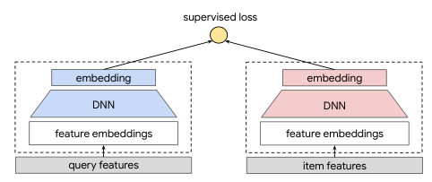
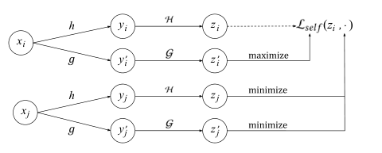
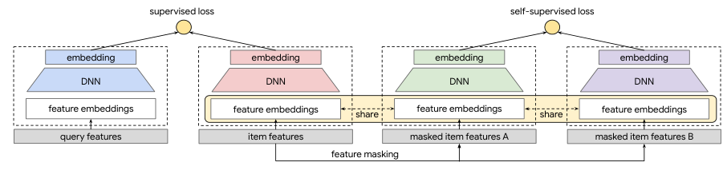
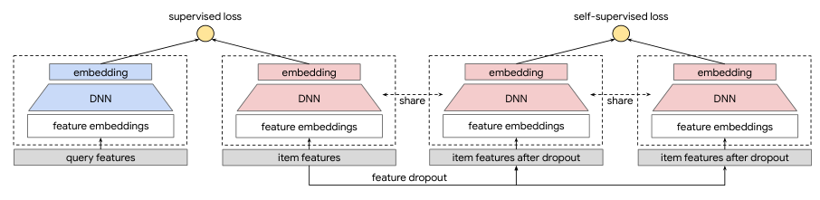
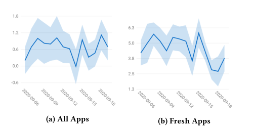

# 物品自监督如何让长尾向量同时利用 ID 与内容

[原文版本与中文 PDF 位置](#原文与阅读范围) · [私有备份下载说明](../../文档/工具/中文PDF发布.md#登录下载)

用户依次点过耳机、耳机套、零食，下一次点击某款刚入库的降噪耳机。普通双塔用用户上下文和该耳机的完整字段形成正对。若这个耳机几乎没被点击，物品塔很少得到该 ID 的正监督，还可能过于依赖头部 ID。Yao 等在主检索损失之外，用同一件物品生成两套字段视图，要求两套输入能辨认出彼此。物品塔由此得到额外的训练信号。该文的 FM 指 Feature Masking，即字段遮蔽。[§2–3，PDF 第 3–5 页](https://arxiv.org/pdf/2007.12865v3#page=3)

Yao 等作者原图 1，arXiv 2007.12865v3，PDF 第 3 页。左为查询塔，右为物品塔，顶部目标计算跨塔相似度。

## 主分母区分候选，自监督分母区分物品身份

在批内，主任务把查询 $q_i$ 与真实交互物品 $c_i$ 的向量作为正对，同批其他行的物品向量作为负候选。分数 $a_{ij}=\cos(q_i,c_j)/\tau$，从 $i$ 行的 Softmax 取第 $i$ 列，计 $-\log p_{ii}$。查询与物品独立编码，服务时先编码物品，再做向量检索。

辅助任务以物品记录 $x_i$ 为单位，做变换 $h,g$，再由编码器 $H,G$ 得到 $z_i,z_i'$。它也算批内分类，但行是物品视图，正确列是这件物品的另一个视图。若小批只有降噪耳机和旅行箱，分数取教学值 $\cos(z_i,z_i')=0.8$、$\cos(z_i,z_j')=0.2$、$\tau=0.2$，正列概率是 $e^4/(e^4+e^1)\approx0.953$。损失会抬高正列并压低错误列。将 $h,g$ 都设为恒等且使用同一编码器时，自身相似度为 1，目标主要把不同样本彼此推开，接近作者比较的 spread-out 正则。近似商品或同一 ID 的重复记录可能提供含混负例，取决于批的构造。[§3.1、式 (1)–(3)、(5)](https://arxiv.org/pdf/2007.12865v3#page=4)

Yao 等作者原图 2，arXiv 2007.12865v3，PDF 第 3 页。同一输入的两种视图形成正对，跨身份匹配形成负对。

## 固定拆字段与随机缺字段训练出不同不变性

字段遮蔽时，一支只读耳机 ID，另一支只读品牌、类别等元数据。两支的维度可以不同并各用自己的 MLP，相关字段的嵌入表与主任务共用。训练把 ID 与内容联系起来，即使主塔仍读取完整字段。随机字段丢弃则对同一件物品独立采样两次，将丢失值交给 OOV 默认向量。两支可以完整共用物品网络，与主任务也可共享 MLP。同一个 $\mathcal L=\mathcal L_{\mathrm{main}}+\alpha\mathcal L_{\mathrm{self}}$ 通过共享参数让辅助梯度影响线上物品表示。主干推理仍使用既有查询与物品塔，辅助头只用于训练。[§3.2–3.3、式 (4)](https://arxiv.org/pdf/2007.12865v3#page=4)

Yao 等作者原图 3，arXiv 2007.12865v3，PDF 第 5 页。黄色横箭头连通嵌入表。遮蔽后的两个 MLP 有独立参数。

Yao 等作者原图 4，arXiv 2007.12865v3，PDF 第 6 页。三个红色物品路径共享整塔。随机字段被当作缺失值。

## 长尾增幅受切片分母和实验口径影响

Wikipedia 的全库种子物品检索中，表 2 的 FD Recall@50 是 0.2056，FD+FM 为 0.2061。表 6 的低频切片中 FD 为 0.1812，较基线 0.1621 提高约 11.8%。AAI 的低频切片基线是 0.0376，FD 到 0.2066，因此相对增幅接近 449.5%。这一切片和全部物品的指标差别很大。表 7 的 AAI 头部 FD+FM Recall@50 列给出 0.5082（+8.15%），与同列基线 0.5082 存在冲突，保留疑点。作者同时给出仅训练侧丢字段（DO）、仅推散（SO）和两种辅助目标的对照。各方法在两个数据上并非同一排序，含义取决于低频数据量以及字段内容。[§4.3–4.7、表 2–7](https://arxiv.org/pdf/2007.12865v3#page=7)

14 天线上 A/B 报告整体头部业务指标 +1.5%、用户参与指标 +0.67%、新鲜应用切片参与 +4.5%。原文用通用指标名称，不能改写成某个具体点击率或安装率。该切片也不能推断无行为、无属性的新商品必然有同幅收益。[§5、图 8–9](https://arxiv.org/pdf/2007.12865v3#page=10)

Yao 等作者原图 9，arXiv 2007.12865v3，PDF 第 10 页。两幅图分别为全部应用和新鲜应用，纵轴是原论文报告的相对参与变化。

[序列与物品自监督怎样选择视图](../../知识库/问题/推荐自监督怎样构造有效视图.md) · [CL4SRec](../SRC-CL4SREC/阅读笔记.md)

## 原文与阅读范围

采用 arXiv 2007.12865v3，阅读 §1–6、式 (1)–(5)、离线切片及 14 日线上报告。arXiv 页提供版本身份，PDF 页眉会议模板文字仅作原版保留依据。[固定版本](https://arxiv.org/abs/2007.12865v3)

中文 PDF（15 页）依据采用版 PDF 和作者 LaTeX单栏重排，覆盖摘要、§1–6、公式及图表说明。图内文字、原表部分英文及参考文献保留，部分叙述合并表述。

本地文件 `.local/papers/SRC-ITEM-SSL/translation/SRC-ITEM-SSL.中文.pdf`，可编辑工程主文件 `.local/papers/SRC-ITEM-SSL/translation/translated-sources/main.tex`。[许可与范围盘点](../../译文/PDF目录.md) · [私有备份下载说明](../../文档/工具/中文PDF发布.md#登录下载)
