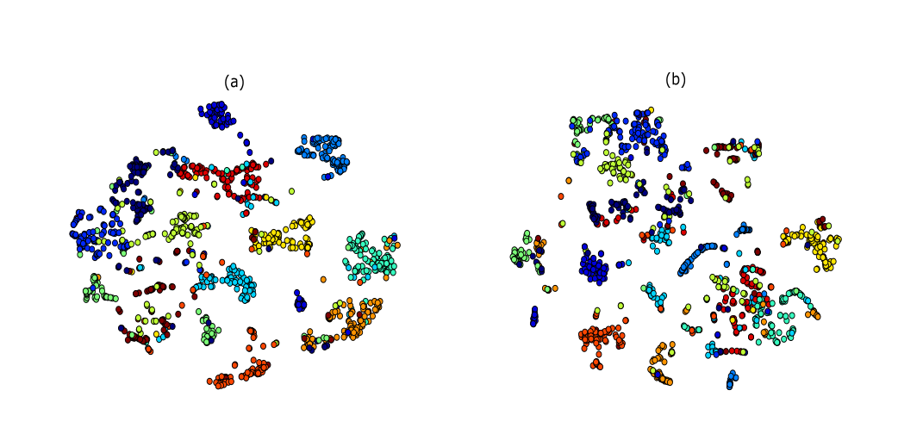

# Item2Vec 如何从购物篮学到物品近邻

商品详情页已知用户正在看某个种子物品，只需查与该物品行为相关的一批候选。物品协同过滤常直接统计共同交互的人群。只保留订单或会话时，每个集合仍然给出了物品之间的关系。Item2Vec 用这些集合产生 Skip-gram 的训练对，把每件物品编码成低维向量，使相似度可以通过向量近邻计算。

作者原图 1，Barkan 与 Koenigstein，arXiv 1603.04259v2，PDF 第 1 页。一个种子对应一个推荐列表。网站示例说明读出接口，训练输入来自下文的交互集合。

## 把购物篮展开成正例

设教学购物篮为耳机 A、耳机套 B、降噪耳机 C。Word2Vec 在有序文本中给中心词取左右窗口。Item2Vec 假定同集合内物品的相关性可忽略时间与顺序，把六个有向对都送入训练，包括 A→B、A→C、B→A。集合大小为 $K$ 时，原文给出 $K(K-1)$ 个方向性配对并以 $K$ 归约，也试过随机打乱后用窗口。大篮子携带更多正对，集合形成规则因此影响学到的相似度。若 A、B 来自订单一，B、C 来自订单二，A、C 并没有直接正对。它们仍可能因共享多个上下文而在嵌入空间接近。[原文 §2–3，PDF 第 2–3 页](https://arxiv.org/pdf/1603.04259v2#page=3)。

## 两张向量表接收不同梯度

对 A→B，$u_A\in\mathbb R^m$ 取自中心表，$v_B\in\mathbb R^m$ 取自上下文表。抽到网球拍 D 为负例时，损失出现 $-\log\sigma(u_A^\top v_B)-\log\sigma(-u_A^\top v_D)$。若两个内积都是 0，两个 logit 的损失梯度分别是 $-0.5$ 和 $+0.5$。更新经内积回传到 $u_A,v_B,v_D$。B→A 读的是 $u_B,v_A$，所以训练对的方向有意义。原文的 $p(w_j\mid w_i)$ 在采用负采样后记的是正例与抽中负例的联合分类项，训练时不会为所有上下文归一化。

负例按一元物品频率的 $3/4$ 次方抽取，热门物品另在正例数据进入训练时做降采样。两者分别决定模型观察到什么和它要和谁区分。服务使用中心表 $u$ 的余弦相似度，查询 A 与 B、C 的 $u$ 向量，训练时的中心—上下文打分与服务时的中心—中心余弦有不同含义。[原文 §2–3，PDF 第 3 页](https://arxiv.org/pdf/1603.04259v2#page=3)。

## 与直接压缩共现矩阵的比较

作者给 SVD 基线使用同类正对共现矩阵 $C$，先将 $C_{ij}$ 除以行和与列和乘积的平方根，再分解并取 $US^{1/2}$ 各行的余弦。SVD 拟合归一化矩阵，Item2Vec 逐对训练并引入负样本和频次规则。训练两套私有数据均为 20 epoch、每正例 15 个负例，Music 和 Store 分别用 100 和 40 维。[原文 §4.1–4.2，PDF 第 3–4 页](https://arxiv.org/pdf/1603.04259v2#page=4)。

作者原图 2，同版 PDF 第 4 页。左右分别是 Item2Vec 与 SVD，颜色来自网络音乐流派元数据。作者另在热门分层上用 $k=8$ 近邻投票核对流派。1 万个低流行度音乐人以听众少于 15 人定义，准确率为 68.0% 对 58.4%。这项对照检验流派同质性，两个模型还存在损失与采样差异，无法单独识别哪个频次策略产生差值。Store 无定量标签，表 4 给出种子物品的定性近邻。[原文 §4.3、表 2–4，PDF 第 5–7 页](https://arxiv.org/pdf/1603.04259v2#page=5)。

和序列型会话方法相比，整个集合展开会扩大共现范围。想让最后预订对前序点击提供额外监督时，可沿 Airbnb 的会话方案继续读。相似图与向量的共同问题见[物品相似性](../../知识库/问题/物品相似性怎样由交互日志学出.md)。

采用 [arXiv 1603.04259v2](https://arxiv.org/abs/1603.04259v2)，阅读 §1–5、图 1–2、表 1–4。源码端点返回同版 PDF。

中文学习译本 8 页。摘要、正文 §1–5、图表说明译为中文，参考文献和图内原字保留。作者源码端点返回 PDF，译文依据固定 PDF 重排。本地附件为 `.local/papers/SRC-ITEM2VEC/translation/Item2Vec.中文.pdf`。采用版原文与译文均已认证下载并核对完整 SHA-256。见 [PDF 备份说明](../../文档/工具/中文PDF发布.md)。
