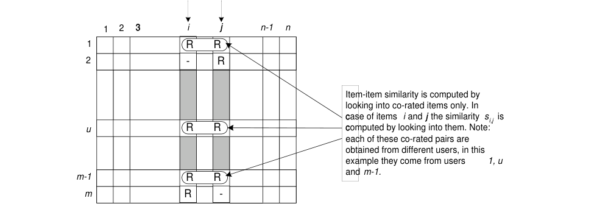
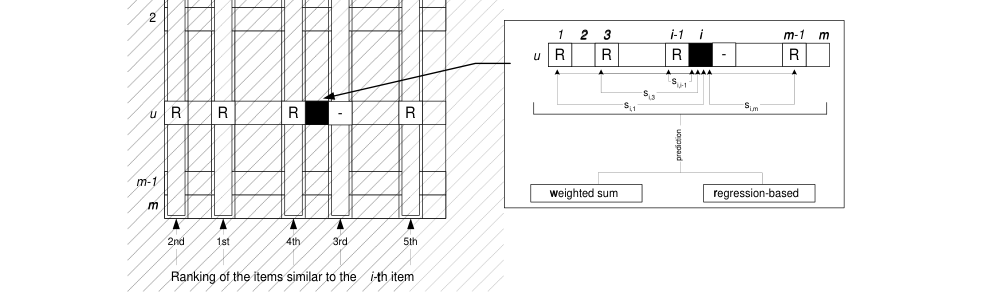
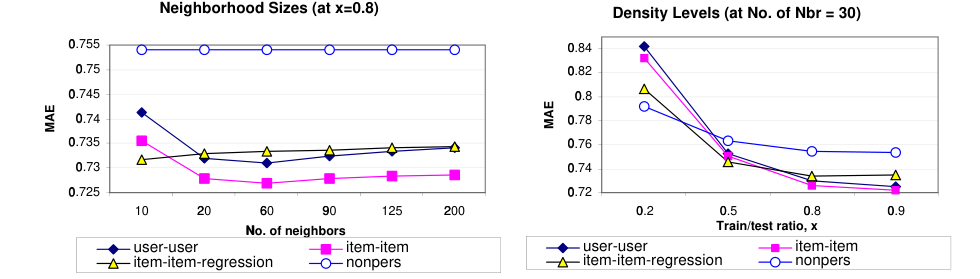

# ItemCF 如何用已有评分预测邻近物品

用户协同过滤在线查与当前用户相似的人，再聚合这些人对候选的评分。用户集合大、个人历史随时变化或共同评分很少时，计算邻域和覆盖长尾都会变难。Sarwar 等把相似关系改为离线计算物品邻域。在线根据一个人已经评价的物品，找目标物品的邻居并汇合其评分。

## 相似度来自共同评分用户

设 $R_{ui}$ 为用户 $u$ 给物品 $i$ 的显式评分，$U_{ij}$ 为同时评价过 $i,j$ 的用户集合。原文比较三种相似度。普通余弦直接用这批用户的两列评分。Pearson 相关先对每列减去物品平均评分。调整余弦对两列都减同一用户的评分均值 $\bar R_u$，用以抵消有的人普遍给高分、有的人普遍给低分的影响：

$$
s(i,j)=\frac{\sum_{u\in U_{ij}}(R_{ui}-\bar R_u)(R_{uj}-\bar R_u)}
{\sqrt{\sum_{u\in U_{ij}}(R_{ui}-\bar R_u)^2}\sqrt{\sum_{u\in U_{ij}}(R_{uj}-\bar R_u)^2}}.
$$

教学例沿用 A 耳机、B 耳机套、C 降噪耳机。用户 1 对 A、C 分别评 5、4，用户 2 评 2、1。若两人的历史均值各为 3、2，计算余弦时两列输入是 $(2,0)$ 与 $(1,-1)$，相似度为 $1/\sqrt 2$。共同评分只决定能用谁计算，没给评分的单元不会填成真实 0 分。共评太少或中心化后某列零向量时，需要另定稀疏回退，原式本身给不出可靠值。[原文 §3.1](https://www.ra.ethz.ch/cdstore/www10/papers/519/node11.html)。

作者原图 2，Sarwar 等，WWW 2001，PDF 第 5 页。先确定两件物品所在列，再找两列都有效的评分行，最后计算相似度。

## 先取邻域，再把用户已有评分传到目标

预测用户 3 对 C 的评分时，从 C 的物品邻域和其已评分历史的交集中取 $N_C(u)$。按论文加权和，以相似度乘用户已给分，再除以相似度绝对值和：

$$
\hat R_{uC}=\frac{\sum_{j\in N_C(u)}s(C,j)R_{uj}}{\sum_{j\in N_C(u)}|s(C,j)|}.
$$

若用户 3 给 A、B 分别评 5、3，而 $s(C,A)=0.7,s(C,B)=0.3$，则预估为 4.4。服务可预存每件物品的最相似邻居和分数，从用户历史读出附近候选，再聚合目标得分。论文第二个预测器先用共同评分拟合邻居到目标的线性变换，再加权预测，用于补偿高相关但绝对评分水平不同的物品。[原文 §3.2](https://www.ra.ethz.ch/cdstore/www10/papers/519/node15.html)。

作者原图 3，同版 PDF 第 6 页。左侧抽出用户历史里可用的邻居，右侧合成对目标物品的预测。

## 邻居可预计算，实验测的是评分误差

MovieLens 实验使用 943 人、1682 部电影的 10 万条显式评分。随机切分后评价 MAE。作者先在训练部分再划分数据做参数敏感性，随后报告多次随机划分的平均 MAE。图 6 在训练比例 0.5 的比较中给出用户邻域 0.755，物品加权邻域 0.749。相同报告还发现回归预测在稀疏、小邻域条件下较好，密度或邻居数增加后可能落后。截断预存邻居可降低运行成本，同时减少能参与预测的邻居。图 8 在同一训练比例 0.8 下，预存 200 邻居的版式从 36.34 秒降为 1.292 秒，这是论文当时对整批评分预测记录的运行时间。[原文 §4.3.4–4.3.5](https://www.ra.ethz.ch/cdstore/www10/papers/519/node31.html)。

作者原图 6，同版 PDF 第 9 页。左图固定训练比例变化邻居数，右图固定邻居数变化训练比例。越低的 MAE 表示留出评分预测越准确。现代隐式召回常用二元共现近似物品关系，那个输入不再带有每个人的评分尺度。可与 [BPR-kNN](../SRC-BPR/阅读笔记.md) 学习相似度矩阵、[Item2Vec](../SRC-ITEM2VEC/阅读笔记.md) 学习可索引向量对照。比较见[物品相似性怎样由交互日志学出](../../知识库/问题/物品相似性怎样由交互日志学出.md)。

采用 [WWW 2001，DOI 10.1145/371920.372071](https://doi.org/10.1145/371920.372071) 的 [GroupLens 原文](https://files.grouplens.org/papers/www10_sarwar.pdf)。正文 §1–6、图 1–8 以 PDF 页和会议 HTML 对照阅读。

中文学习译本 10 页。摘要、正文 §1–5、图注及致谢正文译为中文。用正式 PDF 和会议 HTML 对照重排，参考文献、作者图内标签和原版资助声明保留英文。本地附件为 `.local/papers/SRC-ITEMCF/translation/ItemCF.中文.pdf`。采用版原文与译文均已认证下载并核对完整 SHA-256。见 [PDF 备份说明](../../文档/工具/中文PDF发布.md)。
