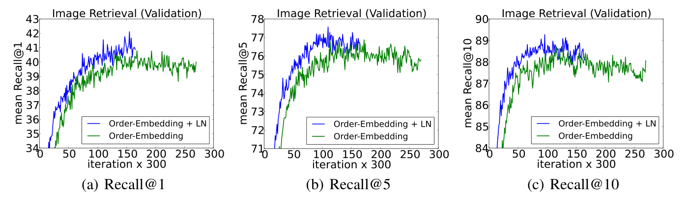
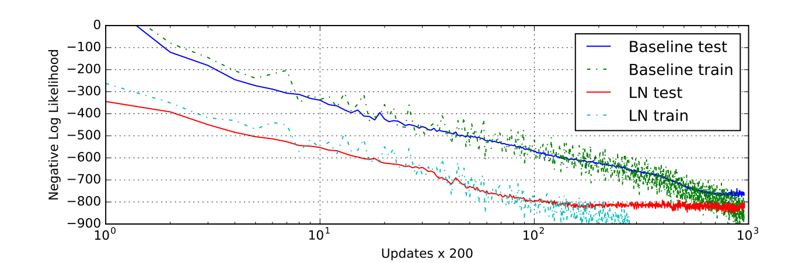
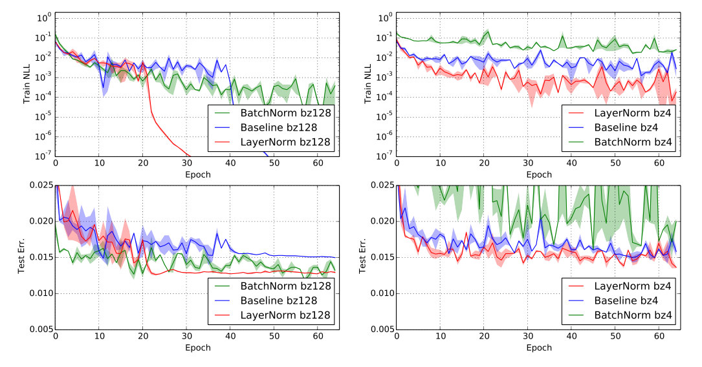

# Layer Normalization：为什么对一条状态向量做归一化

在循环网络里，同一个仿射变换会沿序列反复执行。门控层收到的状态尺度若变化很大，sigmoid 和 tanh 会较早进入饱和区，给前面时间步传回的梯度也会变化。BatchNorm 可以按特征汇总一批样本来调节分布，但序列长度不同、后段位置有效样本变少，批大小较小时统计尤其难估计。Ba、Kiros 和 Hinton 在 §3 改了统计量的取样轴：同一时刻、同一条样本，用该层所有隐藏单元的激活估计均值和标准差。

## 从当前状态算出门控输入

令 $a^t=W_hh^{t-1}+W_xx^t$。固定样本与时间步，取 $\mu^t=\sum_j a_j^t/D$、$(\sigma^t)^2=\sum_j(a_j^t-\mu^t)^2/D$，再计算 $z^t=g\odot(a^t-\mu^t)/\sigma^t+b$，送给非线性函数得到新状态。式（4）示意这一顺序。LSTM 或 GRU 的具体归一化位置见作者附录，门控分支可各有参数。现代实现通常在分母加入 $\epsilon$，以处理方差为零和数值误差。

假设当前序列是 “hello world .”，world 的四维预激活恰为 $[2,4,6,8]$。均值为 5，方差为 5，取 $g=1,b=0$、忽略稳定常数后，非线性读到的是 $[-1.342,-0.447,0.447,1.342]$。下一位置使用自己的统计量，仍读同一组训练参数 $g,b$。若这是语言建模样本，当前位置隐状态送入词表头预测句号，交叉熵的梯度经过门控、归一化与仿射变换回传。每个位置对 $g,b$ 的贡献相加，$\mu,\sigma$ 随当前激活重算并参与求导。推理时仍按同样轴重算。Transformer 中的特征轴和反向公式见 [LayerNorm 与残差梯度](../../知识库/概念/LayerNorm与残差梯度.md#哪些是参数哪些只是当前输入的统计量)。

## 什么变化能被统计量消掉

把四维预激活同时加 3，变为 $[5,7,9,11]$，均值也加 3，中心化结果相同。忽略 $\epsilon$ 时乘同一正数也会被分母抵消。对整个输入样本或权重矩阵重缩放，要先确认偏置与操作位置。给权重各行加同一个行向量会使每个隐藏单元多出同一个标量，从而被中心化消去。若给原始输入加某向量 $c$，则得到 $Wc$，其各维一般不同，归一化后可能变化。§5 表 1 比较了按层统计、按批统计与 WeightNorm 对这些变换的响应，附录的曲率推导解释了参数重缩放如何改变局部几何。

## 曲线读步数、耗时与最终误差

作者原图 1，固定版第 6 页，Ba 等。横轴是迭代次数，三幅图分别读 Recall@1、5、10。两种 Order Embedding 使用相同模型结构和初始超参数，作者报告带 LN 的模型达到最佳验证点只用约 60% 的耗时。表 2 是 MS COCO 五份测试切分平均，和使用一份切分的外部报告口径不同。

作者原图 5，固定版第 9 页，Ba 等。横轴为更新次数，纵轴为负对数似然，图例标出基线和 LN 的训练与测试曲线。该 IAM-OnDB 设定用批大小 8、序列长度 500，LN 更早达到可比损失。CNN 阅读理解和 DRAW 也报告优化改善，各自的输入、基线与目标见 §6.2、§6.4。Skip-thought 的分类与相似度任务结果有升有降，须看表 3 的各列。

作者原图 6，固定版第 10 页，Ba 等。左列批大小 128，右列 4。上排训练负对数似然，下排测试误差。右列显示小批时 BN 波动较大，LN 依靠单样本统计保持较平滑的训练。§6.7 对卷积的初步观察则是学习速度改善，但最终泛化逊于 BN。归一化轴在架构中应与激活形状及统计条件一起选择。

阅读范围为固定版摘要、§1–7 与相关附录，正文中文 PDF 保留作者图、英文文献与附录。实验数字为作者报告。[固定原文](https://arxiv.org/pdf/1607.06450v1) · [中文 PDF 访问说明](../../文档/工具/中文PDF发布.md)
