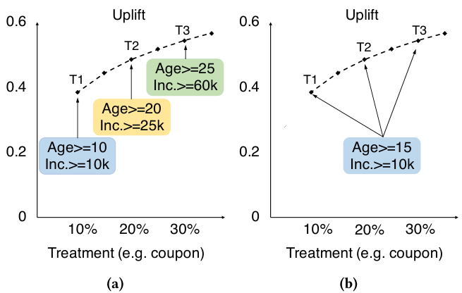
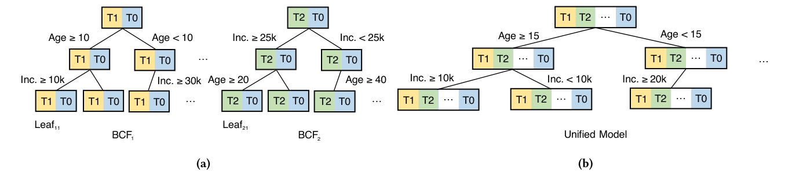
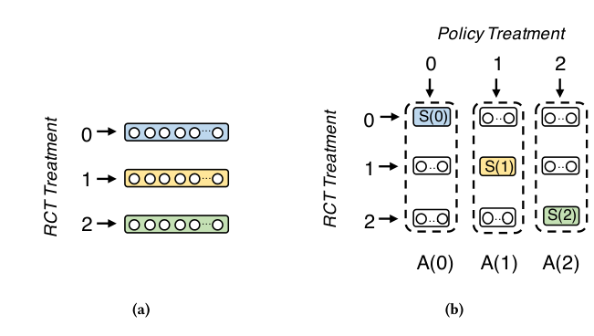
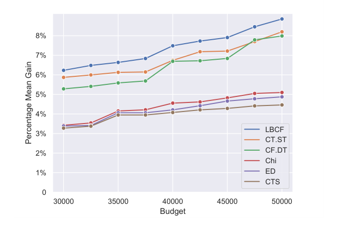
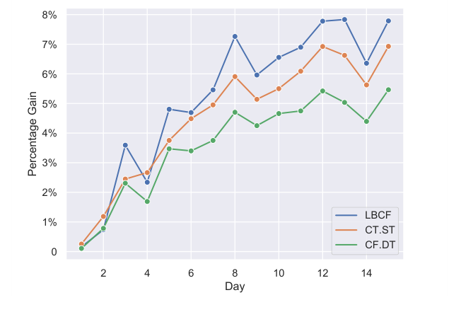

# LBCF 怎样在多个券档之间比较增量并分配预算

逐档训练二元因果森林时，用户 A 在券 1 的模型可能和一组近邻同叶，在券 2 的模型却跟另一组人同叶。两边都估计相对无券的条件效应，有限样本下的局部人口与平滑方式却不同。LBCF 把所有处理档放进同一座森林，再用统一预算价格给每人选档。建模阶段比较同一局部人群里的不同动作，求解阶段比较按预算价格扣除各自成本后的净增量。 [arXiv v2 §1–4](https://arxiv.org/pdf/2201.12585v2#page=3)

Ai 等，v2 第 3 页图 1，从采用版原 PDF 裁出。左图三组估计的局部年龄和收入不同，右图多个券档共享邻域。只要目标对照一致、假设成立且估计充分，分开建模理论上也能估同一个 \(x\) 的各档效应。该图说明有限的叶节点样本如何改变比较。 [v2 图 1](https://arxiv.org/pdf/2201.12585v2#page=3)

## 一次分裂同时考虑人群异质性与档位差异

历史行是 \((X_i,T_i,Y_i)\)，用长度 \(K\) 的非对照指示编码 \(T\)，对照为全零。UDCF 在父节点内中心化指派矩阵与结果，通过局部最小二乘估计 \(K\) 维效应，然后把每行的拟合残差乘上 \(\tilde T_i(\tilde T^\top\tilde T)^{-1}\) 得伪结果向量 \(\rho_i\)。固定这一批伪结果，对候选切分的各子节点按处理档累计 \(\rho_{ij}\)，平方再按子节点样本量归一，以较快的节点间分数筛出前 \(m\) 个切分。第二步重估这 \(m\) 个切分的各子节点效应。设一个子节点两档效应为 \((20,30)\)，其对节点内分数的贡献为 \((20-25)^2+(30-25)^2=50\)。如果两档均为 25，这部分为零。模型倾向保留能在局部区分处理档的切分。最终同叶频率形成森林权重，推理对加权处理与结果做局部回归，一次给出用户对各档的增量向量。某档缺乏局部支持时，统一分区也解决不了处理矩阵秩不足。 [v2 §4.2.1、式 (3)–(4)、算法 1](https://arxiv.org/pdf/2201.12585v2#page=5)

Ai 等，v2 第 4 页图 2，从采用版原 PDF 裁出。左侧不同树用不同切分，右侧每个节点同时保留二元以外的多个处理档。具体比较的结果基准仍是共同对照。 [v2 图 2](https://arxiv.org/pdf/2201.12585v2#page=4)

## 同一价格下每人可以并行选档

论文表 1 的用户 1 两档为增量／成本 \(20/1\)、\(30/2\)，ROI 贪心为他选前者。整批预算 6 时，把另一位低增量用户的 1 单位预算移给用户 1 升档，合计价值从 92 提至 98。DGB 将同一个 \(\lambda\) 发给各分片，在每人可选档及无券的净值 \(0,\theta_{i1}-\lambda c_{i1},\ldots\) 中找最大值。若 \(\lambda=5\)，用户 1 两档净值为 15 和 20，优先第二档。每个分片只需汇总该价格下的成本。对偶目标为 \(g(\lambda)=B\lambda+\sum_i\max(0,\max_j(\theta_{ij}-\lambda c_{ij}))\)，凸且分段线性。总成本超过预算时一个次梯度为负，向上调整价格区间。成本低于预算时则向下调整。每轮复杂度为 \(O(NK)\)，按书中价格区间二分还有对数轮数。 [v2 表 1，式 (5)–(8)，算法 2](https://arxiv.org/pdf/2201.12585v2#page=6)

该对偶来自 LP 放松。论文按净值严格为正才选档，未给折点并列恢复的整数最优性证明。一人只有一档，价值 10、成本 6、预算 5，取 \(\lambda=10/6\) 时放松解可选 \(5/6\)，整数可行解只能不选。再看预算约束的证明，\(\lambda\) 接近零时被选的是最大增量对应的档位，未必是最贵档位。若最大增量档已在预算内，零价格可为最优。正成本并补上零动作时，高端仍可用最大正增量成本比作价格界。 [v2 §4.2.2 命题 2 与式 (8)](https://arxiv.org/pdf/2201.12585v2#page=6) · [共享预算与选档](../../知识库/问题/组合营销策略如何共享结构并估计因果增量.md#同样的增量为什么会选出不同的券)

## 随机日志怎么衡量一整套券策略

Ai 等，v2 第 4 页图 3，从采用版原 PDF 裁出。列是策略建议动作，行是日志里实际随机动作，对角线才同时命中。对每列 \(A(j)\) 用命中集合 \(S(j)\) 的结果均值，再按策略列在全体中的份额加权。若 100 人中 60 个不发、40 个发券，两列命中均值为 10、15，策略期望结果估计为 12。若全体对照结果均值为 10，PMG 为 20%。各列分配概率对该列人群近似常数且有命中时能按原式估计。不同分层的概率有差异时可用已知概率校正，极少命中的动作需要报告覆盖。 [v2 §3、图 3、式 (2)](https://arxiv.org/pdf/2201.12585v2#page=4) · [冻结策略价值](../../知识库/问题/怎样验证补贴增量的排序幅度和策略价值.md#选择这条投放规则能得到多少净收益)

Ai 等，v2 第 7 页图 5，从采用版原 PDF 裁出。视频平台用活动积分为处理，结果是活动参与时长，离线对照受各自的预算和随机日志支持限制。 [v2 §5.2](https://arxiv.org/pdf/2201.12585v2#page=7)

Ai 等，v2 第 8 页图 6，从采用版原 PDF 裁出。线上各算法有相同预算，另设不发激励组，最后一天 LBCF、CT.ST、CF.DT 分别为 7.79%、6.87%、5.51% 的参与时长提升。线上 CF.DT 同用 DGB，差异主要用于比较 UDCF 与分档森林拟合路径。原文也承认用户分享活动可能破坏单位之间无干扰的条件。 [v2 §5.3、§7](https://arxiv.org/pdf/2201.12585v2#page=8)

## 版本与译本

Meng Ai、Biao Li、Heyang Gong、Qingwei Yu、Shengjie Xue、Yuan Zhang、Yunzhou Zhang、Peng Jiang。采用 WWW 2022 作者版 arXiv v2，正文、算法、图表和对偶凸性附录，未运行模型。中文 PDF 共 8 页。摘要、正文、致谢、算法叙述和正文图表说明。图内文字、参考文献和附录保留原文。译本已逐页渲染核对，采用原文与译本均完成私有备份和认证下载校验。 [中文 PDF 私有下载说明](../../译文/PDF目录.md) · [固定原文](https://arxiv.org/pdf/2201.12585v2) · [会议 DOI](https://doi.org/10.1145/3485447.3512103)
