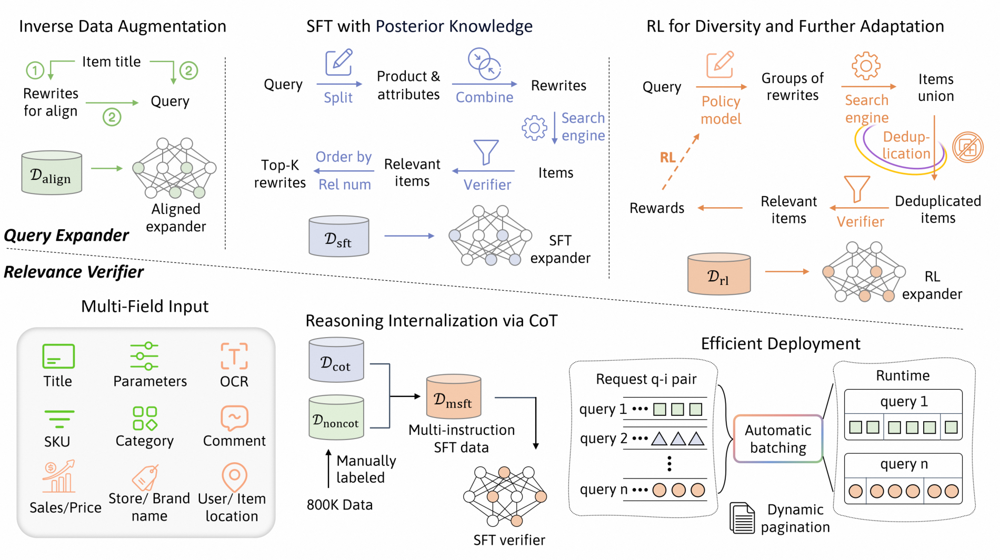

# LEAPS：分开做查询扩展和原意核验

用户要“500–800 元、适合海滩婚礼、不要纯黑或大图案的男士亚麻西装外套”。把每项限制都拼进一次检索，可能因标题或索引没记录“海滩婚礼”而零召回。若只搜索“男士亚麻西装”，又会给用户留下大量超预算、图案不符或场景欠合适的候选。LEAPS 让查询扩展器发出互补的检索请求，把候选聚合去重后，再由验证器逐件对照**完整原查询**。这里的对话式搜索指带多个约束的单轮自然语言查询。底层检索按原接口提交查询并返回候选。[原文 §1、§3.1，第 1–3 页](https://arxiv.org/pdf/2601.05513v2#page=3)

*作者原图 1 · 上半图从商品标题到改写监督、实际召回和 GRPO 奖励，下半图从多源特征和标签到验证器与在线分批。Lei Wang 等，arXiv:2601.05513v2 第 3 页。*

## 先学商品语言，再让检索结果选择示范

先从商品标题得到标准改写，提示 DeepSeek-R1 逆向生成类似真实日志的口语查询，形成“口语输入 → 商品词改写”的示范。用目标改写的前序 Token 和输入构建上下文，扩展器预测每个目标位置的 Token，交叉熵更新语言模型。这个阶段能把口语接到目录用词，但单凭文本相似度无法判断某项属性会不会过度限制召回。[原文 §3.2.1，式 (3)，第 4 页](https://arxiv.org/pdf/2601.05513v2#page=4)

后验 SFT 在同一个婚礼外套请求上先拆核心商品 $p$ 和属性集合 $A$，固定商品，从属性子集构造候选。诸如“男士亚麻西装外套”“男士亚麻西装外套 海滩婚礼”只是说明动作的教学例子，最终仍保留用户的完整原句给验证器。每条候选实际查后端，对返回集 $I$ 用冻结验证器筛出 $I^+$，以 $|I^+|/|I|$ 排序，空集记 0。作者实验选 Top-4，将同一原查询下的优选改写串联成监督输出。训练中代入模拟画像，线上验证用实际画像。对 $|A|>6$ 的少数训练样本，合并语义等价属性后抽 50 个子集；穷举属性会有 $2^{|A|}$ 个组合。作者的 500 条查询核查支持抽样大致保留效果，不能推及任意约束长度。[原文算法 1、§3.2.2，第 4–5 页](https://arxiv.org/pdf/2601.05513v2#page=4)

## 用去重后的相关覆盖奖励一组改写

单条试搜的相关比例相近时，模型可能反复生成近义查询，返回同一批高分商品。强化学习对一个原查询采样多组改写，按组执行并聚合去重。设 $I_r$ 为一组改写在预算内经验证的相关商品去重集，部署预算 $N=100$。原文式 (4) 的有效相关性奖励为

$$
R_{\mathrm{eff}}=\frac{|I_r|}{N}.
$$

用缩小的教学预算 $N=4$ 举例，两条改写各返回两件。第一组两条都返回符合约束的 A、B，去重后奖励 $2/4$；第二组分别返回 A、B 和 C、D，若 C、D 也符合原查询，奖励为 $4/4$。第二组若有一件纯黑，验证器剔除后只得 $3/4$。所以同义复写只有在不能增加相关商品时得不到额外贡献，公式没有另列文本相似度惩罚。重复是否实际耗掉名额还取决于各路检索预算、去重顺序及补位规则。论文指出部署预算和等权分配，未完整给出这些边界的实现。GRPO 在同查询下比较整组改写的奖励，按组内相对优势更新扩展器。离线搜索后端和已冻结验证器只用来打分。组大小为 8，KL 系数 0.04；强化学习样本限于预期奖励 $[0.1,0.9]$。[原文 §3.2.3，第 5 页](https://arxiv.org/pdf/2601.05513v2#page=5)

## 用商品证据复核完整原句

对候选外套，标题可能只写“度假西装”，材质需要看详情页 OCR，穿着场景可参考评论，价格与颜色再从相应字段核对。验证器每次读取原查询、候选商品与可用用户情境，输出相关或不相关标签及短理由。OCR 离线制成字段，线上读取已建索引数据；还纳入价格、历史销售速度、店铺或品牌信号和用户位置等。销量和声誉不能直接证明满足“不要纯黑”一类硬约束，原文未给出证据冲突、字段缺失或弃权的判定协议。[原文 §3.3.1，第 5–6 页](https://arxiv.org/pdf/2601.05513v2#page=6)

训练约 80 万个人工标注的查询—商品对。标注员双标并裁决，最终正负比约 1:1.4。DeepSeek-R1 在看不到人工结果时生成理由，只保留结论一致的样本，后续用标签与理由一起做 SFT。这样可以筛去与人工结论冲突的理由，不能逐条保证理由引用的证据真实。验证器与人评一致性的另一个 5000 对核查报告约 95% 一致和 $\kappa=0.88$，高复杂组为 0.82。1000 查询的小规模训练对照中，用人工标签或验证器标签作为奖励得到 F1@20 0.82 对 0.81。两个核查看的是特定抽样、评分和训练协议。[原文 §3.2.3、§3.3.2，第 5–6 页](https://arxiv.org/pdf/2601.05513v2#page=5)

*作者原图 2 · 左边展示逐候选判定，右边展示过滤后的双列结果。图是单个案例，离线表和线上随机抽查另列统计。Lei Wang 等，arXiv:2601.05513v2 第 10 页。*

## 扩展后是否补回了有效商品

两后端各自比较同一套端到端候选接口。淘宝内部 10,000 条对话式查询由专家评价候选；ESCI 用英文目录构建 BM25+BGE，正类含 Exact 和 Substitute。表 1 中 LEAPS 的 F1@20 分别为 0.81、0.73，原召回为 0.60、0.53，MiniELM 为 0.62、0.58。跨后端方向一致，不能把本结果读成标准 ESCI 单点重排排行榜。表 2 更能分解权衡：仅扩展器 P/R/F1 为 0.48/0.85/0.61，仅验证器为 0.84/0.42/0.56，完整方案为 0.79/0.82/0.81。拿掉后验 SFT 后 F1 为 0.67，拿掉思维链后为 0.72，拿掉多源特征后为 0.71。多源消融一起去掉 OCR、评论、销量和店铺品牌，无法逐项归因。表 3 在高复杂组的 F1 为 0.70 对原召回的 0.32，单约束组为 0.86 对 0.79；原文的约束计数来自 Qwen3-32B 并在 200 条人评抽样上复核。[原文表 1–3，第 7–9 页](https://arxiv.org/pdf/2601.05513v2#page=7)

§4.1 的“验证器只作为训练时组件”与式 (2) 和“仅验证器”消融描述存在张力。本笔记依照方法和消融解释其筛选职责，离线最终指标仍以独立专家判断为准。具有其他后端和预算的验证应检查正类及完整召回真值口径，工业内部的候选标注范围按原文报告。

2025 年 7 月淘宝 AI 搜索对话式流量 A/B 报告 CTR 9.4%→11.9%，SRR 77.0%→91.4%，每会话点击 0.82→1.18。SRR 指完整链路有至少 10 件相关商品的查询比例，与零结果率或购买转化不同。表中 CTR 相对增幅写 +27.1%，用显示值相除约 +26.6%，实际计算精度未披露。另有 200 个多约束会话抽查，首屏完全符合条件为 84% 对 41%。论文记录 INT8、TP=2、批处理、自适应补页、约 290 ms P99 与约 150 峰值 QPS，未公布充分的硬件和请求分解，不能把插件时延相加、或与另篇的全链路时延作同协议对照。[原文 §3.1、§3.3.3 与表 4，第 3、6、9–10 页](https://arxiv.org/pdf/2601.05513v2#page=9)

## 采用版与中文 PDF

采用 arXiv:2601.05513v2，条目修订为 2026-05-12，采用版题名页印 2026-05-13。中文工作译本覆盖摘要、五节正文、两图四表的标题、说明性脚注和算法注释，保留原图文字、四个编号公式及 33 条参考文献。12 页 PDF 已逐页目视，原文和中文 PDF 已完成私有备份与认证下载。可编辑工程和本地译文位于 `.local/papers/SRC-LEAPS/translation/`。[固定原文](https://arxiv.org/pdf/2601.05513v2) · [私有 PDF 访问说明](../../文档/工具/中文PDF发布.md)

复习时可从[可执行的检索请求](../../知识库/问题/复杂查询怎样生成可执行的检索请求.md)对照三种反馈位置，或进入[相关性证据与服务接口](../../知识库/模块/搜索相关性判断与验证.md#q-evidence)查看验证侧的职责。
