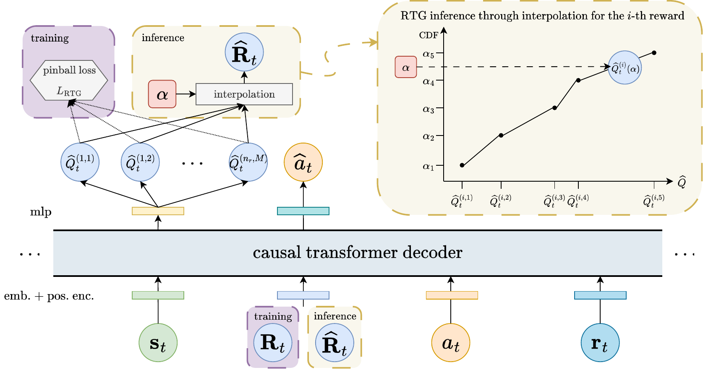
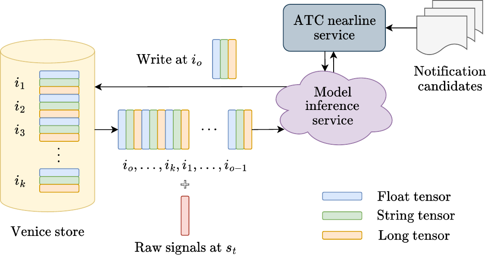
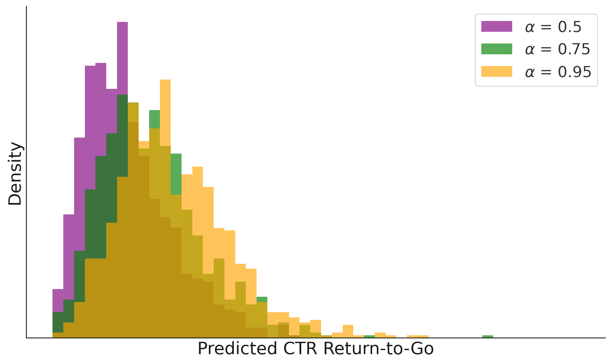
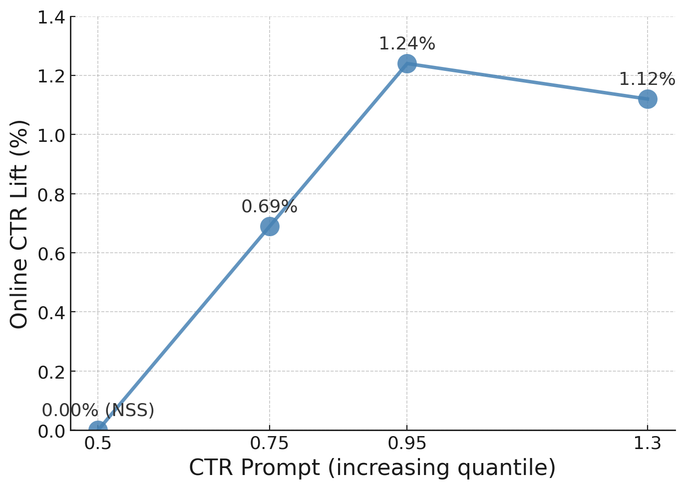

# LinkedIn 通知 Decision Transformer：从历史回报分位数生成动作

到了系统的下一轮检查，排序器给一个用户选出一条通知。系统可更新应用角标、发一条系统 Push 或暂不发送。一个只看点击率的规则会优先拿眼前容易得到的反馈，忽略此刻发送会怎样影响后续疲劳、访问与可用机会。LinkedIn 此前用 [基于 CQL 的多目标通知策略](../SRC-LINKEDIN-NOTIFICATION-MORL/阅读笔记.md) 学习长程动作价值。本篇把训练改写为条件化动作预测，用同一段用户轨迹训练回报分位数和动作两个任务，再在上线时用预测的回报提示引导选动作。[固定 v1，§1–3](https://arxiv.org/pdf/2509.02458v1#page=1)。

## 日志中的未来回报怎样成为训练条件

设上一轮用户收到应用角标，接下来打开应用浏览，然后这一轮又产生候选。每轮状态 $s_t$ 含最近发送量、距上次访问的时长、候选内容与用户画像等。动作 $a_t$ 取决于该候选允许的渠道。奖励向量 $r_t$ 同时容纳按渠道预测的点击效用、两次状态之间实际发生的访问以及自适应发送量惩罚。点击预测降低标签方差，也把上游模型的偏差带入训练。单个用户可能在通知未发时仍然访问，因此日志里记录的访问不能简单归给发出的那条。

对持续交互流按长度 $T+H$ 切窗口。前 $T$ 步作为动作预测上下文，额外的 $H$ 步供计算上下文末端所需的未来奖励。对窗口内第 $t$ 步，
$$R_t^{(i)}=\sum_{\ell=0}^{H}\gamma^\ell r_{t+\ell}^{(i)}.$$
这里 $i$ 是奖励项索引，$\gamma$ 让远期奖励折减。比如示意取 $H=2,\gamma=0.9$。若该步和随后两步访问奖励分别为 $0,1,0$，它的访问 RTG 就是 $0.9$；发送量惩罚和点击效用以各自轨迹独立求和。动作头用历史状态序列、实际 RTG 和日志动作做交叉熵训练。RTG 来自观测后续，在这一轮线上决策时尚未实现。作者报告动作预测和 RTG 预测这两个训练目标，没有训练一个可以模拟未来状态的用户环境。[固定 v1，§3–4，图 1](https://arxiv.org/pdf/2509.02458v1#page=3)。

Borja Ocejo 等，arXiv v1 图 1，PDF 第 3 页。由作者 LaTeX 矢量附图转 PNG。训练时先看真实 RTG 怎样进入动作头，推断时对应位置由分位数分支产生。组件承接上例中的下一条候选。

## 当前状态怎样决定一个可用的回报提示

基础 DT 可以在回合开始指定一个目标，之后逐步扣除已得到的回报。通知的点击奖励可能在下一次检查后才到，无法在检查点上准时扣除。全局常数也可能远离某位用户当前状态能达到的回报。本文改用条件分位数。对当前历史和现态，网络用 pinball loss 学习每个奖励维度的若干分位点。目标分位数高时，低估的损失权重更大。例如 $\alpha=0.75$ 时，低估 1 加 0.75，等幅高估加 0.25。

沿用同一用户。若访问 RTG 在 $\alpha_l=0.5$ 和 $\alpha_u=0.75$ 处的预测分位数分别为 0.8 和 1.3，则选择 $\alpha=0.60$ 需要 $0.6\times0.8+0.4\times1.3=1.0$。计算出的实数回报向量进动作分支。候选允许角标但不允许 Push 时，合格动作集合的嵌入也进入动作分支。正文写的是线性投影后做乘法交互，缺少硬屏蔽或非法动作兜底的细节。插值要求目标分位数被训练分位包住，端点与越界规则也未写清。各维分别估计边际分位数，混合得到的回报向量未必在历史中共同出现。验证集和线上试验共同约束可用的设置。[固定 v1，§4.2，式 (3)–(10)](https://arxiv.org/pdf/2509.02458v1#page=4)。

Borja Ocejo 等，arXiv v1 图 2，PDF 第 4 页。作者附图转 PNG。图中 ATC 负责驱动近线请求，Venice 保存带时间戳的历史张量，模型服务按时间排序后读入当前用户上下文，完成推断后覆盖最旧条目。存储最多支持 16 步，正文线上配置选上下文 4，在质量与 CPU 实例开销之间取舍。[固定 v1，§5 与表 2](https://arxiv.org/pdf/2509.02458v1#page=4)。

## 从动作拟合到线上策略，需要补哪一步证据

离线数据来自随机抽取的 2% LinkedIn 用户，运行带 $\epsilon$-greedy 探索的 CQL 一周，再按用户做 70/30 训练验证。最佳策略报告动作预测准确率 96.7%，分位数损失 0.358。动作准确率衡量对数据中决策的拟合，无法直接回答部署后用户状态会发生什么。线上每项实验持续一周，在随机选出的 2% 用户中试候选 DT，以原 CQL 为对照。表 1 的最优 DT 整体比较为会话 +0.72%、通知量 −1.68%、CTR 变化不显著。表中三个增量行属于不同改进实验，特征也比原 CQL 丰富，不能把整体差异单独归给序列架构。表 2 中上下文长度 4 的动作准确率相对提高 0.194%、服务 CPU 实例成本提高 25%，长度 8 对应 0.202% 和 60%。[固定 v1，§6.1–6.4，表 1–3](https://arxiv.org/pdf/2509.02458v1#page=6)。

Borja Ocejo 等，arXiv v1 图 3、图 4，PDF 第 6、7 页，沿用作者附图。图 3 读模型给出的目标回报，图 4 读不同设置下实际观察的 CTR。后者的每个点来自独立 A/B。按横轴 0.5、0.75、0.95、1.3，图中 CTR 增幅依次为 0.00%（不显著）、0.69%、1.24%、1.12%。最后一档下降，与正文“持续改善”不符。1.3 也超出了分位水平的定义域，原文没有解释它怎样得到。图中各点不能作为同一试验内的剂量效应。[固定 v1，§6.5](https://arxiv.org/pdf/2509.02458v1#page=6)。

对[月初预选优惠发送日](../../知识库/总览/优惠信息Push触达场景.md)，本篇的历史缓冲和回报提示适合研究执行时可改期的版本。若策略要在月初一次定完日期，需要先定义月初可用的状态及整月候选日期动作。现有论文的系统以固定节奏让模型对当前候选选渠道或不发，且只在其 LinkedIn 人群、动作覆盖和实验窗口内比较了回报策略。

[发送或等待的问题比较](../../知识库/问题/通知候选到达后怎样决定发送或等待.md)对照所需状态、监督与线上验证条件。

## 阅读范围

采用 arXiv 固定 v1，读摘要、正文 §1–8、致谢、四图三表及参考文献表，并对照作者 LaTeX。原件标注 Under review，原始论文与项目机制未做复现。正文译本保留作者图内英文和书目。[采用版本与 CC BY 4.0 声明](https://arxiv.org/abs/2509.02458v1)。

正式中文正文 PDF 为 `.local/papers/SRC-LINKEDIN-NOTIFICATION-DT/translation/LinkedIn-Notification-DT-zh.pdf`，共 12 页，按作者源码译后单栏重排，保留四图、三表、十式、致谢和 36 条参考文献。逐页渲染、中文提取和引用校验通过。可编辑主文件为同目录下 `translated-sources/main.tex`。

中文 PDF 与采用版原文的[私有备份下载说明](../../文档/工具/中文PDF发布.md#登录下载)。
