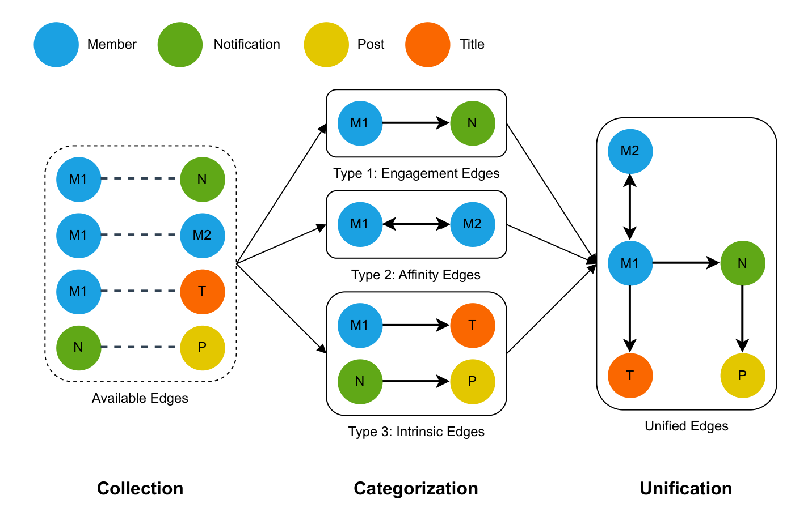
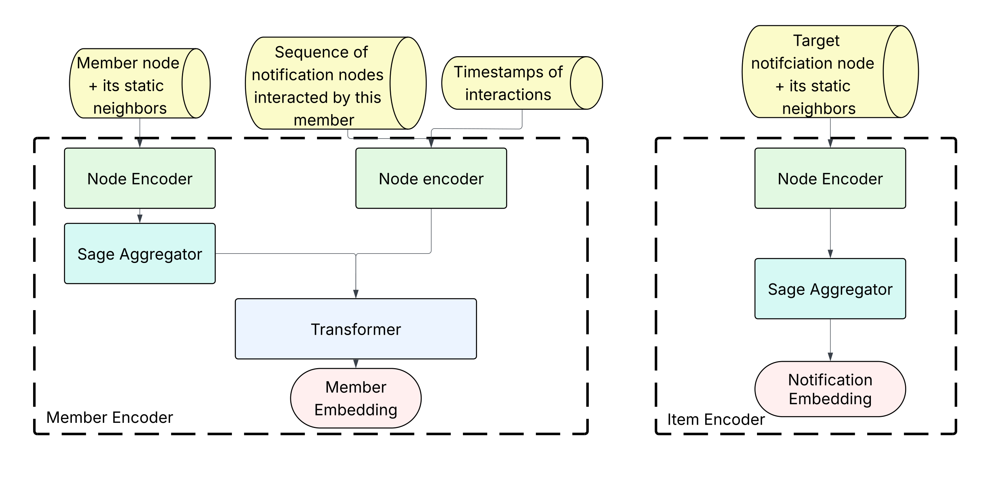
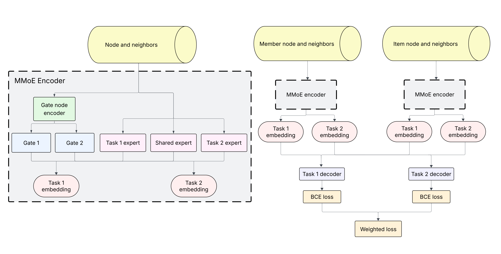
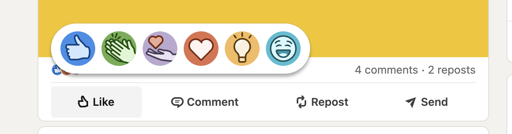
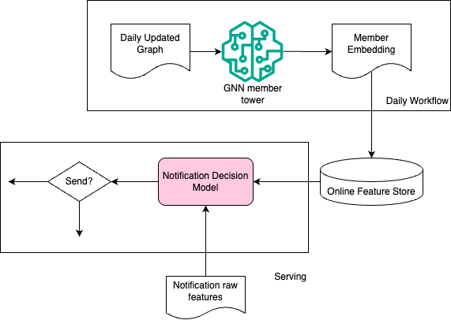

# LinkedIn 跨域通知图网络：把动态和邮件互动带入通知决策

通知排序器要判断某条通知值不值得发给某位会员。仅用通知日志时，一个很少点通知的人几乎没有可用历史，即使他经常在动态里看同一位创作者，也可能排不准这位创作者的通知。LinkedIn 把会员、通知、动态和邮件接到一张异构图里，通过邻居传播学习会员表示。训练时用会员与通知的双塔学习点击和点击后的互动，部署时每天批量产出会员向量，交给原有的在线通知链路使用。[原文 §1、§5](https://arxiv.org/pdf/2506.12700v1#page=1)

## 从一条动态互动走到通知

假设会员陈宁昨天点过周敏的求职动态，过去几周也常看她的内容，今天有一条关联该动态的通知等待评分。一次已发生的点击给出有向**互动边**，较长时期的浏览者与作者关系给出双向**亲和边**，通知指向对应动态的关联属于**固有边**。这样，即使陈宁从未收到过这条通知，会员塔能聚合他与内容、创作者的既有关系，物品塔也能聚合通知所连接的动态等上下文。节点起始特征包括 BERT 内容嵌入、会员历史内容聚合向量及行业或内容类别等离散特征。三种边代表不同观测，既有亲和关系本身无法说明今天会点击。[原文 §3.1–3.2](https://arxiv.org/pdf/2506.12700v1#page=3)

作者图 1，Shihai He、Julie Choi 等，arXiv v1 第 3 页，源码原图转 PNG。沿着图里的三类边看，交互发生在会员与内容之间，亲和关系可在人之间传递，固有关系把不同内容实体接到一起。

## 怎样把邻居和时间变成会员表示

对每种关系，函数 $f$ 用源节点、目标节点的上一层表示与可用的时间戳生成消息。聚合器收拢同一目标的邻居消息，再经非线性更新目标节点表示。对陈宁而言，动态、邮件和以往通知的数据都可以沿采样路径进入会员表示。通知物品塔也聚合其异构邻居。原文列举均值、求和、注意力作为聚合选项，未公开各关系的具体实现参数。[原文 §4.1，式 1–2](https://arxiv.org/pdf/2506.12700v1#page=4)

作者图 2，采用版第 4 页，源码原图转 PNG。左侧会员塔的时序分支保留近期通知邻居的顺序，右侧物品塔使用异构消息传递。

假设陈宁昨天点了上条求职通知，而更早的一条未点。论文从会员节点相连的近期通知邻居中采样，用 Time2Vec 把时间戳编码成一个线性分量和多个可学习的正弦分量，将带时间的表示与标准消息传递嵌入拼接后交给 Transformer。他昨天点击的邻居仍可带入训练。预测标签发生之后的互动边须排除。若亲和边、会员历史向量也用到未来数据，同样会泄漏，所以实现时这些派生特征也需要依预测时点截断。论文明确给出了互动边的时间限制，未交代所有派生特征的截断方式。同一节的“四个时段”只列出构图 35 天、训练 14 天与验证 7 天。后文另给按时间保持一致的 80%/10%/10% 划分，未解释两组划分如何对应。[原文 §3.3–3.4、§4.2 式 3、§6.1.2](https://arxiv.org/pdf/2506.12700v1#page=4)

## 点击和点击后的职业互动共享多少

pClick 预测已经展示的通知会否被点击。pPI 则关心已经点击后有无评论、点赞、长停留等职业互动。若陈宁点开通知，随后只看了一眼，点击任务得到正例，职业互动任务可得到负例。论文未详述 pPI 的样本掩码或负例抽样，不能把所有未点击都当作 pPI 负例。多任务架构中每个专家都是实体编码器。任务门根据当前节点特征输出专家权重，任务内部的会员向量和物品向量再一起进入对应的解码头。这个设计允许 pClick 更多利用近期通知兴趣，pPI 更多利用来自创作者关系的信号，同时共享一部分专家。这里的权重倾向用于说明门控接口，论文没有报告学得的专家分工。[原文 §4.3、§6.1.2](https://arxiv.org/pdf/2506.12700v1#page=4)

作者图 3，采用版第 4 页，源码原图转 PNG。每个任务从专属与共享专家取表示，按门的权重合成，再计算对应的二元交叉熵。论文式 7 的求和指标 $i$ 未出现在被加项中。按其文字含义应沿任务求和，例如 $\sum_i\alpha_i\mathcal L_i$，具体代码未经复现。多场景共享对象怎样区分，见[问题页](../../知识库/问题/多场景怎样共享模型又保留差异.md#先共享关系图再向通知排序器供给表示)。

作者图 5，采用版第 6 页，源码原 PNG。图中列出点开通知后可能出现的点赞、评论和转发等互动。线上职业互动率 PIR 的分母是已点击通知。表 5 没有报告 PIR 的结果。

## 在线只读当天已算好的会员向量

每天更新异构图，批量跑会员塔，把会员向量写入在线特征库。当陈宁的通知候选进入第二阶段排序器（SPR），排序器查当天已有的会员向量并结合实时输入决定发送资格与优先级。因而，两次每日刷新之间的新行为不会立刻进入这个 GNN 向量。论文描述的是向下游供给表示的接口，日更时间是特征生产频率，Time2Vec 对既有互动编码，两者都没有输出“隔多久再调用系统”。后者要看[发送或等待](../../知识库/问题/通知候选到达后怎样决定发送或等待.md)或目录中的自触发调度工作。[原文 §5、§6.3](https://arxiv.org/pdf/2506.12700v1#page=5)

作者图 4，采用版第 5 页，源码原 PNG。沿图从每日构图读到在线特征库，再到通知发送排序。线上可低延迟读取预计算向量，原文未给出延迟分位数。

## 离线消融与线上收益分别由哪组比较得到

- 表 3 比较跨域图 GNN 和单域图 GNN，报告离线 AUC 提升 **8.089%**。表 3 未给绝对 AUC，也未在表中标注指标对应的具体预测任务。
- 表 4 用对应任务的无时序单任务 Sage 为基线。时间建模的 pClick AUC 提升 **0.265%**，Sage MTL 的 pClick、pPI AUC 分别提升 **0.063%**、**0.327%**。这些对照不能把三项数字相加，表中也没有时间建模和 MTL 的联合消融。
- §6.3 与表 5 报告 14 天线上 A/B。6% 通知流量使用接入跨域 GNN 会员向量的 SPR，8% 作为既有决策模型对照。会话数 **+0.07%**，WAU **+0.10%**，站内通知 CTR **+0.62%**，Push CTR **+0.30%**，表注均 $p<0.01$。这组结果衡量在线加入跨域表示后的整体变化。作者没有给线上单域 GNN 对照，因此无法估计线上收益中多少来自加入其他域。文中宣称规模是约 15 TB、86 亿节点、逾千亿边，每训练轮约 32 GPU 日。表 1、2 只展示列出的部分类型规模。[原文 §6–7、表 1–5](https://arxiv.org/pdf/2506.12700v1#page=5)

## 原文与阅读范围

采用 [arXiv:2506.12700v1](https://arxiv.org/abs/2506.12700v1) 的固定版及配套源码，核对摘要、§1–8、五图五表和七式。CIKM 2025 出版题名为 *Cross-Domain Graph Neural Networks for Notification at LinkedIn*，预印本使用较长题名。未运行作者实现。7 页中文 PDF 已逐页验收，覆盖摘要、正文、脚注和图表标题，图内英文和参考文献保留。存取信息见[中文 PDF 目录](../../译文/目录.md)与[本批交接](../../文档/会话/PAPER-022.md)。[正式出版 DOI](https://doi.org/10.1145/3746252.3761581)
