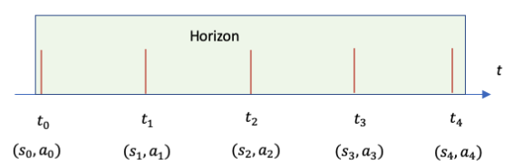
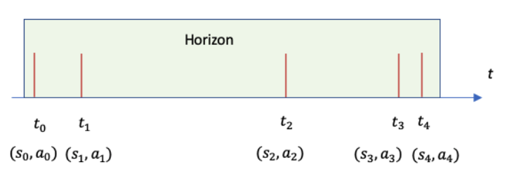
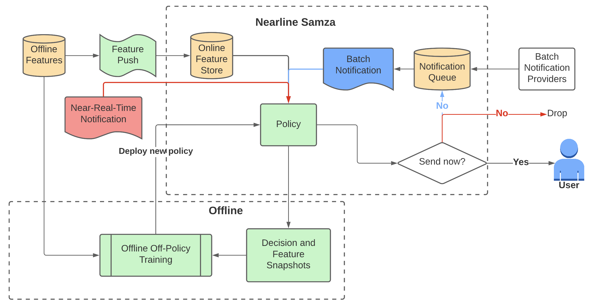
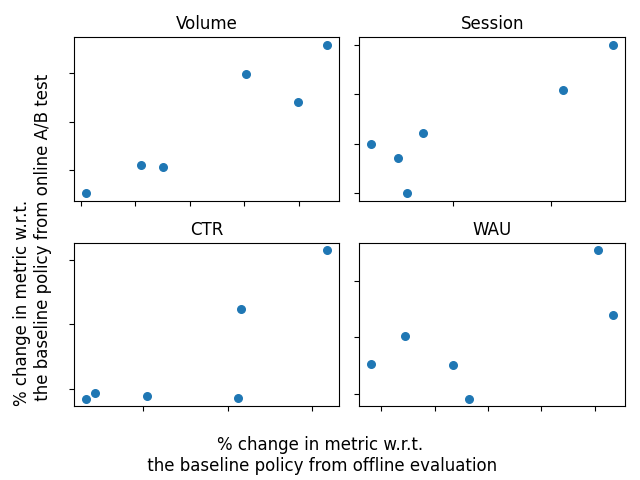
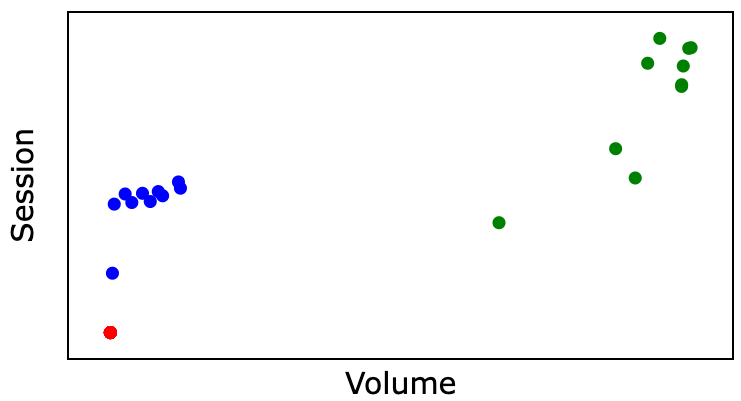
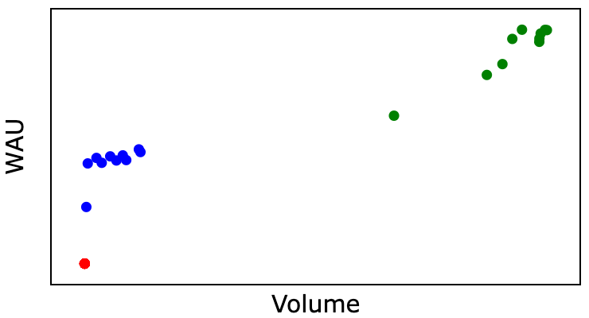
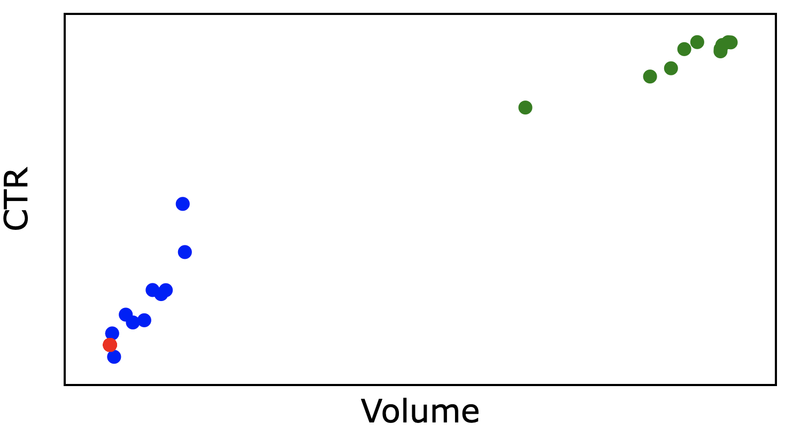
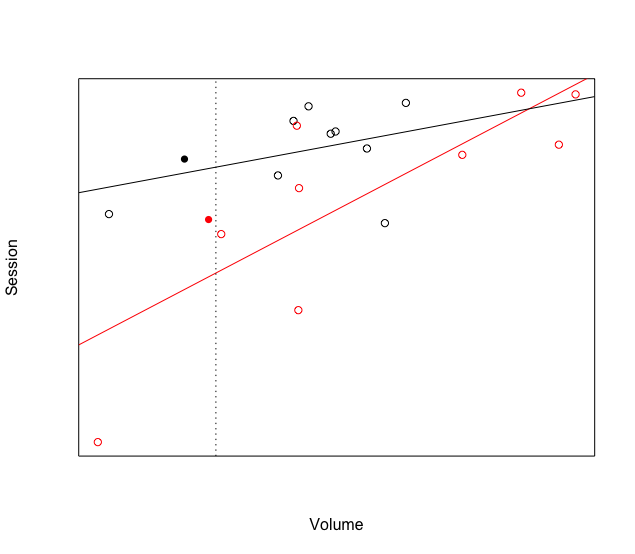
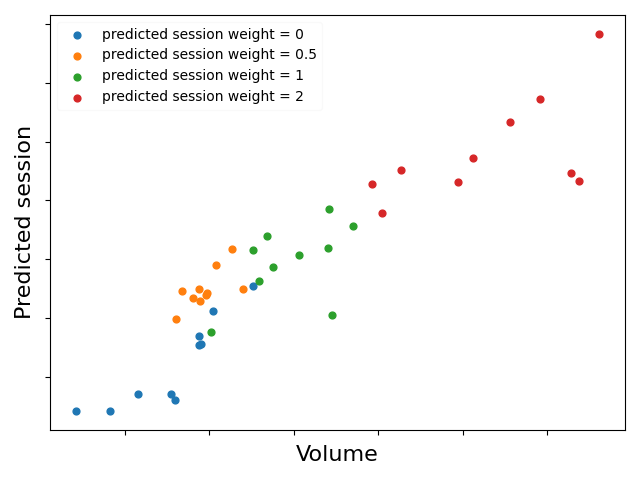

# LinkedIn 通知多目标离线强化学习：不等间隔决策与保守动作价值

上午 9 点来了条直播通知，午间队列又交来一条周年通知。两条候选都要经过发送判定，但不发直播会直接丢弃，周年通知则可能回队。LinkedIn 原有多目标优化（MOO）先预测会话和点击，再把加权预测分与参数化阈值比较。调阈值可以控制发送量，当前动作对下一次决策状态的影响则需要额外建模。本文用三项奖励定义目标，在不等间隔的事件流上学习发送与不发的长期价值，再在训练损失里用 CQL 约束日志支持薄弱的动作估值。[固定 v1，§1、§3、§6.5](https://arxiv.org/pdf/2207.03029v1#page=2)。

## 候选到达时决策，用真实间隔折扣

[CIKM 2022 的通知间隔系统](../SRC-LINKEDIN-NOTIFICATION-RL/阅读笔记.md)主要在固定检查点对非强时效候选决定发或等。本篇的策略同时服务近实时流和批量队列。状态含最近收到的通知数、距上次访问时间、角标、画像与上下文。直播到达立刻评估，批量队列则定期选出优先级最高的一条，转为同一种在线决策请求。用户可能在两次请求中间访问，策略只在请求时刻观测状态并执行动作。[固定 v1，§3、图 1](https://arxiv.org/pdf/2207.03029v1#page=3)。

Prakruthi Prabhakar 等，固定 v1 图 1a、1b，PDF 第 3 页，直接引用作者源码的两个子图。两图都有五个动作，右图中 $t_1$ 到 $t_2$ 的间隔明显长于 $t_3$ 到 $t_4$。把相邻两步统一折扣会丢掉这个差异。本文用 $\gamma^{t_{k+1}-t_k}$ 折扣下一状态的动作价值，并把相邻决策之间的奖励聚合在同一步，区间内更细的奖励发生时刻被近似掉。

Prakruthi Prabhakar 等，固定 v1 图 2，PDF 第 6 页，直接引用作者源码图。先对比红色近实时流与蓝色批量流的“不发”出口，再沿策略下方看决策和特征快照回到离线训练、策略返回近线 Samza。作者报告在生产基线上加入 $\epsilon$-greedy，对少量用户采集一周快照并与行为日志关联。[固定 v1，§5](https://arxiv.org/pdf/2207.03029v1#page=6)。

## 同一条日志怎样形成多目标训练信号

沿用上午 9 点直播的例子。若日志选择发送，点击可归到该卡片，发送量奖励取 $-1$；会话奖励统计到中午下一次决策为止的站内访问。这段时间用户即使没收到通知也可能自然访问。论文的默认奖励用现有 XGBoost 预测点击替换观测点击，保留观测会话和确定的发送量惩罚：

$$
r_k = \omega_s m^s_k + \omega_c \widehat E[m_k^c\mid s_k,a_k] + \omega_v m^v_k.
$$

教学例子取权重 $(1,2,0.5)$，观测会话 1 次、预计点击概率 0.2、发送量奖励 $-1$，则 $r_k=0.9$。若动作是 NOT-SEND，点击与发送惩罚归零，仍记录该用户的实际区间会话。训练按不同权重组合各学一套策略；权重的意义取决于指标单位和缩放。用预测点击平滑稀疏标签会降低方差，也会继承上游模型偏差。换成预测会话同理，效果需要单独验证。[固定 v1，§4.5、§6.3–4](https://arxiv.org/pdf/2207.03029v1#page=5)。

## CQL 为什么限制未被日志支持的高分

日志样本为 $(s_k,a_k,s_{k+1},r_k)$。三层全连接网络为 SEND 和 NOT-SEND 各输出一项 Q 值。Double DQN 用在线网络在中午的 $s_{k+1}$ 选出更高分动作，用目标网络给该动作算分。若下一步目标网络给 0.8，间隔 3 小时，示意折扣每小时 0.9，则上午动作的拟合目标为 $0.9+0.9^3\cdot0.8=1.4832$。损失回传给上午实际动作对应的在线 Q 值，目标网络每隔若干步从在线网复制参数。独立估值缓解取最大引入的高估，但固定日志里罕见动作若持续被选作自举目标，其误差仍可能放大。[固定 v1，§4.2–4](https://arxiv.org/pdf/2207.03029v1#page=4)。

本篇的 CQL 损失在 Double DQN 的平方误差之外，加上按状态计算的保守惩罚：
$$
\alpha E_{s\sim D}\left[\log\sum_a e^{Q(s,a)}
       -E_{a\sim\widehat\pi_\beta(\cdot\mid s)}Q(s,a)\right].
$$
第一项让任一动作的异常高分抬高损失，第二项保留行为日志中各动作的经验支持。若示意同一状态只有 SEND 日志，模型却给 SEND 取 1、NOT-SEND 取 3，则括号约为 2.13；将未观测的 NOT-SEND 降到 0，括号约为 0.31。对两个动作的惩罚梯度分别与其 softmax 权重减去经验动作频率成正比。平方误差继续把有观测的动作向长期回报目标拟合。$\alpha$ 控制保守幅度。在训练完成后，服务根据当前状态的价值选动作，CQL 惩罚只参与训练。[固定 v1，§4.3，算法 1](https://arxiv.org/pdf/2207.03029v1#page=4)。

## 离线评价可以排序候选，绝对收益仍要上线验证

上午策略若从发送改为等待，午间遇到的用户状态分布可能随之改变。逐决策重要性采样用截至该步的动作概率比乘积修正这种变化，代价是长轨迹上方差高。本文保留当前动作概率比，省去历史比值连乘，实质上仍在日志状态分布下衡量目标动作。它依赖日志概率可用和动作覆盖，不能消除由历史动作改变状态分布带来的偏差。§4.6 的有限样本排版在均值及权重中各出现一次 $1/n$，还混用 $t$ 与 $k$。按上行期望，平均只应用一次，截至当前步的权重是概率比乘积。[固定 v1，§4.6](https://arxiv.org/pdf/2207.03029v1#page=6)。

Prakruthi Prabhakar 等，固定 v1 图 3，PDF 第 7 页，直接引用作者源码图。横轴是离线相对变化，纵轴是线上相对变化，数值刻度隐去。作者报告对发送量、会话、CTR、WAU 的 Pearson $r^2$ 依次为 0.94、0.90、0.82、0.68，并指出离线估计系统性偏高。六个策略在该系统内给出了排序参考，相关性无法校准绝对增益。[固定 v1，§6.1](https://arxiv.org/pdf/2207.03029v1#page=6)。

Prakruthi Prabhakar 等，固定 v1 图 4 的三个原始子图，PDF 第 7 页。红点为基线，蓝点为含 CQL，绿点为不含 CQL。三个横轴都是发送量。蓝点集中在左侧，贴近基线发送量且波动更小；许多绿点靠更大体量取得更高的纵轴代理指标。应沿横轴读权衡，图无法证明两个方案在相同发送量下存在普遍严格支配。[固定 v1，§6.2](https://arxiv.org/pdf/2207.03029v1#page=7)。

## 线上两组比较各自验证了什么

表 1 中，DDQN + CQL 相对同目标的监督 MOO 基线，会话 **+0.24%**、WAU **+0.18%**、发送量 **−1.73%**、CTR **+2.26%**；无 CQL 的 DDQN 分别是会话无显著变化、WAU **−0.69%**、发送量 **+7.72%**、CTR **−7.79%**。文中报告表内有数值的比较达到 $p\le 0.05$。会话数与 WAU 都包含自然访问，衡量的是整套策略对平台指标的影响。论文未给这些变化的置信区间，WAU 的观察口径也不足以判断更远期留存。[固定 v1，§6.5、表 1](https://arxiv.org/pdf/2207.03029v1#page=8)。

Prakruthi Prabhakar 等，固定 v1 图 5，PDF 第 7 页，直接引用作者源码图。黑色为预测会话训练策略、红色为观测会话训练策略，实心点各选一个进入线上 A/B。表 2 比较这两个点，预测会话训练的策略相对观测会话训练，会话 **+0.35%**、WAU 持平、发送量 **−1.44%**、CTR **+2.37%**。这种变化支持在该设置采用预测奖励，无法单独隔离它降低方差的贡献，也不能与表 1 的不同对照增益相加。[固定 v1，§6.3、§6.6、表 2](https://arxiv.org/pdf/2207.03029v1#page=8)。

Prakruthi Prabhakar 等，固定 v1 图 6，PDF 第 8 页，直接引用作者源码图。固定其他训练设定，将预测会话权重设为 0、0.5、1、2，各训练 10 次，图中较高权重整体移向较高发送量与预测会话。原文称展示三项指标，图中可读证据是两个轴上的离线权衡。对比[后续通知 Decision Transformer](../SRC-LINKEDIN-NOTIFICATION-DT/阅读笔记.md)，本篇靠固定权重分别训练策略，并在各状态比较两个 Q 值；后续工作学多目标回报提示以及条件化动作分布。两者的在线对照见[Push 触达与时机论文路线](../../知识库/阅读/Push触达与时机论文路线.md#linkedin把等待当作可以学习的动作)。

[发送或等待的问题比较](../../知识库/问题/通知候选到达后怎样决定发送或等待.md)对照所需状态、监督与线上验证条件。

采用 arXiv:2207.03029v1，核对 §1–7、六图、两表、算法 1 和致谢。译文覆盖正文、图表说明、算法与致谢，图内英文及参考文献沿用原文。未复现实验。

中文 PDF 与采用版原文的[私有备份下载说明](../../文档/工具/中文PDF发布.md#登录下载)。
