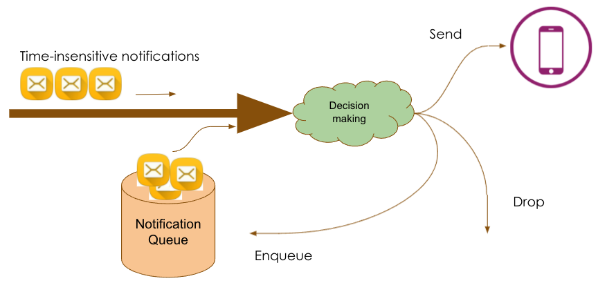
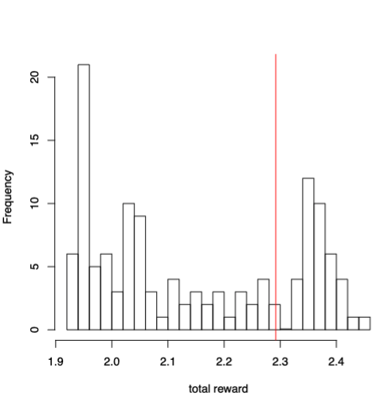
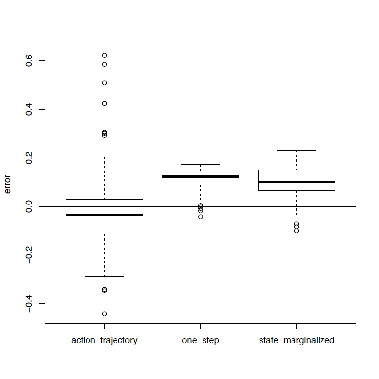
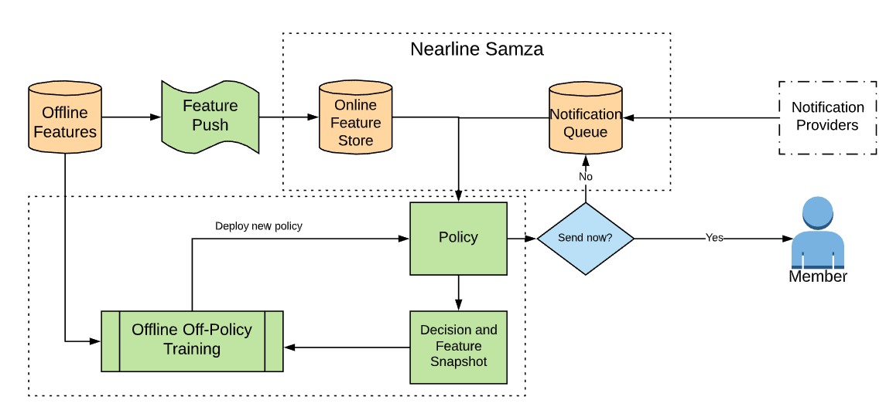

# LinkedIn 移动通知离线强化学习：让发送与等待共享一个长期目标

一个用户早上有一条同事周年动态待发，昨晚已经收到多条通知。现在发可能促成访问，稍后发可能更合适，也可能轮到更有价值的候选。LinkedIn 的通知间隔系统会定期挑出队首候选，交给策略选择发送或等待。论文把目标设为跨多轮的访问奖励，用带探索的日志学习 Double DQN，再用离线评价筛选进入线上 A/B 的策略。[固定 v1，§I、III](https://arxiv.org/pdf/2202.03867v1#page=1)。

## 预测未来几小时会不会来，与选择这一步该怎么做

生存模型基线分别预测发与不发后的窗口访问概率。假设发后为 0.24，不发为 0.20，相对访问增量为 $(0.24-0.20)/0.20=0.20$。阈值若是 0.15 就发，若是 0.25 就等。分母让短期提升按自然活跃度归一化。阈值通过另外的线上调节平衡短期和长期效果。一次发送如何改变下一轮决策所处的状态，未进入这次阈值计算。论文在同一个间隔系统里替换动作决策，候选仍先由已有优先级排序。[固定 v1，§III-A](https://arxiv.org/pdf/2202.03867v1#page=3)。

Yiping Yuan 等，arXiv v1 图 2，PDF 第 3 页，直接引用源码 PNG。先沿候选流进入队列，再读周期性决策和过期处理两条路径。打回队列保留后续选择，用户进入下一轮时队列也可能已有新候选。

## 日志怎样训练出发送与等待的两个价值

沿用周年通知这个例子。上午检查时，状态 $s_t$ 包含角标数、距上次访问的时长、最近收到的通知数和其他画像特征。策略若选择等待，周年动态回队。到下一轮，可能新增更相关的活动通知，队首改变。若这段时间用户自行访问，日志记录访问奖励。这条奖励属于两次决策之间的环境反馈，动作样本仍是等待。策略以状态作摘要，以周期为步长；排队候选的过期发送或丢弃由独立规则处理，模拟中使用的 4 小时步长只属于论文的模拟设置。[固定 v1，§III-B、IV-C、V-B](https://arxiv.org/pdf/2202.03867v1#page=4)。

一次观测给出 $(s_t,a_t,r_t,s_{t+1})$。全连接 Q 网络读当前状态，输出发送和等待的长期价值。对日志里真的发生的动作，将该动作预测值向下式给出的目标靠拢。
$$
y_t=r_t+\gamma Q_{\theta^-}\!\left(s_{t+1},\arg\max_a Q_\theta(s_{t+1},a)\right).
$$
设上午等待后本轮无访问，即 $r_t=0$。下午的状态中，在线网络对发送和等待分别给 0.8、0.6，于是内层选发送。若目标网络给这个发送动作 0.7、折扣取 0.9，上午等待的训练目标是 0.63。平方损失更新当前 Q 网络，让 $Q_\theta(s_t,\text{等待})$ 靠近 0.63；目标网络在多批训练之间按间隔同步。在线网络选下一动作，目标网络只评价该动作，减轻同一估计同时取最大和给分造成的高估。上线时应用当前状态的两项价值直接选动作，学习信号来自固定日志而非部署中实时回传的梯度。[固定 v1，§IV-A](https://arxiv.org/pdf/2202.03867v1#page=5)。

## 为什么同一批日志能筛策略，又在哪些情况下会失真

如果旧策略一遇到上午这个状态就发，日志便没有在该状态等待后发生什么。作者在监督基线上叠加 $\epsilon$-greedy，在少量用户上采集一周探索日志。每步以一定概率在可用动作中均匀探索，训练和评估尤其依赖目标动作在日志中的支持以及正确记录的动作概率。探索覆盖稀薄时，离线 Q 值和评价都会变得不可靠。[固定 v1，§IV-A–B](https://arxiv.org/pdf/2202.03867v1#page=5)。

要评价一条新策略，可对每一步的已观测奖励乘权，补偿新旧策略在访问的状态和采取的动作上分布不同。轨迹法把从开头到本步的动作概率比连乘。若新策略要求上午等、下午发，而日志在上午发了，确定性目标策略下整段到下午的权重为零。时域增长后，少数能对齐的轨迹权重可能很大。一步法只乘当前动作比，下午是否选择发可以对齐，但漏掉此前选择等待改变了哪些用户会处于下午这个状态。状态边缘化保留两项：
$$
w_t=\frac{d_t^{\mathrm{目标}}(s_t)}{d_t^{\mathrm{日志}}(s_t)}
      \frac{\pi^{\mathrm{目标}}(a_t\mid s_t)}{\pi^{\mathrm{日志}}(a_t\mid s_t)}.
$$
前一项修正各状态下出现的频率，后一项修正在该状态中选该动作的频率。若某组下午状态在目标轨迹和日志中分别占 0.30 和 0.20 且当前发送概率比为 2，该组下午发送日志的权重就是 3。算法从初始状态经验分布开始，用上一轮校正权重累积下一轮状态的频率。连续高维特征会让样本被切成过小的组。作者在评估时移除满足条件的特征、将保留特征分箱，学习 Q 时仍可用可能影响奖励的静态特征。只有给定保留状态后，被省略部分的分布在目标与日志策略间可共用，压缩前后的状态密度比才相等；实际分箱另带来近似误差。[固定 v1，§IV-B](https://arxiv.org/pdf/2202.03867v1#page=6)。

固定 v1 的降维公式把两侧分母排为目标策略，按上式应以行为策略为分母。原文一步校正的状态、动作条件也排反，应读作给定状态时的动作概率比。前文权重定义和同节推导给出了对应口径。译文保留印出式并说明。[固定 v1，§IV-B](https://arxiv.org/pdf/2202.03867v1#page=7)。

## 模拟器检验选策略，生产实验检验实际收益

Yiping Yuan 等，arXiv v1 图 3，PDF 第 8 页，直接引用源码 PNG。红色竖线是探索行为策略的回报，128 个超参数配置中只有 38 个超过它。离线学出的策略需要筛选，训练成功本身没有提供优于日志策略的证据。

Yiping Yuan 等，arXiv v1 图 4，PDF 第 8 页，直接引用源码 PNG。作者在同样的 128 个策略上比较三种自归一化估计。该模拟里动作轨迹法偏差最小、方差最大，一步法相反，状态边缘化在两者之间。模拟器提供可交互比较的参考回报，正式上线策略由真实探索日志训练。[固定 v1，§IV-C、V-A](https://arxiv.org/pdf/2202.03867v1#page=7)。

Yiping Yuan 等，arXiv v1 图 5，PDF 第 9 页，直接引用源码 PNG。策略在 Samza 内读取特征并检查候选队列。决策和当时的特征快照落到 HDFS，与访问日志关联后形成离线训练数据。离线选出的策略部署回同一个近线服务。

固定 v1 表 I 报告与 AFT 阈值基线的一周线上 A/B。会话数 $+0.30\%$，通知卡片数 $-3.49\%$，通知 CTR $+4.53\%$，取消关注通知总数 $-4.37\%$，作者报告各项 $p<0.05$。访问会话以同设备类型 30 分钟无活动为分隔，卡片数对实际发给用户的通知去重。作者认为 CTR 和取消关注变动主要与减量有关。整套策略的 A/B 不能分解单项算法或时机独立贡献，一周指标也无法说明一年尺度的持续效果。作者报告系统后来全面部署，离线筛选节省了原来常需 1–3 周的线上调阈值环节。[固定 v1，§V-B、VI](https://arxiv.org/pdf/2202.03867v1#page=8)。

[Push 触达与时机论文路线](../../知识库/阅读/Push触达与时机论文路线.md#linkedin把等待当作可以学习的动作)梳理何时使用预定时槽、周期性发送或等待、近实时渠道动作。后续[通知 Decision Transformer](../SRC-LINKEDIN-NOTIFICATION-DT/阅读笔记.md)把多项目标转成待获回报提示，并用日志动作监督训练动作头，改变了这里直接拟合两项动作价值的做法。

[发送或等待的问题比较](../../知识库/问题/通知候选到达后怎样决定发送或等待.md)对照所需状态、监督与线上验证条件。

采用 arXiv:2202.03867v1，核对 §I–VI、五图、表 I 与参考文献；未复现实验。中文 PDF 覆盖正文与致谢，沿用作者图及参考文献。

中文 PDF 与采用版原文的[私有备份下载说明](../../文档/工具/中文PDF发布.md#登录下载)。
