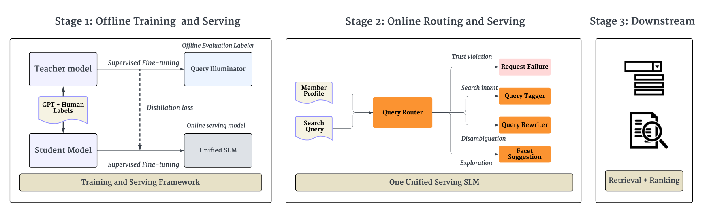

# LinkedIn 结构化查询理解：一次生成路由与可执行字段

“找我附近的软件工程师岗位”需要地点上下文才好检索。传统流水线先判断意图，再由独立组件抽职位、地点和其他条件。意图分类与实体判断若使用不同的规则，“我附近”可能既被当作地点词又被交给改写，召回拿到的字段和查询会互相冲突。LinkedIn 让一个小模型按固定模式共同生成路由和相关字段，下游据此决定用改写文本、过滤条件、召排特征，还是走保守回退。作者给出的例子是当画像地点为加州湾区时，把“我附近”落实为“加州湾区附近”。[原文 §1、§3.1–3.4](https://arxiv.org/pdf/2605.27441v2#page=4)

*作者原图 1 · 左侧生成训练监督并做离线评估，中间用统一小模型解析请求，右侧消费输出。Ping Liu 等，arXiv:2605.27441v2 第 3 页，CC BY 4.0。*

## 把选择哪条路径和提取什么一起训练

模型读查询、画像、地点及会话上下文，根据约定格式生成 $y=\{r,t,w,s,\ldots\}$。$r$ 表示操作路由，$t$ 是标签，$w$ 为可选改写，$s$ 为可选信任判断，分面另有候选选择和打分接口。职位场景的四类路由包括条件查询、自指查询、意图不清或不支持、违反信任规则。对“我附近”显式触发改写并引用已有地点。用户只写“软件工程师”时，不能仅因画像在湾区就把地点变成必选过滤。对不支持或不清楚的意图，规则描述允许保守走关键词检索。信任判断可拦截或转向。生产指标中还会统计误拦和未能形成可执行计划的失败，论文未给出完整状态转移及阈值。[原文 §3.1–3.5、§6.4](https://arxiv.org/pdf/2605.27441v2#page=4)

结构形式采用类型化工具名和参数，例如图 2 的关系网络工具只有查询明确提到人脉时才触发。语法约束可保证字段类型和结构可解析，工具调用策略还要由模型、规则和实际输入决定。地点和 Easy Apply 可用于召回过滤，职称等文本字段可用于召排的语义输入。分面建议先从历史归一化库存检索少量候选，再逐候选打分供用户编辑。人员搜索换了实体模式和执行器，也保留轻量首级分流，将经典姓名检索和语义路径分开。[原文图 2、§3.3–3.6、§6.5](https://arxiv.org/pdf/2605.27441v2#page=5)

*作者原图 3 · 搜索框下的分面供用户细化条件。Ping Liu 等，arXiv:2605.27441v2 第 5 页，CC BY 4.0。*

同一句查询可以同时产出路由、字段与可选分面。哪些值会进入硬过滤，哪些只供排序或供用户确认，见[查询结构如何驱动搜索动作](../../知识库/问题/搜索查询怎样变成下游可执行的结构.md#搜索动作由路由和字段共同决定)。

## 用产品规则定义教师目标与评估准则

离线 8B Query Illuminator 先按规则标注，专家审核约 1.4 万条生产查询上的训练结构。原查询是“我附近”时，训练标签要同时检查路由是否有资格使用画像、改写是否只使用已有地点、以及字段是否符合执行接口。传统关键词还可改写成自然语言并附工具标注，线上难例每天通过教师与学生的分歧及新语义模式挑选。训练先用结构目标做下一词元交叉熵，再在同一损失上加平均 $D_{\mathrm{KL}}(P_T\parallel P_S)$，把教师分布蒸馏到 1.5B 学生。地点抽取的同骨干消融中，多任务比单工具的 F1 为 0.924 对 0.885。英文标注的 1.5B 蒸馏版精确率/召回率为 0.857/0.878，1.5B SFT 为 0.823/0.843，8B 教师为 0.867/0.857。蒸馏并非各语言两指标全升，GLUE 对照也有自然语言推断回退。[原文 §4、§6.2，表 5–7 与附录 A、D](https://arxiv.org/pdf/2605.27441v2#page=7)

同一个 Illuminator 通过不同的版本化提示做代理评委，读取原查询、人工参考和待评输出。在 SPS 的 4,903 条人工黄金集上，分别给出分面抽取和查询洁净度 0–2 分及错误类别，合计 0–4 分。黄金集上的 JSON 解析成功率 99.96%–100% 衡量的是可解析性。另一个约 30 万内部样本的一致性研究报告人机 Cohen $\kappa=0.77$、专家间 0.83，原文未细列样本组成以及各错类的一致性。两项验证的分母、目标各异。用同族教师做代理评委时，可用人工参考和定期回审分歧约束漂移。人员搜索 +57%/+75% 是导航型/探索型查询的离线 GR@10 相对值，由高容量评委打分。正文没有提供该结果的人评复核或随机流量因果证据。[原文 §6.3、§6.5，表 10](https://arxiv.org/pdf/2605.27441v2#page=8)

## 看字段被怎样执行，再看失败和时延

“Anthropologie”作公司名时，可给 EBR 的原提示加 `Job Company` 字段。表 11 在无需重训下报告 Prec@50 从 0.577 到 0.595、Rec@50 从 0.699 到 0.721、NDCG@50 从 0.687 到 0.704。按百分点为 1.8、2.2、1.7，原文段落写百分比；按显示值算相对变化则约 3.1%、3.1%、2.5%。这只验证把公司信息传给指定的 EBR 提示，不能直接推出所有字段应作硬过滤。[原文 §6.6、表 11，附录图 4](https://arxiv.org/pdf/2605.27441v2#page=9)

职位搜索和职位提醒做了 14 天 50/50 随机实验。职位搜索表 8 的请求失败 −17.13%、成功申请或保存 +0.49%，是相对变化。提醒组搜索无结果 −0.65%、总申请 +0.23%。压测是另一个协议：单张 A100 MIG-4g.40G、1000 条生产抽样、1–15 QPS。15 QPS 下标注中位/P99 为 275.81/625.93 ms，分面建议为 106.30/566.46 ms。分面一次请求为 20–30 个候选逐点打分，应用层批处理减少传输等开销；缓存复用跨请求提示，JSON 恢复处理截断或轻微不合规。较低中位数和格式恢复都不能直接给出整站尾延迟或字段语义正确率。[原文 §5、§6.4，表 3、8](https://arxiv.org/pdf/2605.27441v2#page=8)

## 采用版与中文 PDF

采用 arXiv:2605.27441v2（2026-06-07），arXiv 条目及作者稿标示 KDD 2026 V.2，DOI 10.1145/3770855.3818312。核对固定 12 页原文、作者工程及正文和附录 A–D。17 页中文 PDF 逐页目视，译摘要、正文、主文图表标题与致谢，保留代码与数据示例、部分表内术语、图内文字、附录和书目。原文和中文 PDF 已完成私有备份与认证下载。未复现生产服务。[固定原文](https://arxiv.org/pdf/2605.27441v2) · [查询理解问题](../../知识库/模块/查询理解与结构化表达.md) · [私有 PDF 访问说明](../../文档/工具/中文PDF发布.md)
