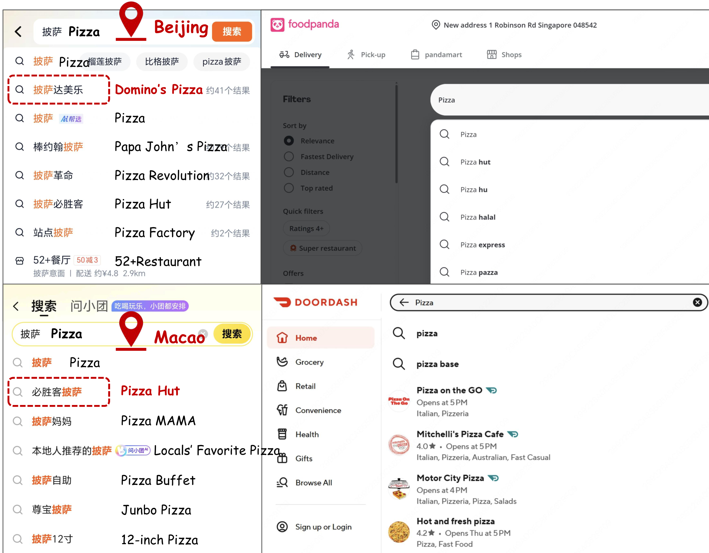
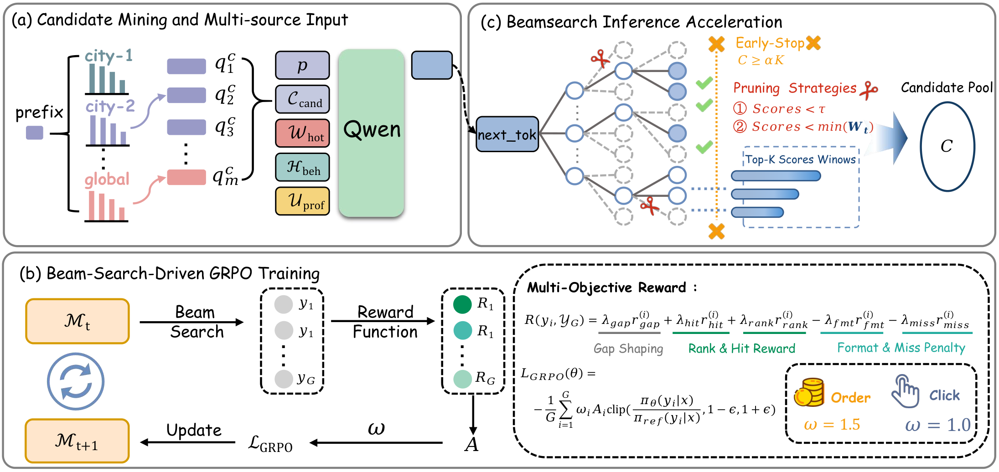

# LocalSUG：给同一个短前缀更新城市参考

用户输入“披萨”，经典联想先从已有前缀—查询日志召回候选，再排序。城市供给一变，候选可能仍是过去的热门门店，新店又可能没有足够日志进入候选池。直接用语言模型生成，也可能把别的城市的连锁店带到这里。LocalSUG 用每日更新的城市候选给生成器提供参考，再用更宽的训练束观察哪些建议被排在前面，最后压缩线上解码开销。输出仍是一列可选择的查询文本。用户选择一条之后才执行商品搜索。[原文 §1–2，图 1–2](https://arxiv.org/pdf/2603.04946v3#page=1)

*作者原图 1 · 用披萨联想说明建议与城市门店供给的关系。Jinwen Chen 等，arXiv:2603.04946v3 第 1 页。*

## 城市点击统计进入提示

对每个前缀，用过去七天日志按点击次数分别维护城市候选和全局候选，每天刷新。拼“披萨”的提示时先取当城列表，名额不足才从全局列表补齐。前缀、参考、平台热词、用户行为历史和画像一起进入 Qwen3-0.6B。监督微调先让模型学会从这些输入生成目标查询。提示里的“披萨自助”可以帮助模型生成新的组合，模型没有被限制只能复述它。附录 G.1 在 Mix 子集报告 41% 的生成查询未原样出现在提供的候选集。这衡量逐字重合，不能直接说明新建议有商品供给或此前从未出现。[原文 §2.1–2.2，第 2–3 页](https://arxiv.org/pdf/2603.04946v3#page=2) · [附录 G.1](https://arxiv.org/pdf/2603.04946v3#page=13)

*作者原图 2 · 左侧构造输入，下面用训练束形成奖励，右侧加速线上解码。Jinwen Chen 等，arXiv:2603.04946v3 第 3 页。*

## 训练束比展示列表更宽

推理时，累计词元对数概率给每个候选序列排序。光做 SFT 可以教模型生成日志目标，却缺少直接信号区分同一次解码里的重复建议、跑偏建议与目标靠后的情形。LocalSUG 在每个输入上用当前模型的束搜索取 $G=16$ 条候选，线上列表目标是 $K=12$ 条。奖励按组内均值和标准差标准化，再更新策略，使生成模型在自己的候选上学习。订单样本的损失权重高于仅点击样本。式 (2) 印为策略与参考模型的概率比率截断，实验设 KL 系数为 0。按论文印式理解即可，未核对实现。[原文 §2.3，式 (2)–(3)，第 3 页](https://arxiv.org/pdf/2603.04946v3#page=3) · [附录 A、E](https://arxiv.org/pdf/2603.04946v3#page=11)

设“披萨自助”为日志目标、排第 13，是用于理解算法的例子。算法 1 先给前 $K$ 条加间隔奖励，并给后 $G-K$ 条分摊等总量惩罚。命中虽然落在展示区之外，仍得名次奖励与命中奖励，并补回这条的尾部惩罚。比目标靠前的候选受到名次惩罚。前 $K$ 条中若有重复或无效文本，扣格式奖励，并尝试让有效尾部候选补位。完全没命中时，伪代码先压低前 $K/2$ 条的奖励，随后给有效候选设奖励下限 1，后一步文字上也覆盖先前受罚的有效候选。正文没有解释这一重叠，算法中计数减一也写成表达式。这里保留原算法与意图的边界。让训练看到相似的束能缩小训练与服务的候选差异，点击目标仍取自旧曝光日志。[原文 §2.3 与算法 1](https://arxiv.org/pdf/2603.04946v3#page=11)

## 解码收束与实际测量

QA-BS 在每步计算候选累计对数概率，剪除低于绝对阈值的活跃束，再用当前 Top-K 分数窗口筛选已结束的候选。有效候选达到饱和门槛可提前结束，低分触发提前结束的伪代码另设最少结果数。词表裁剪只保留 3800 万条日志中最高频的 30,000 个输出词元。图 3 在报告的实验设置下给出每秒 1.41 → 3.77 → 4.38 条样本，分别对应标准束搜索、QA-BS 和再加词表裁剪。3.11 倍是解码吞吐倍数，不能换算成相同倍数的线上端到端 P99。低频商户名和新词能否保留，取决于词元覆盖和实际结果。[原文 §2.4、§3.5.1、图 3](https://arxiv.org/pdf/2603.04946v3#page=7) · [算法 2](https://arxiv.org/pdf/2603.04946v3#page=12)

八天真实日志中，前七天 350 万条用于训练，第八天 5 万条用于测试，再构造 Mix、Click、Order 子集。表 1 的 Click MRR 为 81.13%，OneSug 复现是 54.83%，同样加入共现参考的 OneSug-rule 为 80.69%。LocalSUG 的 Click HR@12 为 96.36%，低于 OneSug-rule 的 96.47%。City-MCA 的 QUA 最高，OneSug 的 DIV 最高。QUA 衡量格式与列表内不重复，DIV 按测试集汇总独特文本比例。表 2 去除格式奖励时，Order QUA 从 98.78% 降至 89.85%。附录 G 的三种随机种子复核使用 Mix 子集。单个消融说明在报告设置下移除该项会改变结果，各项贡献不能直接相加。[原文表 1–2，第 5 页](https://arxiv.org/pdf/2603.04946v3#page=5) · [附录 C、G](https://arxiv.org/pdf/2603.04946v3#page=14)

线上一月 A/B 覆盖 10% 真实流量，无结果率相对下降 3.98%，PV CTR 相对上升 0.35%，独特商品曝光相对上升 7.14%。餐饮和未知类的 PV CTR 分别下降 0.56% 和 0.90%。人评只纳入三名独立盲标员一致的样本，每方法 2000 条，报告好评率由 96.71% 到 97.95%。一致样本上的变化不能外推到有争议的请求。日期窗口、品类构成、低分补位和实时门店状态仍影响效果。[原文 §3.4–3.5，表 3–6](https://arxiv.org/pdf/2603.04946v3#page=5)

## 采用版与中文 PDF

采用 arXiv:2603.04946v3（2026-08-25）。核对固定 PDF 正文和附录 A–G。15 页中文 PDF 翻译摘要、主文、图表标题、作者脚注和致谢，保留图内原文、公式、参考文献及英文附录，已逐页渲染目视，原文和中文 PDF 已完成私有备份与认证下载。可编辑工程位于 `.local/papers/SRC-LOCALSUG/translation/translated-sources/`。从[短前缀问题](../../知识库/问题/短前缀怎样生成相关且有排序能力的查询建议.md)可以复习它与 OneSug 在参考来源、候选比较及指标上的差异。[固定原文](https://arxiv.org/pdf/2603.04946v3) · [私有 PDF 访问说明](../../文档/工具/中文PDF发布.md)
