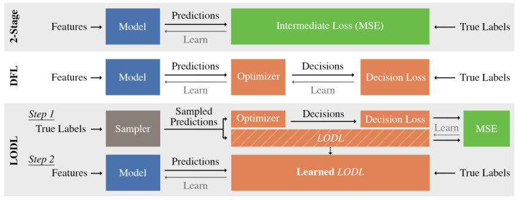
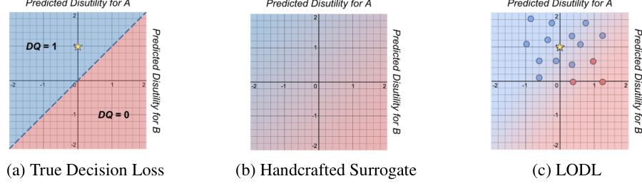
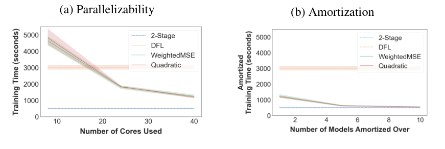

# LODL 怎样提前量出决策损失，再训练预测器

在两条候选路径中选便宜的一条，预测成本在交换边界的同侧连续移动时，真实后悔保持不变。直接对后悔求导常得零。在线调用扰动求解器可以制造训练信号，但调一组超参数就可能再付一轮求解成本。LODL 为每个训练实例预先采样若干预测，运行下游求解与真实计价，把邻域内的后悔拟合成光滑代理。后续可对同一组代理反复训练预测模型。 [arXiv v4 §2–4](https://arxiv.org/pdf/2203.16067v4#page=3)

Shah 等，v4 第 3 页图 1，从采用版 PDF 裁出。下半部分的采样和优化器为代理准备监督。代理拟合好以后，训练预测器的反传只穿过平滑代理。部署选决策时仍需求解。 [v4 图 1](https://arxiv.org/pdf/2203.16067v4#page=3)

## 从一条事实成本向量构造多条训练探针

沿用两条路径真实成本 \(y=(2,3)\)。对同一实例 \(n\)，以真实标签为中心取预测探针。探针 \((2.8,2.7)\) 令求解器选路径 2，用真实成本计价得到后悔 1。探针 \((1,4)\) 令求解器选路径 1，后悔 0。原文最小化局部代理与决策损失的平方偏差，对一般目标可先以真实最优值为参照改写成零点的后悔。按维度全部扰动、一次只动一维或一次动两维，各自会越过不同的决策边界。所有探针共享同一个训练实例的真实 \(y\)，无需为探针重新收集标签。 [v4 §4.1、§4.3、式 (2)](https://arxiv.org/pdf/2203.16067v4#page=6)

Shah 等，v4 第 3 页图 2，从采用版 PDF 裁出。两坐标是同一实例的两个预测分量，颜色对应选错的代价。局部代理在阶跃附近提供连续训练信号，采样不足的区域主要受代理函数形状控制。 [v4 图 2](https://arxiv.org/pdf/2203.16067v4#page=3)

## 权重、交叉项和误差方向由谁学习

令 \(e=\hat y-y\)。WeightedMSE 拟合非负逐维权重，计算 \(\sum_l w_le_l^2\)。Quadratic 拟合半正定 \(H\)，损失 \(e^\top H e\)，梯度 \(2He\) 会将一维误差通过交叉项传给另一维。两条路径的两个成本同时平移不改变决策，给差值方向更多权重比逐维均匀惩罚更接近求解器的选择。DirectedWeightedMSE 为每维高估与低估设不同权重。DirectedQuadratic 依据两维误差符号从四套系数中取值，按近邻形状学习交叉和方向。二次损失由采样拟合得到，原始离散损失在边界不具备经典 Hessian，Taylor 展开在这里解释函数选择。 [v4 §4.2](https://arxiv.org/pdf/2203.16067v4#page=5)

第二阶段每步得 \(\hat y=M_\theta(x)\)，按样本编号读取已经拟合的 \(L_{\phi_n}\)，再以 \(\partial L_{\phi_n}/\partial\hat y\) 更新预测器。令 \(\hat y=(2.8,2.7)\)，一项教学用拟合 \(L=2(e_1-e_2)^2\) 的梯度为 \((4.4,-4.4)\)，会降低第一条路径和提高第二条路径的预测成本。实际系数由探针及真实损失决定。训练附近与拟合探针的邻域错开时，学到的局部形状可能无法指导预测。 [v4 §4.1–4.4](https://arxiv.org/pdf/2203.16067v4#page=6)

## 哪些求解成本可以复用

Shah 等，v4 第 9 页图 3，从采用版 PDF 裁出。左图增加核心数，右图把一次局部拟合成本分摊到多个预测器。两图统计的是 Web Advertising 的特定实验配置。局部参数按实例存储，探针多、维度高或求解昂贵会提高预计算成本。表 1 比较 Linear Model、Web Advertising 和 Portfolio Optimization。方向敏感的二次代理在前两项有优势，Portfolio 上原始 DFL 领先。论文没有用每人仅有一个动作回报的发券日志作为完整 \(y\) 来验证该损失。 [v4 §5、表 1、图 3](https://arxiv.org/pdf/2203.16067v4#page=8) · [其他决策导向损失](../../知识库/问题/决策导向损失怎样训练预算分配的预测器.md)

## 版本与译本

Sanket Shah、Kai Wang、Bryan Wilder、Andrew Perrault、Milind Tambe。采用 arXiv v4 作者版，另核对 NeurIPS 正式 PDF 的标题、作者与图表入口。正文与局部损失、采样及泛化的补充证据已读，未运行模型。清单原题录使用 Without Decision-Making，所采用 PDF 的题名使用 without Differentiable Optimization。中文 PDF 共 14 页。摘要、正文 §1–6、致谢及资助说明、正文图表说明。图内文字、参考文献、检查表与附录 A–B 保留原文。译本已逐页渲染核对，采用原文与译本均完成私有备份和认证下载校验。 [中文 PDF 私有下载说明](../../译文/PDF目录.md) · [固定作者稿](https://arxiv.org/pdf/2203.16067v4) · [NeurIPS 正式入口](https://proceedings.neurips.cc/paper_files/paper/2022/hash/0904c7edde20d7134a77fc7f9cd86ea2-Abstract-Conference.html)
