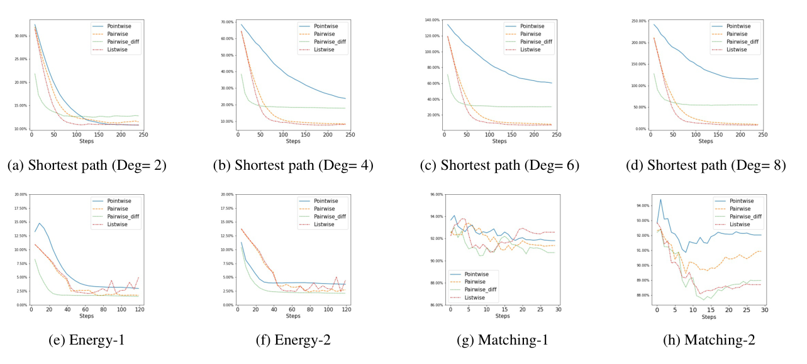
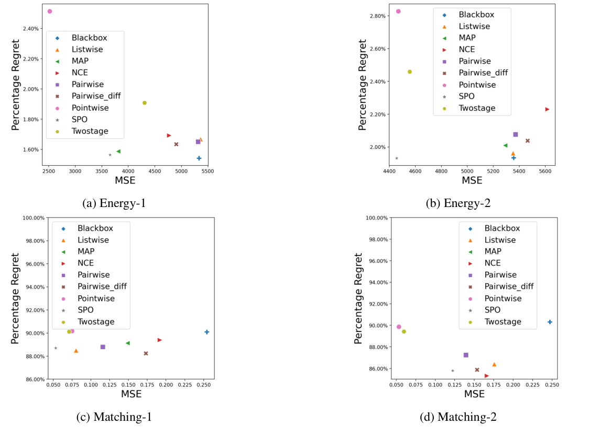

# 决策导向的 LTR 排的是可行解

最短路径的经典训练流程用回归预测每条路段的成本，再把全图交给求解器。回归关心每条边，而求解器只比较完整路径的成本，高估了两条路径上的公共边可能毫无影响。Mandi 等把每条可行路径视为一个排序项。用完整真实成本给候选解标顺序，再训练预测成本保留这一顺序。面对指数多个可行解时，只在一小池解上构造监督。 [arXiv v4 §1–4](https://arxiv.org/pdf/2112.03609v4#page=4)

## 同一条训练记录怎样形成路径对

输入为实例特征 \(x\) 和完整成本向量 \(c\)，预测器输出 \(\hat c\)。以两条互斥路径 \(v^1=(1,0)\)、\(v^2=(0,1)\) 为例，真实成本 \(c=(2,3)\)，预测 \((2.8,2.7)\)。令 \(f(v,c)=c^\top v\)，真实先选路径 1，预测先选路径 2，真实后悔为 1。算法先为训练实例精确求出真值最优解放入缓存。训练过程可按概率 \(p_{\mathrm{solve}}\) 在当前预测成本上另求一解，加到缓存。例中如果缓存只含路径 1，就缺少这次颠倒的对照。求预测最优解能把路径 2 带入该池。 [v4 §3–4、算法 1](https://arxiv.org/pdf/2112.03609v4#page=5)

在候选池中，Pointwise 回归每条路径的目标值。当两条路径的预测一起偏移时它仍产生误差。Pairwise 对真实严格更优的 \(p,q\) 使用 \(\max[0,\nu+f(v^p,\hat c)-f(v^q,\hat c)]\)。例中 margin 为 0.1 时，损失是 0.2，梯度沿解差 \(v^1-v^2\) 回传。论文公式写了所有有序对，实现为了降低计算成本主要比较真值最优解和其他候选。Pairwise-diff 还回归真实差值，例中 \(2.8-2.7\) 与 \(2-3\) 差 1.1，平方惩罚的单项为 1.21。成对差值法的误差交叉项由两个可行解在坐标上的差异决定。 [v4 式 (8)–(13)、算法 1](https://arxiv.org/pdf/2112.03609v4#page=4)

Listwise 在可行解池内对 \(-f(v,c)/\tau\) 作 softmax，以同池预测概率拟合真实概率。温度 1 时，路径 1 的目标概率约为 0.731，预测约为 0.475。交叉熵推动模型提高路径 1 的概率。温度越低，权重越集中在真值最优解上。路径评分对 \(\hat c\) 可微，反传经候选决策向量进入预测参数，缓存更新本身不用求导。推理时仍在完整可行域求最优解，因此缓存遗漏的竞争路径可能影响泛化。 [v4 §4.4–4.5、式 (14)–(16)](https://arxiv.org/pdf/2112.03609v4#page=5)

## 候选池的成本与末端决策误差

Mandi 等，v4 第 6 页图 1，从采用版 PDF 裁出。每个子图固定一个最短路、能源调度或匹配设定，纵轴为验证后悔，横轴用训练过程比较下降和稳定性。 [v4 图 1](https://arxiv.org/pdf/2112.03609v4#page=6)

Mandi 等，v4 第 8 页图 2，从采用版 PDF 裁出。横轴是系数 MSE，纵轴是百分比后悔，误差小的方法并不总位于同一实例的后悔最低点。表 1 的最短路 Deg-8，Listwise 为 12.38%、SPO+ 为 33.75%、两阶段为 28.50%。在 Energy-2 中，Listwise 为 1.96%，SPO+ 和 Blackbox 均为 1.93%。表 2 的 Energy-2 从每记录都尝试求解降至 10% 时，Listwise 每轮由 120 秒降至 40 秒，后悔从 1.99% 到 1.96%。这些是论文的实例、硬件和模型设置下的数字。 [v4 表 1–2、图 2](https://arxiv.org/pdf/2112.03609v4#page=8)

RERUM 也用列表损失，但它在一个营销小批内给用户排收入增量，标签由随机两臂的事实金额构造。这里列表里的每一项是一个完整可行解，评每个解时复用同一实例的完整真实系数。事件日志只有一个券档结果时，需要额外的政策价值估计或反事实模型。 [RERUM 的列表监督](../SRC-RERUM/阅读笔记.md#事实金额和反事实增量各把什么传回预测头) · [决策导向损失比较](../../知识库/问题/决策导向损失怎样训练预算分配的预测器.md)

## 版本与译本

Jayanta Mandi、Víctor Bucarey、Maxime Mulamba、Tias Guns。采用 arXiv v4，核对正文和实验配置附录，未运行模型。中文 PDF 共 11 页。摘要、正文 §1–6、致谢、算法叙述及正文图表说明。图内文字、参考文献与附录 A–C 保留原文。译本已逐页渲染核对，采用原文与译本均完成私有备份和认证下载校验。 [中文 PDF 私有下载说明](../../译文/PDF目录.md) · [固定原文](https://arxiv.org/pdf/2112.03609v4) · [ICML 2022 正式入口](https://proceedings.mlr.press/v162/mandi22a.html)
