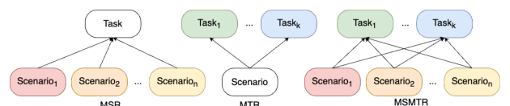
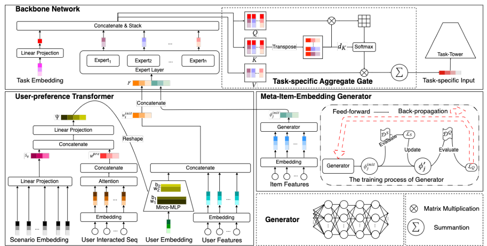

# M3REC 怎样让物品初值、用户迁移和任务专家分别读取条件

把首页、搜索结果和商品详情页的 CTR 或 CVR 样本混入 Shared Bottom，可以共用训练量，底层却容易把场景差异平均掉。只按场景建模又会割裂同一用户的行为，普通 MMoE 只把输出按任务分开，未直接规定源场景的用户证据怎样进入目标场景。M3REC 从这三处着手：属性生成物品向量，多场景历史生成用户侧的迁移参数，任务塔读取专家视图。论文采用 RecSys 2023 正式版。[§1–2，出版页 771–774](https://dl.acm.org/doi/epdf/10.1145/3604915.3608828)。

*Zerong Lan、Yingyi Zhang、Xianneng Li，RecSys 2023 正式版图 1，PDF 第 1 页。从采用版裁取图区。*

## 一次推荐同时需要商品起点、用户偏好和任务输出

设用户最近在搜索场景反复查看运动鞋，目标是在首页预测一双新鞋的点击和转化。新鞋只有上架属性时，MIEG 直接把属性映射为物品初始向量。UPT 分场景对用户交互序列做注意力聚合，把汇总偏好与源、目标场景向量拼起来，投影出一段参数，再切成微型 MLP 的权重和偏置。把各源场景迁移到首页的结果与用户特征拼接、投影，形成首页用的用户表示。用户和商品表示合并后进入共用的多个专家，点击塔、转化塔各自读聚合视图。运动鞋是解释用的例子，论文实验把热门类目当作场景。[§2.1–2.3，式 (1)–(15)，出版页 772–774](https://dl.acm.org/doi/epdf/10.1145/3604915.3608828#page=2)。

*Zerong Lan、Yingyi Zhang、Xianneng Li，RecSys 2023 正式版图 2，PDF 第 3 页。从采用版裁取图区。*

## 用适配后的预测训练物品生成器

先用随机用户与物品嵌入训练骨干，此时可跳过生成器。第二阶段冻结骨干和 UPT。每个历史物品 ID 构成一个元任务，两批互不重叠的样本分担支持集和查询集。先将物品属性变为初态 $e_0=g_\Phi(v)$，用支持集二元交叉熵 $L_S$ 更新临时物品向量 $e_1=e_0-\alpha\nabla_{e_0}L_S(e_0)$，再把查询集 $L_Q(e_1)$ 反传给生成器 $\Phi$。式 (9) 中的单位项在向量情形对应单位矩阵。最后骨干、UPT 和 MIEG 解冻联合训练。论文给出的测试协议按时间切分，没有单列未见物品或线上逐 ID 回传更新。[§2.2、§2.4，算法 1，出版页 772–774](https://dl.acm.org/doi/epdf/10.1145/3604915.3608828#page=2)。

[新品初始化与少量反馈](../../知识库/问题/新品怎样用属性初始化并从少量反馈适配.md)比较了这一路径与 MAML 的共享参数初点、Meta-Embedding 的冷态与适配后组合监督。UPT 的动态参数由用户偏好、源域、目标域共同产生，借鉴 CAN 的参数生成，但该网络应用于用户表示迁移。式 (15) 对初始和输出的用户表示沿用同一符号，未完整写出各源域输入和多任务损失汇总协议。[多场景共享与迁移](../../知识库/问题/多场景怎样共享模型又保留差异.md)。

## 任务向量能否改变专家注意力取决于它怎样进入分数

TAG 将每个专家向量 $E_l$ 拼接同一个任务向量 $T_k$，按式 (4) 组成 $Q=K$；$V$ 为专家输出堆叠。对专家 $i,j$，字面实现的点积是 $E_i^\top E_j+\|T_k\|^2$。如果每行的同一常数进入标准行 Softmax，它就被抵消。比如一行的专家 logits 是 $[1,3]$，给两个值都加 4，注意力概率相同。由此不能仅根据式 (3)–(4) 推出专家权重因任务而异。要实现这一点，可用任务向量单独查询专家键，或在投影里引入任务与各专家的交叉项。论文没有给出可核实的额外公式或实现，后一种写法是机制分析。[§2.1，式 (2)–(4)，出版页 772](https://dl.acm.org/doi/epdf/10.1145/3604915.3608828#page=2)。

## 类目内 AUC 支持联合模型配置的离线表现

Ali-CCP 和淘宝用户行为都以五个热门类目为场景，按时间 8:2 切分。Ali-CCP 的完整 M3REC 预测 CTR、CVR，表 1 场景 3 CVR 为 0.6642，CGC 为 0.6522。淘宝缺商品属性，表 2 的主结果是移除 MIEG 的 w/o I，预测加购、收藏和购买，所以只能用来解释仍启用的部分。表 2 场景 3 购买 AUC 印为 0.7962，同列最强对照 0.6662，按表值相对差 19.51%，提升列却写 3.02%。此外，w/o T 的场景 5 购买 AUC 0.6785 低于 CGC 的 0.6792。报告各单元格并保留不一致，等待原始实验记录确认。原文未给业务新场景迁移或在线 A/B 结果。[§3，表 1–4，出版页 774–775](https://dl.acm.org/doi/epdf/10.1145/3604915.3608828#page=5)。

## 原文与阅读材料

采用 [ACM RecSys 2023 正式版](https://doi.org/10.1145/3604915.3608828)，共 6 页。核对全文、图表、15 个公式及算法 1，未运行模型。未找到作者 LaTeX，中文 PDF 根据正式 PDF 重排，覆盖摘要、正文、算法、图表说明、脚注和致谢，保留图内文字、参考文献及 ACM 权利声明。中文 PDF 共 9 页，保留可编辑的排版工程。正式原文与译文均通过私有备份的认证下载与哈希核验。见[私有备份下载说明](../../文档/工具/中文PDF发布.md)。
