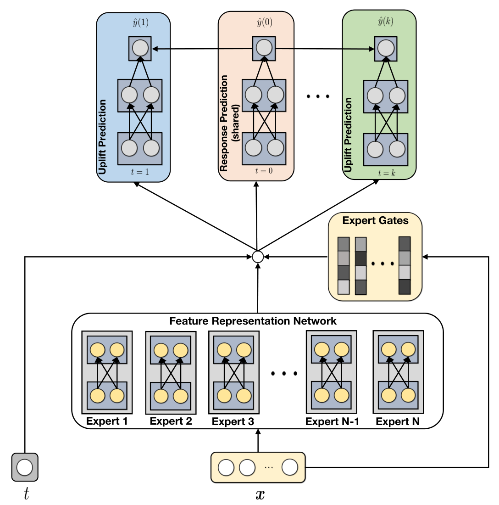
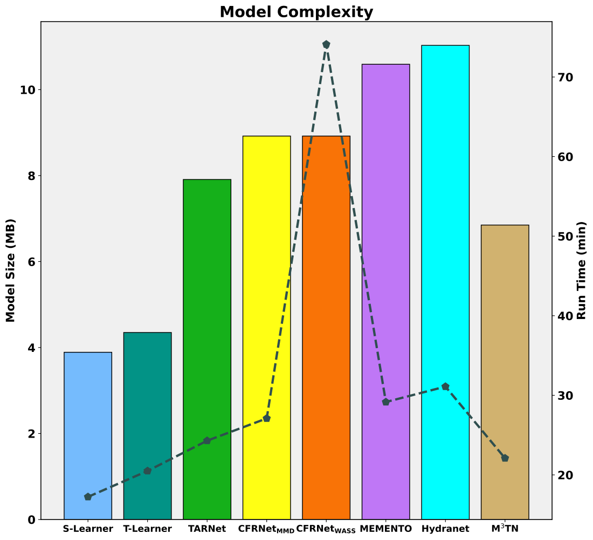

# M³TN 把每档处理写成同一自然响应加专属增量

Zexu Sun、Xu Chen，*M³TN: Multi-gate Mixture-of-Experts based Multi-valued Treatment Network for Uplift Modeling*。采用 [arXiv:2401.14426v1](https://arxiv.org/pdf/2401.14426v1)（2024 年 1 月 24 日），ICASSP 2024 书目见 [IEEE DOI](https://doi.org/10.1109/ICASSP48485.2024.10446323)。[来源与版本](来源.json) · [译本范围](#版本与译本) · [私有备份下载说明](../../文档/工具/中文PDF发布.md#登录下载)。

M³TN 研究的是一个结果、多个互斥处理。例如短视频平台评估不同锐化强度对次日观看时长的增量。标准多头模型为每档拟合观看时长，评分时再减去未锐化时长。这里有两个问题。一个用户只提供实际被分到那档的结果，稀少处理的预测头缺监督。另一个问题是每档都需要扣掉同一条自然观看基线，若训练时没有让各处理共享这条预测，模型要分别拟合其中重复的部分。M³TN 把 MMoE 的门从常见的多个业务目标改到自然响应和各处理增量上，再把事实响应写成显式的加法。 [v1 §1–3](https://arxiv.org/pdf/2401.14426v1#page=2)

## 一条锐化日志经过哪两个头

设用户特征 $x$ 包括过去一周观看时长和设备类别。平台试验可选普通视频、轻锐化和强锐化，目标统一是一天的观看分钟数。各个专家接收同样的 $x$，但对照头、轻锐化增量头、强锐化增量头各用自己的门把专家向量加权。由式 (4)–(5) 可把第 $k$ 个表示读作 $\phi_k(x)=\sum_n [g_k(x)]_n f_n(x)$。原式 (4) 省略了门控的分量下标。门控编号来自要读哪个预测头，门权由 $x$ 决定，同一用户可读出所有候选的结果。每个头同时使用所有专家的软权重，这里的共享成本应结合专家、门和塔的规模一起看。 [v1 §3.1–3.2，式 (4)–(5)](https://arxiv.org/pdf/2401.14426v1#page=2)

Zexu Sun、Xu Chen，arXiv v1 第 2 页图 1，从采用版作者 LaTeX 原图渲染，保留图内文字。先沿下方专家和门读各头的输入，再沿顶部从共享响应连到处理响应。 [arXiv v1 图 1](https://arxiv.org/pdf/2401.14426v1#page=2)

假设当前模型对这位用户的自然响应预测为 30 分钟，轻、强锐化增量分别为 2 和 5 分钟。这条日志恰好接受强锐化，观察到 39 分钟，则事实项用 $(30+5-39)^2=16$。梯度到达自然响应头和强锐化头，也经它们各自的门回流给共享专家。轻锐化头此行没有直接事实残差，却仍会因共享专家更新而受间接影响。若另一条普通视频日志的观察结果为 29，则其事实项用 $(\hat\mu_0(x)-29)^2$。式 (3) 是把各试验臂的事实损失写在一个目标里，数据不会为某位用户同时提供 29 和 39 两个标签。 [v1 §2–3.3，式 (1)–(3)、(6)](https://arxiv.org/pdf/2401.14426v1#page=3)

## 显式增量共享了什么

上线时模型直接读取两个增量头，得到 2 和 5 分钟。若要比较强锐化与轻锐化，做同一用户特征下 $5-2=3$ 分钟的差。各增量头都对照普通视频，结构没有相邻锐化级别的平滑、单调约束或档位间递推。将有序业务量直接编码为处理剂量时，可另比较 [OFA 的有序档位响应](../../知识库/问题/组合营销策略如何共享结构并估计因果增量.md#有序券档怎样共享一条响应曲线)。OFA 用一条基函数曲线跨档共享，M³TN 允许每个已见臂从独立增量头学习。若要让锐化同时影响观看和付费，可比较 [按处理与按结果的两种专家门](../../知识库/问题/多档营销动作怎样共享并区分多个结果.md#共享发生在动作轴还是结果轴)。若动作由锐化与滤镜两个开关构成，可读 [XTNet 的动态遮罩](../SRC-XTNET/阅读笔记.md)。 [v1 §3.2–3.3](https://arxiv.org/pdf/2401.14426v1#page=3)

显式参数化带来一个共享基线和对应的梯度路径。令真实两臂均值是 $\mu_k,\mu_0$，直接相减的误差是 $e_k-e_0$，各档复用的 $e_0$ 会同时进入多个分数。换成加法头后，学习过程和模型偏好变了，但式 (3) 仍然以事实结果作监督，没有把误差项变成正交得分。分布一致也取决于各臂用户的 $X$ 分布。若随机指派使 $X$ 在期望上同分布，将同一个 $\hat\tau^k(X)$ 应用到各臂会得到相同的总体分布。观测日志中各臂人群不同时，公共结构不能推出这一性质，仍需一致性、可交换性和重叠等识别条件。 [v1 §2、§3.3](https://arxiv.org/pdf/2401.14426v1#page=3) · [历史日志的识别条件](../../知识库/问题/历史发券日志如何估计补贴增量.md#在哪一群人哪个时刻比较发与不发)

## 排序表现、消融和训练开销各回答什么

Production 来自两周随机试验，含普通视频加三个锐化等级、超过 700 万用户和 108 个特征，单结果为每日观看短视频总时长。表 1 报告五个随机种子的聚合比较。MultiTwins 的 mQini 为 0.8733，最高基线 CFRNet-WASS 为 0.7942。该数据的 mKendall 实际最高为 Hydranet 0.8277，作者把 M³TN 的 0.8077 标了粗体。生产数据 mKendall 为 0.6906，mQini 0.6804 略低于 CFRNet-MMD 的 0.6823。第 4.2 节称生产数据超越所有基线，比较应读表中的点估计。第 4.1 节用标准误描述跨处理的 sdQini，表中每个单元格的 $\pm$ 又反映了跨种子的波动，两个聚合层次需分开。 [v1 §4.1–4.2，表 1](https://arxiv.org/pdf/2401.14426v1#page=4)

表 2 的 Production mQini 从完整模型的 0.6804 降至移除 MMoE 的 0.6408 和移除重新参数化的 0.6107。这支持该训练配置下两个组件对排序效果的贡献。图 2 展示 V100 上在 Production 训练 20 轮的时间，比较不含评估耗时。M³TN 比列出的四个共享底座网络更小，参数体积仍高于图中的 S/T-Learner。图 3 改变专家数后，mQini 与 mKendall 的较好配置不完全相同。实验没有提供个人的未观测反事实标签，也未报告锐化配置策略的线上增量收益。如何把排序、幅度与策略价值分开验证，见 [补贴增量评估](../../知识库/问题/怎样验证补贴增量的排序幅度和策略价值.md)。 [v1 §4.3–4.5，表 2、图 2–3](https://arxiv.org/pdf/2401.14426v1#page=4)

Zexu Sun、Xu Chen，arXiv v1 第 4 页图 2。由采用版作者 LaTeX 原图渲染，保留坐标和图例。柱形对应左轴模型大小，折线对应右轴训练分钟。 [arXiv v1 图 2](https://arxiv.org/pdf/2401.14426v1#page=4)

## 版本与译本

检索与对照截至 2026-11-26。阅读范围为采用稿摘要、正文、公式 (1)–(6)、图 1–3 和表 1–2。实验均为作者报告，本库未运行模型。中文 PDF 4 页，含摘要、正文、图表说明、通讯作者脚注与致谢，英文参考文献与原图内文字保留。采用作者 LaTeX 并用 XeLaTeX 编译，保留双栏。表 1 的数值和原有强调方式照录，另加译注说明表文出入。采用稿的 arXiv 非独占分发许可仅适用于该版本的 arXiv 分发。 [版本与许可](https://arxiv.org/abs/2401.14426v1)

本机附件为 `.local/papers/SRC-M3TN/translation/中文.pdf`，对应可编辑工程 `.local/papers/SRC-M3TN/translation/translated-sources/Template.tex`。逐页渲染核对中文、数学式、图表、数值及参考文献引用，验证中文字体嵌入与 Unicode 映射。 [PDF 盘点](../../译文/PDF目录.md) · [私有备份下载说明](../../文档/工具/中文PDF发布.md#登录下载)。
