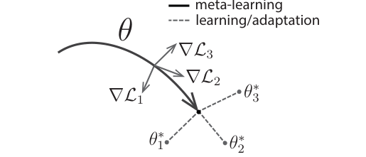
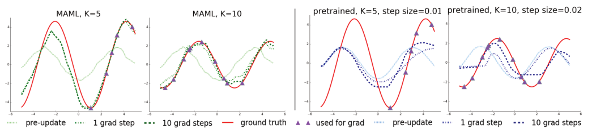

# MAML 怎样把下一批表现反传到适配前的初值

将许多历史任务混在一起训练，初值可能表现为折中的平均模型。少样本场景关心的是新任务给出几条监督后能走到哪里。Chelsea Finn、Pieter Abbeel、Sergey Levine 在 MAML 中把若干步任务内梯度更新放进训练计算图，用不同的一批数据检查更新后表现，再改全局初值。采用 arXiv 1703.03400v3。

## 两个批次分别承担适配与验收

*Chelsea Finn、Pieter Abbeel、Sergey Levine，本文图 1，采用版 PDF 第 2 页。由采用版裁取图区。*

从任务分布抽一个正弦回归任务，支持集提供少量输入输出，查询集提供同任务的另一些样本。共享初值 $\theta$ 经支持集更新到 $\theta'_\tau=\theta-\alpha\nabla L_{S_\tau}(\theta)$，然后在查询集上计算 $L_{Q_\tau}(\theta'_\tau)$。将各任务的查询损失相加，外层优化器更新 $\theta$。测试任务使用已学的 $\theta$，拿自己的支持样本做内层更新，更新后对未见查询点输出预测。元测试查询的标签只用于评估。若是少样本分类，任务由若干类及一组重定义的类标构成，内层用这些类的少量标注图更新。强化学习分支用任务内轨迹更新，再收集更新后的轨迹评估。[§2–3，算法 1–3](https://arxiv.org/pdf/1703.03400v3#page=2)。

## 从查询损失走回初值需要经过更新算子

一次更新的链式法则为

$$\nabla_\theta L_Q(\theta')=(I-\alpha\nabla_\theta^2 L_S(\theta))^\top\nabla_{\theta'}L_Q(\theta').$$

为观察方向，设标量初值是 0，$L_S(\theta)=(\theta-2)^2/2$，$\alpha=0.25$，更新后 $\theta'=0.5$。对查询目标 3，$L_Q(\theta')=(\theta'-3)^2/2$，更新后梯度为 $-2.5$，完整外梯度为 $0.75(-2.5)=-1.875$。一阶近似将更新的雅可比视作恒等，给出 $-2.5$。两者仍用更新后的参数算查询损失，差异在外层是否计入内层曲率。原文使用 Hessian–向量积，不要求显式造整张 Hessian。数值为教学构造。[§2.2、§5.2](https://arxiv.org/pdf/1703.03400v3#page=2)。

## 结果要按类别切分与适配预算读

正弦实验以不同振幅、相位形成回归任务，图 2 比较观察范围之外能否恢复曲线。MiniImagenet 表 1 的 5-way 1-shot 和 5-shot，MAML 分别为 $48.70\pm1.84\%$、$63.11\pm0.92\%$，该表的一阶近似为 $48.07\pm1.75\%$、$63.15\pm0.91\%$。这些是跨任务区间；Omniglot 与既有工作切分可能不同，一阶开销及近似质量也受任务而异。[§5，图 2、表 1](https://arxiv.org/pdf/1703.03400v3#page=6)。

*Chelsea Finn、Pieter Abbeel、Sergey Levine，本文图 2，采用版 PDF 第 6 页。由采用版裁取图区。*

[Meta-Embedding](../SRC-META-EMBEDDING/阅读笔记.md) 用新广告 ID 构造任务，只更新这个 ID 的表示，并额外监督零交互初态。这个应用既改变要适配的参数，又改变外层目标，输入是点击监督和上架已知属性。见[新品的零反馈和少量反馈](../../知识库/问题/新品怎样用属性初始化并从少量反馈适配.md)。

## 分类损失按交叉熵最小化

采用版 §3 式 (3) 将两项二元对数似然写作损失，式首缺少整体负号。若采用算法 2 的梯度下降，应最小化负对数似然。作者公开分类实现使用 `softmax_cross_entropy_with_logits`，随后沿负梯度更新适配参数，见[固定实现的损失](https://github.com/cbfinn/maml/blob/a7f45f1bcd7457fe97b227a21e89b8a82cc5fa49/utils.py#L56-L58)与[适配更新](https://github.com/cbfinn/maml/blob/a7f45f1bcd7457fe97b227a21e89b8a82cc5fa49/maml.py#L84-L100)。[原文 §3，式 (3) 和算法 2](https://arxiv.org/pdf/1703.03400v3#page=3)。

## 原文与阅读材料

采用[固定 v3 PDF](https://arxiv.org/pdf/1703.03400v3)，13 页，核对正文、算法、相关附录和上游 LaTeX。中文 PDF 共 11 页，翻译摘要、正文、致谢、附录 A–C、图表说明和算法注释。参考文献、图内文字与作者权利声明保留原文。作者 LaTeX 双栏工程可继续编辑。原文与译文均已认证下载核验，见[私有备份下载说明](../../文档/工具/中文PDF发布.md)。
