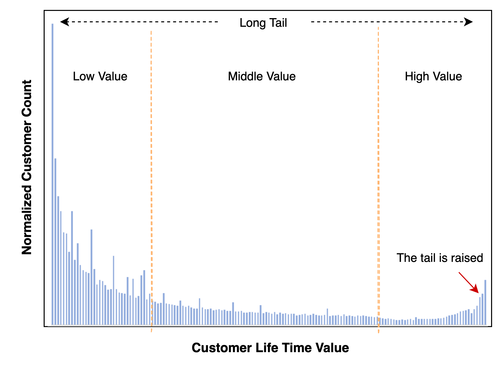
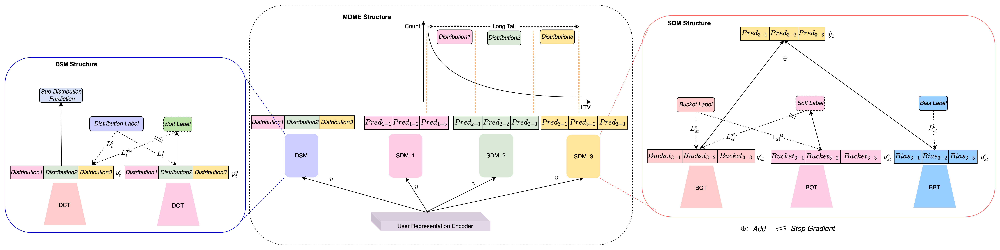
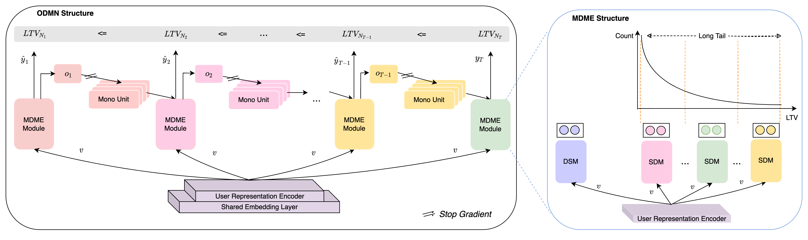
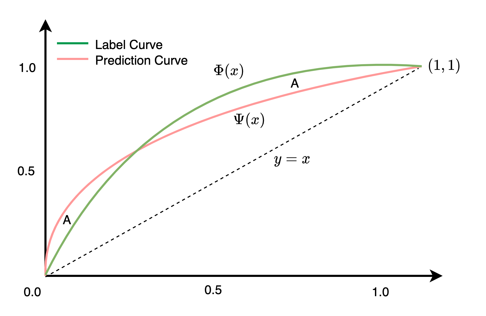

# MDME 与 ODMN：分桶预测怎样连接长短期客户价值

快手用新客首 7 天的特征预测 30、90、180 和 365 天的价值。离线标签是注册后各窗累计活跃天数，线上投放实验另用 30 天平台价值。一个模型要同时处理标签分布不均衡，以及非负累计结果随窗口延长而增加的顺序。MDME 在各窗口内分段、分桶再回归。ODMN 将短期桶分布送入长期分类头，并用顺序损失惩罚相邻窗口倒挂。 [作者版 §1、§5](https://arxiv.org/pdf/2208.13358v1#page=2)

*图 1，采用版第 2 页，Li 等的作者原图。§1 用收入解释图，§5.1 则称图对应 365 天活跃天数。图区没有给出可裁定的单位。*

## 一条事实标签怎样训练三层预测

直接对 365 天的活跃天数做 MSE 时，极端天数对梯度的贡献大；对所有可能取值做等宽分类时，少数桶缺样本。MDME 先让分段分类塔 DCT 学习粗粒度的子分布，再让事实子分布的 BCT 学习段内桶，可用不同桶宽调节桶内样本量。零点等高频取值可单独成段或设单值桶。对有宽度的桶，偏移塔 BBT 学习桶内位置，监督目标是归一化偏移并用 MSE 回归。归一化只限制桶内训练标签的尺度，恢复到原值后，宽桶上的同等偏差对应更大的原量纲误差。 [作者版 §3.3，式 (2)–(8)](https://arxiv.org/pdf/2208.13358v1#page=5)

*图 3，采用版第 4 页，作者原图。段和桶分别有分类与顺序监督，偏移只在有关桶中拟合。*

考虑 90 天活跃天数，两个示意段是 0–9 天、10–90 天。若事实标签为 37 天，选中第二段内的 ([30,50)) 桶，偏移监督为 ((37-30)/20=0.35)。全部样本训练分段分类与顺序，段内塔只接收其事实段样本，桶内偏移用相应桶事实标签。序数塔对各阈值学习“标签是否跨过”，阈值顺序信息再通过蒸馏进入分类塔。若实际推理的两段概率为 0.45、0.55，第二段中 ([30,50)) 桶概率最高，偏移为 0.4，则输出 38 天。部署读出依次取最可能的段和桶，目标并非对所有桶做概率加权期望。 [作者版 §3.3、§3.5 式 (7)–(11)](https://arxiv.org/pdf/2208.13358v1#page=5)

## 短窗传什么给长窗

每个段概率与该段内条件桶概率相乘，即 (o_{t,s,b}=p_t(s)q_t(bmid s))，所有桶合计为 1。比如第二段概率为 0.55、其 ([30,50)) 桶条件概率为 0.60，这个桶在完整分布中的概率是 0.33。长窗头接收上游完整桶分布，而非只接收上游选中的 38 天。Mono Unit 用非负权重网络变换该分布，再将结果加到下游 DCT 和 BCT 的 logits，沿直接连接切断反向梯度。共享表征仍受各窗口任务的监督。 [作者版 §3.3–3.4，式 (2)–(3)](https://arxiv.org/pdf/2208.13358v1#page=5)

*图 2，采用版第 4 页，作者原图。图中的 Stop Gradient 标注在窗口前递路径。*

若 90 天预测 38 天、180 天预测 35 天，相邻项的 (max(hat y_{90}-hat y_{180},0)) 为 3。训练时加惩罚并不保证逐用户输出无倒挂。非负权重也只约束变换的输入到 logit，归一化概率之间此消彼长，加上两级 argmax 和偏移头，不能推出跨窗输出必定有序。原文给出硬 argmax 读出与基于读出值的校准损失，未细述训练中如何通过离散选桶求梯度。业务若要求硬单调，可另行核验输出约束，并确认价值定义可按非负量累加。 [作者版 §3.4–3.5，式 (7)–(8)、(12)–(14)](https://arxiv.org/pdf/2208.13358v1#page=6)

## 分布拟合、用户排序与业务收益怎么区分

Mutual Gini 取预测曲线与标签曲线的绝对面积 (int_0^1|Phi(x)-Psi(x)|,dx)，交叉部分不会互相抵消。各自按值排序形成的曲线能比较分布形状，但置换用户预测仍可保留同一曲线，将所有预测乘同一正常数也可保留累计份额。业务读数还需单看金额校准和同人排序。文中式 (15) 用类别频数定义 Gini 项，和 ZILN 按预测排序累计**真实金额**的归一化 Gini 是不同的计算描述，末列的详细实现未披露。 [作者版 §4，图 4、式 (15)–(16)](https://arxiv.org/pdf/2208.13358v1#page=7) · [ZILN 原文 §4](https://arxiv.org/pdf/1912.07753v1#page=7)

*图 4，采用版第 7 页，作者原图。横轴是累计用户份额，纵轴是累计价值份额。*

表 1 的 365 天活跃天数实验中，ZILN 与 ODMN 的 AMBE 分别为 8.6644、0.3123，Mutual Gini 分别为 0.0558、0.0083。表 2 中 NMO 的 NRMSE 是 1.2064，略低于完整 MDME 的 1.2119，但完整模块 AMBE 更低。表 3 对比同一多任务底座上的各组件。表 4 则是线上获客广告，按不同模型预测的 ROI 选人，各取 10% 流量作为实验和对照，作者报告累计 7、14、30 天 ROI 相对 ZILN 提高 11.9%、12.8%、14.7%。原文未披露 ROI 的具体定义及投放细节。该结果对应整套投放实验，不能据此推出某位用户的发券增量。 [作者版 §5，表 1–4](https://arxiv.org/pdf/2208.13358v1#page=8) · [金额建模方法比较](../../知识库/问题/新客价值怎样预测零值和长尾金额.md)

[固定作者版](https://arxiv.org/pdf/2208.13358v1) · [CIKM 题录](https://doi.org/10.1145/3511808.3557152) · [PDF 访问流程](../../文档/工具/中文PDF发布.md)。中文译本覆盖摘要、正文 §1–6、图表说明与说明性脚注，参考文献、数学表达、图内标注和版权声明沿用原文。
