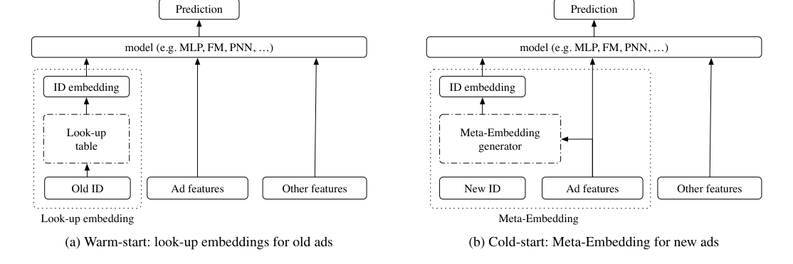
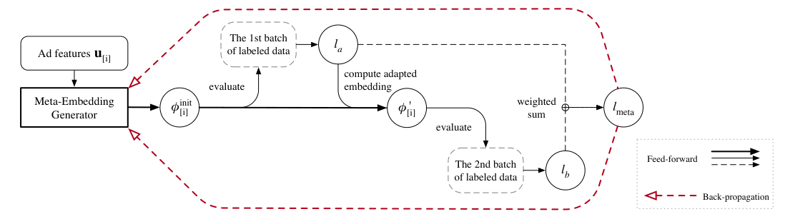

# Meta-Embedding 怎样为新广告生成能接着更新的 ID 向量

广告刚上线时，查表里没有它的 ID 向量。随机值和老广告向量均值都能启动打分，但均值不区分新广告，随机值没有利用已知属性。Feiyang Pan 等人为广告训练了一个共享属性生成器。它要让新广告初次打分可用，并让最初几条标签带来的向量更新有效。采用 arXiv 1904.11547v1。

## 上架时如何把属性接到原预测塔

*Feiyang Pan 等，本文图 2，采用版 PDF 第 3 页。由采用版裁取图区。*

基座先在旧 ID 上训练 CTR 或实验对应的 CVR 预测，再冻结。新广告的类目、广告主等属性经已有属性嵌入作为生成器输入，得到与原 ID 表相同形状的 $e_0=g_w(a)$。同一次曝光中，用户和上下文等公共特征仍按基座路径进入，原先查 ID 的位置改读 $e_0$。生成器训练和部署可以延用既有预测接口，论文实验比较多个基座。上架时的属性必须已经存在，产品能否展示还受前面的召回与探索策略影响。[§2、图 2–3](https://arxiv.org/pdf/1904.11547v1#page=3)。

## 先用一批自己的反馈改向量，再用另一批教生成器

*Feiyang Pan 等，本文图 4，采用版 PDF 第 5 页。由采用版裁取图区。*

在旧广告中抽一个 ID，拿它的两批有标签反馈。以批 A 看冷态损失 $L_A(e_0)$，并做 $e_1=e_0-\eta\nabla_eL_A(e_0)$；用批 B 计算 $L_B(e_1)$。更新的是共享生成器 $w$：

$$L_{\rm meta}=\alpha L_A(e_0)+(1-\alpha)L_B(e_1).$$

例如生成器为鞋类教学广告给出一维 $e_0=0$，基座读作 $\sigma(e)$。批 A 只有一条点击，则梯度是 $-0.5$，若步长 1，得到 $e_1=0.5$。批 B 再来一条点击时预测约 0.622，高于初态 0.5，交叉熵约 0.474。外层通过更新算子把这一变化归还给 $w$；完整链路包含批 A 的损失二阶项。部署遇到同类新 ID，只在初次插入时用生成器，随着标签到来更新该广告的向量，其他预测参数沿用基座。数值为教学构造。[§3.1–3.3、式 (12)–(17)、算法 1](https://arxiv.org/pdf/1904.11547v1#page=4)。

MAML 的主目标是在适配后的查询集优化模型初值。本篇进一步让初值随广告属性变化，用零反馈和热身两项损失共同训练，适配对象是当前 ID 向量。[MAML](../SRC-MAML/阅读笔记.md)。

## 新旧 ID 与观察批次决定数字如何解释

论文按 ID 分组构造新旧广告，再把模拟新品样本切出热身 A/B/C 和留出的评估集。三类数据包含 MovieLens-1M、腾讯 CVR、KDD Cup 2012 搜索广告 CTR，任务含义各异。表 2 相对冷态基线报告 MovieLens 冷态平均 AUC 相对 +3.36%、Logloss 相对 −10.23%，阶段 A 中随机初值基线 AUC +7.02%、Meta-Embedding +8.66%，两者分母均是初始基线。相对百分比不能视作 AUC 点数。该构造能对照未知 ID 与少量标签后预测，和线上实际新品上架时间、曝光分配与延迟观察仍有差异。[§4.3–4.4，表 1–2](https://arxiv.org/pdf/1904.11547v1#page=7)。

完整比较见[新品向量与少量反馈适配](../../知识库/问题/新品怎样用属性初始化并从少量反馈适配.md)。

## 原文与阅读材料

采用[固定 v1 PDF](https://arxiv.org/pdf/1904.11547v1)，10 页，核对正文、图表、算法和上游 LaTeX。中文正文 PDF 待交付。
