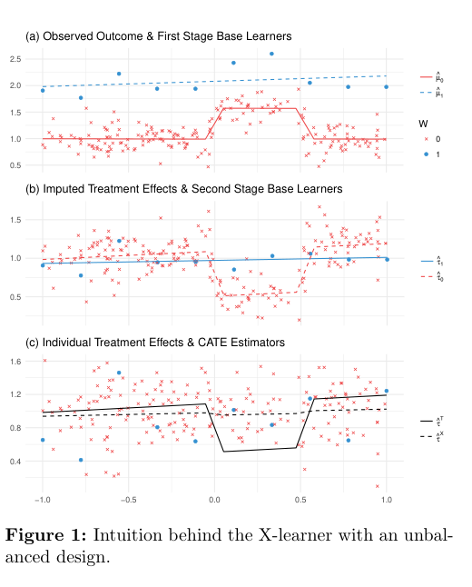

# S、T、X-Learner 怎样借用结果监督学发券增量

S、T、X-Learner 是将现成回归算法组织成条件效应估计器的三种方式。设 $X$ 是发券前特征，$W$ 是领券资格下的发券指派，$Y$ 是随后七天下单，$\mu_w(x)=E[Y\mid X=x,W=w]$。在可忽略性、重叠与一致性下，目标为 $\tau(x)=\mu_1(x)-\mu_0(x)$。主要选择是共享多少事实结果信息，以及是否另外利用效应函数的结构。 [原文 Framework and Definitions、Meta-algorithms](https://arxiv.org/pdf/1706.03461v6#page=3)

## 一个模型、两个模型与两阶段模型

S-Learner 用全部 $(X,W,Y)$ 训练一个结果模型 $\hat\mu(X,W)$，对同一个人改写 $W$ 两次后相减。共同学习能利用大臂样本，但处理字段可能被正则压低。若模型中无 $W$ 与 $X$ 的交互，效应可能被估成常数。T-Learner 分别用处理和对照样本训练两个结果模型，两臂可以采用各自的函数形状。当处理臂很小，它单独拟合 $\mu_1$ 会不稳定。 [原文 S-learner、T-learner](https://arxiv.org/pdf/1706.03461v6#page=3)

作者原图 1，arXiv 1706.03461v6 第 4 页裁取。由上向下读：第一阶段预测各组结果，第二阶段将事实结果和填补的另一臂结果相减，最后比较 T 与 X 的估计。蓝色处理臂稀少，两个结果函数要独立学好比直接学习较简单的效应形状更难。 [原文图 1](https://arxiv.org/pdf/1706.03461v6#page=4)

X-Learner 先按 T-Learner 拟合。若拿券的一笔记录下单 $Y^1=1$，无券模型给 $\hat\mu_0(x)=0.25$，则处理臂伪标签 $D^1=Y^1-\hat\mu_0(x)=0.75$。若相似的无券用户 $Y^0=0$，处理模型给 $\hat\mu_1(x)=0.30$，该臂伪标签 $D^0=\hat\mu_1(x)-Y^0=0.30$。伪标签有事实噪声和填补误差，不等于这两个人真实效应。分别对两臂回归伪标签得到 $\hat\tau_1,\hat\tau_0$，最后 $\hat\tau(x)=g(x)\hat\tau_0(x)+(1-g(x))\hat\tau_1(x)$。原文允许选择 $g$，常用倾向 $e(x)$。处理稀少时 $g$ 小，更多使用由大对照臂结果模型填补得到的 $\hat\tau_1$。 [原文式 (7)–(9)](https://arxiv.org/pdf/1706.03461v6#page=4)

## 什么时候第二阶段有优势

两臂结果曲线都很复杂，但差值可能近似线性或平滑。大对照臂估出的 $\hat\mu_0$ 较可靠时，小处理臂只需学低复杂度的效果形状，因此样本不均时 X-Learner 可能更有利。理论比较给定样本规模、光滑度、重叠和基学习器的误差率，线性效应例不意味着 X-Learner 在所有数据上都优于 S、T。原文选用随机森林及 BART 等基学习器并改变模拟设计，排序会随数据生成机制调整。现实应用的选举和上门沟通实验说明如何探索异质性，各人的反事实没有进入观测数据。 [原文收敛率与应用](https://arxiv.org/pdf/1706.03461v6#page=6) · [不同结果学习器如何估券增量](../../知识库/问题/历史发券日志如何估计补贴增量.md)

采用 arXiv 1706.03461v6，核对 PNAS DOI 10.1073/pnas.1804597116。精读正文方法、模拟、速率、应用与附录伪代码。 [固定原文](https://arxiv.org/pdf/1706.03461v6) · [PNAS 正文](https://pmc.ncbi.nlm.nih.gov/articles/PMC6410831/)

中文正文译本共 38 页，本地正式文件为 `.local/papers/SRC-META-LEARNERS/translation/中文.pdf`。原文与译本均可登录私有附件库下载。摘要、正文、图表说明与致谢已译。作者 LaTeX 副本保留附录、参考文献与图内文字。 [下载说明](../../文档/工具/中文PDF发布.md)
