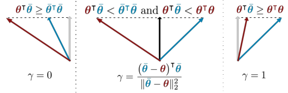

# MGDA 怎样从多个任务梯度选出共同下降方向

共享网络常用固定权重合并多任务损失。若某次批次中的点击与满意度梯度竞争，固定平均可能让一个损失上升。Sener 与 Koltun 把各任务风险视作不同目标，在共享参数梯度的凸包中寻找最小范数组合，再用该组合更新网络。采用 arXiv 1810.04650v2。论文验证了视觉任务，下面的推荐任务数值只用于解释算法。

## 两个梯度的连线上哪一点可以同时下降

*Ozan Sener、Vladlen Koltun，本文图 1，采用版 PDF 第 5 页。由采用版裁取图区。*

设同一次小批次得到 $g_1=(2,0)$ 和 $g_2=(-1,1)$。二者均由各自监督对共享参数求导。等权平均 $(0.5,0.5)$ 与 $g_2$ 的内积为 0。取 $\alpha g_1+(1-\alpha)g_2$，最小平方范数解为 $\alpha=0.4$、$g_*=(0.2,0.6)$；两个内积都等于 $0.4$，因此沿 $-g_*$ 对两个损失的一阶变化都为负。一般 $T$ 个任务在非负且和为 1 的单纯形上求最短向量，图 1 给两任务几何，算法用 Frank–Wolfe 迭代多任务权重。欧氏投影最优条件给 $g_t^\top g_*\geq\|g_*\|^2$。若 $g_*=0$，共享参数满足相应的驻点条件，还需各任务专有参数驻点。Pareto 驻点是局部一阶条件，不能据此宣称找到全局 Pareto 最优点。[§3.1–3.2，式 (3)、算法 1–2](https://arxiv.org/pdf/1810.04650v2#page=4)。

## 表示空间上界省的是重复的编码器反传

直接取 $g_t=\nabla_{\theta_s} L_t$，每任务都要沿共享编码器反传。令共享表示为 $Z$，改用 $a_t=\nabla_ZL_t$ 先求最小范数组合。链式法则给 $\|\sum_t\alpha_t g_t\|\leq\|J_Z\|\|\sum_t\alpha_t a_t\|$，与 $\alpha$ 无关的雅可比范数可以从权重优化中移去。随后用同一组权重对编码器反传一次，各任务专有部分仍各自更新。上界优化一般给不同权重，论文定理 1 使用全秩条件，证明中的正定性涉及表示空间 Gram 矩阵，不能对任意共享层或随机小批次宣称全体损失均下降。训练完成后推理只使用共享编码器与各任务头，训练时的系数并不定义线上多个预测的业务融合权重。[§3.3、附录证明](https://arxiv.org/pdf/1810.04650v2#page=5)。

## 多任务训练与业务决策使用各自的目标

MultiMNIST 将图中左右数字作为不同标签，CelebA 做属性多标签，Cityscapes 做语义分割、实例分割和深度估计。表 2 对比不使用上界与使用上界的效果和单 Titan Xp 训练时间，节省随任务数和网络变化。指标、尺度与共享层边界都与排序不同。[§4、表 2–4](https://arxiv.org/pdf/1810.04650v2#page=8)。

MMoE、PLE 改变哪些任务能经共享专家更新参数，MGDA 改变到达共享部分后各损失的系数。同一结构依然要对齐哪些标签在本批有效、损失量纲、任务梯度归一化和单任务对照。见[共享与负迁移](../../知识库/问题/多任务共享如何避免负迁移.md)。

## 原文与阅读材料

采用[固定 v2 PDF](https://arxiv.org/pdf/1810.04650v2)，15 页，核对正文、算法及补充证明。已取得原 PDF，LaTeX 传输仍待完整核验。中文正文 PDF 待交付。
