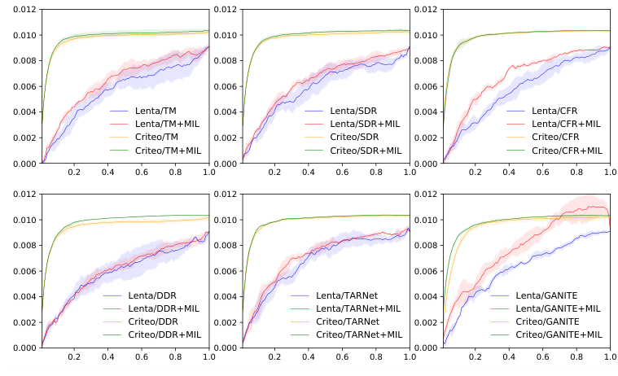

# MIL 如何用一组用户的响应约束增量模型

对一条短信，双头模型分别给出发送与不发送时的访问概率。只向实际指派的头提供访问标签，两个头虽然能拟合响应，差值却可能被各自的误差淹没。Zhao 等把同一小批次里预估增量相邻的用户组成包，再添加一个包级事实残差损失。单个包内的残差允许相互抵消，所以原有的事实损失继续约束每条记录。 [原文 §1、§3](https://arxiv.org/pdf/2312.09639v1#page=2)

## 一包的标签和预测如何相减

用基础模型先得到每条记录的 $p^1(x),p^0(x)$，按差值 $p^1-p^0$ 排序，每 $j$ 条划入一个等大的不重叠包。对包 $B$，用整个批次的处理比例 $u$ 缩放包内两臂。式 (2) 的标签和式 (3) 的预测分别是

$$
y_B=\sum_{i\in B:T_i=1}\frac{Y_i}{u}
-\sum_{i\in B:T_i=0}\frac{Y_i}{1-u},
\qquad
h_B=\sum_{i\in B:T_i=1}\frac{p^1(X_i)}{u}
-\sum_{i\in B:T_i=0}\frac{p^0(X_i)}{1-u}.
$$

式 (3) 只使用当前记录的事实臂。两头在每位用户上同时出分，作用于组包排序和最后的个体增量读出。排序所得包成员是离散索引，平方损失的梯度经过事实臂预测与共享骨干。若各包有 $j$ 条，标签按总量计，除以 $j$ 后才对应每位用户平均作用的尺度。只有在随机概率相同、组包规则在当前指派前固定等条件下，使用已知指派概率的逆概率和才能在相应期望下估计该包的总效应。论文实际使用批内估计的 $u$，分层概率不等与排序的训练反馈都要另行核对。 [原文 §3.1、式 (1)–(4)](https://arxiv.org/pdf/2312.09639v1#page=3)

用四条已经分在同一包的记录算一遍。设批次 $u=0.5$，两名短信用户的实际结果是 $(1,0)$、对应头预测是 $(0.6,0.4)$，两名对照用户实际结果为 $(0,0)$、对应头预测为 $(0.2,0.2)$。则 $y_B=2$、$h_B=1.2$，包损失为 $0.64$。沿减小损失的方向，处理臂预测会向上、对照臂预测会向下。前两名处理用户的单条标签一高一低，事实损失仍会区分两人。如果对照预测同时减小或处理预测共同增大，都可能得到相同的包级预测，故包标签自身无法指定包内每个人的效应。上线只需两个头在同一用户特征上各预测一次，再取差。 [原文 §3.1](https://arxiv.org/pdf/2312.09639v1#page=3)

## 排序聚组改善的是哪项指标

作者原图 1，采用版第 6 页。每个小图固定一个基础模型，先按图例区分数据，再在同一数据内比较是否加 MIL。横轴是覆盖比例，纵轴是累计曲线值。表 2 汇总分臂排序 AUUC。Lenta 上 GANITE 从 0.006260 到 0.007839，约增加 25.2%。CRITEO 上 TARNet 从 0.009833 到 0.009895，幅度更小。表 4 在 Lenta 比较完整 TARNet+MIL 的 0.007111 和取消排序聚组的 0.006059、只用包损失的 0.005284。原文报告的是重复实验的汇总，直接比较这些数值可以核对方向，幅度校准和实际净收益仍要各自验证。 [原文表 2–4](https://arxiv.org/pdf/2312.09639v1#page=4) · [原文图 1](https://arxiv.org/pdf/2312.09639v1#page=6) · [补贴增量评估](../../知识库/问题/怎样验证补贴增量的排序幅度和策略价值.md)

引言印作 Lenta 处理组转化率 11.912%，表 1 对应 11.012%，减去对照的 10.257% 后为 0.755 个百分点。式 (6) 和附录式 (8) 把包内误差和的平方等同于各误差平方之和。直接展开还有交叉项，独立零均值只能消掉该项的期望，排序条件下则需重新论证独立性。即便采用独立误差设定，也应核对聚合前后的尺度与包标签噪声。这里保留包级损失的实际计算和消融结论。 [原文第 2–3、6 页](https://arxiv.org/pdf/2312.09639v1#page=3)

采用 arXiv 2312.09639v1 六页作者稿，核对 CIKM 2022 正式题录，阅读正文 §1–5 及附录 A–B。五页中文正文译本由作者 LaTeX 编译，附录、图内文字和参考文献保留原文。本地正式文件位于 `.local/papers/SRC-MIL-UPLIFT/translation/中文.pdf`。 [固定原文](https://arxiv.org/pdf/2312.09639v1) · [正式 DOI](https://doi.org/10.1145/3511808.3557655) · [私有备份下载说明](../../文档/工具/中文PDF发布.md#登录下载)
