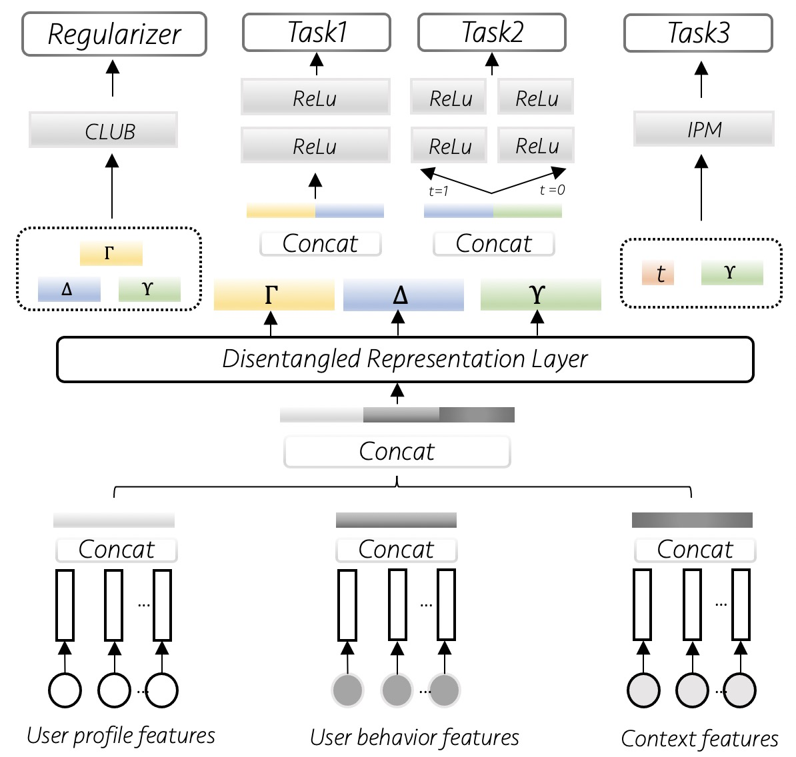
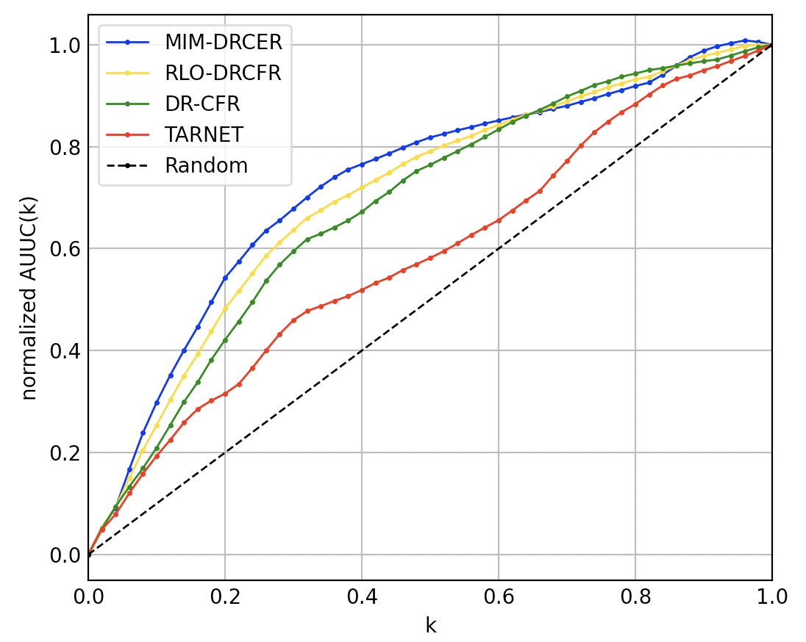

# MIM-DRCFR 如何从历史发券日志学习三个表征

旧策略依据用户活跃度发券时，高活跃用户即使没券也更容易购买。MIM-DRCFR 要估计给同类用户发券与不发券的结果差。它让两组共用一套底层编码器，从同一份发券前特征学出三路表征，再用分配预测、结果预测、跨臂分布距离和互信息约束它们的分工。推理时对同一个用户计算两个结果头，差值用于排序。采用 Mingyuan Cheng、Xinru Liao、Quan Liu、Bin Ma、Jian Xu、Bo Zheng 的作者预印本 arXiv 2206.01022v1，对应 SIGIR 2022 的 *Learning Disentangled Representations for Counterfactual Regression via Mutual Information Minimization*。 [采用版](https://arxiv.org/pdf/2206.01022v1) · [出版条目](https://doi.org/10.1145/3477495.3532011)

## 旧策略产生的组间差怎样进入结果模型

设每条样本是一位满足资格的用户在发券前的一次决策。$X$ 包括旧策略可见的近期活跃度、商品偏好和触达批次，$T=1$ 为指派固定面额、固定时效的券，$T=0$ 为不指派，$Y$ 为 7 天内是否下单。一位活跃用户收到了券而且购买，留下的是 $(x_i,t_i=1,y_i=1)$，没有留下这位用户无券时的结果。若高活跃用户有券下单率 45%、无券 40%，低活跃用户分别为 15%、10%，两类的设定效应都是 5 个百分点。发券组和对照组若分别有 80% 和 20% 的高活跃用户，直接相减却得到 $39\%-16\%=23$ 个百分点。 [发券算例与选择偏差](../../知识库/问题/历史发券日志如何估计补贴增量.md#历史发券日志如何估计补贴增量)

TARNet 用共享的 $\Phi(X)$ 和两个结果头，历史用户只监督事实臂。遇到几乎从未进入对照组的活跃用户，$h^0$ 就难以从实际对照观察中学习该部分关系。CFR 在事实预测之外降低两臂 $\Phi(X)$ 的距离，限制跨臂表征偏移。如果编码器把只影响发券的批次与预测购买的活跃度混在一起，压低共同表征的组间差异可能损失预测信息。DR-CFR 先拆出三种因素，各用一个网络。MIM-DRCFR 延续这种分工，改为共享底层和因素专用层，并在输出上加入互信息惩罚。 [CFR 原文](https://proceedings.mlr.press/v70/shalit17a.html) · [MIM-DRCFR §1–2](https://arxiv.org/pdf/2206.01022v1#page=2)

## 一条发券样本怎样给三路网络提供信号

图 1 为 Cheng 等作者原图，来自 arXiv 2206.01022v1 源码的 `model.png`，与采用版第 2 页对应。由下向上读，画像、行为和上下文先汇入共享编码，再分成黄色 $\Gamma$、蓝色 $\Delta$ 和绿色 $\Upsilon$。向上跟两个拼接箭头，即可看出为什么 $\Delta$ 同时服务于分配和结果任务。 [原文图 1](https://arxiv.org/pdf/2206.01022v1#page=2)

继续用收到券并购买的那位用户。假如触达批次只改变发券机会，活跃度同时影响发券和购买，某些商品偏好主要提供购买信号，这三者分别有助于理解 $\Gamma$、$\Delta$、$\Upsilon$ 的目标角色。网络评估的是整组特征 $x_i$，每个因素都从共享编码读取信息，字段的角色由实际分配、购买机制和训练监督决定。

1. 从 $[\Gamma(x_i),\Delta(x_i)]$ 预测 $t_i=1$，该误差训练分配分类器及其两条表征路径。分配信号可以来自触达批次和活跃度。
2. 从 $[\Upsilon(x_i),\Delta(x_i)]$ 经过 $h^1$ 拟合 $y_i=1$。活跃度和商品偏好都可帮忙，$h^0$ 则从 $t=0$ 的用户取得事实监督。同一条样本的反事实差值无需作为训练标签。
3. 把该用户的 $\Upsilon(x_i)$ 放入发券臂，对两臂的 $\Upsilon$ 计算 Wasserstein IPM。若这路表征保留了大量可靠区分发券的批次信号，分布项会对其施加压力。$\Delta$ 同时接两项监督，用于保留横跨分配和结果的信息。原文式 (4) 将事实结果、分配预测和 IPM 加权求和，$\alpha$ 和 $\beta$ 控制其相对强度。 [原文图 1、式 (3)–(4)](https://arxiv.org/pdf/2206.01022v1#page=2)

线上给另一位高活跃用户打分时，把相同的 $[\Upsilon(x),\Delta(x)]$ 同时送入 $h^1$ 和 $h^0$。如果两个头给出 0.45 和 0.40，模型估计相似人群每指派 100 次多 5 位用户下单。只在一次指派对应相同预算单位、目标为可相加的结果且允许少投时，挑出覆盖上限内最高的非负增量分数即可求解原文的计数预算问题。若券面额、预计核销成本或跨商品替代存在差异，需要将这些因素纳入策略目标。 [原文式 (9)–(10)](https://arxiv.org/pdf/2206.01022v1#page=4) · [补贴预算接口](../../知识库/总览/营销补贴总图.md#从增量预估走向预算决策)

## 互信息惩罚针对的是编码出来的因素

同一份活跃度信号可能同时被 $\Gamma$ 和 $\Delta$ 利用，两路合在一起仍能准确预测是否发券。加入互信息项的目的，是对这种依赖形成另一条训练信号。对于一对表征 $U,V$，vCLUB 用 $q_\theta(v\mid u)$ 近似真实条件分布，比较同一条记录得到的配对和分别从边缘分布取出的配对。

$$
I_{\rm vCLUB}(U,V)=
\mathbb E_{p(u,v)}[\log q_\theta(V\mid U)]
-\mathbb E_{p(u)p(v)}[\log q_\theta(V\mid U)].
$$

如果同一用户的 $\Gamma$ 能可靠预告自己的 $\Delta$，第一项相对第二项通常更高。原文式 (6) 加总 $(\Gamma,\Delta)$、$(\Delta,\Upsilon)$、$(\Upsilon,\Gamma)$ 三项，式 (7) 用 $\gamma$ 控制它们对表征学习的压力。上界性质依赖近似条件，MIM 论文给出了目标，条件密度模型和参数更新细节在复现时仍需单独确定。训练权重过高时可损失用于事实任务或区分效应的人群信号。 [原文 §2.3、式 (5)–(8)](https://arxiv.org/pdf/2206.01022v1#page=3) · [CLUB 上界条件与两步训练](../SRC-CLUB/阅读笔记.md#条件概率由网络估计时上界还剩什么)

RLO-DRCFR 沿用同一任务结构，把 vCLUB 换成三个输入贡献向量的成对内积和。向量来自权重积及取平均，衡量的是参数代理。即使内积为零，共用坐标的正负贡献也能抵消。vCLUB 则直接利用样本输出的统计关系。即使三对真实互信息都等于零，三路仍然可能共同依赖。令 $U,V$ 为独立的均匀二元变量，再令 $W=U\mathbin{\rm XOR}V$，任意一对独立，但前两项决定第三项。有限样本中的低 vCLUB 值还受到估计质量影响。要赋予两头差值因果含义，仍需处理前的无混杂、共同支持和稳定处理定义等条件。 [原文式 (8) 与 §2.1](https://arxiv.org/pdf/2206.01022v1#page=3) · [DeR-CFR 的参数约束](../SRC-DER-CFR/阅读笔记.md#一条样本怎样训练上线怎样出分)

DeR-CFR 同样区分分配、混杂和调整因素。它学习每个历史样本的权重，在两臂之间调整混杂表征 $C$ 的训练分布，并用 $C,A$ 出结果；MIM 的跨臂约束作用于 $\Upsilon$，$\Delta$ 通过分配、结果监督及三对依赖惩罚形成。比较时要分别检查 DeR-CFR 的支持和权重集中情况，以及 MIM 共享编码下的事实拟合和表征信息是否保留。两种做法都依赖有可比人群的历史日志。 [两种方法的业务接口](../../知识库/问题/历史发券日志如何估计补贴增量.md#应该让两组在哪些特征上可比)

## 已知反事实和线上投放各检验了什么

在 IHDP 的 100 次半合成结果实现中，训练、验证、测试比例为 63/27/10。表 1 的 IHDP-A 上，MIM 的根 PEHE 为 0.38（标准差 0.09），RLO 为 0.54（0.16），原 DR-CFR 为 0.64（0.25）。单独移除互信息项和用三个独立网络取代共享底层时，指标分别为 0.50（0.21）、0.53（0.20）。IHDP-B 上三者为 2.08（0.09）、2.29（0.12）、2.28（0.13），这里后两项仍是移除互信息和移除共享底层的变体。指标是对两个潜在结果之差的误差，与已模拟的反事实直接比较。 [原文 §3.1 与表 1](https://arxiv.org/pdf/2206.01022v1#page=4)

图 2 为 Cheng 等作者原图，来自 arXiv 2206.01022v1 源码的 `uplift.png`，与采用版第 4 页对应。横轴在模型排序后逐步扩大覆盖人群，纵轴是覆盖子集的两臂事实结果率差乘以覆盖人数，再除以全量时的同一量。由于这项归一化，各模型终点汇合。表 2 比较的是曲线汇总值，报告发券为 1.55、推送为 0.80，DR-CFR 分别为 1.22、0.68。历史日志经旧策略筛选，这一分组差仍取决于覆盖和人群平衡。 [图 2、表 2 与式 (11)–(12)](https://arxiv.org/pdf/2206.01022v1#page=4)

线上表 3 用过去 7 天登录过的人群，每组 100 万人，按各策略选择其中 60% 推送，观察 5 天日登录用户数。论文报告 MIM 相对旧线上策略平均增长 6.1%、RLO 为 4.1%、DR-CFR 为 1.2%。式 (13) 对整组人口计入被推送人群和未被推送人群的登录数。这个结果描述特定推送策略和窗口下的登录变化。发券的成本、订单价值及券额变化需要相应实验验证。 [原文 §3.3 和表 3](https://arxiv.org/pdf/2206.01022v1#page=5)

## 原文与中文译本

- 采用版阅读覆盖摘要、正文 §1–4、13 个公式、两幅图与三张表。文献引用用原论文版本定位。截至 2026-11-25，采用 arXiv 作者版，ACM 条目用于核实出版身份，本文未运行作者模型。 [原文 PDF](https://arxiv.org/pdf/2206.01022v1) · [来源与原件哈希](来源.json)
- 中文 PDF 共 8 页，译出摘要、正文、图表标题、表头与释义及描述性脚注，保留公式、数值、原图内文字、书目、署名和权利声明。采用 XeLaTeX 下的单栏排版，经逐页目视检查。正式文件位于 `.local/papers/SRC-MIM-DRCFR/translation/MIM-DRCFR_中文.pdf`。译后工程主文件位于同目录 `translated-sources/main.tex`。 [私有备份下载说明](../../文档/工具/中文PDF发布.md)
