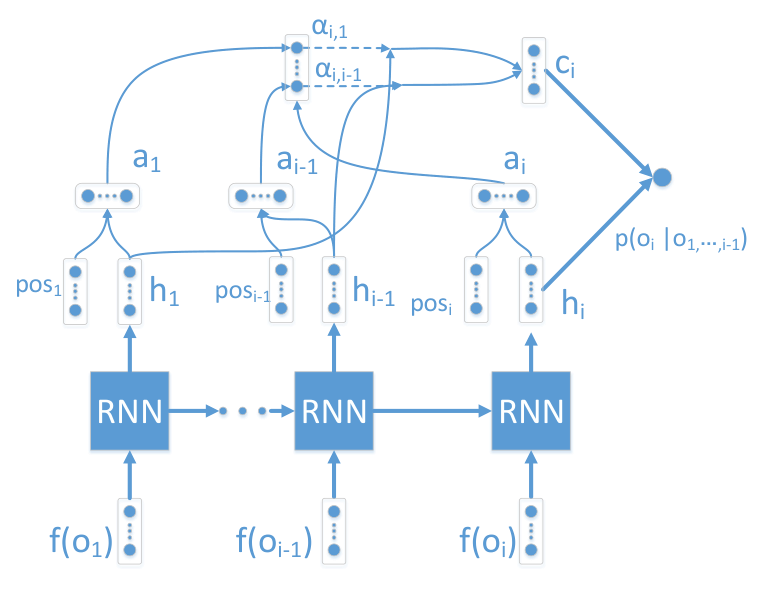
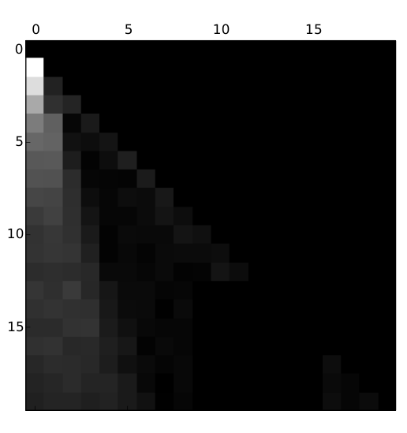
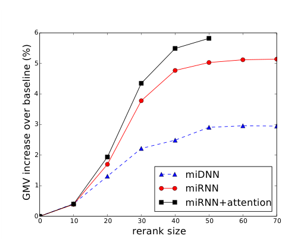
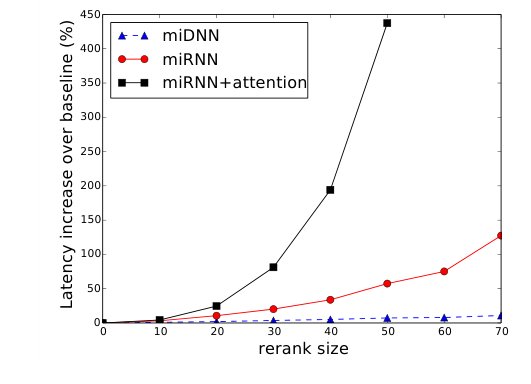
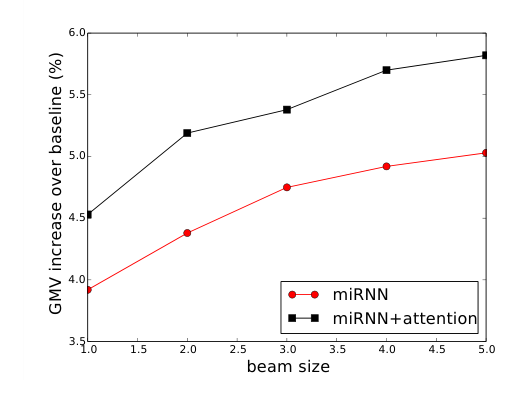
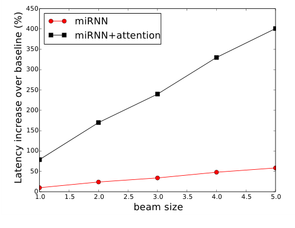

# miRNN 如何按前缀估计购买概率，再用束搜索提高期望成交额

同价商品放在一批便宜商品中显得贵，放在一批更贵的商品中则可能更容易成交。淘宝搜索的 miRNN 把这类相对特征与已经排出的前缀一起送进购买概率模型。给出概率后，线上再比较不同排列的期望成交额。原文将这两个步骤分别视为估计和搜索，训练时沿既有日志顺序，线上通过束搜索试探多个可能的展示顺序。[IJCAI 2018 §1–3，PDF 第 1–4 页](https://www.ijcai.org/proceedings/2018/0518.pdf#page=2)。

## 价格乘概率后，基础分数何时可以一次排序

同一请求的候选集合为 $S$，一个排列为 $o$，商品 $i$ 的售价为 $v_i$，在该排列下的购买概率为 $p(i\mid c(o,i))$，其中 $c(o,i)$ 表示该项之外的排序上下文。按一次购买量一般为一件的业务近似，目标为

$$
G(o)=\sum_{i\in S}v_i\,p(i\mid c(o,i)).
$$

由期望的线性性得到求和，商品购买事件可以相关。先把上下文简化为候选集合。miDNN 对每个局部特征维度算候选内最小最大值，将相对值 $(x_i-\min x)/(\max x-\min x)$ 与原局部特征拼接。以 A、B、C 三条周末产品为例，价格 100、120、200，扩展的相对价格为 0、0.2、1。局部的价格、相关性、CTR、CVR 和偏好分数共 23 维，扩展后为 46 维。原文没有写极差为零的处理。[§3.1、式 (3)–(5)，PDF 第 2–3 页](https://www.ijcai.org/proceedings/2018/0518.pdf#page=2)。

此时一个候选的预测概率在重排前即可算好，位置效应另写为随位置递减的 $b(t)$，对贡献 $v_ip_i$ 一次降序可最大化 $\sum_t b(t)v_{o_t}p_{o_t}$。交换逆序对会让大贡献乘上较大的折扣。生产基线用 $v_i^\gamma p_i$，$\gamma$ 由线上实验人工调整，实验还改变了相对特征和模型结构。[§3.1、§4.1，PDF 第 3–4 页](https://www.ijcai.org/proceedings/2018/0518.pdf#page=3)。

## 每次试探添加一个商品，都更新该分支的购买概率

miRNN 在完整候选集的相对特征之外，加入已经排出的前缀。假设候选 $i$ 接在前缀 $s$ 后，取该分支的 LSTM 状态 $h_s$，计算 $h'=\mathrm{RNN}(h_s,f_i)$，再以 $p(i\mid s)=\sigma(W_h h')$ 预测它是否购买。对每个分支缓存已用索引、完整 LSTM 状态和期望成交额。原式与算法简称 $h$，实现 LSTM 续算还需单元状态。单个候选的 Sigmoid 概率是一个购买事件的预测，同轮所有试探候选的概率可以同时较高。它与 [Seq2Slate 对剩余索引做 Softmax](../SRC-SEQ2SLATE/阅读笔记.md#输出是当前候选索引的无放回排列) 的选择分布语义不同。[§3.2、式 (6)–(7)、算法 1，PDF 第 3 页](https://www.ijcai.org/proceedings/2018/0518.pdf#page=3)。

仍用 A、B、C，设教学首位购买概率分别 0.40、0.30、0.18，价值增量 40、36、36。贪心先选 A。若之后接 C 的概率是 0.16、接 B 的概率是 0.20，第二步 A→C 的累计值为 72，优于 A→B 的 64。再令 A→C 之后的 B 概率为 0.10，得到完整列表值 84。宽度为 3 的束第一步也留 C，设 C→B 时 B 的概率为 0.35，累计 78，最后 A 若有 0.15 的概率，完整 C→B→A 得 93。这个算例展示首项最优与完整列表最优可以分离，实际束搜索依赖训练后的概率和中间截断。每步把分支扩展到尚未出现的商品，以 $G(s)+v_i p(i\mid s)$ 排序，只留最多 $k$ 条。总 RNN 扩展数为 $O(kN^2)$，堆维护和批处理另计。束达到容量仍会丢弃部分分支。[算法 1，PDF 第 3 页](https://www.ijcai.org/proceedings/2018/0518.pdf#page=3)。

Zhuang 等，IJCAI 2018 图 1，PDF 第 4 页，作者原图。由下向上读局部与全局拼接特征 $f(o_i)$、RNN 隐状态 $h_i$ 与位置嵌入。按式 (11)–(13) 对此前位置生成权重 $\alpha_{ij}$，汇成 $c_i=\sum_{j<i}\alpha_{ij}h_j$，输出 $\sigma(W_hh_i+W_cc_i)$。该路径让很早的已选项也能直接参与估计。每次试探要看此前多个位置，原文估算 $\Theta(kN^3)$。

## 监督来自已展示的购买日志

每条训练记录包含一次查询与当时展示的商品。购买商品标正，其他展示商品标负。作者去掉无购买记录，因此离线概率学习与验证依赖这一样本选择。训练序列沿日志顺序，不运行束搜索。用二元交叉熵时，B 已展示但未购买会下调其对应 logit，损失通过该时刻状态传回候选特征和先前状态。文中没有用随机位置干预验证重排后的概率是否已校准。第 4.2 节按前一天训练、次日测试，各约 1700 万条记录，平均约 50 项。DNN、miDNN、miRNN、带注意力 miRNN 的 AUC 分别为 0.724、0.747、0.765、0.774，RIG 为 0.094、0.119、0.141、0.156。[§4.1–4.2、表 1，PDF 第 4–5 页](https://www.ijcai.org/proceedings/2018/0518.pdf#page=4)。

Zhuang 等，IJCAI 2018 图 2，PDF 第 5 页，作者原图。每行是待预测位置，每列是其前缀中的一个位置。靠前项在较后行仍可取得较大权重，说明模型在这些样本上使用了这条连接。注意力值来自日志样本的平均。

## 把重排长度和束宽放回同一服务预算

作者称线上把用户及其查询随机均分到 30 桶，实验约一个月。表 2 在重排 50 项、RNN 束宽 5 的条件下给出对同一生产基线的变化。

| 方案 | GMV | 搜索时延 |
| --- | ---: | ---: |
| miDNN | +2.91% | +9% |
| miRNN | +5.03% | +58% |
| miRNN 加注意力 | +5.82% | +401% |

基线为 21 ms，正文约述最后一种配置从 21 ms 升至 105 ms。没有硬件、延迟分位或置信区间的完整口径。实验作者选择 miRNN 作为收益与成本的折衷。图 3–6 将两种预算分别展开。[§4.3、表 2，PDF 第 5–6 页](https://www.ijcai.org/proceedings/2018/0518.pdf#page=5)。

Zhuang 等，IJCAI 2018 图 3–4，PDF 第 5–6 页，作者原图。横轴为重排项数，纵轴各为对基线的相对变化。增加候选后 GMV 改善趋缓，注意力方案的延迟成本增长更快。

Zhuang 等，IJCAI 2018 图 5–6，PDF 第 6 页，作者原图。横轴是束宽，扩大搜索候选分支后，GMV 增益趋缓，时延仍上升。

相同候选下的逐步监督、显式金额目标与一次打分见[列表顺序与前缀依赖怎样建模](../../知识库/问题/列表顺序与前缀依赖怎样建模.md)。

## 原文与译文

采用 IJCAI 2018 正式版，第 3725–3731 页，核对正文 §1–5、算法 1、图 1–6 及表 1–2。 [固定原文](https://www.ijcai.org/proceedings/2018/0518.pdf) · [会议记录](https://doi.org/10.24963/ijcai.2018/518)。 10 页译文按 IJCAI 正式版正文重排，含摘要、算法、图表题注、脚注和致谢，参考文献与图内文字保留原文。下载并冻结的 arXiv 1805.08524v1 作者 LaTeX 作为对照。 正式译本位于 `.local/papers/SRC-MIRNN/translation/miRNN_中文翻译.pdf`。 [私有备份下载说明](../../文档/工具/中文PDF发布.md)。
