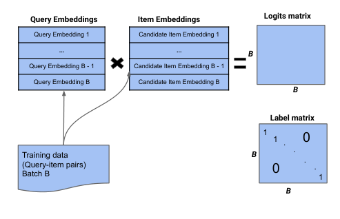
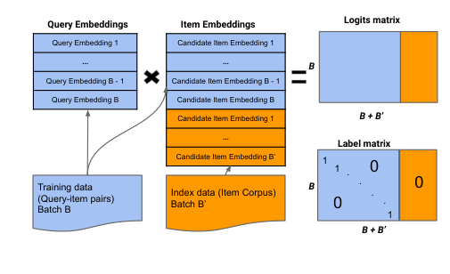

# 混合负采样让双塔同时看到日志物品与目录物品

批内抽样把一条请求的安装物品复用为其他请求的对照。这样生成的负例集中在历史上已经展示或已有人安装的 App。新上架 App 即使能出现在服务索引里，也可能长期没机会参与训练分母。Google Play 论文在同批正例之外，再从检索目录均匀抽一组 App。

作者原图 2，Yang 等，The Web Conference 2020，PDF 第 3 页。正例在对角线，其他列由其余训练对的物品编码组成。

## 从两份物品输入构造一个分母

请求是用户、上下文及正在浏览的 seed App，标签是随后从推荐中安装的 App。教学批有两个请求，分别安装 A 降噪耳机伴侣和 B 运动记分。物品塔先编码 A、B，再额外从目录抽 C 音效工具、D 训练计划，同塔重新编码 C、D。以第一个请求为例，A 是目标，B、C、D 进入分母。第二个请求在 B 列取标签。两条请求共用 4 个候选向量。C 和 D 的内容特征取自目录输入，分母梯度沿它们的向量更新物品塔。

作者原图 3，同版 PDF 第 4 页。蓝列由日志形成，橙列由目录流形成，标签矩阵橙块全为 0。若有两塔向量维度 $d$，则矩阵相乘的形状为 $(B\times d)(d\times(B+B'))$。$B'$ 是每批目录样本数。取 $B=B'$ 时，混合分布可用 $\frac12Q_{\rm log}+\frac12Q_{\rm uniform}$ 描述。论文式 (5) 将各负列的 $\exp(s_{ij})$ 改为 $\exp(s_{ij}-\log Q_j^\ast)$，分子及分母中的目标项按该式保留 $\exp(s_{ii})$。这与 Yi 等式 (4) 在所有批候选列上使用同一种校正的写法有差异。重合目标 ID 和重复列会影响有效采样分布，工程中应记录实际处理规则。[原文 §3.2–3.3、式 (5)，PDF 第 3–4 页](https://storage.googleapis.com/gweb-research2023-media/pubtools/6090.pdf#page=4)。

## 用哪些 App 做线上检索

作者原图 5，同版 PDF 第 5 页。只在线算左塔，右塔产出可缓存物品嵌入。论文的训练额外列来自目录特征的当次前向，部署索引保存的是用于服务的产物。训练每批成本随 $B'$ 增加，目录覆盖与时效受入库快照影响，目录里未经展示的样本仍可能是潜在正例。

Google Play 的离线轮换窗口比较中，表 1 批内双塔 Recall@50 为 0.6439，混合双塔为 0.7474，单塔采样 Softmax 为 0.7226。批内双塔每批 2048 条日志，混合为 1024 条日志加 1024 条目录项，前者与后者的梯度组成随批方案变化。固定 $B=1024$ 的表 2 显示 $B'$ 增至 8192 时 Recall@100 为 0.8939，继续增至 16000 后降到 0.8575。两周 A/B 以安装后实际使用的 App 定义高质量安装，混合双塔比生产对照 +1.54%，批内双塔 −1.46%。实验支持该目录和场景下的折中，目录到正反馈的选择偏差仍存在。[原文 §5、表 1–3，PDF 第 5–6 页](https://storage.googleapis.com/gweb-research2023-media/pubtools/6090.pdf#page=6)。

采用 [The Web Conference 2020 DOI 10.1145/3366424.3386195](https://doi.org/10.1145/3366424.3386195) 的 Google Research 完整 PDF，阅读 §1–6、三张实验表及模型图。

中文学习译本 8 页。摘要、正文 §1–6、图表说明译为中文，图内英文与参考文献保留。依据会议 PDF 重排。本地附件为 `.local/papers/SRC-MIXED-NEGATIVE-SAMPLING/translation/混合负采样.中文.pdf`。采用版原文与译文均已认证下载并核对完整 SHA-256。见 [PDF 备份说明](../../文档/工具/中文PDF发布.md)。
