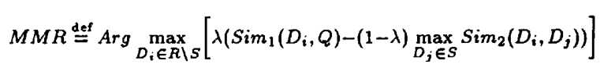
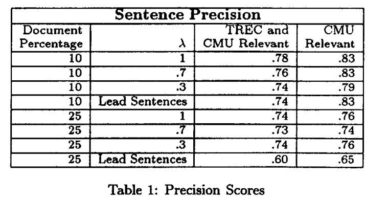

# MMR 如何在高相关结果中减少重复

一个查询已经取回一批相关文档，按原分数排序却可能让前几条反复讲同一个事实。Carbonell 与 Goldstein 在 SIGIR 1998 把查询相关性和已选结果的冗余放进同一次贪心选择，给出了最大边际相关性（Maximal Marginal Relevance，MMR）。这一步只在检索器返回的列表内移动位置。候选阶段遗漏的内容需要先由检索器找回。[原文 §1–2，第 335 页](https://www.cs.cmu.edu/~jgc/publication/The_Use_MMR_Diversity_Based_LTMIR_1998.pdf#page=1)。

## 第二个空位开始考虑已经覆盖了什么

设查询“城市周末短途”召回河边步道 A、同一河段另一篇攻略 B、郊外骑行 C。以下分数均为教学值。相关性分别为 0.90、0.87、0.70。纯相关性排序输出 A、B、C，第二条多占了一个介绍同一河段的名额。令 $R$ 是检索器按门槛或候选数量返回的文档集合，$S$ 是已经入选的集合。$r(i)=\mathrm{Sim}_1(D_i,Q)$ 衡量文档对查询的相关性，$s(i,j)=\mathrm{Sim}_2(D_i,D_j)$ 衡量两篇文档的相似性。两种度量可各自选择。按正文线性组合和两个端点写出的逐轮计算为

$$
i^* = \arg\max_{i\in R\setminus S}\left[\lambda r(i)-(1-\lambda)\max_{j\in S}s(i,j)\right],
\qquad 0\le\lambda\le 1.
$$

用“空前缀罚零”作本例的首步约定，先取 A。设 B、C 与 A 的相似度为 0.95 和 0.20。当 $\lambda=0.7$，B 新分数为 $0.7\times0.87-0.3\times0.95=0.324$，C 为 $0.7\times0.70-0.3\times0.20=0.430$。C 先填第二位。若还要继续选择，B 的罚分取它与 A、C 的相似度中较大的那个。在相似度可按需取值时，可以给每个未选项缓存这个最大值，每新增一项做一次比较。已有 $M$ 项候选，需选 $K$ 项，这一实现需 $O(KM)$ 次候选扫描和相似度查询，另计计算相似度本身的代价。原文未给初始空集、并列或所有边际分数偏低时如何停的规则，固定长度重排需确定这些约定。[原文 §2，第 335 页](https://www.cs.cmu.edu/~jgc/publication/The_Use_MMR_Diversity_Based_LTMIR_1998.pdf#page=1)。

Carbonell 与 Goldstein，SIGIR 1998 §2，第 335 页，作者原式裁图。印式把 $\lambda$ 乘在括号里的两项上。取 $\lambda=0$ 时所有候选的分数都会归零，和紧随公式的多样性端点说明冲突。按印式比较上例 B 和 C，得 0.4095 和 0.448，恰好也选 C，但阈值不同。比如 $\lambda=0.8$ 时，按印式选 B，按正文线性组合仍选 C。译本保留印式及译注，上文算例按正文端点一致的线性组合计算。

## 从搜索列表到抽取摘要

把候选从文档变为句子，$r(i)$ 仍衡量对查询的相关性，$s(i,j)$ 改为句间相似性。比如两篇短途攻略都写了“步道入口在北门”，先选一条包含这项信息的句子后，另一条的边际分数就可能低于介绍骑行路线的句子。原文的单文档试验用余弦相似度，以用户或系统生成的查询为条件，选完句子后再按原文位置呈现。因此打分时的选择顺序和交付摘要时的阅读顺序各有职责。这是已有相关性度量之上的重排规则，文中没有用于拟合 MMR 权重的训练标签。作者观察到先用较小的 $\lambda$ 浏览，再结合改写查询和较大的 $\lambda$ 聚焦主题的策略。该观察来自小规模试验。[原文 §2–4，第 335–336 页](https://www.cs.cmu.edu/~jgc/publication/The_Use_MMR_Diversity_Based_LTMIR_1998.pdf#page=2)。

## 文档偏好、句子准确率与摘要效用

搜文档的试验只有五名本科生，最终自由选法时四人选择 MMR，三人明确发现多样性和聚焦搜索各有用途。SUMMAC 的 15 个系统评估中，作者报告其查询相关摘要 F 值为 0.73，信息型摘要准确率为 70%。各系统的摘要长度等参数有差别。多文档摘要结果来自新闻集合前 10 片段的初步观察，作者未报告用于估计总体效果的量化对照。[原文 §3–4，第 335–336 页](https://www.cs.cmu.edu/~jgc/publication/The_Use_MMR_Diversity_Based_LTMIR_1998.pdf#page=2)。

Carbonell 与 Goldstein，SIGIR 1998 表 1，第 336 页，作者原表裁图。左列是保留的文档比例，中间是 $\lambda$ 或按文首取句的基线。两个准确率列分别采用 23 篇 TREC 判相关且至少一名 CMU 评审判相关的文档，以及 18 篇获三名 CMU 评审中至少两人判相关的文档。作者从一个 TIPSTER 主题的 200 篇中抽查了 50 篇，报告三档 $\lambda$ 的准确率无显著差异。该测量关注句子的相关性，重复减少的幅度要另行观察。[原文 §4、表 1，第 336 页](https://www.cs.cmu.edu/~jgc/publication/The_Use_MMR_Diversity_Based_LTMIR_1998.pdf#page=2)。

MMR 的冗余由最相似的一项决定。沿着同一候选算例，进一步考虑整组向量是否覆盖了新方向，或让位置折扣参与目标，可以得到不同的排序规则。[列表相关性与多样性权衡](../../知识库/问题/列表相关性与多样性权衡.md)。

## 原文与译文

采用 SIGIR 1998 正式版第 335–336 页，核对摘要、§1–5、印式与表 1。原文 DOI 为 10.1145/290941.291025，采用第一作者 CMU 站点的两页版本。正文、摘要与表题用 XeLaTeX 重排为中文，保留原权利声明及参考文献。 [固定原文](https://www.cs.cmu.edu/~jgc/publication/The_Use_MMR_Diversity_Based_LTMIR_1998.pdf) · [私有备份下载说明](../../文档/工具/中文PDF发布.md)。
