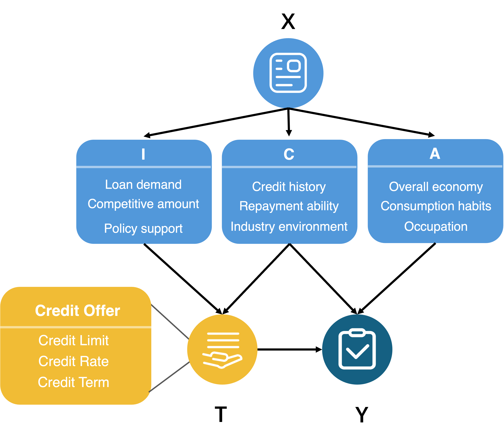
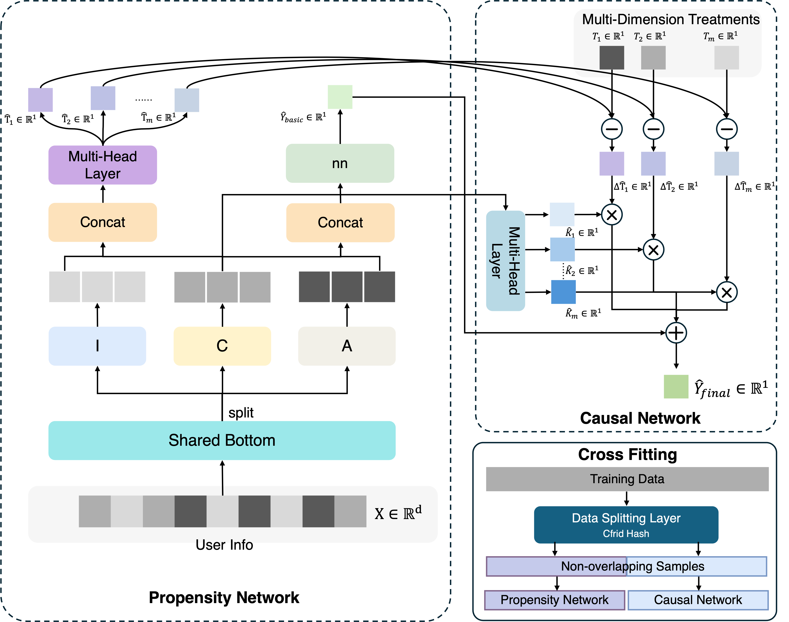
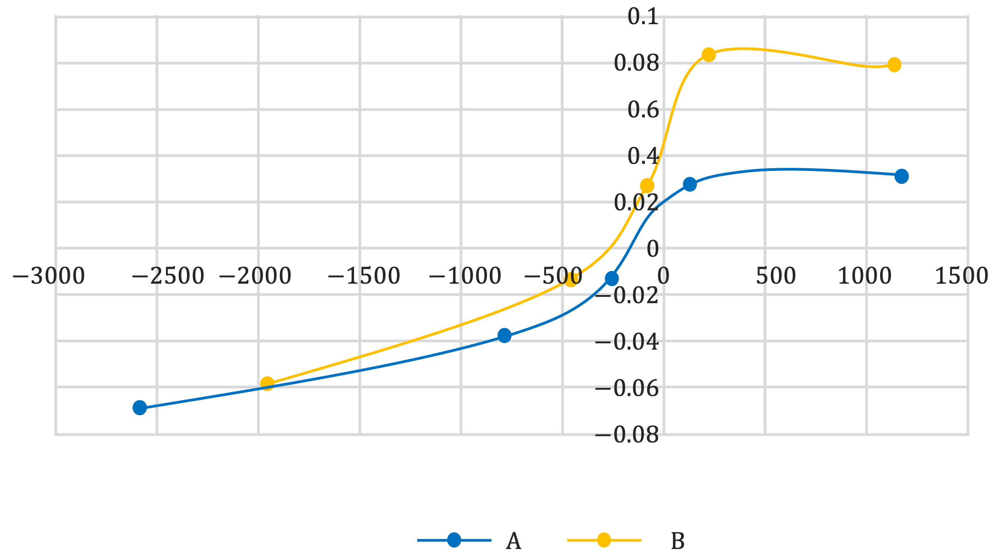
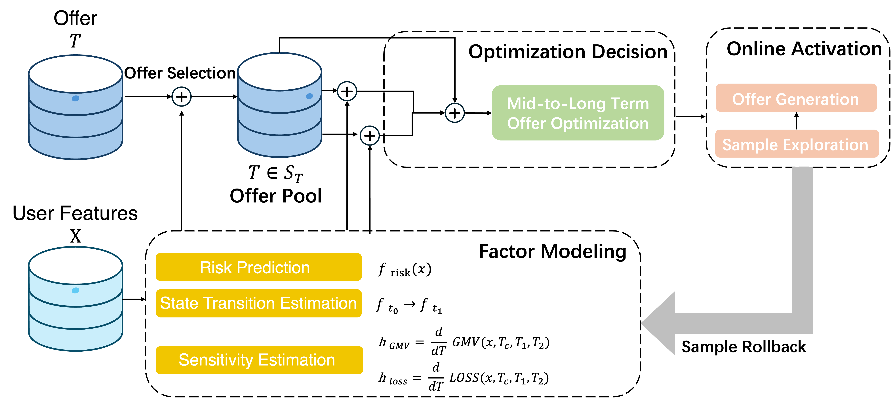

# Multi-Treatment-DML 怎样从历史方案估计多维连续响应

额度、利率和期限通常由同一套历史策略决定。直接比较高低额度客户的违约结果，容易把客户本来的风险差当作额度作用。Multi-Treatment-DML 先估计各维处理和结果在同类客户中的基准，再在残差上学习随用户变化的敏感度。线上固定用户特征，代入候选组合求差，并用分项预测接入三个月收益策略。采用 Zhao、Wang、Zhao 和 Wan 的 arXiv 2508.02183v2，2025-08-11 修订。 [固定原文](https://arxiv.org/pdf/2508.02183v2)

## 历史优惠为什么不能直接回归成因果效应

图 1 来自 Zhao 等的 v2 作者源码，PNG 原字节，原 PDF 第 3 页。箭头把 $X$ 分解成只影响分配的 $I$、同时影响分配和结果的 $C$、只影响结果的 $A$。例如，审批策略可能给风险较低的人更高额度，而同类人本来的违约也较少。就算提高额度本身增加损失，历史高额度组仍可能表现为更低损失。 [原文 §3、图 1](https://arxiv.org/pdf/2508.02183v2#page=3)

把同样的问题放到补贴。若旧策略往往同时提高券额和延长有效期，就难以确定支出变化主要来自哪个坐标。二元双头在每一对动作内估计条件均值，连续联合动作没有有限个天然分组。可将每个坐标改为同类人群实际获得的档位相对其历史基准的偏差，再问这些变化是否有相互独立的覆盖。即使两个单坐标各有范围，如果两者始终按固定比率一起变化，联合残差的协方差仍可能退化，独立斜率难以估计。连续处理的正值性应理解为目标邻域在条件联合支持中，而原文 §3 的点概率写法来自离散情形。 [原文识别假设](https://arxiv.org/pdf/2508.02183v2#page=3)

## 一条记录怎样从双残差变成候选响应

图 2 来自 Zhao 等的 v2 作者源码，原 PDF 第 4 页。左边共享编码将观测变量分到三路，$I,C$ 连接处理头，$C,A$ 连接结果头。右边将实际处理和预测处理相减，将实际结果和预测结果相减，再学习两者之间的关系。下方是两份不重叠样本的训练与交换次序。 [原文 §4、图 2](https://arxiv.org/pdf/2508.02183v2#page=4)

用两个连续坐标说明计算。假设某一类用户预期收到 10 元券、7 天有效期，预期货币结果为 20 元。某条观察记录收到 12 元、8 天券，结果为 25 元，于是 $\Delta T=(2,1),\Delta Y=5$。单条记录只给一条方程，很多系数都能解释这个点。第二阶段须借助各坐标独立变化的同类记录，由 $X$ 生成用户敏感度 $K(X)$ 并拟合残差关系。举例取系数 $(1.5,2)$，在这条记录上残差预测为 $1.5\times2+2\times1=5$ 元。把 (12 元、8 天) 与 (10 元、7 天) 两候选代入，同一个用户的结果基准与处理基准在作差时抵消，得到 5 元。数学直读为：

$$
\widehat Y(x,t)=\widehat m(x)+K(x)^\top(t-\widehat e(x)),\qquad
\widehat\tau(x;t,t')=K(x)^\top(t-t').
$$

这里使用原文线性因果网络的一种自然解释。原文预测式的加项写为 $Y$，图 2 和基准网络对应上线可得的预测 $\widehat m(x)$。处理基准 $\widehat e(x)=\mathbb E[T\mid X=x]$ 是各维条件均值。它不能当作候选动作收到指派的概率。原文说明两折轮换，一份训练基准网络，另一份训练因果部分，再交换并平均两轮估计。独立划分减少同条记录同时拟合基准和效应时的误差泄漏。对一般非线性异质效应，残差斜率可以是条件线性投影，不能当作任意剂量下的真实响应。 [原文 §4.1–4.4、式 (1)–(7)](https://arxiv.org/pdf/2508.02183v2#page=4)

三路因素的处理与结果监督沿用解耦模型的思路，差异在于它输出处理向量和边缘结果基准供残差学习。式 (4) 加总输入贡献向量的成对余弦，和 MIM-DRCFR 的 vCLUB 惩罚在对象与估计方式上不同。余弦可以为负，最小化三项之和不能推出三项各为零，也不能补回未记录的混杂变量。POUL 对完整离散策略的可学习表示构造正交得分，讨论的是误差一阶敏感性。该性质与参数向量的余弦约束分属不同步骤。 [MIM-DRCFR 正则与识别](../SRC-MIM-DRCFR/阅读笔记.md#互信息惩罚针对的是编码出来的因素) · [POUL 正交得分](../../知识库/问题/正交得分怎样约束逐点效应误差.md)

## 单调性保证要看哪一个量

当同一用户的结果头采用上式且第 $k$ 个坐标的 $K_k(x)\geq0$，保持其他坐标不变，提高 $t_k$ 时预测结果不下降。相反方向需要 $K_k(x)\leq0$ 或先定义反向坐标。论文说依靠结构施加该单调性，同时在式 (5) 加 $L_2$ 正则抑制系数过大。$L_2$ 只控制幅度。采用版未完整给出每个坐标的符号参数化，若要重现该保证，应分别核对实际输出层和坐标编码。原文式 (3) 的 Tweedie 表达式与常见最小化负对数似然方向相反，式 (6) 邻近文字同时提到均方误差和 Tweedie。译文保留原式，以论文公开材料无法确认具体训练符号。 [原文式 (3)、(5)–(6)，PDF 第 4–5 页](https://arxiv.org/pdf/2508.02183v2#page=4)

图 4 来自 Zhao 等的 v2 作者源码，原 PDF 第 6 页。横轴为提额变化、纵轴为风险变化，贷款样本分成高信用 A、中信用 B。中信用曲线在中间区间上升更快，外端略有回落。正文把总体趋势描述为线性上升。模型图可以检查约束附近的行为，但无法独立验证选择偏差是否消除。 [原文 §5.4、图 4](https://arxiv.org/pdf/2508.02183v2#page=6)

## 离线提额比较与三个月策略收益

表 1 在 Twins 上的根 PEHE 为 0.323，ATE 绝对误差为 0.011。表 3 中神经网络 DML 的 Qini AUUC 为 0.165，叠加解耦为 0.168，再采用 Tweedie 为 0.187，最后一项 PCOC 为 1.002。表 4 的贷款对照统一为是否提额这个二元任务，报告 Qini AUUC 0.243，PCOC 1.100。两张表各有自己的比较设置，正文没有给出足够信息以对齐两项 PCOC。指标支持相应二元任务下的排序与聚合拟合比较，多维联合响应仍需按各坐标及组合验证。 [表 1–4](https://arxiv.org/pdf/2508.02183v2#page=6)

图 5 来自 Zhao 等的 v2 作者源码，原 PDF 第 7 页。由左到右，先产生合规候选额度、利率和期限，再按候选估计本金损失等多个结果，交给决策模块选三个月预期收益更高的方案。线上保留一定探索流量，将结果回流下一轮。表 5 报告策略相对基线的累计利润增幅 +10%。在线收益包含候选与选择环节的整体变化，论文没有给出所有处理维度各自的独立实验数量及置信区间。 [原文 §6、表 5](https://arxiv.org/pdf/2508.02183v2#page=7)

## 原文与中文译本

- 阅读采用 8 页作者预印本，覆盖摘要、正文 §1–7、式 (1)–(7)、图 1–5 及表 1–5。检索截至 2026-11-25，未运行作者模型。 [原文 PDF](https://arxiv.org/pdf/2508.02183v2) · [来源与原件哈希](来源.json)
- 中文正文按采用版重排为单栏，译出摘要、正文和图表说明。保留公式、表值、署名、图内文字和书目，译注标出连续处理正值性等符号问题。正式文件位于 `.local/papers/SRC-MT-DML/translation/MT-DML_中文.pdf`。 [私有备份下载说明](../../文档/工具/中文PDF发布.md)
