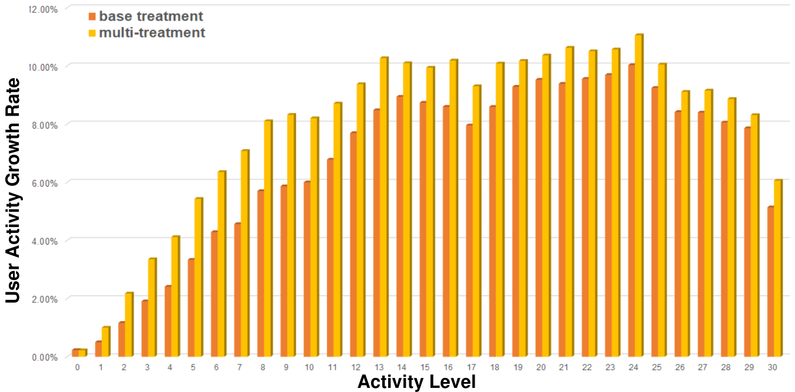
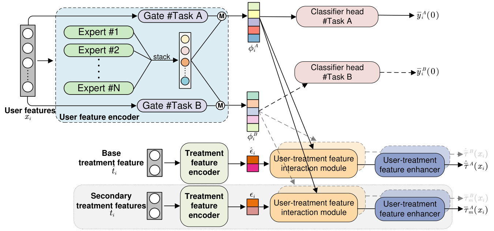
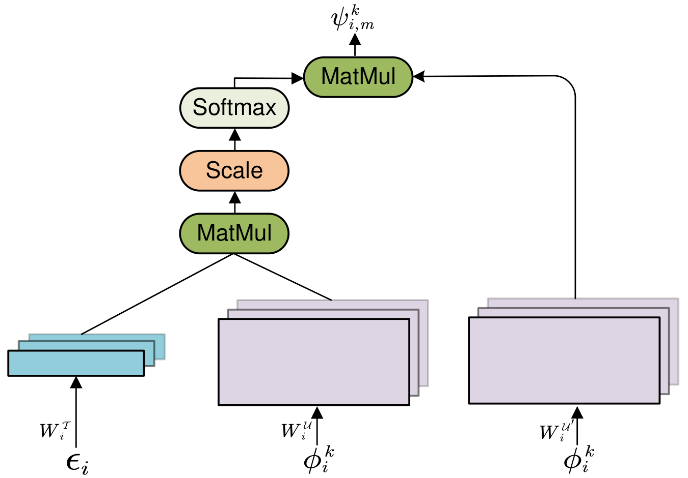
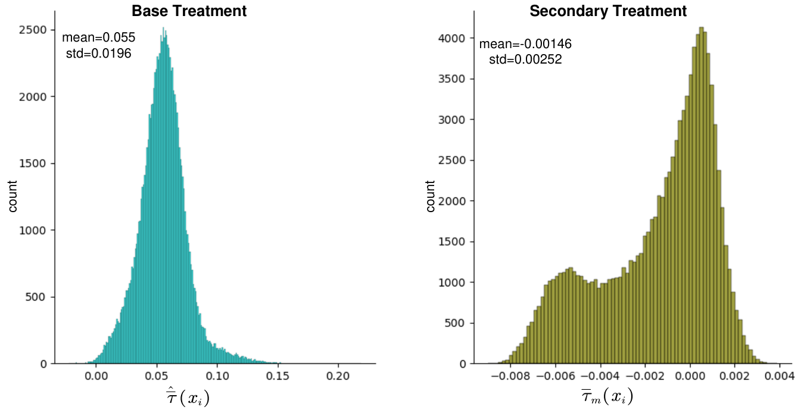
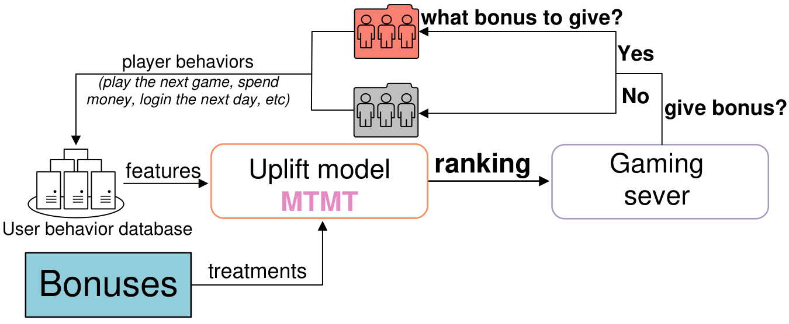

# MTMT 把是否发奖励和选哪种奖励拆开学

Yuxiang Wei、Zhaoxin Qiu、Yingjie Li、Yuke Sun、Xiaoling Li，*Multi-Treatment Multi-Task Uplift Modeling for Enhancing User Growth*。采用 [arXiv:2408.12803v1](https://arxiv.org/pdf/2408.12803v1)（2024 年 8 月 23 日）。[来源与版本](来源.json) · [译本范围](#版本与译本) · [私有备份下载说明](../../文档/工具/中文PDF发布.md#登录下载)。

给玩家发奖励有两道决策。第一道决定这个玩家是否值得发，第二道在 A、B 奖励间选择。直接为 A、B 各训练一套响应模型，再减去同一条自然活跃基线，可以算出两个总增量。当两种奖励大体都让玩家更愿意回来时，排序很好地识别了“发了会多玩”的玩家，却仍可能无法辨别 A 和 B 的小差异。若还要同时预测次日登录和七天多玩几局，模型还得允许同一奖励对两个窗口有不同方向的影响。MTMT 在任务侧做 MMoE，在处理侧拆成基础与二级处理，再让处理查询各任务的用户表示。 [v1 §1，图 1](https://arxiv.org/pdf/2408.12803v1#page=2)

Wei 等，arXiv v1 第 2 页图 1。从采用版作者 LaTeX 原图渲染，保留图例、坐标与分组。两个柱形系列呈现作者观察到的业务差别，图中未给出置信区间。 [arXiv v1 图 1](https://arxiv.org/pdf/2408.12803v1#page=2)

## 玩家历史先按结果路由，奖励再查询任务表示

考虑一位低活跃但偏爱竞技玩法的玩家。输入包含最近登录、对局历史和可在分配前取得的属性，日志另记录是否发奖、实际奖励类型和两项事实结果。各 ResNet18 专家都读同一份玩家历史，次日登录、七天多玩各有自己的 softmax 门。从专家输出加权得到 $\phi^{\text{次日}}$、$\phi^{\text{七天}}$，两个任务头分别读出自然响应。与 [M³TN](../SRC-M3TN/阅读笔记.md#一条锐化日志经过哪两个头) 逐处理头配置门相比，MTMT 的门按目标编号，奖励类型到下一步才进入。 [v1 §4.1–4.2，式 (2)–(5)](https://arxiv.org/pdf/2408.12803v1#page=4)

Wei 等，arXiv v1 第 4 页图 2。从采用版作者 LaTeX 原图渲染。沿左上方专家到两条任务门，再分别看右侧自然响应、下方基础处理和二级处理。 [arXiv v1 图 2](https://arxiv.org/pdf/2408.12803v1#page=4)

发奖标记与 A/B 类型独热编码后进入不同的处理嵌入。在基础分支用“发奖励”的嵌入作 Query，在二级分支改用具体奖励的嵌入。对每个任务，用户表示的投影作 Key 和 Value，按处理与用户特征的匹配分数聚合，再由 MLP 和线性投影形成标量。于是 A 奖励可使次日登录分支着重读取竞技偏好，B 奖励可有不同权重。图 3 的注意力读出解释了不同处理怎样共享编码而保留条件差异。论文未用干预特征的实验把注意力权重识别为因果贡献。 [v1 §4.3，式 (6)–(7)](https://arxiv.org/pdf/2408.12803v1#page=5)

Wei 等，arXiv v1 第 5 页图 3。从采用版作者 LaTeX 原图渲染。下方左侧参与匹配，中间参与匹配和归一化，右侧投影被归一化权重汇总。 [arXiv v1 图 3](https://arxiv.org/pdf/2408.12803v1#page=5)

## 哪些输出得到这位玩家的监督

以次日登录为例，设模型的自然响应为 0.20，基础效应 0.05，A/B 附加效应分别为 0.02 和 −0.01。候选总响应为不发 0.20、A 0.27、B 0.24。若日志实际发了 A，玩家次日登录，此行的次日事实损失为 $(1-0.27)^2$，梯度回到自然、基础和 A 附加的路径。B 路径没有该行的反事实标签。同一行对七天任务使用它自己的事实标签和三个分量，梯度共同流入共享专家。不给奖励的日志只以自然响应拟合两个结果。原文式 (8)–(9) 以加法和 MSE 构造监督，示例中的值仅为教学设定。 [v1 §4.4–4.5，式 (8)–(9)](https://arxiv.org/pdf/2408.12803v1#page=5)

上线时，示例的 A、B 相对不发总增量分别为 7、4 个百分点。A 相对 B 是 3 个百分点，基础项在差值中抵消。若只看到各臂事实响应，基础分量和附加分量的拆法还取决于模型约束。对每个 $x,k$ 加 $c$ 到基础项，并从各奖励附加项减去 $c$，总响应和式 (9) 都相同。若业务要用基础分数单独决定人群，应明确它对应特定参考奖励，或对应权重预先确定的奖励混合。采用固定混合时，可以把二级偏差定义为对该混合的偏离并加权中心化。这里是由原文损失推出的识别边界；论文未给出这种独立锚点。 [v1 §3、§4.4–4.5](https://arxiv.org/pdf/2408.12803v1#page=5) · [离散处理与多目标比较](../../知识库/问题/多档营销动作怎样共享并区分多个结果.md#是否发放与发哪种优惠的参照)

Wei 等，arXiv v1 第 6 页图 4。从采用版作者 LaTeX 原图渲染。左侧基础分数均值约 0.055，右侧附加分数均值约 −0.00146。分布是训练模型的读出，证据范围见上文。 [arXiv v1 图 4](https://arxiv.org/pdf/2408.12803v1#page=6)

## 从按臂排序到受约束投放

论文在 CRITEO 的约 1,400 万条随机排除广告样本上以到访为结果，单任务 MTMT 的归一化 QINI 为 0.164，FlexTENet 为 0.0779（表 1）。生产数据约 1,000 万条 RCT 样本、多处理实验另限于可领所有类型奖励的人。表 2 奖励 A 的 MTMT QINI 为 0.0324，M³TN 为 0.0162。奖励 B 的 MTMT QINI 为 0.0291，略低于 EFIN 的 0.0294，尽管 MTMT 的 B AUUC 为 0.0782，高于 EFIN 的 0.0513。正文“两个奖励均优于对照”不能替代逐列比较。表 1 中多任务版相对分别训练，两项任务 QINI 均降，长期任务前 30% 增量由 0.110 到 0.111。表 3 中移除分层处理估计后，A/B 的 QINI 分别从 0.0324/0.0291 降至 0.0249/0.0233。各表支持各自实验设定中的排序比较，不能由跨表结果推定实际预算收益。 [v1 §5，表 1–3](https://arxiv.org/pdf/2408.12803v1#page=7)

Wei 等，arXiv v1 第 6 页图 5。从采用版作者 LaTeX 原图渲染。模型负责离线给分，游戏服务器读取分桶后根据约束决定发放与类型。论文展示上线结构，未给出可回查的预算公式或线上对照政策的净收益区间。 [arXiv v1 §5.5、图 5](https://arxiv.org/pdf/2408.12803v1#page=6)

若 A/B 只是同一种券的连续力度，按面额以 [OFA](../SRC-OFA/阅读笔记.md) 共享函数可以把临近剂量连起来。若奖励可同时发成一组，MTMT 的“是否给，给哪种”结构只处理到原文设定的候选，联合动作与成分交互另见 [XTNet](../SRC-XTNET/阅读笔记.md)。模型决定估计什么，分配器还需要成本、可发资格以及多目标优先级。 [MTMT v1 §3、§5.5](https://arxiv.org/pdf/2408.12803v1#page=6)

## 版本与译本

检索与对照截至 2026-11-26。精读摘要、正文、式 (1)–(9)、图 1–5 与表 1–3。第 5.4 节指向附录第一节，采用版 PDF 和源码均在参考文献后结束，未收录该附录。正文关于 M³TN 的描述与其 v1 §3.3 不符，译本以译注保留证据。本库未运行模型。

中文 PDF 6 页，依据作者 LaTeX 双栏编译，翻译摘要、正文、图表说明和描述性脚注，保留英文参考文献、图内文字与原稿权利说明。原始 PDF 的会议名、2018 年、ISBN、DOI 属模板占位，译本用实际 arXiv 版本标注。arXiv 版本页标示 CC BY 4.0，固定 PDF 同时印有 ACM 模版权利文字。 [采用版许可](https://arxiv.org/abs/2408.12803v1)

本机附件为 `.local/papers/SRC-MTMT/translation/中文.pdf`，可编辑工程主文件为 `.local/papers/SRC-MTMT/translation/translated-sources/main.tex`。逐页渲染核对中文、公式、表格、图和参考文献，并检查中文字体嵌入与文本映射。 [PDF 盘点](../../译文/PDF目录.md) · [私有备份下载说明](../../文档/工具/中文PDF发布.md#登录下载)。
