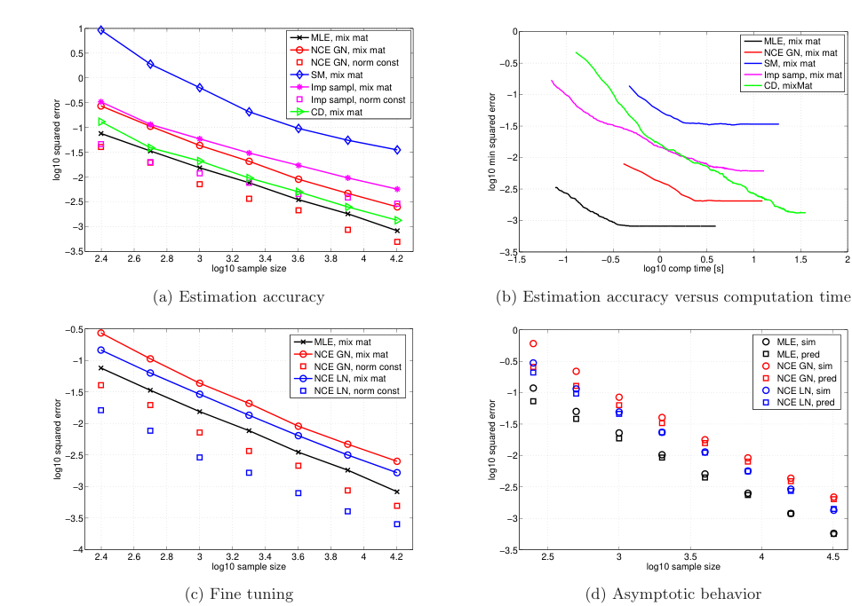

# NCE 用数据与噪声的密度比估计未归一化模型

给概率模型写出一个未归一化打分很容易，对高维空间积分求归一化常数可能很贵。Gutmann 与 Hyvärinen 从已知密度额外生成噪声，用二元分类估计数据与噪声的密度比，从中恢复数据密度。论文把归一化常数也纳入参数。

## 从混合样本构造可计算的后验

设真实数据密度 $p_d(x)$，已知并能抽样的噪声密度 $p_n(x)$。原文取数据与噪声各 $T$ 个，类别先验各半。贝叶斯公式给出数据标签后验 $p_d(x)/(p_d(x)+p_n(x))$。模型用 $\log p_m(x;\theta)=\log p_m^0(x;\alpha)+c$ 替代未知 $\log p_d$，其中 $c$ 用来估计负的对数配分函数。令 $g(x)=\log p_m(x;\theta)-\log p_n(x)$，分类器输出 $\sigma(g(x))$。对数据点最大化 $\log\sigma(g)$，对独立噪声点最大化 $\log\sigma(-g)$。优化只访问这些点的未归一化分数和已知噪声密度。正例与噪声个数若推广成 $1:k$，先验 odds 会进一步乘 $1/k$，logit 减去 $\log k$。[原文 §2.1–2.2，式 (1)–(11)，PDF 第 2 页](https://proceedings.mlr.press/v9/gutmann10a/gutmann10a.pdf#page=2)。

## 从正确分类后验恢复密度

用教学离散样本代替连续空间，令耳机 A 与球拍 B 的数据质量为 0.8、0.2，已知噪声各 0.5。分类器见到 A 的正确后验为 $0.8/(0.8+0.5)=8/13$，见到 B 为 $2/7$。如果拟合正确，乘回噪声后有 $p_m(A)=\frac{8/13}{1-8/13}\times0.5=0.8$。在总体目标中，每个位置最大化 $p_d(x)\log h(x)+p_n(x)\log(1-h(x))$，对 $h$ 求导即可得到这个后验。代回 $h=\sigma(g)$，唯一的密度值由数据决定。噪声在数据非零的区域需要有支撑，否则某些位置只看到数据标签，无法从后验读出有限密度比。有限参数模型的一致性还要求正确设定、目标一致收敛和信息矩阵满秩。论文的定理 3 在进一步正则条件下给出渐近正态性。[原文 §2.3、定理 1–3，PDF 第 3 页](https://proceedings.mlr.press/v9/gutmann10a/gutmann10a.pdf#page=3)。

## 噪声覆盖也影响估计效率

作者原图 1，Gutmann 与 Hyvärinen，PMLR 9，PDF 第 6 页。上左看随样本量变化的参数误差，上右看达到误差所需的时间。下左改换噪声分布，下右检验渐近近似。在四维 ICA 的这组仿真中，匹配更好的 Laplacian 噪声比 Gaussian 噪声更有效。噪声能覆盖样本空间并不足以保证小方差。对比散度段落的式 (22) 积分被积项印为 $p_m\nabla_\alpha p_m^0$。由式 (2) 对配分函数求导可得 $p_m\nabla_\alpha\log p_m^0$，才能接到文中的模型分布下梯度期望。自然图像实验还用高斯模型和带能量因子的非归一化模型学习滤波器，图 2 展示滤波器结构，任务关注自然图像密度而非推荐召回。[原文 §3–4、图 1–2，PDF 第 4–8 页](https://proceedings.mlr.press/v9/gutmann10a/gutmann10a.pdf#page=6)。

[Word2Vec NEG](../SRC-WORD2VEC-NEG/阅读笔记.md)用裸点积承担数据与噪声的分类分差，并把服务目标放在表示相似度。双塔的 [LogQ 校正](../SRC-SAMPLING-BIAS-CORRECTION/阅读笔记.md)则把采样频率放进候选 softmax。三者的共同结构是从候选分布构造训练监督。供学习的统一比较见[负样本怎样改变双塔召回目标](../../知识库/问题/负样本怎样改变双塔召回目标.md)。

采用 [AISTATS 2010 PMLR 9，297–304](https://proceedings.mlr.press/v9/gutmann10a.html)，阅读 §1–4、定理和两组实验。

中文学习译本 8 页。摘要、正文 §1–4、图注与脚注译为中文，原作者图内文字及参考文献保留英文。依据正式 PDF 重排。本地附件为 `.local/papers/SRC-NCE/translation/NCE.中文.pdf`。采用版原文与译文均已认证下载并核对完整 SHA-256。见 [PDF 备份说明](../../文档/工具/中文PDF发布.md)。
