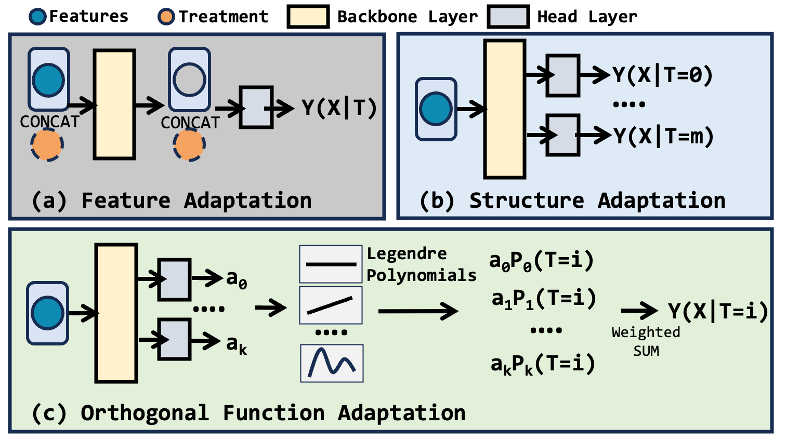

# OFA 怎样让几个券档共享一条用户响应曲线

网约车平台希望知道给同一名乘客发哪档券能多带来订单。每次试验只给了一个档位，日志只记录该档位下有没有下单。独立结果头为每档券各学一个预测器，样本稀少的档位很难借用其他头直接收到的监督。OFA 用用户特征预测一组曲线系数，再用候选券档决定如何组合这些系数。几个档位由此共享同一条响应曲线。本文解读滴滴 Ruyue Zhang 等六位作者的 arXiv 2511.01185v1。 [固定原文](https://arxiv.org/pdf/2511.01185v1)

## 处理变量进入网络的三个位置

图 1 为作者原图，直接使用采用版 LaTeX 源包中的 PNG。先看橙色的处理变量。左上两条特征适配（FA）路径把它分别接在编码前和编码后，再用同一个预测器出结果。右上结构适配（SA）让多个档位共享用户表示，随后由处理值选择一个结果头。下方 OFA 用用户表示预测各阶系数，让处理值进入勒让德多项式，再把各阶结果加权相加。图中用的是 $T=1$ 的结果示例，线上更换候选处理时，可以复用同一组系数。 [图 1，PDF 第 2 页](https://arxiv.org/pdf/2511.01185v1#page=2)

设同一乘客可以拿不发券、低额券和高额券三种动作。训练记录只有处理前特征 $x$、实际分到的券 $t$ 和随后是否下单 $y$。若乘客分到高额券且下单，FA 给共享模型输入该乘客和高额券，编码器与读出都可借用跨档训练记录，但模型学到的档位关系取决于编码和数据。SA 用这条记录直接监督高额券头，其他头仍可间接受益于共享骨干。OFA 同样只预测事实结果来计损失，这个损失却会沿计算路径更新该档位下有非零基值的各阶系数及共享表示。 [§2.1–2.5，PDF 第 2 页](https://arxiv.org/pdf/2511.01185v1#page=2)

## 一次真实下单怎样影响其他档位的预测

记用户表示为 $h(x)$，模型输出 $p+1$ 个系数 $a_j(h(x))$。每档券对应一个标量 $t$，其基向量为 $(P_0(t),\ldots,P_p(t))$，结果为

$$
f(x,t)=\sum_{j=0}^{p}a_j(h(x))P_j(t),\qquad
P_0(t)=1,\quad P_1(t)=t,\quad P_2(t)=\frac{3t^2-1}{2}.
$$

标准勒让德多项式在 $[-1,1]$ 上相对均匀权重正交。方便演算，令不发券、低额券、高额券依次对应 $-1,0,1$，系数为 $(0.12,0.02,0.04)$。三档预测依次为 $0.14,0.10,0.18$，低额券相对不发券的增量预测为 $-4$ 个百分点，高额券为 $+4$ 个百分点。例中的三点编码、二阶截断和系数均为教学设定。

乘客实际分到高额券时，事实读出用 $t=1$，三个基值均为 1。若 $y=1$，最小化 $-\log(0.18)$ 时，三个当前系数都会收到训练信号。低额券档位的 $P_1(0)=0$，它的预测依然可能随这次训练改变，因为一阶以外的系数也由高额券样本更新。推理时枚举候选 $t$，将各档结果减去同一个无券基线，再看增量和成本。固定阶数时，候选变多仍需逐档打分，读出权重可在部署前按券档预计算。 [§2.4–2.5，PDF 第 2 页](https://arxiv.org/pdf/2511.01185v1#page=2)

低阶截断共享响应形状，适合券额有明确顺序且相邻档位反应有一定连续性的情况。较低阶数可能抹平最低消费门槛带来的跳变。给两张性质不同的券任意编号时，编号间距会引入未验证的距离关系。原文展示标量勒让德读出，未报告实际多项式阶数、券档编码和二元概率映射。多项式加权和的值域在结构上无约束，示例中的 $0.14,0.10,0.18$ 恰好在 $(0,1)$ 内。原稿交叉熵式保留正的对数似然写法，若用最小化目标则通常取其负值。 [§2.4–2.5，PDF 第 2 页](https://arxiv.org/pdf/2511.01185v1#page=2)

## 为什么有序券档会受益于固定基函数

把刚才的三档扩为 0、5、10、15、20 元券。一阶 OFA 的五档响应共用两个系数，给同类乘客学到两端响应 10% 和 18% 后，中间的 10 元档会读出 14%。低样本档能从其他档借力，代价是模型无法单独学出该档恰好跨过满减门槛时的跳变。用勒让德坐标，在连续均匀权重下，不同阶基函数交叉项为零，同阶单项式则可以表达同一组曲线。低阶截断限制形状，正交基改善特定条件下的系数耦合，两者的作用可以通过固定阶数的消融分开验证。真实的离散券档与分配比例会改变经验内积。 [跨档训练更新与基函数数值例子](../../知识库/问题/组合营销策略如何共享结构并估计因果增量.md#固定曲线会怎样借用其他券档的样本)

若高额券需要关注历史大额订单，低额券更依赖近期活跃度，可以让 treatment Token 查询由这些特征构成的多 Token 用户记忆。Attention 会随券档改变读入哪些用户信息。OFA 对同一用户复用一组系数，券档决定怎样读出这条曲线。Attention 适合表达处理依赖的特征交互，OFA 则给有序单轴预先施加形状约束。原文表 1–4 对照特征拼接和多头，尚缺在相同数据与训练预算下对 treatment attention 的对比，也缺固定阶数下的单项式对照。 [Attention 计算和逐项比较](../../知识库/问题/组合营销策略如何共享结构并估计因果增量.md#什么时候由-treatment-查询用户特征)

## 响应曲线与观测纠偏各解决什么

OFA 的基函数控制处理轴怎样共享参数。历史策略偏爱给活跃乘客高额券时，高额组更常下单也可能来自初始活跃度。论文单独加入 MMD 或 Wasserstein 差异惩罚，对不同事实处理组的表示做平衡。原文写两组间的损失，未交代在多组上选择哪些组对以及如何归约。离开随机分配时，要把 $f(x,t)-f(x,t_0)$ 解释为因果效应，仍要依赖相应的可交换性、重叠和处理定义。稀有档位在某类用户上没有观测支持时，曲线可以出分，因果解释仍有缺口。 [§2.5，PDF 第 2 页](https://arxiv.org/pdf/2511.01185v1#page=2) · [历史发券的识别条件](../../知识库/问题/历史发券日志如何估计补贴增量.md)

与 OFA 同样在用户向量和干预表示之间用加权和的 POUL，另外对结果与干预表示做残差化。POUL 的正交性用于控制辅助回归误差对估计得分的一阶影响。OFA 的正交性来自一组勒让德函数，实测档位分布有不等概率时，经验基值之间也可能相关。XTNet 另用联合折扣向量生成权重遮罩，关注多类处理交互。这里三档是同一类券的三个备选值，一维多项式只对这条处理轴建立结构。 [组合策略中的方法比较](../../知识库/问题/组合营销策略如何共享结构并估计因果增量.md#有序券档怎样共享一条响应曲线)

逼近定理说明紧区间上的连续函数可以用足够高次的多项式逼近。原稿 §2.4 另给出 OFA、SA、FA 三者的复杂度顺序，前文的 $m$ 表示处理选项数，公式中 $r$ 缺少定义。所引 Galanti 与 Wolf 定理 4 的指数使用函数输入维数 $m_1$ 及平滑阶 $r$，界定的是生成参数后主网络的大小。原稿未给出从该定理到三种适配复杂度排序的变量映射和假设核对。在固定阶数下可以数清读出系数和每档乘加量，原稿的逼近复杂度排序仍待补证。 [OFA §2.4](https://arxiv.org/pdf/2511.01185v1#page=2) · [Galanti 与 Wolf，PDF 第 6 页](https://arxiv.org/pdf/2002.10006v2#page=6)

## 哪些数据条件下排序有改善

作者的 mQini 对每个处理分别计算排序曲线面积，然后跨处理等权平均。对某一档，曲线在排序前缀 $k$ 中，从处理组累计结果减去按两组人数比例缩放的对照组累计结果。有了每档各自的排序得分，可以比较模型在同一试验协议下的排序质量。mQini 的公式没有成本项，也不度量个体效应幅度误差。 [§3.2，PDF 第 3 页](https://arxiv.org/pdf/2511.01185v1#page=3)

| 作者报告的训练条件 | 最佳 OFA mQini | 最佳非 OFA mQini |
|---|---:|---:|
| 合成低噪声 RCT | 0.2652 | 0.2855 |
| 合成额外噪声 RCT | 0.2875 | 0.2663 |
| 合成非单调 RCT | 0.3160 | 0.2812 |
| 合成纯观测，有 / 无 IV | 0.2837 / 0.2848 | 0.1997 / 0.2017 |
| 合成混合，有 / 无 IV | 0.2798 / 0.2864 | 0.2460 / 0.2510 |
| 网约车优惠券 RW-RCT | 0.1153 | 0.1082 |

合成训练与测试各 10,000 条，五个处理且测试始终使用无噪声 RCT。真实券实验有五个处理、47 个协变量，训练 975,940 条，测试 811,027 条。低噪声合成 RCT 由 BNN + FA 领先。相同 TARNet 骨干上，真实 RW-RCT 的 SA 为 0.0765，OFA 为 0.1153。0.1153 对最佳非 OFA 的 Slearner + FA 为约 6.6% 的相对排序分数提升。观测表里 CFRNet + OFA 在有 IV 时单独达到 0.2778，加入 WASS 后为 0.2796，说明读出变化和分布惩罚可以分开比较。论文报告同数据下参数量相近且重复独立运行，表中只给出点值，未报告置信区间或线上利润。 [表 1，PDF 第 3 页](https://arxiv.org/pdf/2511.01185v1#page=3) · [表 2–4，PDF 第 4 页](https://arxiv.org/pdf/2511.01185v1#page=4)

## 原文与中文译本

- 阅读覆盖固定采用版 5 页、正文 §1–4、图 1 和表 1–4，并核对复杂度引用中的定理 4。实验数字采用作者报告。截至 2026-11-25，本库未运行作者模型。 [原文](https://arxiv.org/pdf/2511.01185v1) · [来源版本和哈希](来源.json)
- 7 页中文译文在作者 LaTeX 副本上完成，改用 XeLaTeX 单栏排版。翻译摘要、全部正文、图表标题与表头、描述性脚注，保留公式、数值、图内原标签和 22 条参考文献。正式 PDF 位于 `.local/papers/SRC-OFA/translation/OFA_中文.pdf`，译后主文件位于同目录的 `translated-sources/main.tex`。 [原文许可](https://arxiv.org/abs/2511.01185v1) · [私有备份下载说明](../../文档/工具/中文PDF发布.md)
