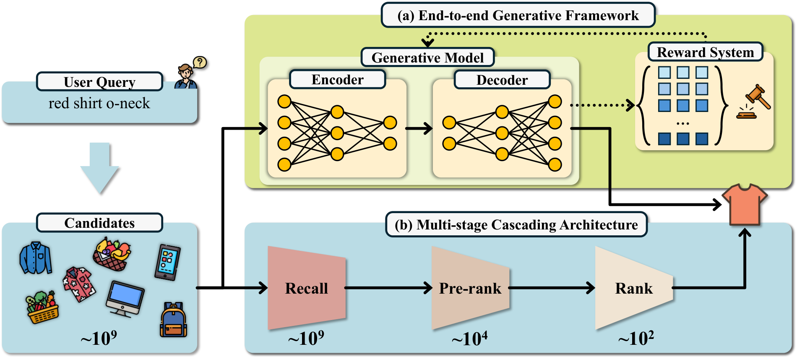
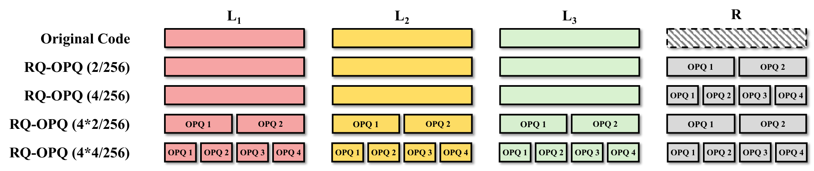
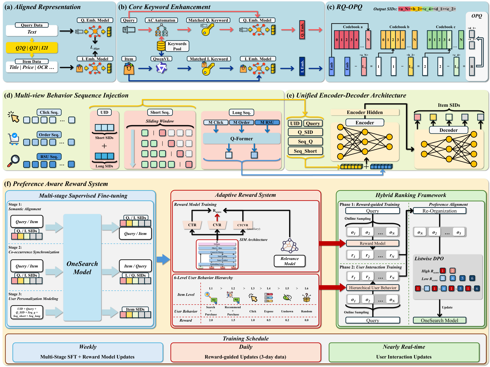
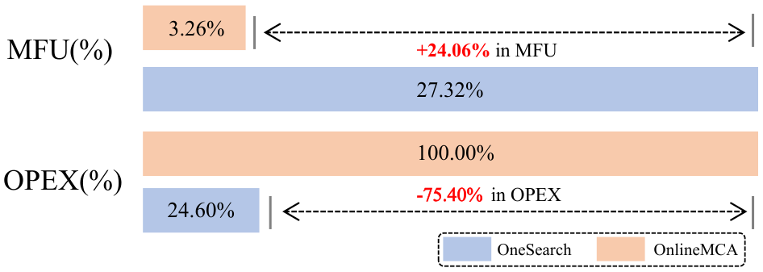

# OneSearch：从当前查询直接生成商品编码

用户搜“银戒指”，传统级联先找出相关候选，粗排缩小范围，精排再结合用户偏好。若情侣对戒在召回或粗排时被丢掉，精排不能补回。OneSearch 把查询、商品语义和用户行为放入同一个生成过程，逐词元解码可映射到目录的商品语义 ID（SID）。作者用曾搜“情侣运动鞋”和“情人节礼物”的用户举例，实际日志中 OneSearch 展示了她最终购买的对戒。这个案例解释了意图推断的作用，相关性和业务效果还需分别看人评与 A/B。[原文 §1、§4.4](https://arxiv.org/pdf/2509.03236v5#page=12)

*作者原图 1 · 生成路径上也可以附加奖励模型选择。Ben Chen 等，arXiv:2509.03236v5 第 1 页，CC BY 4.0。*

## 多层语义先分组，残差再区分同组商品

“银戒指”与“银色戒指”可能进入相似语义区域，但颜色词不能代替材质。作者先从 ItemCF、Swing 配对及搜索日志获得协同信号，用查询、标题、价格、OCR、点击、加购与下单统计等信息学习表征。训练包括同类配对和跨查询—商品的对比、行为等级间隔以及困难配对的 LLM 相关性校正。再按 18 类结构化属性抽关键词，线上用 Aho-Corasick 匹配查询，商品侧由 Qwen-VL 抽取。式 (2) 将原向量与命中关键词的均值各取一半。属性因此能改变后续编码，但没有逐商品施加材质硬过滤。[原文 §3.1.1–2，式 (1)–(2)，表 1](https://arxiv.org/pdf/2509.03236v5#page=5)

编码依次用 4096、1024、512 个中心拟合当前向量及前层残差。只在第三层用均衡 K-means，有助于保留前层聚类。最后残差用两个各 256 容量的 OPQ 子码补足商品差异。对两款都叫“银戒指”的教学例子，可以把前三段想成共享粗粒度归组，后两段区分它们的剩余向量。码位不直接对应材质、款式或品牌，实际映射须查目录。表 3 中 RQ-Kmeans 到 RQ-OPQ 的 ICR 为 68.08%→91.91%，Recall@10 为 0.2844→0.3369，线上 MCA 的对应 Recall@10 为 0.3440。独立编码率仍低于 100%，论文未完整给出冲突组内选择和无效码回退。§3.1.3 的 43.42% 与表 2 对应的 43.32% 存在差异，这里采用表值。[原文 §3.1.3，表 2–3](https://arxiv.org/pdf/2509.03236v5#page=5)

*作者原图 5 · 用残差的两段 OPQ 是最终配置。Ben Chen 等，arXiv:2509.03236v5 第 11 页，CC BY 4.0。*

## 查询保持开放词表，解码映射到已有商品

同一位用户的历史通过三条路径进入模型。第一，把长短历史中商品 SID 的各位置加权汇总并向上取整，拼成 10 个词元的行为 ID。编码空间的编号加权是一种构造，不能保证语义邻近或身份唯一。式 (3) 的长期求和项下标与权重定义不一致，原文意图是分别汇总长短序列。第二，近期查询和点击的 SID 直接放入提示，滑窗长度最多 5，并含空历史训练样本。第三，长期点击、下单、RSU 分开取三层 RQ 聚类中心、同层求和，再由 Q-Former 生成向量放入编码器。聚合保留分层行为成分，层内求和已经丢失事件的明确时序。到线上，编码器还读取当前“银戒指”的文本和 SID、平台画像，解码器以 512 束宽产生候选编码。有效编码只表示目录中存在相应商品；符合原查询仍要由属性和相关性证据判定。[原文 §3.2–3.3，式 (3)–(5)](https://arxiv.org/pdf/2509.03236v5#page=6)

*作者原图 4 · 由左上开始阅读表征和量化，中间连接长短行为与用户 ID，最后看语义训练和偏好对齐。Ben Chen 等，arXiv:2509.03236v5 第 4 页，CC BY 4.0。*

## 偏好可以从教师排序迁移，也可以从日志更新

监督微调依次学习文本与 SID 双向转换和品类预测、查询和商品在文本或码空间的共现、最后带用户信息预测目标商品 SID。对齐的第一阶段从微调模型生成的候选中取奖励模型重排发生变化的列表，点击或被升位商品作正例，被降位及靠后者作负例。奖励模型用 SIM 三塔预测 CTR、CVR、CTCVR，并加上权重为 10 的离线相关性分（实验中各可调系数为 1）。它是排序分中的软约束。第二阶段直接从日志前三级取正例、后三级取负例，沿用同一损失，尽量流式更新。[原文 §3.4，表 4、式 (10)](https://arxiv.org/pdf/2509.03236v5#page=8)

如果同一查询下两件银戒指各有同等级行为，作者先用带对数和加 10 平滑的点击、曝光及订单统计构造近似点击和转化分，调和平均后乘行为基础权重。正负奖励差的倒数再放进式 (11) 的多负例损失。按印式，正差越小其倒数越大，与文中“较小的权重区分细微差异”的说法有张力。门槛内的差项截断为零，该候选的偏好分支在此区域没有梯度；仍有优选商品的对数似然项。原文未交代奖励差非正或接近零的处理，不能把这条损失自动按标准 DPO 解释。历史标签仍可能含旧系统曝光倾向。[原文 §3.4.2，式 (6)–(12)](https://arxiv.org/pdf/2509.03236v5#page=8)

## 覆盖、位置、业务和成本分别看

商城日志约 10 亿 PV，前 90 天训练、最后一天测试，点击与下单各取 3 万配对。表 5 的下单 HR@350 是 66.46% 对完整 MCA 的 51.74%，MRR@350 是 18.38% 对 19.26%。同一日志目标更常进入 350 条，平均相对名次仍可能落后。表 8 的纯生成第二版报告商品 CTR +1.45%，订单 −0.69% 为灰字。带奖励模型选择的第二版报告商品 CTR +1.67%、买家数 +2.40%、订单 +3.22%，后者是混合线上组的估计。表 9 同曝光位置人评用了 200 查询、3200 对，评价主体及核心关键词是否匹配等，第二版相关性报告 +1.87%。表示、训练和上线配置同时改变，不能由组间差值拆出单一因素的因果贡献。[原文 §4.1–4.3，表 5、8–9](https://arxiv.org/pdf/2509.03236v5#page=10)

*作者原图 7 · MFU 为 3.26% 对 27.32%，OPEX 为基线的 24.60%。Ben Chen 等，arXiv:2509.03236v5 第 11 页，CC BY 4.0。*

MFU 两个显示值相差 24.06 个百分点，原文的相对提升 700.38% 与直接计算约 738.0% 不一致。“高于常见 LLM 约 40%”也与显示值矛盾。OPEX 节省 75.40% 按文中用于纯生成路径，不能套用到附加重排的业务组。未给出可复核的全链路并发、硬件分项和尾延迟协议。[原文 §1、§4.3，图 7](https://arxiv.org/pdf/2509.03236v5#page=11)

## 采用版与中文 PDF

采用 arXiv:2509.03236v5（2025-10-22），核对固定 PDF 及作者 LaTeX 的 §1–5。18 页中文 PDF 经逐页目视验收，原文和中文 PDF 已完成私有备份与认证下载。中文学习译本覆盖摘要、正文、图表标题和作者脚注，保留公式、原图文字、部分表内技术标签与参考文献。作者原版的许可与译文声明均保留。本库未复跑模型或生产 A/B。[固定原文](https://arxiv.org/pdf/2509.03236v5) · [语义短码比较](../../知识库/问题/用语义短码直接检索物品.md) · [私有 PDF 访问说明](../../文档/工具/中文PDF发布.md)
