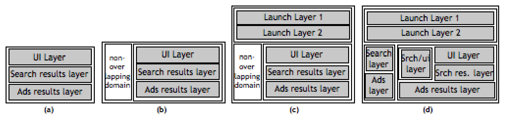
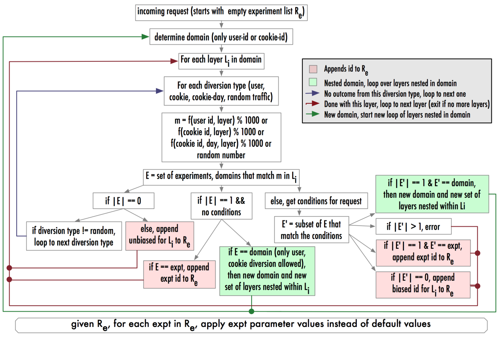
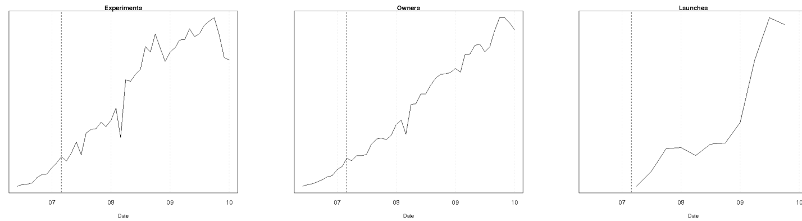

# Google 重叠实验怎样复用流量并保留可解释的对照

一个推荐请求原本只能参与一项实验。新版排序、卡片样式和延迟优化都等同一批桶时，哪怕各改不同参数也要争流量。如果给所有配置任意组合，又会遇到字体与背景同色、候选格式与排序器版本不兼容等问题。Tang 等人的重叠实验基础设施把可以分别变动的参数放在不同层，同层再互斥分配请求。决策仍依赖实验比较的单位、触发条件以及实际生效的配置。

## 先划参数的写入范围，再在每层分流

单层机制把同一个请求交给至多一项实验。论文 §3 解释早期多个服务各自用全局实验流量时，下游能看到的剩余流量可能不足，剩余人群也可能经上游选择。§4 将常规层定义为系统参数子集，将域定义为流量子集。一个域可以包含若干层，层还可包含嵌套域。每个请求走进一个域后，同一层至多落入一个实验。常规层在同一个域内分割参数，某项实验只能覆盖本层参数。需要同时改变多层紧耦合参数时，可在独立的非重叠域里一起试。

作者原图，Tang 等 KDD 2010 图 2，PDF 第 4 页（固定 PDF 裁取，原标签保留）。把请求看成穿过图的一条竖线。图 (b) 左侧只进非重叠域的一项实验，右侧可进入 UI、搜索、广告各一项。图 (c)–(d) 顶部的上线层对所有域有效，为参数提供替代默认值。

用一条首页请求示例。正常 UI 层的桶 120–219 负责测试大卡片，排序层的桶 0–199 负责测试排序 B，两个层分别对相同 cookie 与层 ID 取散列再取模。设用户在两层的桶号各为 183 和 61，则同一请求同时看大卡片与 B。两层配置写不同参数，散列按层变化有助于避免机械地把两项处理绑定在同一人群。若排序层已经显式改为 B，即使上线层正在把默认排序改为 C，这个请求仍用 B。没有普通实验覆盖时才继承该请求适用的上线默认，或系统默认。调大非重叠域比例可让一些 cookie 换域，比较跨配置时段要记录人群变化。

## 请求日志应保留分配、条件与实际触发

作者原图，Tang 等 KDD 2010 图 3，PDF 第 6 页（固定 PDF 裁取，原标签保留）。图从辨认域开始，进入各层，并按服务采用的编号或随机方式查桶。候选桶命中后才检查实验条件。若桶已在 cookie 类型中被预留，即使实际语言条件都不满足，也用专用 ID 标记并停止向该层后续分流类型补位。这样随机请求分流不会捡到已经被语言条件筛过的残余流量。

原文四种常规分流按用户 ID、cookie、cookie-day、随机请求优先。前两种支持跨请求稳定性，cookie-day 按天改变人群，随机请求的稳定性只在当次。实验与对照采用相同分流类型。把上一例的 B 限定为执行到“返回至少三个可用候选”分支才启用时，桶分配发生在请求开始，是否满足条件要等到运行时知道。若能在对照计算同一条触发规则，两组都可记录本来会触发哪些请求，并在该共同定义的集合内比较。仅以实际点击或仅在处理组可见的候选状态筛选会引入处理后选择。对所有被分配用户的效果与触发集合内的效果应各写分母，详见[线上随机化问题](../../知识库/问题/线上实验怎样复用流量并识别真实增量.md)。

## 跨层独立分配之后仍要判断交互

大卡片会改变首屏能容纳多少结果，排序 B 可能恰好把高点击内容排到第三位。教学例中若小卡片下 B 增加 2 个百分点，大卡片下 B 减少 1 个百分点，排序增益依赖布局，交互差为 −3 个百分点。即使布局和排序各自独立分配，汇总的排序效果也只对应当时布局流量配比。两层各覆盖 10% 时重叠约 1%，容易没有足够样本测交互。作者给出的办法包括试验交叉组、使用覆盖较大的上线层，或为不可安全混搭的参数用独立域。§5 将分流单位和分析单位的差别带到样本量估计。两组各有 $n_T,n_C$ 个请求时，文中有效规模为 $N=(1/n_T+1/n_C)^{-1}$。若排序实验 10 万请求且对照同样大，$N=5$ 万；可以共用 90 万请求的同层同条件对照时，$N=9$ 万。这只是论文规模关系的代入。若按 cookie 分流，同一 cookie 的多次请求相关，给每请求指标计算标准误时仍要按实验单位估计波动。作者用 A/A 校验置信区间，并用不改处理的预观察期检查可比性，用实验后观察期查学习残留。

作者原图，Tang 等 KDD 2010 图 5，PDF 第 9 页（固定 PDF 裁取，原标签保留）。图给三种计数的时间趋势，纵轴数值因保密省略。计数包括对照实验，负责人可能含团队邮件列表，上线数仅列部署后。作者报告规模接近提升一个数量级。关于错误更少和决策更快的材料主要是经验观察与流程耗时描述，论文未用对照实验单独估计基础设施的因果效果。

## 原文与阅读范围

Diane Tang、Ashish Agarwal、Deirdre O’Brien、Mike Meyer，KDD 2010，17–26，DOI 10.1145/1835804.1835810。采用版是第三方仓库中冻结的十页会议 PDF，题名、作者、会议标识与 ACM 书目信息一致。阅读摘要、§1–7、致谢，核对图 1–5，参考文献仅定位。原文采用[固定 PDF 镜像](https://raw.githubusercontent.com/oldratlee/translations/f867b77e271481fb2a3447e9341c845c4f059a2a/overlapping-experiment-infrastructure-more-better-faster-experimentation/overlapping-experiment-infrastructure-more-better-faster-experimentation-36500.pdf)，出版信息见 [ACM DOI](https://doi.org/10.1145/1835804.1835810)。

中文 PDF 为 10 页，译出摘要、正文 §1–7、公式、五图图注、脚注和致谢，图内文字及参考文献保留英文。未取得作者的 LaTeX，保留本地 XeLaTeX 重排工程 `.local/papers/SRC-OVERLAPPING-EXPERIMENTS/translation/translated-sources/`。正式译文位于 `.local/papers/SRC-OVERLAPPING-EXPERIMENTS/translation/SRC-OVERLAPPING-EXPERIMENTS.中文.pdf`，已逐页目视并核对中文提取。采用原文与中文 PDF 已实际登录下载验证，见[私有备份下载说明](../../文档/工具/中文PDF发布.md)。
